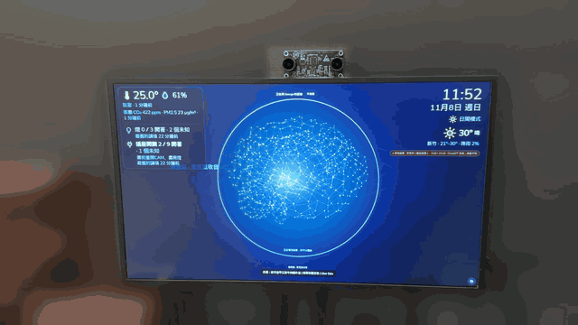

<!-- bilingual: source=zh-TW -->

# Nous — Cognitive Operating System with Claude as Kernel

<!-- language-switch:start -->
<div align="center">

**語言 / Language**

**[繁體中文](README.md)** &nbsp; | &nbsp; **[English](README.en.md)**

Currently reading: English

</div>
<!-- language-switch:end -->

> **An animated, high-tech electronic brain wallpaper at rest. State your request, let AI Agents do the work, and see results when they are ready. Operate by voice and use webcam gaze to point, without choosing or opening an App.**

<div align="center">

<a href="docs/media/nous-demo-2026-11-08.mp4"></a>

**▶ [Watch the full video with sound (47 s)](docs/media/nous-demo-2026-11-08.mp4)** · Subtitles: [English](docs/media/nous-demo-2026-11-08.en.srt) · [繁體中文](docs/media/nous-demo-2026-11-08.zh-TW.srt)

<sub>Real recording, 2026-11-08: asked Nous by voice to look up the menu of Lao Zhang Beef Noodles and recommend something. Nous found an older menu, answered, and noted that current items and prices should be confirmed with the shop. The surroundings are blurred so only the Nous screen and camera remain.</sub>

</div>

---

<a id="這是什麼"></a>
## What is this?

**Nous** is an experimental Cognitive Operating System design project. It borrows the core concepts of an operating system, including the kernel, memory management, filesystem, scheduler, and shell, and maps them to the AI era:

| Traditional OS | Nous Cognitive OS |
|---|---|
| Kernel (CPU instructions) | Claude API (cognitive reasoning) |
| Memory Management | Three-layer memory architecture (Working / Dynamic / Archival) |
| File System | Semantic knowledge base + knowledge graph |
| Process / Task | Agent / Workflow |
| Scheduler | Agent Orchestrator |
| Shell | Idle electronic brain + voice / gaze interaction + results generated on demand |
| IPC | MCP + A2A protocols |
| Driver | Tool / MCP Connectors |

**Core proposition**: When AI becomes a cognitive coprocessor, we need a complete infrastructure layer that lets AI manage knowledge, memory, and workflows, beyond improving individual Apps.

---

<a id="目標使用體驗"></a>
## Target experience

The following describes the product direction. The status table and current implementation document below govern what exists and what still needs validation. This description does not establish calibrated eye tracking or a complete Agent tool environment.

**State a request → AI Agents solve the problem → Show results → Look at content and ask follow-up questions by voice → Dismiss it and return to the electronic brain.**

- **Quiet at rest**: Only an animated neural network / particle brain wallpaper, without App icons, a permanent chat box, sidebar, or dashboard.
- **Information appears on demand**: Show results for the current request, necessary clarification / confirmation, and user-subscribed reminders. Show details and progress only when requested.
- **Voice first**: Use natural language to request work, adjust parameters, recalculate, save, or dismiss results.
- **Gaze points**: A calibrated webcam estimates the region being viewed. Look at a target and speak the action. The first stage validates large regions and does not assume mouse-like pixel accuracy.
- **Results can be recalled**: A disappearing view does not delete its result. Skills remain in a background capability library and are invoked by requests.
- **Recoverable**: Use voice numbers when the camera is unavailable. Retain text, keyboard, and mouse for settings and accessibility.

The first release is a desktop Shell on an existing OS. Native wallpaper embedding requires separate validation. Agents act according to available capabilities, data, and permissions. When a capability is missing, explain it clearly rather than promising success for arbitrary tasks.

See [06 Experience and architecture specification](docs/06_Ambient_Voice_Gaze_Experience.en.md) and [07 Development tasks, prompts, and acceptance](docs/07_Ambient_Implementation_and_Acceptance.en.md).

---

<a id="專案狀態2026-10-24"></a>
## Project status (2026-10-24)

**Pre-Alpha, with an executable prototype.** Implementation is concentrated in [`prototype/ambient-shell`](./prototype/ambient-shell): Node HTTP + SSE, TypeScript + Vite, an Electron desktop shell, and local JSON persistence. A Python kernel, Tauri, Claude Agent SDK, and a full monorepo remain design options rather than the existing architecture.

| Area | Current state | Verification boundary |
|---|---|---|
| Electronic brain and tasks | Six-region event animation, results on demand, queue, cancellation, retry, and result persistence | Implemented in the prototype. This does not declare G0–G3 passed |
| Models and voice | Claude / ChatGPT / mock; browser speech and two WebRTC realtime voice routes | Some Mac hardware records exist for Codex live login, calls, and temperature queries. Full journeys and billing remain unaccepted |
| Camera and gestures | Presence, nominal distance, head facing, palm-to-stop playback, three-region arm pointing, proximity zoom | Head facing is not eye tracking. Stereo calibration has not been physically validated; accuracy and hardware acceptance remain pending |
| Home devices | H0 queries, H1 ordinary control, H1b AIFA / infrared | Light on/off has verbal hardware reports; H1b needs hardware checks. H2 device policy, H3 room groups, and H4 background MCP are unimplemented |
| Persistence and safety | JSON tasks / results (encrypted at rest inside the macOS App, MEM-4a; the browser build still stores plaintext), presentation policy, partial tool confirmation; family memory MEM-0–MEM-5b is merged (macOS App only, off by default, enabled only after first-time consent) | Unfinished tasks fail after restart. Checkpoints, full artifact versions, and a general Action Gate are missing. Memory has Linux cloud tests only; none of the MEM-1–MEM-5b Mac gates has run; there is no knowledge graph or skill promotion (note added 2026-11-10; the original text said long-term memory was missing) |
| Quest / OpenClaw | This feature assessment is complete | No Quest client or OpenClaw agent adapter. Using OpenClaw voice references is not agent integration |

At the 2026-10-24 baseline `1f44c6b`, 48 test files and 790 tests, type checks, a build, and an isolated mock HTTP journey passed. These results do not replace acceptance of real models, microphones, Quest, cameras, or home devices. See [current state and evidence](docs/Current_Implementation_Status.en.md).

Note added 2026-11-10: the figures above are from that date; test counts are no longer updated here. The most recent recorded run is in [architecture review measurements and baseline](docs/validation/architecture-review-2026-11-09.en.md): 172 test files and 3,194 tests on main `416a1ab` (3,188 passed, 6 skipped), all mock and fixture, not hardware acceptance.

The recommended sequence is current state and product CI → shared capabilities / Action Gate → resumable tasks and artifact versions → device pairing → Quest spatial results → restricted OpenClaw worker and voice handoff. This is an expansion route still to implement. It does not change existing gate results. See the [feature expansion assessment](docs/13_Feature_Expansion_Assessment_2026-10-24.en.md) for MVP scope, risks, effort, and acceptance.

<a id="執行原型"></a>
<a id="中英文文件與介面"></a>
## Bilingual documentation and interface

Project documentation is available in Traditional Chinese and English. See the [Traditional Chinese README](README.md) and [bilingual policy](docs/BILINGUAL.md). Select 繁體中文 or English under Language in App/web settings or the desktop menu; the choice is saved. See [language support](docs/development/localization.en.md) for use and maintenance. Build current source for this feature; existing downloads do not update automatically.

<a id="執行原型"></a>
## Run the prototype

Requires Node.js 22.12 or later.

```bash
git clone https://github.com/pcpcchen-coder/AIOS.git
cd AIOS/prototype/ambient-shell
npm ci
npm start
```

Open `http://localhost:8787`. The kernel accepts local connections only; Quest cannot directly use this localhost. Without model or account configuration, use the explicitly labeled mock mode. See the [installation guide](prototype/ambient-shell/INSTALL.en.md) for models and voice settings. macOS has [preview downloads and packaging instructions](prototype/ambient-shell/desktop/README.en.md). An existing Release is not guaranteed to include the latest main features.

Run development verification from the repository root:

```bash
node scripts/check-pstack.mjs
node scripts/verify-aios.mjs
```

---

<a id="文件導覽"></a>
## Documentation

Development follows the [project pstack guide](docs/development/pstack.en.md). See [AGENTS.md](AGENTS.md) for agent rules.

Documentation lives in [`docs/`](./docs). **Read current state and evidence first, then product rules 06–07 and topic updates 10–12.** 08 is a historical snapshot from 2026-10-07. Old schedules and technology choices in 01–05 are not the current implementation. See the [documentation index](docs/README.en.md) for the full reading order.

| # | Document | Contents | Audience |
|---|---|---|---|
| **Current** | [Current implementation and verification](docs/Current_Implementation_Status.en.md) | Code directories, capabilities, evidence levels, gaps, and verification | Everyone, read first |
| **13** | [Feature expansion assessment](docs/13_Feature_Expansion_Assessment_2026-10-24.en.md) | Priorities and roadmap for Quest, OpenClaw, voice, sensing, and multiple devices | Planning and collaborative development |
| **14** | [Family recognition and named greeting plan](docs/14_Family_Recognition_and_Greeting_Plan_2026-10.en.md) | Recognize during the facing delay and say “George, I'm here” only after interaction starts. [Draft ADR-0001](docs/adr/ADR-0001-local-family-recognition.en.md); ID-00 [spike](docs/validation/family-id-00-spike-2026-10-24.en.md), ID-01 [enrollment and trial recognition](docs/validation/family-id-01-2026-10-25.en.md), ID-02 [named greeting during look-to-talk](docs/validation/family-id-02-2026-10-25.en.md) (cloud fixtures only, uncalibrated thresholds, actual audio pending Mac checks) | Core and sensing developers |
| **15** | [Companion Mode specification](docs/15_Companion_Mode_Spec_2026-10-24.en.md) | **Design proposal, unimplemented**; master switch, response behavior, answer length, cooldown, privacy, and acceptance; [implementation batches](docs/development/companion-mode-implementation-plan.en.md) | UI / voice developers |
| **16** | [Nous family memory layer](docs/16_Nous_Memory_Layer_Design_2026-10-26.en.md) | MEM-0–MEM-5b are all merged (note added 2026-11-10; the original text said the product had not enabled it): macOS App only, memory off by default and enabled only after first-time consent; API-key live voice, background tasks, memory suggestions, and work decisions additionally require listing in `NOUS_MEMORY_ROUTES`. Linux cloud tests only; none of the MEM-1–MEM-5b Mac gates has run, see [current state](docs/Current_Implementation_Status.en.md); MEM-0 [isolated foundation verification](docs/validation/memory-mem0-2026-10-26.en.md); [ADR-0002](docs/adr/ADR-0002-nous-family-memory.en.md) | Core / voice developers |
| **17** | [Local wake word and family voice recognition plan](docs/17_Wake_Word_and_Speaker_Recognition_Plan_2026-10.en.md) | **Wake word implemented (`NOUS_WAKE` off by default); voice recognition SP-01–SP-03a has code (note added 2026-11-10; the original text said it was still planned): voice enrollment, voice recognition at wake, in-call speaker recognition (off by default), and voice calibration. Thresholds are uncalibrated, the Mac has only partial trials by George alone, and the second half of SP-03 has not started; see [current state](docs/Current_Implementation_Status.en.md)**. The plan covers: the wake word was 「哈囉努斯」 (2026-10-29) and became the English "Hello Nous" after the WK-00 Mac trial (2026-10-31), the sherpa-onnx engine and its training-data license risk, privacy design for always-on local listening, voice enrollment, face-voice fusion, convenience limits (not authorization), person rules aligned with 16 memory, voice-based named greetings after calibration, and automatic resume of listening after reopen; WK-00–WK-03, SP-00–SP-03 | Core / voice developers |
| **01** | [Complete technical blueprint](docs/01_Complete_Technical_Blueprint.en.md) | Seven-module architecture, technology choices, and a 12-month schedule | Readers seeking the overall design |
| **02** | [OSS component map](docs/02_OSS_Component_Map.en.md) | Community open-source projects for each module | Implementers |
| **03** | [Three-month accelerated roadmap](docs/03_3Month_Accelerated_Roadmap.en.md) | Weekly action plan | Developers |
| **04** | [Generative interaction system](docs/04_Generative_Interaction_System.en.md) | Dynamic design without fixed UI | Readers exploring the long-term interaction model |
| **05** | [Progress and next steps](docs/05_Progress_and_Next_Steps.en.md) | Project snapshot and subsequent requirement additions | New contributors |
| **06** | [Electronic brain, voice, and gaze experience](docs/06_Ambient_Voice_Gaze_Experience.en.md) | Latest product specification, state machine, presentation policy, and architecture | Product and development |
| **07** | [Development and acceptance plan](docs/07_Ambient_Implementation_and_Acceptance.en.md) | Directories, contracts, prompts, batches, and acceptance cases | Implementers and reviewers |
| **08** | [October 2026 consolidation and update](docs/08_Consolidation_and_Update_2026-10.en.md) | Early October decisions, ecosystem research, and an old schedule snapshot | Historical decision reference |
| **10–12** | [Topic documents](docs/README.en.md) | Design and implementation comparisons for distance UI, stereo interaction, and smart home | Relevant feature developers |

---

<a id="核心設計原則"></a>
## Core design principles

1. **Intent over Application**: Users state intent instead of choosing Apps. AI generates tools and presentation for each request.
2. **Local-First**: Data stays on your device and belongs to you.
3. **Memory as Moat**: Memory turns an AI tool into an assistant.
4. **Ephemeral UI, Durable Artifacts**: UI exists for the current interaction. Saving results and durable skills does not add permanent entry points.
5. **Integrate First**: Prefer existing OSS and tool capabilities.
6. **Voice + Gaze**: Separate pointing from execution and complete core journeys without a mouse.
7. **Quiet by Default**: Show information the user requests, and return to the electronic brain when dismissed.

---

<a id="技術棧"></a>
## Technology stack

The current runtime uses Node.js HTTP + SSE, framework-free TypeScript, Vite, Electron, the Anthropic Messages SDK, MediaPipe, and local JSON. Types are tagged `proto-0.1`. The following are target choices from design documents, subject to separate decisions and verification. This documentation update does not migrate the stack.

- **Kernel**: Claude Opus 5.5 (planning) + Sonnet family (workers), model IDs obtained through the Models API rather than hard-coded.
- **Memory Layer**: The [2026-10-26 family memory design](docs/16_Nous_Memory_Layer_Design_2026-10-26.en.md) adopts local encrypted snapshots, per-person retrieval, and revocable context. MEM-0 has a core-private isolated module; a separately packaged probe passed real Keychain readback across processes. Production signing remains pending. Note added 2026-11-10 (the original text said it was not integrated into the product): MEM-1–MEM-5b are integrated into the product (`prototype/ambient-shell/server/memory/`, `desktop/memory-ipc.mjs`), macOS App only and off by default; Linux cloud tests only, and none of the Mac gates has run. Markdown + SQLite indexing remains a historical proposal; see [ADR-0002](docs/adr/ADR-0002-nous-family-memory.en.md) for current tradeoffs.
- **Knowledge Layer**: [LightRAG](https://github.com/HKUDS/LightRAG) (dual-layer retrieval + knowledge graph; integration after G1).
- **Agent Framework**: [Claude Agent SDK](https://github.com/anthropics/claude-agent-sdk-python).
- **Desktop Shell**: [Tauri 2.x](https://github.com/tauri-apps/tauri) + React.
- **Result Surface**: Proposed MCP Apps-compatible host (`ui://`, sandboxed iframe, default-deny CSP). [assistant-ui](https://github.com/assistant-ui/assistant-ui) + [shadcn/ui](https://github.com/shadcn-ui/ui) serve only as on-demand components.
- **Voice**: Candidate [sherpa-onnx](https://github.com/k2-fsa/sherpa-onnx) (wake, VAD, ASR, TTS) + [Breeze-ASR-25](https://huggingface.co/MediaTek-Research/Twister) (Taiwan Mandarin), pending PoC. Note added 2026-11-10: wake-word detection already uses the sherpa-onnx 2.0.1 KWS wasm (`NOUS_WAKE` off by default, `src/audio/`); family voice embeddings run CAM++ on onnxruntime-web (`src/speaker/`). sherpa-onnx VAD / ASR / TTS and Breeze-ASR-25 remain candidates and are not adopted.
- **Gaze**: Candidate MediaPipe Face Landmarker + custom calibration, pending PoC.
- **Observability**: Local OpenTelemetry; [Langfuse](https://github.com/langfuse/langfuse) as optional export.
- **Tool Protocol**: [Model Context Protocol (MCP)](https://github.com/modelcontextprotocol), 2026-07-28 specification (including Apps and Tasks extensions).

See [02 OSS component map](docs/02_OSS_Component_Map.en.md) and [08 §5](docs/08_Consolidation_and_Update_2026-10.en.md#5-更新後的元件對應只列差異) for the evolution of these choices.

---

<a id="團隊"></a>
## Team

- **@pcpcchen-coder**: Lead developer and architecture decisions.
- **Claude Code**: AI pair programmer.
- **Development direction**: Claude leads the AIOS core, while ChatGPT / Codex leads Quest work. Runtime routing still follows configured models and capabilities rather than binding providers to devices.

<a id="授權"></a>
## License

**Apache-2.0** is planned. Design documents are currently All Rights Reserved and will move to Apache-2.0 after formal open-sourcing.

<a id="聯絡"></a>
## Contact

This project is in prototype development. Use GitHub Issues for feature and architecture discussions. Track changes through reviewable PRs and corresponding verification evidence. This documentation update does not commit to implementing every plan or indicate that acceptance has passed.

---

_“The history of operating systems is a history of reducing the cost of interaction between people and computers. From the command line to GUI to touch, each generation moves more cognitive effort from people to the system. Nous takes the next step, asking AI to carry even the burden of learning an App.”_

<!-- language-switch:start -->
<div align="center">

**語言 / Language**

**[繁體中文](README.md)** &nbsp; | &nbsp; **[English](README.en.md)**

Currently reading: English

</div>
<!-- language-switch:end -->
