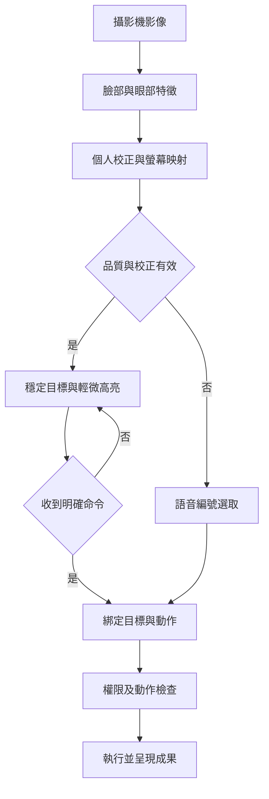
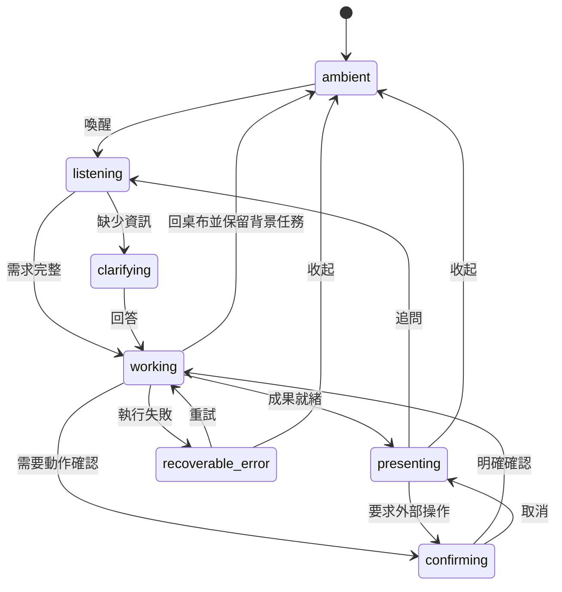
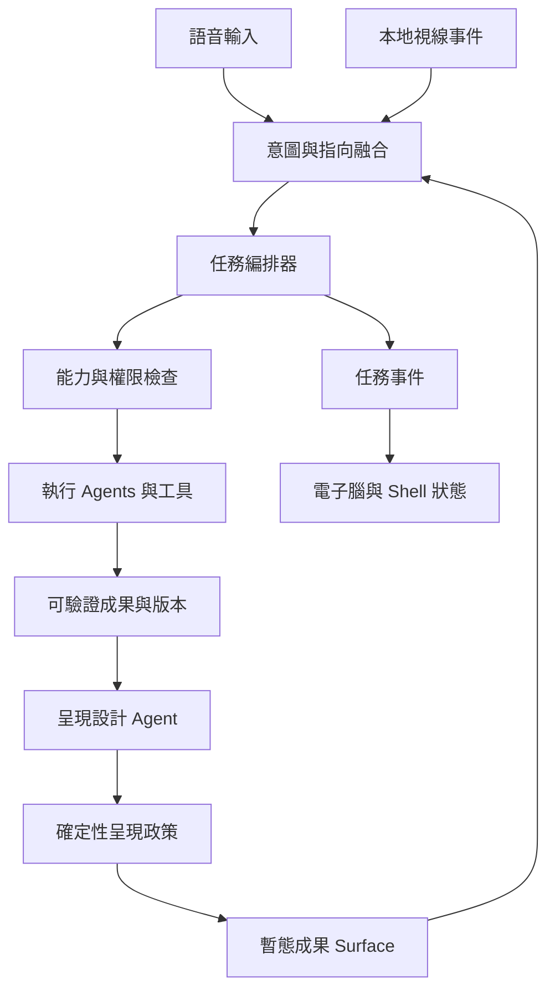

<!-- bilingual: source=zh-TW -->

> [繁體中文](06_Ambient_Voice_Gaze_Experience.md) | [English](06_Ambient_Voice_Gaze_Experience.en.md)

# Nous: ambient brain desktop, voice, and gaze interaction specification

Version v0.1 · Specification date 2026-09-16 · Authority clarification updated 2026-10-24. Product rules remain valid. Some capabilities have prototypes. Each overall gate and hardware acceptance still needs evidence.

> **Reading guide, 2026-10-24**: See [implementation status](Current_Implementation_Status.en.md) for code/gaps and [feature expansion assessment](13_Feature_Expansion_Assessment_2026-10-24.en.md) for proposals. Baseline `1f44c6b` (2026-10-23). The Node HTTP/SSE, TypeScript, Vite, Electron prototype has browser STT/TTS and two WebRTC live-voice paths. Local wake, Tauri, full Agent SDK, and calibrated gaze remain target designs.
>
> [11 stereo camera interaction](11_Stereo_Camera_Interaction_2026-10.en.md) explicitly revises distant interaction. Current sensing covers `presence`, facing the screen, stop gestures, and three-zone arm pointing. Head direction is not eye tracking. Existing code does not prove accuracy or hardware gates. Distant selection uses spoken numbers first, arm pointing second. The gaze specification below remains a research/acceptance requirement. Applying it to head direction does not complete gaze. F0–F10 and Q0–Q4 do not replace G0–G3.

## 1. Product definition and scope

**At rest, a quiet, high-tech animated brain wallpaper. Users speak a need, AI agents do the work, and only requested information appears. Users look at part of a result and continue by voice.**

George's 2026-09-16 requirements:

1. Show requested information rather than permanent panels.
2. Return to the brain when nothing is requested.
3. No user-facing apps, app icons, store, or launcher. Agents compose capabilities.
4. Voice handles requests, clarification, adjustments, confirmation, dismissal.
5. Webcam gaze estimation provides pointing in place of a mouse.
6. The core flow is request → agents solve → results appear.

“Any need” describes a general product direction, limited by tools, data, permissions, and hardware. Explain gaps rather than use fake data/success. APIs, MCP, libraries, and controlled software may remain underneath. Users need not choose an app first.

Retain the target Claude kernel, memory, knowledge, agents, and tools. The formal shell planned on 2026-09-16 was **Tauri + React**. The runnable prototype is Electron and plain TypeScript. Keeping or migrating it requires a separate decision. Animated brain wallpaper describes standby visuals, not completed native wallpaper embedding, login desktop replacement, or a new OS kernel. Native wallpaper integration is later platform work.

### Document precedence

This document and [07](07_Ambient_Implementation_and_Acceptance.en.md) govern the new shell, inputs, and disclosure policy. They override 01–05's permanent dashboards, skill sidebars, and deferred voice. Other architecture remains target design rather than presumed implementation. See 11 for camera limitations and distant interaction revisions, and the status document for code. “Three months” was a scheduling assumption. Re-estimate against acceptance gates after adding gaze and voice.

## 2. Display and disclosure rules

### 2.1 Standby visuals

| Item | Specification |
|---|---|
| Subject | Abstract brain/neural sphere with particles, connections, slow breathing, local light pulses. |
| Colors | Dark background, cyan/blue, a little purple. Voice-adjustable brightness and animation. |
| Space | Mostly open space. No fake numbers, code, or monitoring data for visual effect. |
| Standby | No apps, Dock, sidebar, chat history, task list, unread count, default dashboard. |
| Feedback | Light forms and brief cues for listening, processing, waiting, driven by real events. |
| Results | Brain shrinks/fades for reading and returns after dismissal. |
| Reduced motion | Reduced animation, static brain, lower frame rates, no rapid flashing. |
| System information | Clock, weather, performance, cost, notifications only on request. |

Animation expresses state, not internal model thought. A loop cannot pretend work is progressing.

### 2.2 Every visible surface needs a reason

Presentation Policy is a deterministic checker independent of the LLM. Every Surface has a verifiable `visibility_reason`:

| Reason | Allowed content | Lifetime |
|---|---|---|
| `user_request` | Requested answer, table, chart, document, tool | Until dismissal, task switch, or explicit hiding configuration. |
| `task_clarification` | One indispensable question | Closes after answer. |
| `action_confirmation` | Action target, scope, impact | Closes on confirm, cancel, expiry. |
| `subscribed_event` | Explicitly subscribed, currently permitted reminder | Subscription rules, queued during do-not-disturb. |
| `sensor_status` | Minimal active microphone/camera indication | While active, preserving host OS indicators. |
| `user_pinned` | Result the user asked to keep visible | Current work context until dismissal/lock. |

Rules:

- Default maximum **one primary + one secondary result area**. Navigate more with next, previous, compare. Explicit comparisons can use 2–3 stable large regions.
- Every expansion follows a request. Inferred interest does not authorize popups.
- No permanent agent counts, tokens, traces, reasoning, tool logs, debugging panels, or task board in standby. Show progress/evidence when asked.
- Reading results do not disappear due to gaze, blinking, short absence, or general timers. Hide private content on lock and support recall.
- Dismiss/back to wallpaper closes only views. “Stop this task” cancels work. Background completion cannot reopen a dismissed view unless completion presentation/reminders were requested.
- “Remember this method” saves a skill; “keep this result” saves an artifact. Persistence creates no icons, sidebars, or permanent widgets.
- Report requested-task failures/missing data truthfully. If dismissed, retain queryable status without interrupting other work.

### 2.3 Portable, follow-up-ready artifacts

Artifacts store content, versions, sources, creation time, task status, and assumptions. Surfaces are temporary views. Export when needed and recall “that report.” Sensitive content can remain unsaved, under existing retention/deletion policy. Raw camera images are not artifacts.

## 3. Voice interaction

### 3.1 Input flow

`Local wake/explicit start → voice activity detection → speech recognition → intent → execution → artifact/brief speech response`

- Obtain host microphone permission on first activation. Keep keyboard/buttons for setup or denial. Unauthorized voice cannot grant its own permission.
- Hands-free mode uses a local wake word and does not record continuously when muted. MVP verifies one real wake/STT path. Push-to-talk is optional fallback.
- VAD detects speech, not user commands. Configure post-wake conversation window, timeout, and stop words.
- Explain and authorize cloud STT scope before enabling it. No unwoken audio goes to cloud. Raw audio is not saved by default. Clear short ring buffers after use.
- Optional brief subtitles while listening, with “no subtitles/text only.” Do not read whole long reports by default.
- “Stop” immediately stops TTS and pauses new tool dispatch, then asks whether to cancel work. “Stop task” requests cancellation directly. “Dismiss” preserves background work.
- Handle echo, self-triggering, and user interruption during TTS. System speech cannot become a new command.
- Clarify low-confidence recognition that changes targets, amounts, or actions rather than silently guess.

### 3.2 Basic vocabulary

| User says | Behavior |
|---|---|
| “Compare these three plans” | Create task, check data/capabilities, produce comparison. |
| “Expand this” | Expand the locked gaze target. |
| “The second one” | Select by stable number, including without camera. |
| “Make this a table” | Change the same artifact's presentation without inventing data. |
| “Set the value to eighty” | Lock field, read back new value, update/recalculate. |
| “Down/previous page/next” | Navigate current result. |
| “What's the progress?” | Show completed/active/blocked steps and cancellation state. |
| “Keep this, dismiss the others” | Save specified artifact and update visible surfaces. |
| “Turn off camera” | Release stream, clear focus, continue by spoken number. |
| “Back to wallpaper” | Dismiss current view, return to brain. |

Context includes task, artifact version, visible surfaces, stable target, and recent explicit command. The last sentence alone cannot resolve “this.”

## 4. Webcam gaze

### 4.1 Boundaries

**Looking supplies pointing. Saying what to do supplies action intent.** First target large cards, chart regions, and buttons, without promising mouse-like character selection or arbitrary dragging from ordinary webcams.

MediaPipe Face Landmarker supplies facial landmarks, but screen gaze mapping needs another model and calibration. MediaPipe Iris explicitly does not infer gaze location. [Face Landmarker documentation](https://developers.google.com/edge/mediapipe/solutions/vision/face_landmarker), [Iris documentation](https://chuoling.github.io/mediapipe/solutions/iris.html).

WebGazer estimates screen gaze in browsers with ordinary webcams. Its existing calibration uses clicks/cursors, requiring an explicit hands-free calibration flow. Its site states GPLv3 and no guaranteed updates after 2026-02-24. Treat it as a comparative research candidate, with no packaging or license-compatibility decision here. [Official website](https://webgazer.cs.brown.edu/).

Sources accessed 2026-09-16. Choose technology and accuracy through PoC measurements. Face-detection confidence is not gaze accuracy.

### 4.2 Processing

### 4.3 Calibration and coordinates

- Guide first use through 5 or 9 fixed targets. Say “ready” or use timed sampling, without mandatory mouse input.
- Validate held-out points, first distinguishing left/center/right before increasing target density.
- Match `display_id + viewport_revision + calibration_id`. Major DPI, window, display, camera, or head-position changes suspend pointing until revalidation/calibration.
- MVP is one active user and one display. Multi-display/identity are separate. Multiple faces do not transfer control automatically.
- Stable `target_id`, large hit regions, fixed layout during highlight. Reflow creates a new revision and invalidates old focus.

### 4.4 Point, lock, act

These adjustable initial values have no measured guarantee:

1. After smoothing/hysteresis, highlight a target stable for 450 ms to avoid focus jumps during scanning.
2. Highlight selects only. No automatic click, expansion, scroll, deletion, submission. Continued looking is not consent.
3. Lock stable focus at utterance start, or use valid timestamp samples near “this.” Clarify first vs second if alignment is unreliable.
4. Bind `task_id + surface_id + target_id + artifact_version + viewport_revision`. A version change before STT completion invalidates binding and requires reconfirmation.
5. Clear pointing after >1,000 ms without valid observations, looking away, lost tracking, or camera off. Invalid data cannot trigger actions.
6. Set confidence thresholds through measurement. Do not share arbitrary thresholds across gaze providers.

Look-and-speak is default. Dwell activation for low-impact actions may become a separately enabled speech-free accessibility mode later. Blinking is not a default click. For precision, enlarge then use row/column/right-one-cell commands.

### 4.5 Failure and fallback

Under darkness, glasses glare, occlusion, failed calibration, or permission denial, support “first,” “right card,” “next.” Camera failure cannot block work. Keyboard/mouse remain setup, accessibility, and recovery options, not requirements in normal core flows.

By default activate the camera only when authorized and a selectable surface/calibration exists. Stop gaze capture on return to wallpaper. Future presence detection needs a separate switch and power assessment. Process images locally, never in memory, traces, or reasoning-model requests. Retain only short-lived focus events by default. Calibration data is inspectable/deletable.

## 5. Separate shell and task states

Shell state describes what users see. Task state describes actual work. Do not use one boolean for both.

| Shell state | Visual/audio | Entry/exit |
|---|---|---|
| `ambient` | Brain, minimal wake-mic indicator if enabled | Startup/dismiss; wake → listening. |
| `listening` | Subtle halo, optional captions | Speech end → intent; cancel/timeout restores prior view. |
| `working` | Real execution pulses, one-line description if needed | Ready, missing data, failure; dismissal → ambient. |
| `clarifying` | One question/options | Answer resumes, cancel closes. |
| `presenting` | Primary result, optional secondary | Expand/edit/export/dismiss. |
| `confirming` | Stable action, target, consequences | Current explicit confirmation submits; cancel/expiry does nothing. |
| `recoverable_error` | Brief reason, retained results, next steps | Retry/change/dismiss, preserve task history. |

The diagram shows main transitions. Stop TTS, cancel, clear focus, and lock are cross-state events. Listening may overlay and restore a result without destroying content.

Persist at least `queued / running / awaiting_input / awaiting_confirmation / succeeded / failed / cancelling / cancelled`. Hide private content and stop gaze on lock/absence. Awaiting-confirmation external actions never execute automatically.

## 6. From agents to presentation

| Module | Responsibility | Relationship |
|---|---|---|
| Ambient Renderer | Animation, power, visual state | Extends module E Shell. |
| Voice Session | Wake, VAD, STT, TTS, interruption | Hardware Capability. |
| Gaze Provider / Focus Resolver | Local estimates, calibration, targets, quality | Emits events, never runs tools. |
| Intent Fusion | Speech + aligned focus + context, resolves “this” | Extends 04 Intent Parser. |
| Orchestrator | Routing, dependencies, cancel/retry/persistence | Agent/Scheduler. |
| Artifact Store | Recallable results, source versions | SQLite/knowledge/memory. |
| Presentation Designer | Text/charts/docs/controlled UI | Extends 04 with reasons and targets. |
| Presentation Policy | Counts, source task, subscriptions, lock | New deterministic policy boundary. |
| Capability / Action Gate | Permissions, current intent, versions, side effects | Security layer independent of Designer. |

Use only necessary agents. Answer simple questions directly, retrieve/analyze only when needed, and retain traceable sources/calculations.

### Execution and recovery

- Authorized reversible work follows existing policy without interruption at every step. Confirm email, publication, payment, permanent deletion, and other consequential actions under actual authorization/policy. Gaze is not authorization.
- UI submits only action intent. Executors verify tools, targets, permissions, expiry. Generated UI receives no shell, file system, MCP tokens, or arbitrary network.
- MVP uses controlled renderers/components and structured data. Arbitrary React/Python synthesis waits for sandbox isolation.
- Non-idempotent actions need `idempotency_key` and submission records. Timeout is not failure. Check external state before retry.
- Stop cancels only unsubmitted work. Completed external actions are not reversed without compensation. Show where execution stopped.
- Explain work through facts, sources, assumptions, summaries, and real progress, without requiring internal reasoning text in the UI.
- Offline, retain artifacts/local capabilities and explain connection-dependent steps. Do not pretend the complete cloud model runs locally.

## 7. Concrete scenarios

### A: compare plans

1. Brain breathes slowly, no cards.
2. “Compare these three energy-storage plans, starting with efficiency and cost.”
3. Check attachments, ask only for missing ones, dispatch necessary agents.
4. Show table and conclusion, with source/assumption access.
5. Looking at B: “Set this charging power to eighty kilowatts.”
6. Verify B binding, read back value, recalculate, mark changes, keep other plans in place.
7. “Keep this, back to wallpaper.” Save for recall and restore brain.

### B: unobtrusive long work

“Organize these documents and save them without popping up.” Work stays in the background and updates saved status. Show it only when asked the next day. Retain truthful failure reasons rather than report success.

### C: unavailable gaze

Glasses glare prevents left/center/right validation. Explain once and switch to numbers. Voice, agents, and persistence remain usable without prolonged staring.

### D: external action

“Send this.” Resolve artifact and recipient, asking if missing. When current confirmation is required, show version/recipient and wait for explicit instruction. Looking at Send or blinking cannot send.

## 8. Definition of done

Animation or a prerecorded script is insufficient. Acceptance includes real voice requests, real agent tools, saved results, real webcam calibration/region selection, spoken edits, dismissal, and recall. Mocks/replays are useful but explicitly labeled and cannot prove real capabilities.

See [07](07_Ambient_Implementation_and_Acceptance.en.md) for gates, contracts, structure, prompts, and acceptance.
