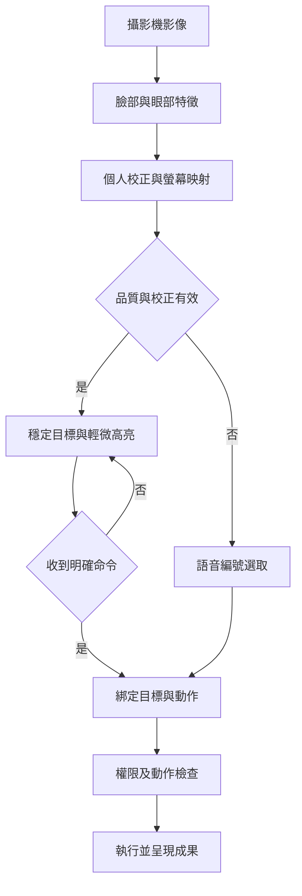
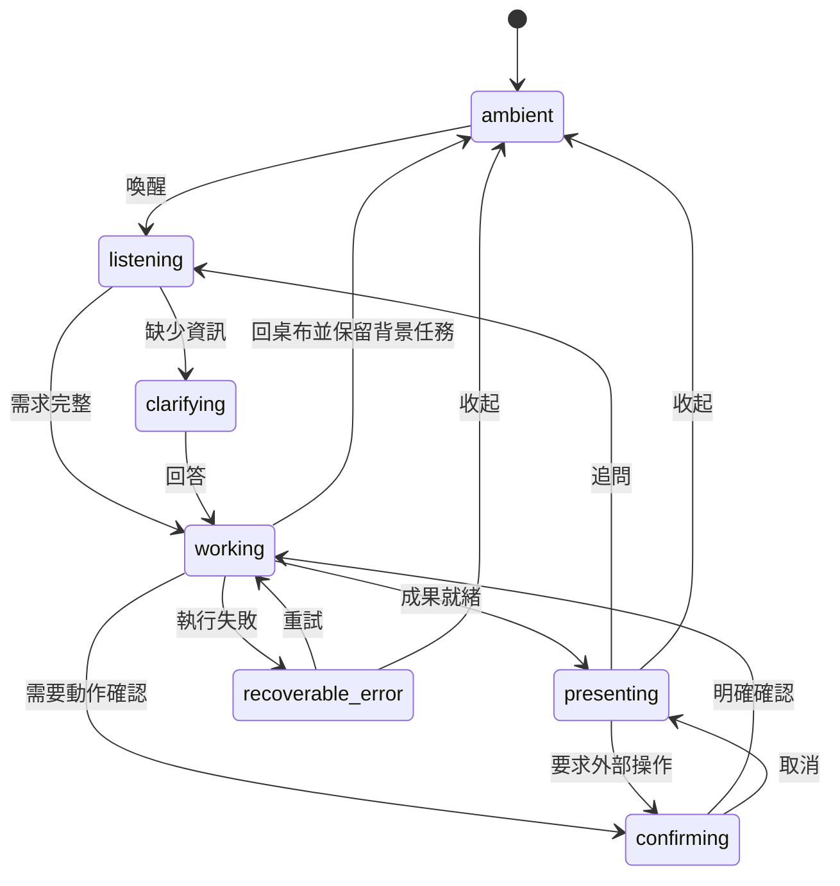
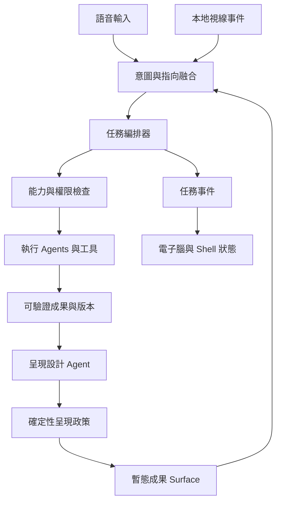

<!-- bilingual: source=zh-TW -->

> [繁體中文](06_Ambient_Voice_Gaze_Experience.md) | [English](06_Ambient_Voice_Gaze_Experience.en.md)

# Nous — 電子腦桌面、語音與視線互動規格

版本：v0.1 · 規格日期：2026-09-16 · 效力說明更新：2026-10-24。產品規則持續有效；部分能力已有原型，整體 gate 與硬體驗收仍須逐項提供證據。

> **2026-10-24 閱讀導覽**：目前程式與缺口見 [實作現況](Current_Implementation_Status.md)，新功能建議見 [功能擴充評估](13_Feature_Expansion_Assessment_2026-10-24.md)。程式基準為 `1f44c6b`（2026-10-23）。原型使用 Node HTTP、SSE、TypeScript、Vite 與 Electron，已有瀏覽器 STT／TTS 與 WebRTC 即時語音雙路；本地喚醒、Tauri、完整 Agent SDK 與本文件的校正視線流程仍屬目標設計。
>
> [11 雙目鏡頭互動設計](11_Stereo_Camera_Interaction_2026-10.md) 明確修訂遠距互動路徑。現有感測是 `presence`、是否面向螢幕、停止手勢及三區手臂指向；頭向不等於眼動，程式存在不代表準確率或硬體 gate 已通過。遠距目標選取以語音編號為主、手臂指向為輔。以下視線規格保留為後續研發與驗收要求，不可套用到頭向後宣稱已完成 gaze。新評估中的 F0–F10、Q0–Q4 不取代 G0–G3。

## 1. 產品定義與範圍

**平時是一個安靜、有高科技感的電子腦動態桌布；使用者說出需求，AI Agents 完成工作，只有當下要看的資訊才浮現。使用者看向成果中的某個部分，再用語音繼續操作。**

本文件記錄 George 在 2026-09-16 補充的產品方向：

1. OS 只呈現使用者要看的資訊，不常駐堆疊資訊面板。
2. 無需求時回到電子腦動態桌布。
3. 沒有面向使用者的 App、App 圖示、App 商店或啟動器；需求由 Agents 組合能力完成。
4. 以語音提出需求、澄清、調整、確認及收起內容。
5. 用 webcam 估計使用者注視哪個區域，承接滑鼠的指向功能。
6. 核心流程為「提出需求 → AI Agents 解決問題 → 呈現成果」。

「任何需求」是通用產品方向，執行範圍仍取決於可用工具、資料、權限與硬體。缺少能力時應說明具體缺口，不得用假資料或假成功掩飾。底層仍可使用 API、MCP、函式庫及受控的既有軟體；使用者不需要先決定開哪個 App。

沿用既有 Claude 認知核心、記憶、知識、Agent 與工具的目標架構。2026-09-16 規劃的正式桌面 Shell 為 **Tauri + React**；目前可執行原型採 Electron 與無框架 TypeScript。兩者的遷移或保留須另行決策，不能把規劃當成現況。「電子腦桌布」描述待機視覺，不表示已完成原生桌布嵌入、登入桌面替換或新的 OS kernel。原生桌布整合屬後續平台工作。

### 文件優先順序

本文件及 [07 開發與驗收計畫](07_Ambient_Implementation_and_Acceptance.md) 規範新的 Shell、輸入及揭露策略；與 01–05 的常駐 Dashboard、技能側欄、語音延後等舊敘述衝突時，以 06–07 為準。其餘核心架構仍沿用既有目標設計，不能據此推定已有實作。遠距鏡頭的具體限制與互動修訂見 11，實作現況由現況文件記錄。原本「3 個月」是排程假設，加入視線與語音後需按驗收 gate 重新估工。

## 2. 畫面與資訊揭露規則

### 2.1 待機視覺

| 項目 | 規格 |
|---|---|
| 主體 | 抽象電子腦／神經網路球體：粒子、神經連線、緩慢呼吸與局部光脈衝 |
| 配色 | 深色底、青藍與少量紫色光線；亮度、動畫強度可用語音調整 |
| 留白 | 大部分畫面保留空間，不以數字、假代碼或假監測資料營造科技感 |
| 待機 | 無 App、Dock、側欄、聊天紀錄、任務列表、未讀數字及預設儀表板 |
| 回饋 | 透過光形與短提示表示聆聽、處理、等待；動畫必須由真實事件驅動 |
| 成果出現 | 電子腦縮小或淡化，讓出閱讀區；成果收起後恢復 |
| 低動態模式 | 支援減少動態、靜態電子腦、降低幀率；不使用急促閃爍 |
| 系統資訊 | 時鐘、天氣、效能、成本及通知都需按需叫出，不預設佔據畫面 |

動畫只是狀態表達，不是模型正在思考的可視化，也不能以循環動畫假裝任務仍在推進。

### 2.2 可見內容必須有原因

Presentation Policy 是獨立於 LLM 的確定性檢查器，每個 Surface 必須帶可驗證的 `visibility_reason`：

| 原因 | 可呈現內容 | 生命週期 |
|---|---|---|
| `user_request` | 使用者剛要求的答案、表格、圖表、文件、互動工具 | 直到收起、切換任務或依明確設定隱藏 |
| `task_clarification` | 完成目前需求不可缺少的一個問題 | 回答後關閉 |
| `action_confirmation` | 需要確認之操作的對象、範圍與影響 | 確認、取消或過期後關閉 |
| `subscribed_event` | 使用者明確訂閱且允許現在顯示的提醒 | 按訂閱條件；勿擾時排隊 |
| `sensor_status` | 麥克風、攝影機正在使用的最小指示 | 只在感測器使用期間；保留宿主 OS 指示 |
| `user_pinned` | 使用者說「先留著」的成果 | 留在本次工作情境，直到收起或鎖屏 |

規則：

- 預設最多 **1 個主要成果區 + 1 個輔助區**；更多內容用「下一個、上一個、比較」導覽。要求比較時可展示 2–3 個穩定大區塊。
- 所有展開都對應需求；模型推測使用者「可能有興趣」不足以彈出資訊。
- 待機時不常駐顯示 Agent 數量、token、trace、推理文字、tool logs、除錯面板或總任務看板。使用者說「進度如何／看依據」才叫出相應資料。
- 正在閱讀的成果不因注視、眨眼、短暫離席或一般計時器而消失；鎖屏按隱私策略遮蔽，恢復時可喚回。
- 「收起／回桌布」只關閉視圖；「停止這個任務」才送出取消。畫面收起後，背景完成不能自行重開，除非使用者已要求完成時顯示或提醒。
- 「記住這種做法」保存技能；「保留這份結果」保存成果。持久化不建立圖示、側欄或常駐 widget。
- 已請求任務的失敗／缺資料要誠實告知。若該任務已被使用者收起，保存狀態供詢問，不突然打斷其他工作。

### 2.3 成果必須可帶走、可追問

成果用 Artifact 儲存內容、版本、來源、產生時間、任務狀態與必要假設；Surface 只是它的暫態視圖。需要時可匯出檔案，並用「剛才那份報告」喚回。敏感內容可選不保留，既有保留／刪除政策仍適用；原始攝影機影像不屬成果。

## 3. 語音互動

### 3.1 輸入流程

`本地喚醒／明確啟動 → 語音活動偵測 → 語音辨識 → 意圖理解 → 任務執行 → 成果／短語音回覆`

- 首次啟用必須走宿主 OS 麥克風權限；首次設定與權限拒絕時保留鍵盤／按鈕入口，不能要求尚未授權的語音來授權自己。
- 免手模式啟用後，用本地喚醒詞開始，靜音時不持續錄製。MVP 必須驗證一條真實喚醒與 STT 路徑；按住說話是可選備援。
- VAD 只能判斷有無語音，不能單獨充當使用者命令辨識。喚醒後的有限對話時窗、timeout、停止詞需可設定。
- 啟用雲端 STT 前說明傳送範圍並取得設定授權；未喚醒的音訊不送往雲端。原始音訊預設不落盤，短暫環形緩衝使用後清除。
- 短字幕可在聆聽期間浮現；可說「不要字幕／只用文字」。長報告預設不整篇念出。
- 「停」先立即停止 TTS，暫停新工具派發，再詢問是否取消工作；「停止任務」直接提出任務取消；「收起」不停止背景工作。
- TTS 播放時處理回聲與自我觸發。需支援使用者打斷，不能把系統自己的語音當成新指令。
- 語音低信心且會改變對象／金額／動作時，先簡短澄清；不得默默猜測。

### 3.2 基本語彙

| 使用者說 | 行為 |
|---|---|
| 「幫我比較這三個方案」 | 建立任務，檢查資料與能力，產生比較成果 |
| 「這個，展開」 | 使用已鎖定的視線目標展開詳情 |
| 「第二個」 | 用固定編號選取，適用攝影機關閉時 |
| 「把這個改成表格」 | 基於同一 Artifact 改呈現，不重新虛構資料 |
| 「數值改成八十」 | 鎖定欄位，讀回修改後的值，更新模型並重算 |
| 「往下／上一頁／下一個」 | 在當前成果中導覽 |
| 「目前進度如何」 | 顯示該任務的完成項、進行項、阻塞及可取消狀態 |
| 「保留這份，其他收起」 | 保存指定成果並調整可見 Surface |
| 「攝影機關掉」 | 釋放影像串流，清除焦點，以語音編號繼續 |
| 「回桌布」 | 收起當前視圖，返回電子腦 |

對话上下文至少包含目前 task、Artifact 版本、可見 Surface、穩定目標及最近明確命令；不能僅靠最後一句文字決定「這個」是哪個。

## 4. Webcam 視線互動

### 4.1 功能邊界

**看向哪裡是指向訊號，說要做什麼才是動作意圖。** 首版目標為選取大卡片、圖表區域與大按鈕，不承諾一般 webcam 能像滑鼠一樣精準選取字元或進行任意拖拉。

MediaPipe Face Landmarker 可提供臉部特徵點等訊號，但螢幕 gaze mapping 需額外模型與校正；MediaPipe Iris 官方明確說明虹膜追蹤本身不推斷注視位置。[Face Landmarker 官方文件](https://developers.google.com/edge/mediapipe/solutions/vision/face_landmarker)；[Iris 官方文件](https://chuoling.github.io/mediapipe/solutions/iris.html)。

WebGazer 可用一般 webcam 在瀏覽器內估計注視位置，官方既有校正依賴點擊／游標互動；無滑鼠流程需另外製作顯式校正。其網站標示 GPLv3，並公告 2026-02-24 起不保證更新。因此列為可比較的研究候選，沒有在本設計中決定打包或宣稱相容既定授權。[WebGazer 官方網站](https://webgazer.cs.brown.edu/)。

上述來源查閱日期：2026-09-16；產品選型與精度以 PoC 實測決定，不把人臉偵測 confidence 當作注視正確率。

### 4.2 處理流程

### 4.3 校正與座標

- 首次使用以 5 或 9 個固定目標引導校正；注視後說「好了」或完成定時採樣，不能強迫使用滑鼠完成必要步驟。
- 用與校正不同的保留點驗證；先檢查可否穩定分辨左、中、右三個大區塊，再增加目標密度。
- `display_id + viewport_revision + calibration_id` 必須匹配。DPI、視窗尺寸、螢幕、攝影機位置、頭部位置明顯改變時，暫停不可靠指向並重新驗證／校正。
- MVP 限一位主動使用者及一個螢幕；多螢幕與多人識別另列。多張臉時不自動轉移控制權。
- UI 使用穩定的 `target_id` 和大命中區；高亮期間固定版面。版面重排產生新的 revision，舊焦點立即失效。

### 4.4 指向、鎖定、操作

以下為可調初始設計值，尚未有實測保證：

1. 經 smoothing 與 hysteresis 後，同一目標連續穩定 450 ms 才高亮，避免視線掃過造成焦點跳動。
2. 高亮只選定，不自動點擊、展開、捲動、刪除或提交；持續注視也不等於同意。
3. 若 utterance 開始時已有穩定焦點，鎖定該目標；否則可使用「這個」附近的有效時間戳樣本。無法可靠對齊時問「第一個還是第二個？」。
4. 命令綁定 `task_id + surface_id + target_id + artifact_version + viewport_revision`。STT 完成前目標換版時作廢綁定，重新確認。
5. 超過 1,000 ms 沒有有效觀測、離屏、追蹤遺失或鏡頭關閉時清除當前指向；失效資料不能觸發新操作。
6. 高信心門檻由實測制定；不能使用不同 gaze provider 的任意分數共用同一閾值。

「看＋說」為預設路徑。低影響動作的停留啟動可留到後續無語音輔助模式，需使用者另行啟用；眨眼不預設當點擊。需要精細選取時先放大區域，再用「第幾列、第幾欄、向右一格」定位。

### 4.5 故障與備援

暗光、眼鏡反射、遮擋、校正失效或 webcam 權限拒絕時，提供「第一個、右邊那張、下一個」等語音操作。鏡頭故障不阻斷任務執行。鍵盤／滑鼠保留作初始設定、可及性與復原入口，不成為正常核心流程的必要步驟。

攝影機預設僅在已授權且有可選取 Surface／校正時啟動；回桌布即停止 gaze 串流。若未來加入在席偵測，需獨立開關與耗電評估。影像在本地處理，不寫入記憶、trace 或傳給推理模型；預設只暫存短期焦點事件，校正資料可以查看及清除。

## 5. Shell 狀態與任務狀態分離

Shell 描述「使用者現在看到什麼」，Task 描述「工作實際進行到哪」。兩者不可用同一個布林值表示。

| Shell 狀態 | 畫面與聲音 | 主要進入／離開條件 |
|---|---|---|
| `ambient` | 電子腦動畫；如有啟用喚醒麥克風則保留最小指示 | 啟動／收起；喚醒後進 listening |
| `listening` | 輕微光環，可選短字幕 | 語音終止後理解意圖；取消或 timeout 回前一畫面 |
| `working` | 真實執行狀態驅動脈衝，必要時一行任務描述 | 成果 ready、缺資訊或失敗；「收起」可直接回 ambient |
| `clarifying` | 單一問題／選項 | 回答後繼續，取消則關閉 |
| `presenting` | 一個主要成果，可選輔助區 | 展開／調整／匯出／收起 |
| `confirming` | 明確動作、對象與後果，固定版面 | 當次明確確認才提交，取消／過期不執行 |
| `recoverable_error` | 短原因、保留的成果及可行下一步 | 重試／改方式／收起；不清空任務歷史 |

此圖表達主要轉移；「停止 TTS、取消、清除焦點、鎖屏」是跨狀態事件。聆聽可作疊層，結束後回到之前成果，不銷毀內容。

Task 狀態至少包括 `queued / running / awaiting_input / awaiting_confirmation / succeeded / failed / cancelling / cancelled`，各自持久化。鎖屏／使用者離席時收起私密內容、停止 gaze；正在等待確認的外部操作不能自動執行。

## 6. Agent 到呈現的架構

| 模組 | 職責 | 與既有架構的關係 |
|---|---|---|
| Ambient Renderer | 動画、低功耗、狀態視覺回饋 | 補充模組 E Shell |
| Voice Session | 喚醒、VAD、STT、TTS、打斷 | 接入 Hardware Capability |
| Gaze Provider / Focus Resolver | 本地估測、校正、目標映射、品質檢查 | 輸出事件，不自行執行工具 |
| Intent Fusion | 語句＋時間對齊焦點＋情境，解決「這個」 | 擴充 04 的 Intent Parser |
| Orchestrator | 路由、依賴、取消、重試、持久化 | 沿用 Agent／Scheduler |
| Artifact Store | 可喚回的成果與來源版本 | 接既有 SQLite／知識與記憶 |
| Presentation Designer | 選文字／圖表／文件／受控互動 UI | 沿用 04；增加可見理由與目標 |
| Presentation Policy | 限制可見數量、來源任務、訂閱與鎖屏規則 | 新增的非模型政策邊界 |
| Capability / Action Gate | 檢查權限、當次意圖、目標版本與副作用 | 沿用安全層，獨立於 Designer |

工作流程只派出達成目標必要的 Agents，不要求每個需求走全部角色。簡單問題可直接回覆；需要資料時才檢索；需要比較時才分析；來源與计算需可回溯。

### 執行與復原規則

- 已授權且可逆的任務依既有政策執行，不每一步打斷使用者。外寄、發布、付費、永久刪除等有實質影響的動作，按具體授權與動作政策確認；視線不能充當授權。
- UI 提交只傳 action intent；能力執行器自行核對工具、目標、權限及有效期。生成 UI 不直接取得 shell、檔案系統、MCP token 或任意網路存取。
- MVP 先用受控 renderer／元件與結構化資料。原有任意 React／Python 工具合成留到沙盒隔離完成後。
- 非冪等操作需 `idempotency_key` 與提交紀錄。timeout 不等於失敗；應先查核外部狀態再決定是否重試。
- 「停止」只能取消尚未提交的工作；已完成的外部操作如無補償機制不可宣稱已復原。使用者可查明停在哪裡。
- 以任務事實、來源、假設、摘要與實際進度回答「你怎麼做的」，不把內部推理文字當作必要產品介面。
- 斷網時保留已有成果與本地能力，說明需連線的步驟；不偽裝本地存在完整雲端模型能力。

## 7. 具體使用情境

### 情境 A：比較方案

1. 電子腦緩慢呼吸，沒有資訊卡。
2. 使用者：「幫我比較這三份儲能方案，先看效率與成本。」
3. 系統檢查附件；若缺一份只詢問缺項。取得資料後調用必要 Agents。
4. 成果以比較表＋簡短結論呈現，列出來源與假設入口。
5. 使用者注視方案 B：「這個，把充電功率改成八十千瓦。」
6. 系統確認綁定方案 B，讀回新參數，重算並標出變更；不移動其他方案位置。
7. 使用者：「保留這份，回桌布。」成果可日後叫回，畫面恢復電子腦。

### 情境 B：不打擾的長任務

使用者：「整理完這批文件先存好，不用跳出來。」任務在背景執行，完成後只更新儲存的狀態。隔天說「昨天的整理拿出來」才呈現；失敗也留有可查核的原因，不能顯示成功。

### 情境 C：視線不可用

使用者戴眼鏡且有反光，左／中／右目標無法通過驗證。系統一次說明並改用編號：「可以說第一個或第二個。」語音、Agent 執行與成果保存持續可用；不能要求一直盯著螢幕完成操作。

### 情境 D：涉及外部行動

使用者：「把這份傳出去。」系統先解析是哪一個成果與接收對象；若缺資訊則詢問。在需要當次確認時，顯示成果版本與對象，收到明確指令才送出。僅注視「送出」或自然眨眼不能觸發。

## 8. 完成定義

只有待機動畫或預錄腳本不算完成產品閉環。驗收必須包含：真實語音需求、真實 Agent 工具工作、可保存成果、真實 webcam 校正與區塊選取、語音調整、收起與喚回。Mock／replay 可用於開發，但需明示，不能用來證明真實能力。

功能 gate、資料契約、檔案結構、任務 prompt 與逐項驗收見 [07 開發與驗收計畫](07_Ambient_Implementation_and_Acceptance.md)。
