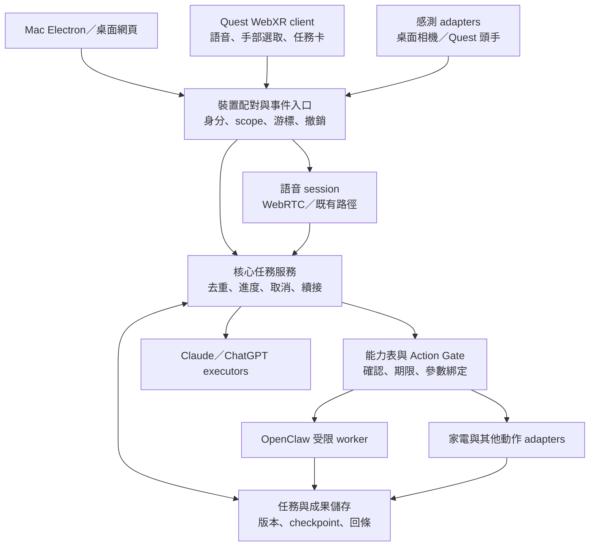

<!-- bilingual: source=zh-TW -->

> [繁體中文](13_Feature_Expansion_Assessment_2026-10-24.md) | [English](13_Feature_Expansion_Assessment_2026-10-24.en.md)

# AIOS / Nous feature expansion assessment

Reviewed on 2026-10-24, Asia/Taipei. Repository: [pcpcchen-coder/AIOS](https://github.com/pcpcchen-coder/AIOS).

> Publication note: This report uses the code at `1f44c6b` as its baseline. GitHub counts are a snapshot taken before this documentation PR was created. At the user's subsequent request, the report and [current implementation and validation](Current_Implementation_Status.en.md) were added to the repo, and related documentation was updated. The documentation inventory is delivered. The product CI proposed in F0 and other features still await implementation. This batch does not change the runtime or advance G0–G3 completion.

**Prioritize a complete loop in which the same job continues between Mac and Quest, with sources and versions for both artifacts and actions.** Claude remains the primary developer of the AIOS core, while ChatGPT handles Quest client engineering. Integrate OpenClaw as a replaceable, restricted worker. This Claude / ChatGPT split describes development responsibility. It does not require Quest to use only OpenAI models at runtime.

This report uses these labels.

- **Verified code fact**: Mainline code, GitHub records, or tests directly inspected or run in this review.
- **Hardware result recorded in the repo**: An existing test documented in the repository, not repeated here. Its evidence limitations remain explicit.
- **Plan / gap**: Proposed in documentation, without a complete implementation on mainline.
- **Expansion proposal**: Recommended in this report and not implemented. Effort and acceptance figures are estimates or proposed thresholds.

## 1. Review baseline and limits

Mainline for this review is [`1f44c6b384d8819e99c5d5a7689069119adf6d53`](https://github.com/pcpcchen-coder/AIOS/commit/1f44c6b384d8819e99c5d5a7689069119adf6d53). Its latest commit, at 2026-10-23 20:48:02 Taiwan time, merged PR #32, “App settings primarily in the menu bar; settings page retains accounts only.” The local directory was initially empty. A reading snapshot was obtained for this review. Product code was not changed, committed, or pushed.

The review covered the root README, AGENTS.md, CLAUDE.md, docs/01–08 and 10–12, development and validation documents, the actual prototype frontend and backend, shared types, Electron shell, tests, and CI. All 32 records returned by the GitHub Issues API were merged PRs. There were no standalone issues or open PRs. Both retained Claude branches were already included in main. `telemetry/pstack` contains observability data and is not an unmerged feature. [Issues / PR records](https://github.com/pcpcchen-coder/AIOS/issues?q=is%3Aissue), [all PRs](https://github.com/pcpcchen-coder/AIOS/pulls?q=is%3Apr), [branches](https://github.com/pcpcchen-coder/AIOS/branches).

Consequently, this report does not treat “in progress” in a document as evidence of active development. It can establish merged content and capabilities awaiting acceptance. The repo cannot establish whether Claude is currently continuing work in an unpushed directory.

Existing verification was rerun with Node.js 22.23.3. All 790 tests in 48 test files passed, as did type checking, the frontend build, and isolated mock task and direct-chat HTTP journeys. The pinned pstack version and skill-link integrity checks also passed. These are code and mock-path evidence. **They do not establish successful real-model execution or acceptance of Quest, microphones, stereo accuracy, or complete smart-home journeys.** See the method in [verify-aios.mjs](https://github.com/pcpcchen-coder/AIOS/blob/1f44c6b384d8819e99c5d5a7689069119adf6d53/scripts/verify-aios.mjs).

## 2. Implemented features, pending acceptance, and gaps

| Area | Verified code facts | Pending acceptance / gaps |
|---|---|---|
| Electronic brain and on-demand artifacts | Canvas 2D brain, event-driven animation in six regions, Shell reducer, task progress, Markdown artifacts, separate hide and stop actions | Animation represents application events, not internal model neural activity. Formal G0 does not pass automatically |
| Execution core | Node HTTP + SSE, TypeScript, Claude / ChatGPT / mock switching, concurrent queue, cancellation, and retry | Not a Python kernel. Claude uses Anthropic Messages SDK. No general Agent SDK workflow or local file tools yet |
| Task and artifact persistence | Local JSON persistence; saved tasks and artifacts can be recalled after restart | Unfinished tasks become failed on restart. Retry reruns the whole task. Checkpoints, submission deduplication, and updatable artifact versions are missing |
| Desktop App | Electron shell, menu bar, settings, signing-related code, and permission handling | Tauri / React is planned architecture, not the current implementation |
| Conversation and voice | Browser STT / TTS and interruption logic. WebRTC realtime voice has API-key and ChatGPT / Codex routes | Ordinary chat history exists only in page memory. Voice device switching and disconnection recovery are absent. Routes have different capabilities |
| Tools | Search, background delegation, smart-home queries and controls. The API-key voice route can configure remote MCP | ChatGPT live has no MCP. Smart-home tools are currently available only in realtime voice. A shared capability registry and general Action Gate across all entry points are missing |
| Sensing | Left/right image splitting, MediaPipe Pose / gestures, presence, distance estimation, head-facing, open-palm speech stop, arm pointing to three zones, and proximity zoom | Distance uses nominal geometry without measured stereo calibration. Head-facing is not eye tracking. Accuracy and environmental operating range are unmeasured |
| Smart home | H0 queries, H1 ordinary device controls, H1b AIFA / infrared route | H2 scoped tokens and device policies, H3 room groups, and H4 background MCP work have not started. AIFA / IR has no device readback |
| Quest / VR | First-party directory and code searches found no Quest or WebXR client or build project | Requires new input adapters, XR renderer, pairing transport, and hardware acceptance |
| OpenClaw agent | Comments and constants for voice, OAuth, sideband, and greetings reference OpenClaw | No OpenClaw Gateway adapter, agent-run mapping, or worker integration |
| Long-term memory / knowledge | Tasks and artifacts are persisted | This is not personal long-term memory. Markdown memory with SQLite indexing, knowledge graphs, and skill promotion are not fully implemented |
| Presentation policy / reminders | Deterministic checks currently support only `user_request` and `action_confirmation` | Subscription reminders and proactive background presentation reasons are unsupported. A permanent task wall cannot simply be added |

Code sources: [prototype guide](https://github.com/pcpcchen-coder/AIOS/blob/1f44c6b384d8819e99c5d5a7689069119adf6d53/prototype/ambient-shell/README.md), [core composition](https://github.com/pcpcchen-coder/AIOS/blob/1f44c6b384d8819e99c5d5a7689069119adf6d53/prototype/ambient-shell/server/nous.ts#L47), [task persistence](https://github.com/pcpcchen-coder/AIOS/blob/1f44c6b384d8819e99c5d5a7689069119adf6d53/prototype/ambient-shell/server/store.ts#L24), [presentation policy](https://github.com/pcpcchen-coder/AIOS/blob/1f44c6b384d8819e99c5d5a7689069119adf6d53/prototype/ambient-shell/src/presentation-policy.ts#L16), [smart-home batch status](https://github.com/pcpcchen-coder/AIOS/blob/1f44c6b384d8819e99c5d5a7689069119adf6d53/docs/12_SmartHome_Integration_Plan_2026-10.md#L127).

### Documentation discrepancies that matter

At baseline `1f44c6b`, the root README and docs/08 still described the repo as primarily design, lagging behind implementation. The prototype README then said live voice had not been tested with a real account, although newer validation records contained partial Mac hardware results. This documentation update corrects the entry points and historical authority. Establish implementation status from mainline code, retain product rules from CLAUDE.md and applicable specifications, and read new acceptance records individually. No single document describes all evidence adequately.

Hardware results recorded in the repo show that Mac Codex login, calls, and sideband worked. After `client_version` was corrected, the user verbally reported successful temperature queries. There are no screenshots or latency measurements, and other tests and billing comparisons remain incomplete. Switching home lights also has verbal confirmation, while complete AIFA / IR hardware results are missing. This is a record of user validation for parts of the flow, not completed voice or smart-home acceptance. [Live voice hardware record](https://github.com/pcpcchen-coder/AIOS/blob/1f44c6b384d8819e99c5d5a7689069119adf6d53/docs/validation/live-voice-2026-10-23.md#L121), [smart-home status](https://github.com/pcpcchen-coder/AIOS/blob/1f44c6b384d8819e99c5d5a7689069119adf6d53/docs/12_SmartHome_Integration_Plan_2026-10.md#L3).

## 3. Expansion direction and priorities

Focus differentiation on four capabilities users can operate themselves: continue work across devices, change the same artifact through pointing and voice, obtain verifiable tool-execution receipts, and own memory that they can correct. Quest gives these capabilities a spatial interaction use. OpenClaw adds actual work execution. Another chat panel, a 3D agent avatar, or a knowledge-graph display contributes less to the current complete loop.

Everything below is a proposal in this report. Value scores range from 1 to 5, with 5 highest, and are subjective judgments for this project. Effort estimates assume one engineer familiar with this repo, assisted by AI, including basic tests and documentation. They exclude hardware procurement, platform review, waiting for account permissions, and development of missing external-system interfaces. Dividing work can reduce waiting, but person-hours do not directly equal calendar time.

| ID / order | Expansion | Value | Incremental effort | Dependencies | Priority rationale |
|---|---|---:|---:|---|---|
| F0 / P0 | Status inventory and product CI | 4 | 8–12 hours | None | Remove misleading documentation and establish a common development baseline |
| F1 / P0 | Shared capabilities, Action Gate, and action receipts | 5 | 24–40 hours | F0 | Shared control boundary for Quest, OpenClaw, and smart home |
| F2 / P0 | Resumable tasks and artifact versions | 5 | 36–56 hours | F1 action identification | State foundation for duplicate prevention, disconnects, and cross-device handoff |
| F3 / P0 | Pairing and device handoff | 5 | 24–40 hours | F1, F2 | Quest cannot currently connect to the localhost core |
| F4 / P1 | Quest spatial artifacts and “this one” actions | 5 | 32–48 hours | F3; first integrate F1/F2 contracts | First clearly demonstrable differentiated experience |
| F5 / P1 | Restricted OpenClaw worker | 4 | 24–40 hours | F1, F2 | Add real tool work, read-only first, authorized writes later |
| F6 / P1 | Voice ownership, interruption, and cost visibility | 5 | 16–24 hours | F3; single-device measurement can start first | Resolve simultaneous capture, duplicate playback, and confusion between muting and cancellation |
| F7 / P2 | Correctable work memory and sources | 4 | 24–40 hours | F2 | Progress from artifact recall to continuity of work preferences |
| F8 / P2 | Spatial smart-home binding and result checks | 4 | 24–40 hours | F1, F4; controller H2 | Bind “that lamp” to a specific device rather than a model's object guess |
| F9 / P2 | Sensing reliability and wearable input | 3 | 24–40 hours | F1; F4 optional | Make existing sensing reliable, then add IMU / BLE assistance |
| F10 / P3 | Quest visual work guidance | 3 | 40–80 hours | F4, F9; native-camera spike | Valuable new capability with the greatest permission, recognition, and privacy cost |

F0–F4 total 124–196 hours. Including F5 and F6 in the first round brings the total to 164–260 hours. These are work-breakdown estimates, not delivery speeds measured after similar completed work.

## 4. MVP, integration, and acceptance for each feature

### F0: Auditable status and product CI

The MVP is feature status built from links to code, tests, and hardware records, separating “code exists,” “fixtures pass,” and “hardware passes.” Correct the Node / Electron prototype status in the root README. Mark docs/08's early-October snapshot as historical while preserving its decision context.

Integrate `scripts/verify-aios.mjs` and add CI triggered by prototype changes. Existing `.github/workflows/` mainly checks the pstack recorder and public export, and cannot prove application verification for every commit. The risk is presenting green prototype tests as completed G0–G3. Acceptance requires a prototype code change to trigger type checking, tests, build, and the mock journey. Hardware fields remain pending without evidence.

### F1: One capability policy and verifiable action receipts

First make `home_status`, `home_control`, and `delegate_task` shared core capabilities. Text, voice, and Quest submit the same intent structure. Policy supports allow / confirm / off based on existing user authorization and action impact, without asking again for every reversible action.

Integration points are `server/nous.ts`, `server/app.ts`, `server/home-bridge.ts`, and `src/realtime-tools.ts`. The renderer currently participates in tool dispatch. Move execution and submission records for owned tools back to the server first, retaining sensing, display, and confirmation input in the renderer. Remote MCP already has its own approval path. Preserve it with separate contract tests. A single migration cannot be claimed to control all third-party tools.

Current detail: HomeBridge already supports confirmation cards, but `policyFor` defaults to allow and `nous.ts` does not inject device policy. docs/12 also explicitly says H1 executes directly by default, with device voice policy introduced in H2. Safety measures exist, but a shared policy boundary is incomplete. [HomeBridge](https://github.com/pcpcchen-coder/AIOS/blob/1f44c6b384d8819e99c5d5a7689069119adf6d53/prototype/ambient-shell/server/home-bridge.ts#L958).

Receipts separately record “not sent,” “sent / accepted,” “device confirmed,” “failed,” and “result unknown.” Acceptance includes rejecting old-version or expired confirmations, refusing model-provided `approved:true` as authorization, avoiding repeated execution of the same intent, and never converting a timeout to success. With OpenClaw, restrictions must apply where it actually invokes tools. A confirmation card in AIOS cannot prevent a command an independent worker has already sent.

### F2: Continue the same work after closing a page or restarting

Choose a three-step research or document-organization task. Persist each step's output, sources, state, and tool receipts. After restart, resume after the completed steps. Support artifact version 1 → 2 and an inspectable diff.

Integrate `TaskStore`, `TaskRunner`, and `Executor`. Gradually replace JSON through a storage interface. Use SQLite transactions for tasks, steps, artifact versions, action receipts, and event sequence numbers. Back up old JSON and provide a one-time import. Resumption across steps requires an explicit executor-output contract refactor. Replacing JSON with SQLite alone does not complete it.

The risk is a crash after an external tool executes but before its receipt is saved. Acceptance must interrupt the process at every step and submission boundary, ensuring completed read-only steps are not repeated. For unknown side-effect state, check first. If it cannot be checked, require resolution instead of blind resubmission. Twenty duplicate submissions must create only one job. Version conflicts return conflict without silent overwrite.

### F3: Share work state across Mac, Quest, and phone

Limit the MVP to one user, a Mac core, and Quest as a second client. The phone initially only views artifacts. Pair devices with a one-time short code / QR, then issue revocable, scoped device credentials. Use HTTPS for the external entry point while retaining the loopback core behind it. Do not just change listen to `0.0.0.0`.

Add device sessions, event cursors, server snapshots, and foreground leases. Work state belongs to the server. Visible artifacts and active audio capture belong to devices. Synchronize task / artifact IDs, versions, summaries the user permits saving, and current selection. API keys, OAuth refresh tokens, raw audio, and camera images are not handoff data.

Risks include duplicate delegation, credential leaks, and stale clients continuing control after disconnects. Acceptance requires 20 Mac↔Quest handoffs with no duplicate tasks and consistent versions of the same artifact. Revoked devices cannot fetch data or submit. Reconnection fills event gaps, without automatically restoring old confirmations. Simultaneous confirmation of the same action on both clients still executes once. The target is state recovery within 3 seconds on a healthy LAN, subject to hardware measurement.

### F4: Quest spatial artifacts and pointing follow-ups

The user says “bring up those three options” to display an on-demand comparison. They highlight option B with head direction or a hand ray, then say “this one, change the cost to eight hundred thousand.” Bind the version, recalculate, and show differences. Remain quiet after dismissal. Spatial pinning saves only the positions of artifacts the user requests, without automatically opening all tasks.

Start with WebXR + TypeScript, three large target cards, and the idle electronic brain. Reuse brain-region data in `shared/domain.ts`, the Shell reducer, Presentation Policy, voice interfaces, and task contracts. XR requires a new renderer and hit testing. Existing DOM/CSS does not automatically become VR UI. The initial brain animation can be used as a texture, with 3D geometry later. Add a core-controlled calculation tool for the comparison case, recalculating numbers from structured inputs rather than accepting the model's spoken arithmetic.

Risks include choosing the wrong card, lost tracking, “this one” referring to another item after layout updates, and unreadable text. Acceptance proposes 30 selections for each of 3 targets, 90 total, with at least 90% accuracy. Lost tracking immediately invalidates pointing. Looking alone for 10 seconds causes zero actions. Old focus cannot modify a revised version. Voice numbering such as “the second one” remains a fallback. Record frame times and discomfort feedback over 20 minutes. The initial target is 72 FPS, about 13.9 ms per frame. Do not claim it before measurement.

### F5: OpenClaw as a restricted worker

Connect only one research agent for the MVP, completing “look up three items → provide sources → produce an artifact.” Claude's planning layer decides when a worker is needed. AIOS persists tasks and artifacts. OpenClaw returns traceable runs and results. Initially prohibit arbitrary local writes, outbound messages, payments, and smart-home control.

Add `WorkerAdapter` with submit, observe, cancel, and recover. Map worker/run IDs to task IDs. Do not add OpenClaw as a model provider parallel to Claude. It is an execution environment and may use different models internally. The MVP can pin one gateway, one tested version, and one work capability.

Official guidance recommends Gateway WebSocket + RPC for external applications, supporting start, events, wait, and cancel. Agent runs can use `agent` and `agent.wait`, with the integration version pinned. This is a feasible integration route, not an existing AIOS integration. [OpenClaw external-app integration](https://docs.openclaw.ai/gateway/external-apps), [Gateway identity and scopes](https://docs.openclaw.ai/gateway/protocol).

Risks include workers bypassing the Gate, reporting cancelled after an action completed, and both sides independently changing memory. Acceptance covers success, failure, cancellation, and lost-connection recovery against a real Gateway. Only specified capabilities are allowed. Unknown results remain unknown. Each source, run, and artifact maps to the same task. Workers receive only the current data package. Memory writes go through AIOS. Do not share the entire user directory.

### F6: One audio capturer, distinct stop commands, and cost records

Distinguish “stop playback,” “stop generation,” and “cancel the task.” Allow only one active voice owner during Mac↔Quest handoff. Rebuild voice connections and continue from saved text context. Do not promise transfer of the same WebRTC connection.

Reuse `RealtimeSession` and add an audio lease and capability declaration. Esc in the current live route primarily mutes locally. Quest UI must not describe it as cancelled model generation. Serve both voice routes with the same tool contracts, preventing voice models from bypassing core policy. OpenAI's WebRTC + server-sideband pattern supports keeping private tools and business rules on the server. [OpenAI Docs: server controls](https://developers.openai.com/api/docs/guides/voice-server-controls?api=realtime&voice-api=realtime).

Record end-of-speech to first playback, tool duration, disconnection reason, route, and received usage. If unit prices or account-usage evidence is missing, mark cost unknown rather than infer a definite bill. The repo's Codex live integration uses undocumented endpoints, creating compatibility risk. Retain a disableable adapter and explicit billing-route switching.

Acceptance requires no simultaneous capture or duplicate playback across devices, and no repeated job delegation during voice handoff. The proposed open-palm local-mute p95 is under 200 ms. Collect 30 rounds of p50 / p95 first-audio latency for ordinary questions without tools, then use p95 2.5 seconds as an initial tuning target. Report tool requests separately. Do not mix long-task latency into ordinary conversation.

### F7: Work memory that can be corrected and forgotten

2026-10-26 addition: [16 family memory design](16_Nous_Memory_Layer_Design_2026-10-26.en.md) breaks personal and family preferences into separate batches, using encrypted snapshots initially. [ADR-0002](adr/ADR-0002-nous-family-memory.en.md) explains differences from the historical Markdown + FTS5 proposal below. [MEM-0 delivered the isolated foundation](validation/memory-mem0-2026-10-26.en.md), while hardware gates and product memory remain incomplete. The following is historical and must not justify injecting memory into plaintext task artifacts.

Start with work summaries, explicit user preferences, and artifact sources, supporting “what did we decide last time?” and “do not remember this.” Store readable content in Markdown and index with SQLite FTS5. Defer knowledge graphs and vector services.

Integrate F2 session / artifact versions. Each memory includes source, time, scope, version, and revocation state. User corrections also update derived indexes and future worker data packages. Implement the repo's existing memory-layer ADR here rather than create another conflicting memory store.

Risks include false conclusions becoming permanent preferences and private data crossing jobs. Acceptance uses 20 fixed scenarios for save, recall, conflict correction, deletion, and export. Deleted items cannot be retrieved in a new session. “Yesterday's option B” recalls the correct artifact version. State clearly when data is absent.

### F8: Select smart-home devices spatially and check actual results

The user explicitly binds a virtual marker to a controller device ID, then says “dim this one.” Start with one room and one lamp with readback, expanding to H3 group scenes later. A vision model must not guess the marker-to-device mapping.

Integrate HomeBridge, F1 Gate, F4 target binding, and controller H2 device policy. Display device name, data timestamp, and action receipt. AIFA / IR retains “sent, please confirm.” Do not render physical success without physical state. Real scene actions show per-device results and partial success. Do not automatically retry or compensate IR toggles.

Risks include spatial-anchor drift, wrong bindings after rearrangement, and treating cloud acceptance as physical change. Acceptance invalidates old bindings after removal or room changes, selects the correct device in 30 operations, and includes confirmed, unconfirmed, and unknown examples. Room-group control waits for controller capabilities and device authorization. Estimates exclude missing controller development.

### F9: Sensing reliability and wearable assistance

Create `InputProvider` first, distinguishing sources such as head_ray, hand_ray, eye_gaze, stereo_pose, and imu. Each event includes validity time, quality, and device. Different providers' confidence values must not share one arbitrary threshold. On desktop, establish AR0144 left/right ordering, measured calibration, and error measurements first. Then evaluate wearable IMU or buttons for quiet mode / pointing-lock assistance.

Integrate `shared/sense.ts`, `src/sense/controller.ts`, and F1 target policy. Connect wearable BLE through a Mac companion first, sending minimal events. Do not assume native Quest Bluetooth support. Head direction, gestures, and pose must not imply identity or authorization.

Risks include latency, inconsistent clocks, and stale pointing after tracking loss. Record measured distance points, light/dark conditions, occlusion, sitting/standing, and multiple people in a test matrix. Retain docs/11 targets of distance error <10%, three-zone accuracy ≥90%, and stop accuracy ≥95% as unmeasured targets. Do not directly compare monotonic clocks in different device processes. Calibrate event timing and fall back to voice numbering when errors exceed tolerance.

### F10: Work guidance while looking at physical objects

Choose one fixed task, such as recognizing a specified control panel or marked component, and show the next step with “observed / awaiting user confirmation” status. Start with controlled targets and local recognition, without requiring whole-room understanding. Raw images must not be written to disk or traces. A model without image input can use only emitted structured events.

Integrate a native-camera provider, F9 sensing events, and F4 work cards. The official Quest 3 / 3S Passthrough Camera API provides front-camera data with the required OS, permissions, and passthrough features. Displaying passthrough does not establish app access to images. [Meta camera API](https://developers.meta.com/vr/documentation/unity/unity-pca-overview/).

Risks include misidentified steps, inference presented as observation, bystander images, and camera/browser version restrictions. Acceptance uses at least 30 known and failure cases, tracking false and missed recognition. Stop judgments at low quality and do not declare a step successful for the user. Cloud vision requires separate explicit data consent and data minimization. Do not treat the prototype's “images stay local” rule as cloud authorization. Invest in this only after the previous loops stabilize.

## 5. Quest technical routes and capability boundaries

The user's Quest model, firmware, and Browser version were unavailable in this review. The following are selection recommendations, not compatibility results for their hardware.

| Route | Suitable uses | Cost and limits | Recommendation |
|---|---|---|---|
| 2D page in Quest Browser | Initial pairing, voice, and artifact-sync verification | Not immersive spatial artifacts and cannot establish completed VR capability | Transport and voice smoke test |
| WebXR + TypeScript | Spatial artifact cards, head / hand pointing, reuse of existing TS logic | Requires a new XR renderer. Native cameras, persistent anchors, and background lifecycle need separate verification | First choice for F4 |
| Unity + OpenXR / Meta XR | Camera CV, depth / scene features, native lifecycle | Greater C# / Android tooling, package, and platform-version costs. Cross-language contracts need maintenance | Adopt for F10 or a clear native requirement |

Meta's official comparison lists head and hand tracking for Quest 3 / 3S, without eye tracking. Label the first version clearly as “head / hand pointing,” not eye-gaze operation. [Meta device comparison](https://developers.meta.com/vr/essentials/compare-devices/).

WebXR hand interfaces can provide joints and pointing. Avoid system-reserved palm pinch. Use standard selection or a custom stop gesture, with controller / voice-numbering fallback. [Meta WebXR Hands](https://developers.meta.com/vr/documentation/web/webxr-hands/).

WebXR requires a secure context, and immersive-session start is subject to user-activation requirements. `localhost` on Quest means Quest itself. Mac's `http://localhost:8787` cannot be used directly. LAN HTTP is also not a production voice / XR solution. [W3C WebXR specification](https://www.w3.org/TR/webxr/).

Camera image access and cross-session anchors are separate spikes. The reviewed Meta Browser MR documentation distinguishes passthrough display from pixel access. New native-camera documentation does not prove the same feature exists in the same Browser version. On target hardware, record permissions, enumerable devices, obtainable frames, and positioning after session reconstruction. Then decide whether WebXR suffices or a native adapter is needed. [Meta Browser MR](https://developers.meta.com/vr/documentation/web/webxr-mixed-reality/).

Desktop sensing also cannot be transferred directly to a headset. Existing AR0144 head-facing uses an external camera looking at the user. Quest head pose describes headset orientation in space. Removal, hidden / blurred sessions, or disconnection must immediately restrict privacy and confirmation state, without inheriting the desktop 60-second absence wait. Validate available wear-detection signals in the target runtime.

## 6. Recommended architecture and development responsibilities

The following separates current implementation from target architecture. New module names are proposals, not existing repo paths.

AIOS already has a usable desktop prototype foundation. The most distinctive next step is work delegated on Quest, continued on Mac, with traceable authorization and results for every external action. The brain, voice, and sensing can be entry points into the same task. Tasks must survive independently of views and calls.

`startNous()` currently assembles models, tasks, voice, the home bridge, and HTTP service. `TaskRunner` executes tasks, `TaskStore` persists tasks and Markdown artifacts, and the frontend receives event updates. This path is suitable for extension. There is insufficient reason to rewrite in Tauri or Python first. [Composition entry point](https://github.com/pcpcchen-coder/AIOS/blob/1f44c6b384d8819e99c5d5a7689069119adf6d53/prototype/ambient-shell/server/nous.ts#L47).

JSON persistence already exists. Missing semantics are continuation after interruption, step checkpoints, artifact versions, and duplicate-request suppression. Restart currently marks unfinished tasks failed. Retry creates a new task and runs from the beginning. Artifact version is fixed at `1`. Add these semantics before cross-device work. [Task lifecycle](https://github.com/pcpcchen-coder/AIOS/blob/1f44c6b384d8819e99c5d5a7689069119adf6d53/prototype/ambient-shell/server/runner.ts#L68), [storage behavior](https://github.com/pcpcchen-coder/AIOS/blob/1f44c6b384d8819e99c5d5a7689069119adf6d53/prototype/ambient-shell/server/store.ts#L24).

The core should own tasks, authorization, and execution receipts. Voice calls and Quest views submit intents and present state. This addresses tool lifetime currently depending on page connections, making “the call ends, work continues” an acceptance-testable feature.

Work can start within the current structure. `server/runner.ts` and `store.ts` own tasks and artifacts. `server/providers.ts` and executor files handle models. `server/realtime-*` and `live-*` manage calls. `shared/` defines versioned contracts. `src/sense/` retains device-sensing transformations. The Quest client should remain independent of Electron, joining through the same core contracts.

The following is the proposed target architecture. Device pairing, a general Gate, an OpenClaw adapter, and a Quest client are not implemented.

### Data contracts to decide first

| Contract | Minimum data and responsibilities |
|---|---|
| `FocusEvent` | Device, provider, target ID, surface, artifact version, viewport revision, validity time, and quality. Highlighting does not execute. Lock targets at utterance start and invalidate on version change |
| `ActionIntent` | Intent/action ID, user/workspace, capability, target version, current request, authorization scope, expiry, and idempotency key. The server decides policy, rejecting model claims of authorization |
| `ActionReceipt` | Corresponding intent, submission identifier, time, external state, observation source, and certainty. Timeouts remain recorded. Unknown means neither failure nor success |
| `ContextCapsule` | Session, task, artifact ID/version, selection, synchronization cursor, and user-permitted summary. Separate from provider audio sessions. No long-lived provider credentials |
| `WorkerJob` | Adapter, run ID, capability list, input references, deadline, status, sources, and artifact references. Cancellation receipts remain separate from side effects that already occurred |

The first round does not require rebuilding the monorepo for these contracts. Establish versioned boundaries with runtime validation in existing `shared/` first. Generate types from the same schema when Python or C# clients become necessary. After F1–F4 pass, use actual maintenance costs to decide on `packages/`, Tauri, or Python.

| Owner | Recommended scope | Delivery boundary |
|---|---|---|
| Claude mainline | Core capabilities, task / artifact persistence, Gate, device authentication, OpenClaw, and smart-home policy | Pinned contracts, test data, and change descriptions |
| ChatGPT / Codex Quest side | WebXR renderer, input adapters, voice lifecycle, spatial hit testing, privacy and performance acceptance | Consume contracts without independently recreating task / memory core |
| Shared maintenance | Versioned schemas, end-to-end acceptance cases, source and receipt semantics | Same feature ID, acceptance data package, and expected failures |

## 7. Roadmap and decision gates

Use new gate names Q0–Q4 to avoid mislabeling original G0–G3 as passed. Use relative stages after this review, without reusing obsolete start dates in docs/08. Assume 20–25 hours per week and schedule to estimate upper bounds. Hardware blockers are additional.

| Stage | Effort | Estimated duration | Observable delivery and release conditions |
|---|---:|---|---|
| Q0: Trustworthy development baseline | F0 + F1, 32–52 hours | About 2–3 weeks | Status documents, product CI, shared capabilities and receipts. Confirmation, resubmission, and unknown-result cases pass |
| Q1: Resumable work and pairable devices | F2 + F3, 60–96 hours | About 3–5 weeks | Persistence and handoff first on Mac plus a second browser. Disconnect, restart, duplicate action, and device revocation pass |
| Q2: Complete small Quest loop | F4, 32–48 hours | About 2–3 weeks | Real Quest recalls three options, points to change parameters, saves, and recalls on Mac. On-demand display and tracking-loss fallback pass |
| Q3: Real work and natural conversation | F5 + F6, 40–64 hours | About 2–4 weeks | Real OpenClaw read-only work, voice handoff, first-audio and stop measurements. No unauthorized tools or simultaneous capture |
| Q4: Choose one based on usage | F7, F8, F9, each 24–40 hours | About 1–2 weeks or more each | User-needed memory, spatial smart home, or sensing assistance. Validate one feature at a time |

Q0–Q2 convert to about 5–10 work weeks of pure effort. Allowing acceptance and integration between stages, reserve about 7–11 calendar weeks. Adding Q3 means about 7–13 work weeks or 9–15 calendar weeks. These are not guaranteed dates. If Claude and Quest developers work in parallel, overlap adapters / renderers first. Core state and authorization still pass sequentially.

Fix the first demonstration to these steps.

1. Mac uses a real model to compare three options, saving sources and artifact version 1.
2. The user puts on Quest, completes one-time pairing and XR activation, and says “bring up that last result.”
3. Quest displays the same task/artifact. The user selects B with head direction or a hand ray and speaks parameter changes.
4. The core checks the version, creates version 2 and a diff, and Quest displays progress only from real events.
5. The user dismisses the view without cancelling background work, then says “show the last changes” on Mac to retrieve the same version 2.
6. Repeat with one disconnect, one stale focus, and simultaneous submission on both clients, ensuring no incorrect changes, duplication, or false success.

Defer whole-room digital twins, arbitrary agent marketplaces, direct execution of freely generated code, full knowledge graphs, persistent wake detection on every device, and a simultaneous Python + Tauri rewrite. These expand capabilities and maintenance scope without replacing the complete loop above.

## 8. Questions that still require hardware and accounts

- Target Quest model, OS, Browser version, and controller / hand-input support cannot be established from the repo.
- Real Quest microphone, WebRTC, text readability, sustained power consumption, and temperature were not measured here.
- Installed OpenClaw version, gateway permissions, and intended tools have not been inventoried. This review checked only official integration documents.
- Actual AR0144 calibration, left/right ordering, and multiple-person / low-light performance cannot be inferred from synthetic tests.
- Full ChatGPT / Codex live billing and failure switching still require account-usage comparison. The repo contains only partial hardware records.
- Controller H2, physical device readback, and room-group dependencies require inspecting the controller project before committing complete delivery effort.

These questions do not prevent starting F0–F2. Initial artifact display also does not require access to raw camera images.
