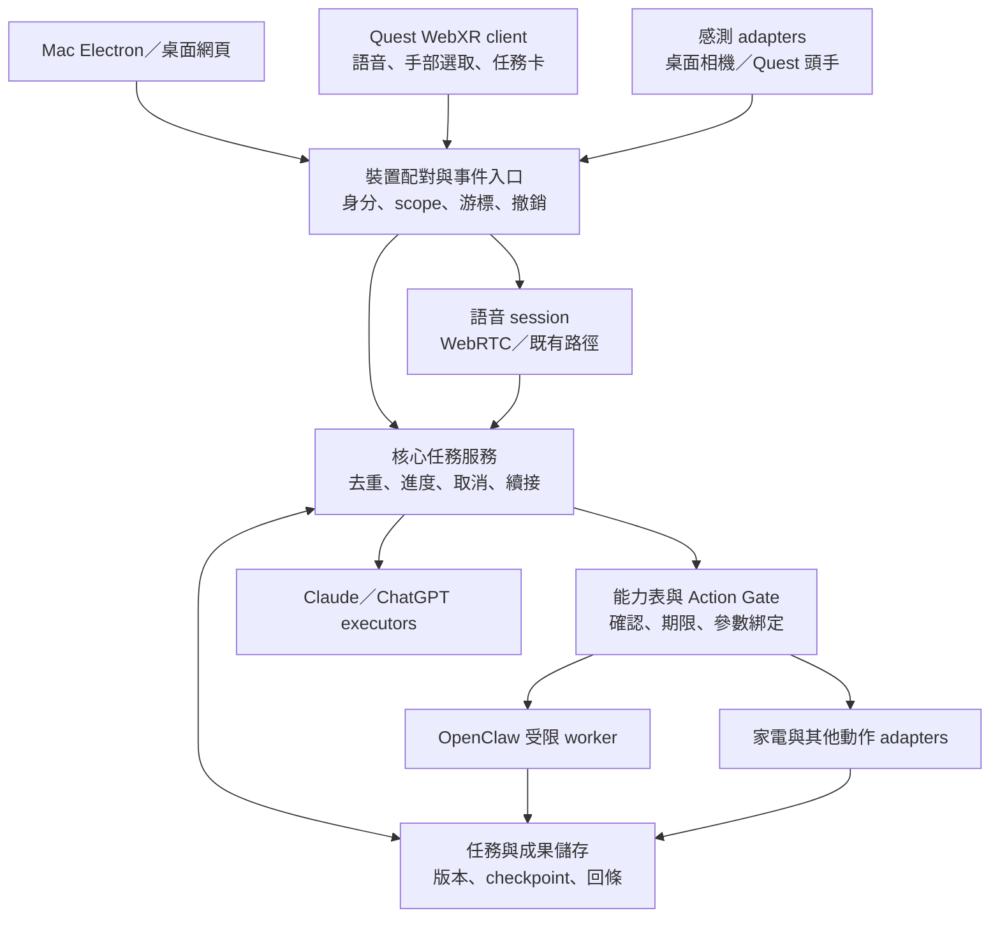

# AIOS／Nous 功能擴充評估

查核日期：2026-10-24，Asia/Taipei。對象：[pcpcchen-coder/AIOS](https://github.com/pcpcchen-coder/AIOS)。

> 發布說明：本報告以 `1f44c6b` 的程式為基準，GitHub 數量是建立本次文件 PR 前的查核快照。依使用者後續要求，報告與 [目前實作及驗證](./Current_Implementation_Status.md) 一併納入 repo，並同步更新說明文件。文件盤點已交付，F0 所提產品 CI 與其他功能仍待實作；本次不修改 runtime，也不提升 G0–G3 完成度。

**建議優先完成「同一個工作在 Mac 與 Quest 接續，成果與操作都有來源和版本」的閉環。** Claude 維持 AIOS 核心的主要開發工作，ChatGPT 負責 Quest 客戶端工程。OpenClaw 作為可替換、受限的工作執行者接入。這裡的 Claude／ChatGPT 分工是開發責任，不代表 Quest 執行時必須只用 OpenAI 模型。

本報告的標記意義如下。

- **已驗證程式事實**：本次直接讀到的主線程式、GitHub 記錄或本次執行的測試。
- **repo 記錄的實機結果**：儲存庫文件記載的既有測試，本次未重做，會保留證據強弱。
- **規劃／缺口**：文件已提出，但主線尚未提供完整實作。
- **擴充構想**：本報告建議，尚未實作。工時與驗收數值都是估計或提議門檻。

## 1. 查核基準與限制

本次主線為 [`1f44c6b384d8819e99c5d5a7689069119adf6d53`](https://github.com/pcpcchen-coder/AIOS/commit/1f44c6b384d8819e99c5d5a7689069119adf6d53)，最後提交為 2026-10-23 20:48:02 台灣時間，合併 PR #32「App 設定以選單列為主，設定頁只留帳號」。本機原先是空目錄；本次取得閱讀快照，沒有改動、提交或推送產品程式碼。

檢查範圍包含根目錄 README、AGENTS.md、CLAUDE.md，docs/01–08 與 10–12、開發及驗證文件，實際原型的前後端、共用型別、Electron 殼、測試及 CI。GitHub Issues API 的全部 32 筆記錄都是已合併 PR，沒有獨立 issue、沒有開啟中的 PR。兩個保留的 Claude 分支皆已包含在 main；`telemetry/pstack` 是觀測資料分支，不能當作尚待合併的功能。[Issues／PR 記錄](https://github.com/pcpcchen-coder/AIOS/issues?q=is%3Aissue)、[全部 PR](https://github.com/pcpcchen-coder/AIOS/pulls?q=is%3Apr)、[分支](https://github.com/pcpcchen-coder/AIOS/branches)。

因此，本報告不把「文件寫進行中」當成有人正在開發的證據。能確認的是已合併內容與仍待驗收的能力，無法從 repo 判斷 Claude 當下是否在未推送的工作目錄繼續開發。

本次以 Node.js 22.23.3 重跑既有驗證，結果為 48 個測試檔、790 項測試通過，型別檢查、前端建置、隔離的模擬任務與直接對話 HTTP 流程皆通過。另通過 pstack 固定版本與技能連結完整性檢查。這些是程式和模擬路徑證據，**沒有證明真實模型成功、Quest、麥克風、雙目精度或家電全流程已驗收**。測試方法見 [verify-aios.mjs](https://github.com/pcpcchen-coder/AIOS/blob/1f44c6b384d8819e99c5d5a7689069119adf6d53/scripts/verify-aios.mjs)。

## 2. 已實作、待驗收與缺漏

| 領域 | 已驗證程式事實 | 待驗收／缺口 |
|---|---|---|
| 電子腦與按需成果 | Canvas 2D 電子腦、六區事件動畫、Shell reducer、任務進度、Markdown 成果、收起與停止分離 | 動畫代表應用事件，不代表模型內部神經活動；正式 G0 沒有因此自動通過 |
| 執行核心 | Node HTTP＋SSE、TypeScript、Claude／ChatGPT／mock 切換、併發佇列、取消及重試 | 不是 Python kernel；Claude 用 Anthropic Messages SDK，尚無通用 Agent SDK 工作流與本機檔案工具 |
| 任務與成果保存 | 本機 JSON 持久化，可在重啟後喚回已保存任務與成果 | 未完任務重啟後標成 failed；retry 整單重做；缺 checkpoint、提交去重、可更新成果版本 |
| 桌面 App | Electron 殼、選單列、設定、簽章相關程式與權限處理 | Tauri／React 是規劃架構，不是目前產品實作 |
| 對話與語音 | 瀏覽器 STT／TTS、插話邏輯；WebRTC 即時語音有 API key 與 ChatGPT／Codex 兩路徑 | 一般對話歷史只在頁面記憶體；語音切裝置與失聯恢復未提供；兩路徑能力不同 |
| 工具 | 搜尋、背景交辦、家電查詢與控制；API key 語音路徑可設定遠端 MCP | ChatGPT live 路徑沒有 MCP；家電工具目前只在即時語音中提供；缺所有入口共用的能力註冊與通用 Action Gate |
| 感測 | 左右影像切分、MediaPipe Pose／手勢、presence、距離估計、頭向、張掌停止播報、手臂指向三區、靠近放大 | 距離使用名目幾何，沒有實測雙目校正；面向不是眼動；準確率與環境適用範圍未實測 |
| 智慧家庭 | H0 查詢、H1 一般設備控制、H1b AIFA／紅外線路徑 | H2 範圍權杖與設備政策、H3 房間群控、H4 背景 MCP 工作尚未開始；AIFA／IR 沒有設備回讀 |
| Quest／VR | 第一方目錄與程式搜尋未見 Quest、WebXR 客戶端或建置專案 | 需要新輸入 adapter、XR renderer、配對傳輸與實機驗收 |
| OpenClaw agent | 語音、OAuth、sideband、問候的註解與常數參考 OpenClaw | 沒有 OpenClaw Gateway adapter、agent run 對應或 worker 整合 |
| 長期記憶／知識 | 任務與成果已有保存 | 不能視為個人長期記憶；Markdown 記憶＋SQLite 索引、知識圖譜、技能晉升皆未完整實作 |
| 呈現政策／提醒 | 目前只支援 `user_request`、`action_confirmation` 的確定性檢查 | 訂閱提醒、背景主動浮現等理由尚不支援；不能直接加常駐任務牆 |

程式依據：[原型說明](https://github.com/pcpcchen-coder/AIOS/blob/1f44c6b384d8819e99c5d5a7689069119adf6d53/prototype/ambient-shell/README.md)、[核心組裝](https://github.com/pcpcchen-coder/AIOS/blob/1f44c6b384d8819e99c5d5a7689069119adf6d53/prototype/ambient-shell/server/nous.ts#L47)、[任務保存](https://github.com/pcpcchen-coder/AIOS/blob/1f44c6b384d8819e99c5d5a7689069119adf6d53/prototype/ambient-shell/server/store.ts#L24)、[呈現政策](https://github.com/pcpcchen-coder/AIOS/blob/1f44c6b384d8819e99c5d5a7689069119adf6d53/prototype/ambient-shell/src/presentation-policy.ts#L16)、[家電批次現況](https://github.com/pcpcchen-coder/AIOS/blob/1f44c6b384d8819e99c5d5a7689069119adf6d53/docs/12_SmartHome_Integration_Plan_2026-10.md#L127)。

### 不能忽略的文件落差

查核基準 `1f44c6b` 中，根 README 與 docs/08 仍把 repo 描述成主要只有設計，已落後實作。當時原型 README 說 live 語音尚未真帳號驗證，但較新的驗證紀錄已有部分 Mac 實機結果；本次文件更新已同步更正入口與歷史效力。因此，實作現況以主線程式判定，產品規則沿用 CLAUDE.md 與相關規格，驗收則逐項讀取新紀錄，不能挑其中一份文件概括全部。

repo 記錄的實機結果是：Mac 的 Codex 登入、通話、sideband 曾正常；溫度查詢在修正 `client_version` 後由使用者口頭回報成功，沒有截圖、延遲量測，其他測項和計費對照仍未完成。家中開關燈也有口頭確認，AIFA／紅外線完整實機結果尚缺。這屬「部分流程已有使用者驗證紀錄」，不是整套語音／家電驗收完成。[live 語音實機紀錄](https://github.com/pcpcchen-coder/AIOS/blob/1f44c6b384d8819e99c5d5a7689069119adf6d53/docs/validation/live-voice-2026-10-23.md#L121)、[智慧家庭狀態](https://github.com/pcpcchen-coder/AIOS/blob/1f44c6b384d8819e99c5d5a7689069119adf6d53/docs/12_SmartHome_Integration_Plan_2026-10.md#L3)。

## 3. 擴充方向與優先序

差異化應落在四個能親自操作的能力：工作跨裝置接續、以指向與語音修改同一份成果、工具執行有可核對回條、使用者擁有並能修正的記憶。Quest 讓這些能力具有空間互動價值，OpenClaw 則增加實際工作能力。單獨多一個聊天面板、3D agent 頭像或知識圖譜展示，對目前閉環的幫助較小。

以下皆為本報告構想。價值採 1–5 分，5 最高，屬對本專案的主觀判斷。工時是熟悉本 repo 的一位工程師搭配 AI，包含基本測試及文件的估計；不含硬體採購、平台審核、等待帳號權限及外部系統未具備介面的開發。分工可減少等待，不能把人時直接等同日曆時間。

| ID／次序 | 擴充項目 | 價值 | 增量工時 | 依賴 | 排序理由 |
|---|---|---:|---:|---|---|
| F0／P0 | 現況清單與產品 CI | 4 | 8–12 小時 | 無 | 先消除文件誤導，讓後續開發有共同基準 |
| F1／P0 | 共用能力、Action Gate 與操作回條 | 5 | 24–40 小時 | F0 | Quest、OpenClaw、家電共用的控制邊界 |
| F2／P0 | 可續跑任務與成果版本 | 5 | 36–56 小時 | F1 的操作識別 | 防重送、斷線與跨裝置接力的狀態基礎 |
| F3／P0 | 配對與裝置接力 | 5 | 24–40 小時 | F1、F2 | Quest 目前不能連現有 localhost 核心 |
| F4／P1 | Quest 空間成果與「這個」操作 | 5 | 32–48 小時 | F3；先接 F1/F2 契約 | 第一個明確可展示的差異化體驗 |
| F5／P1 | OpenClaw 受限 worker | 4 | 24–40 小時 | F1、F2 | 增加真工具工作，先唯讀，再開授權寫入 |
| F6／P1 | 語音擁有權、打斷與費用可見性 | 5 | 16–24 小時 | F3；可先做單機量測 | 解決兩端同時收音、雙重播音、靜音與取消混淆 |
| F7／P2 | 可修正的工作記憶與來源 | 4 | 24–40 小時 | F2 | 從能喚回成果進展到能延續工作習慣 |
| F8／P2 | 空間家電綁定與結果核對 | 4 | 24–40 小時 | F1、F4；中控 H2 | 把「那盞燈」綁到明確設備，而非模型猜物件 |
| F9／P2 | 感測可信度與穿戴輸入 | 3 | 24–40 小時 | F1；F4 可選 | 將現有感測做可靠，再加 IMU／BLE 輔助 |
| F10／P3 | Quest 視覺工作導引 | 3 | 40–80 小時 | F4、F9；原生相機 spike | 能力新且有價值，但權限、辨識與隱私成本最高 |

F0–F4 共 124–196 小時。若把 F5、F6 一起納入首輪，合計 164–260 小時。這是工作分解估計，不是已完成相似工作後量到的交付速度。

## 4. 各功能的 MVP、整合與驗收

### F0：可查核的現況與產品 CI

MVP 是一份由程式／測試／實機紀錄連結組成的 feature status，分開「有程式」「fixture 通過」「實機通過」。在根 README 更正 Node／Electron 原型現況；將 docs/08 的 10 月初快照標為歷史資料，保留原始決策背景。

整合現有 `scripts/verify-aios.mjs`，新增針對原型變更的 CI。現有 `.github/workflows/` 主要查 pstack recorder 與公開匯出，不能當成應用程式每次提交都驗過。風險是把原型測試全綠誤寫為 G0–G3 完成。驗收為一個原型程式變更能觸發型別、測試、建置及 mock journey；真實硬體欄位沒有證據就保持待驗。

### F1：同一套能力政策與可核對的操作回條

MVP 先把 `home_status`、`home_control`、`delegate_task` 做成核心共用能力，文字、語音、Quest 都提交相同結構的 intent。政策支援 allow／confirm／off，依使用者既有授權及動作影響判定，不要求所有可逆操作都重問。

整合點為 `server/nous.ts`、`server/app.ts`、`server/home-bridge.ts`、`src/realtime-tools.ts`。目前 renderer 參與工具分派，先將自有工具的執行與提交紀錄收回 server，renderer 留感測、畫面及確認輸入。遠端 MCP 已有自己的核准路徑，須另以契約測試維持，不能宣稱一次搬移就管住所有第三方工具。

現況細節：HomeBridge 已有確認卡機制，但 `policyFor` 預設 allow，`nous.ts` 沒有注入設備政策；docs/12 也明示 H1 預設直接執行、H2 才接設備 voice 政策。這不是「完全沒有安全措施」，而是尚未完成共用政策邊界。[HomeBridge](https://github.com/pcpcchen-coder/AIOS/blob/1f44c6b384d8819e99c5d5a7689069119adf6d53/prototype/ambient-shell/server/home-bridge.ts#L958)。

回條分開記錄「未送出、送出／受理、設備確認、失敗、結果未知」。驗收包括舊版／過期確認被拒，模型回傳 `approved:true` 不能放行，同一 intent 重送不多執行，逾時不被改成成功。若接 OpenClaw，限制必須落在它真正呼叫工具的地方；僅在 AIOS 顯示確認卡，阻止不了獨立 worker 已自行送出的命令。

### F2：關頁、重啟後仍能接續同一份工作

MVP 選一個三步研究或文件整理任務，持久保存每一步的輸出、來源、狀態與工具回條；重啟後從已完成步驟之後繼續。成果支援 version 1 → 2，以及可查的差異。

整合 `TaskStore`、`TaskRunner`、`Executor`。以儲存介面逐步替換 JSON，SQLite transaction 用於 task、step、artifact version、action receipt 與事件序號；舊 JSON 先備份並提供一次匯入。跨步續跑要明確重構 executor 的輸出契約，不能只把 JSON 改成 SQLite 就宣稱完成。

風險是外部工具已執行、回條尚未保存時程序中斷。驗收要在每個步驟與提交邊界中斷程序，確認已完成唯讀步驟不重做；副作用狀態未知時先查核，無法查核則要求處理，不盲目重送。20 次重複提交只有一個工作，版本衝突回報 conflict，不靜默覆蓋。

### F3：Mac、Quest、手機共用工作狀態

MVP 限同一使用者、Mac 作核心、Quest 作第二端；手機先只看成果。以一次性短碼／QR 完成裝置配對，核發可撤銷且有範圍的裝置憑證；對外入口使用 HTTPS，後方仍可連 loopback 核心。不能只把 listen 改為 `0.0.0.0`。

新增 device session、事件 cursor、server snapshot、foreground lease。工作狀態屬於 server，正在顯示的成果與主動收音屬於裝置。同步 task／artifact ID、版本、使用者允許保存的摘要及目前選取；不把 API key、OAuth refresh token、原始音訊或相機影像當接力資料。

風險是兩端重複交辦、憑證外洩、斷線後舊端繼續控制。驗收為 20 次 Mac↔Quest 接力零重複任務、同一成果版本一致；撤銷裝置後不可再取資料或提交；斷網再接時補齊事件，舊確認不自動恢復。同一個 action 兩端同時確認仍只執行一次。目標是在區網健康時 3 秒內恢復狀態，需在實機量測。

### F4：Quest 的空間成果與指向追問

MVP 使用者說「把剛才三個方案拿出來」，顯示按需比較成果；以頭向或手射線高亮方案 B，再說「這個，把成本改成八十萬」。系統綁定版本、重算、顯示差異；收起後保持安靜。空間釘選只保存使用者要求的成果位置，不自動展開全部任務。

先用 WebXR＋TypeScript 建立三張大目標卡與電子腦待機。沿用 `shared/domain.ts` 的腦區資料、Shell reducer、Presentation Policy、語音介面與任務契約；XR 需新 renderer 與命中測試，既有 DOM/CSS 並不會自動變成 VR UI。初版可把現有腦動畫當材質，之後才做立體幾何。比較案例新增一個核心受控計算工具，以結構化輸入重算數值，不把模型口頭算術當驗收答案。

風險是指錯卡、追蹤丟失、版面更新後「這個」指到別項、文字不可讀。驗收以 3 個目標各 30 次共 90 次選取，提議正確率至少 90%，失追立刻取消有效指向，純注視 10 秒零動作；改版後的舊焦點不得修改新版本。選不到可改說「第二個」。另記錄 20 分鐘使用的幀時間與不適回饋，初期目標 72 FPS，約 13.9 ms／幀，未量測前不宣稱達標。

### F5：OpenClaw 作為受限 worker

MVP 只接一個研究 agent，完成「查三項資料 → 提供來源 → 產生成果」。Claude 規劃層決定何時需要 worker，AIOS 保存任務及成果，OpenClaw 返回可追蹤的 run 與結果。先禁止任意本機寫入、外寄、付款及家電控制。

新增 `WorkerAdapter`，提供 submit、observe、cancel、recover；將 worker/run ID 對應 task ID。不要把 OpenClaw 加成與 Claude 平行的模型 provider，因為它是執行環境，可以在內部使用不同模型。MVP 可先固定一個 gateway、一個已測版本、一個工作能力。

官方建議外部應用使用 Gateway WebSocket＋RPC，支援啟動、事件、等待與取消；agent run 可用 `agent` 與 `agent.wait`，並固定整合版本。這是可行的接入路線，並非 AIOS 已經接好。[OpenClaw 外部應用整合](https://docs.openclaw.ai/gateway/external-apps)、[Gateway 身份與範圍](https://docs.openclaw.ai/gateway/protocol)。

風險是 worker 繞過 Gate、回報 cancelled 但動作已完成，以及兩邊各自改寫記憶。驗收包括真 Gateway 的成功、失敗、取消、失聯重連四條路徑；只准指定能力；未知結果保留原狀；每個來源、run、產物可追到同一任務。worker 只拿當次資料包，記憶寫回要經 AIOS，不共享整個使用者目錄。

### F6：單一收音者、可分辨的停止與費用紀錄

MVP 分清「停止播報」「停止生成」「取消任務」三種命令；Mac↔Quest 交接時只容許一個主動語音擁有者。語音連線可重建，接續保存的文字情境，不承諾移轉同一條 WebRTC 連線。

沿用 `RealtimeSession`，新增 audio lease 與能力宣告。目前 live 路徑的 Esc 主要是本機靜音，不能在 Quest UI 寫成已取消模型生成。以同一套工具契約服務兩路語音，不讓聲音模型直接繞過核心政策。OpenAI 官方的 WebRTC＋server sideband 模式支持將私密工具與商業規則保留在 server。[OpenAI Docs：server controls](https://developers.openai.com/api/docs/guides/voice-server-controls?api=realtime&voice-api=realtime)。

記錄說話結束至第一段播音、工具耗時、斷線原因、route 與已收到的 usage。費用若缺單價或帳號用量證據就標未知，不能推算成確定帳單。repo 的 Codex live 使用未公開文件端點，屬整合相容性風險；保留可關閉的 adapter 與明示的計費路徑切換。

驗收為兩端零雙重收音／播報，語音交接不重交工作；張掌本機靜音 p95 提議小於 200 ms；一般無工具問答的首音延遲先收集 30 輪 p50／p95，再以 p95 2.5 秒作初步調校目標。工具請求另列，不拿長任務延遲混進一般對話。

### F7：能修正、能忘記的工作記憶

MVP 先做工作摘要、使用者明示偏好與成果來源，支援「上次決定什麼」「這項不要記」。以 Markdown 保存可讀內容，SQLite FTS5 作索引，先不接知識圖譜或向量服務。

整合 F2 的 session／artifact version。每筆記憶附來源、時間、作用範圍、版本與撤回狀態；使用者修改後，衍生索引及之後提供給 worker 的資料包一起更新。既有 repo 的記憶層 ADR 可在此落地，避免再建立另一套互相衝突的記憶庫。

風險是錯誤結論變成永久偏好、不同工作混用私密資料。驗收以 20 個固定場景測保存、喚回、衝突更正、刪除與匯出；刪除後不能在新 session 檢索回來；說「昨天方案 B」能帶回正確成果版本，沒有資料就明說。

### F8：在空間中選家電，核對實際結果

MVP 由使用者把一個虛擬標記明確綁到中控 device ID，再說「這盞調暗」。先一個房間、一盞可回讀的燈，之後才擴成 H3 群組場景。錨點與設備的對應不由視覺模型自行猜測。

整合 HomeBridge、F1 Gate、F4 目標綁定及中控 H2 設備政策。畫面顯示設備名稱、資料時間與操作回條；對 AIFA／IR 沿用「已送出，請確認」，沒有物理狀態就不畫成已成功。真正場景動作要逐台顯示結果及部分成功，IR toggle 不自動重試或補償。

風險是空間錨點漂移、重新佈置後綁錯設備、把雲端接受當實體已變化。驗收為移除／換房間後舊綁定失效；30 次操作選中正確設備；confirmed、unconfirmed、unknown 三種結果都有實例。房間群控須等中控能力及設備授權準備好，估時不包含中控缺漏開發。

### F9：感測可信度與穿戴輔助

MVP 先建立 `InputProvider`，區分 head_ray、hand_ray、eye_gaze、stereo_pose、imu 等來源，每個事件含有效時間、品質與裝置。不同 provider 的 confidence 不共用一個任意門檻。桌面先完成 AR0144 左右眼順序、實測校正與誤差測量，再評估穿戴 IMU 或按鈕作安靜模式／指向鎖定輔助。

整合 `shared/sense.ts`、`src/sense/controller.ts` 與 F1 目標政策。穿戴裝置先由 Mac companion 接 BLE，再傳最小事件，避免把 Quest 原生藍牙支援當成已知條件。不得以頭向、手勢或姿勢推定使用者身份與授權。

風險是延遲、時鐘不一致、追蹤丟失仍使用舊指向。驗收以實測距離點、明暗、遮擋、坐站與多人的測試矩陣記錄；沿用 docs/11 的距離誤差 <10%、三區 ≥90%、停止 ≥95% 作待測目標。跨裝置不直接比較兩個程序的 monotonic clock，需事件時間校準，超差就改語音編號。

### F10：看著實物完成工作導引

MVP 選一個固定工作，例如辨識指定控制面板或帶標記的組件，顯示下一步與「已觀測／待使用者確認」狀態。先做受控目標及本機辨識，避免一開始就要求理解整個房間。原始影像不落盤、不進 trace，模型若沒有影像輸入，就只能使用已輸出的結構化事件。

整合原生相機 provider、F9 感測事件與 F4 工作卡。Quest 3／3S 官方 Passthrough Camera API 提供前向相機資料，須相應 OS、權限及 passthrough 功能；顯示 passthrough 不等於 app 已能取得影像。[Meta 相機 API](https://developers.meta.com/vr/documentation/unity/unity-pca-overview/)。

風險是認錯步驟或把推測當觀測、旁人影像、相機與瀏覽器版本限制。驗收選至少 30 個已知案例及失敗案例，追蹤錯認／漏認；低品質時停止判斷，不替使用者宣布步驟成功。需要雲端視覺時，另設明確資料同意及資料最小化模式，不沿用原型「影像不外傳」規則假裝已獲授權。此功能應在前述閉環穩定後才投入。

## 5. Quest 技術路線與能力邊界

本次沒有讀到使用者 Quest 型號、韌體與 Browser 版本，因此以下是選型建議，不能當成現機相容性結果。

| 路線 | 合適用途 | 成本與限制 | 建議 |
|---|---|---|---|
| Quest Browser 的 2D 頁面 | 先驗配對、語音、成果同步 | 不是沉浸式空間成果，不能當作 VR 功能已完成 | 作傳輸與語音 smoke test |
| WebXR＋TypeScript | 空間成果卡、頭／手指向、既有 TS 邏輯重用 | 需新 XR renderer；原生相機、長期錨點及背景生命週期另驗 | F4 首選 |
| Unity＋OpenXR／Meta XR | 相機 CV、深度／場景能力、原生生命週期 | C#／Android 工具鏈、套件與平台版本成本較高，需維護跨語言契約 | F10 或明確原生需求後採用 |

Meta 官方比較表列 Quest 3／3S 為頭部與手部追蹤，沒有眼動追蹤。首版將其清楚標成「頭向／手指向」，不要寫成眼神操作。[Meta 裝置比較](https://developers.meta.com/vr/essentials/compare-devices/)。

WebXR 手部介面能提供關節與指向資訊；系統保留的 palm pinch 應避開，使用一般選取或自訂停止手勢，並保留控制器／語音編號備援。[Meta WebXR Hands](https://developers.meta.com/vr/documentation/web/webxr-hands/)。

WebXR 需要安全環境，沉浸模式開始也受使用者啟動條件限制。Quest 打開 `localhost` 指的是 Quest 自己，不能直接拿 Mac 的 `http://localhost:8787` 連線；區網 HTTP 也不應當正式語音／XR 方案。[W3C WebXR 規格](https://www.w3.org/TR/webxr/)。

相機讀圖與跨 session 錨點列為獨立 spike。已查到的 Meta Browser MR 文件區分 passthrough 顯示與像素讀取；新的原生相機文件也不能直接證明同版 Browser 可用同樣功能。先在目標機記錄權限、可列舉裝置、可取得的 frame、session 重建後定位結果，再決定留 WebXR 或增加 native adapter。[Meta Browser MR](https://developers.meta.com/vr/documentation/web/webxr-mixed-reality/)。

桌面感測也不能直接套到頭戴裝置。現有 AR0144 頭向是外部相機看使用者；Quest 的頭部 pose 是頭戴裝置在空間的方向。Quest 被摘下、session hidden／blurred 或失聯時要即刻收斂隱私與確認狀態，不沿用桌面 60 秒離席等待；實際可用的佩戴訊號由目標 runtime 驗證。

## 6. 建議架構與開發分工

本節下方將現況與目標架構分開；新增的模組名稱是設計提案，不是 repo 已存在路徑。

AIOS 已有可用的桌面原型骨架。下一步最有差異化的方向，是讓使用者在 Quest 交辦工作、轉到 Mac 繼續查看，並能追溯每次外部動作的授權與結果。電子腦、語音和感測可成為同一項任務的入口。任務本身必須獨立於畫面和通話存活。

目前 `startNous()` 組裝模型、任務、語音、家電橋接與 HTTP 服務。`TaskRunner` 執行任務，`TaskStore` 保存任務和 Markdown 成果，前端透過事件接收更新。這條主線適合延伸，沒有足夠理由先重寫 Tauri 或 Python。[組裝入口](https://github.com/pcpcchen-coder/AIOS/blob/1f44c6b384d8819e99c5d5a7689069119adf6d53/prototype/ambient-shell/server/nous.ts#L47)。

已有 JSON 持久化。真正缺少的是執行中斷後續跑、步驟 checkpoint、成果版本與重複請求去重。現在重啟會把未完成任務標為失敗；重試會建立新任務並從頭執行。成果版本固定為 `1`。跨裝置之前，應先補足這些語意。[任務生命週期](https://github.com/pcpcchen-coder/AIOS/blob/1f44c6b384d8819e99c5d5a7689069119adf6d53/prototype/ambient-shell/server/runner.ts#L68)、[儲存行為](https://github.com/pcpcchen-coder/AIOS/blob/1f44c6b384d8819e99c5d5a7689069119adf6d53/prototype/ambient-shell/server/store.ts#L24)。

建議由核心擁有任務、授權和執行回條。語音通話與 Quest 畫面只提交意圖和呈現狀態。這能解決目前工具生存期受頁面連線影響的問題，也讓「通話結束，工作繼續」成為可驗收功能。

保留目前結構即可啟動。`server/runner.ts`、`store.ts` 擁有任務與成果；`server/providers.ts` 和 executor 檔案承接模型；`server/realtime-*`、`live-*` 管理通話；`shared/` 定義版本化契約；`src/sense/` 維持裝置感測轉換。Quest client 應獨立於 Electron，透過同一核心契約接入。

以下是建議目標架構。裝置配對、通用 Gate、OpenClaw adapter 與 Quest client 尚未實作。

### 建議先定案的資料契約

| 契約 | 最少資料與責任 |
|---|---|
| `FocusEvent` | device、provider、target ID、surface、artifact version、viewport revision、有效時間與品質。高亮不執行；語句開始鎖定目標；換版即失效 |
| `ActionIntent` | intent/action ID、user/workspace、能力、目標版本、當次請求、授權範圍、期限、idempotency key。由 server 判政策，不接受模型自報已授權 |
| `ActionReceipt` | 對應 intent、送出識別、時間、外部狀態、觀測來源及確定性。逾時不刪掉，未知不等於失敗或成功 |
| `ContextCapsule` | session、task、artifact ID/version、選取、同步 cursor、使用者允許的摘要。與 provider audio session 分開；不包含長效供應商憑證 |
| `WorkerJob` | adapter、run ID、能力清單、輸入引用、deadline、狀態、來源與產物引用。取消回條與已發生副作用分開 |

第一輪不必為這些契約重建整個 monorepo。先在現有 `shared/` 設立有 runtime 驗證的版本化邊界；需要 Python 或 C# 客戶端時再由同一 schema 產生型別。F1–F4 通過之後，才依實際維護成本決定搬到 `packages/`、更換 Tauri 或引入 Python。

| 負責端 | 建議範圍 | 交付邊界 |
|---|---|---|
| Claude 主線 | 核心能力、任務／成果保存、Gate、裝置認證、OpenClaw、家電政策 | 提供固定版契約、測試資料與變更說明 |
| ChatGPT／Codex Quest 端 | WebXR renderer、輸入 adapter、語音生命週期、空間命中、隱私與效能驗收 | 消費契約；不自行重建任務／記憶核心 |
| 共同維護 | 版本化 schema、端到端驗收案例、來源與回條語義 | 同一 feature ID、同一驗收資料包與失敗預期 |

## 7. Roadmap 與決策門檻

以新 gate 命名 Q0–Q4，避免把原規格 G0–G3 誤標通過。日期採本次之後的相對階段，不重用 docs/08 已過時的開工日。假設每週投入 20–25 小時，按估時上限安排；實機阻塞另算。

| 階段 | 工時 | 預計週期 | 可觀察交付與放行條件 |
|---|---:|---|---|
| Q0：可信的開發基準 | F0＋F1，32–52 小時 | 約 2–3 週 | 現況文件、產品 CI、共用能力與回條；確認／重送／未知結果案例通過 |
| Q1：工作可回復、裝置可配對 | F2＋F3，60–96 小時 | 約 3–5 週 | 先 Mac＋第二瀏覽器做持久化與接力；斷線、重啟、重複 action 與撤銷裝置通過 |
| Q2：Quest 完整小閉環 | F4，32–48 小時 | 約 2–3 週 | 真 Quest 喚回三方案、指向調參、保存、回 Mac 喚回；按需顯示與失追備援通過 |
| Q3：真工作與自然對話 | F5＋F6，40–64 小時 | 約 2–4 週 | 真 OpenClaw 唯讀工作、兩端語音交接、首音與停止量測；沒有越權工具與雙重收音 |
| Q4：依使用率選一項 | F7、F8、F9 各自 24–40 小時 | 每項約 1–2 週以上 | 使用者需要的記憶、空間家電或感測輔助；一次只驗一個功能 |

Q0–Q2 的純工時換算約 5–10 個投入週；分階段留驗收與整合空間，建議日曆預留約 7–11 週。加 Q3 的純工時約 7–13 週，日曆規劃約 9–15 週。這些不是保證日期，若 Claude 與 Quest 端平行工作，應優先重疊 adapter／renderer，核心狀態與授權仍依序通過。

第一個展示流程固定為以下步驟。

1. Mac 用真實模型完成三方案比較，保存來源與 artifact version 1。
2. 使用者戴 Quest、完成一次性配對及 XR 啟動，說「把剛才那份拿出來」。
3. Quest 顯示相同 task/artifact，頭向或手射線選 B，使用者說出修改參數。
4. 核心核對版本，產出 version 2 與差異，Quest 只依真事件呈現進度。
5. 使用者收起，背景工作不取消；回 Mac 說「看剛才修改」，取得相同 version 2。
6. 重做一次斷線、一次舊焦點、一次雙端同時提交，確認不改錯、不重做、不假成功。

先不投入全房間數位孿生、任意 agent 市集、自由生成程式直接執行、全量知識圖譜、跨所有裝置常駐喚醒，也不先同時重寫成 Python＋Tauri。這些會擴大能力和維護範圍，卻不能代替上述閉環。

## 8. 仍需真機與帳號回答的問題

- 目標 Quest 型號、OS、Browser 版本與 controller／hand input 支援，不能從 repo 判定。
- 真 Quest 的麥克風、WebRTC、文字可讀性、持續使用耗電與溫度，尚無本次量測。
- OpenClaw 實際安裝版本、gateway 權限及欲開放工具，尚未盤點；本次只驗官方接入文件。
- AR0144 真校正、左右眼順序與多人／暗光表現，不能由合成測試推論。
- ChatGPT／Codex live 的完整計費與失敗切換，repo 僅部分實機紀錄，仍要用帳號用量對照。
- 中控 H2、家電實體回讀與房間群控依賴，需要同時看中控專案才可承諾完整交付工時。

以上不影響先開展 F0–F2，也不需要為初期成果顯示先取得原始相機影像。
