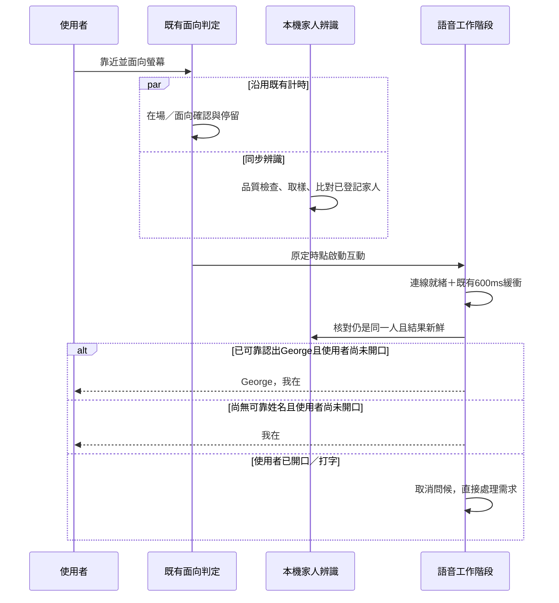

<!-- bilingual: source=zh-TW -->

> [繁體中文](14_Family_Recognition_and_Greeting_Plan_2026-10.md) | [English](14_Family_Recognition_and_Greeting_Plan_2026-10.en.md)

# Recognize enrolled family members nearby and greet by name after interaction begins

Date: 2026-10-24. Status: planned; **ID-00 partially delivered**: [ADR-0001 draft](adr/ADR-0001-local-family-recognition.en.md) plus a runtime spike disconnected from the product ([validation record](validation/family-id-00-spike-2026-10-24.en.md), cloud CPU / WASM measurements only). ID-00 release conditions await Mac + AR0144 testing. **ID-01 has code, with cloud validation only** (2026-10-25, branch `claude/family-id-01`, [validation](validation/family-id-01-2026-10-25.en.md)): enrollment, deletion, and trial recognition are available inside the “Family recognition” screen opened from the macOS App menu bar. Features are encrypted with a safeStorage-wrapped key. Recognition operates only in that screen. **Thresholds are uncalibrated.** On 2026-10-25, George tested enrollment, trial recognition, and palm stop successfully on Mac, and selected YuNet 2023mar 640. **ID-02 has code, with cloud fixture validation only** (2026-10-25, branch `claude/family-id-02`, [validation](validation/family-id-02-2026-10-25.en.md)): the macOS App recognizes concurrently during look-to-talk's facing wait. At voice readiness +600 ms, the core decides whether to include a name and selects a short opening from a fixed list (George requested more variation on 2026-10-25, such as “George, I'm here,” “Hi, George,” “Good morning, George,” or “I'm here,” based on local time and avoiding the previous choice). Both voice routes use the core-selected sentence. George chose to **enable named greetings before threshold calibration**, with honest uncalibrated labeling. Named greetings default on and can be turned off. The browser says only “I'm here.” Actual audio and model verbatim compliance (I12) await Mac tests. Threshold calibration belongs to ID-03. Code review baseline: AIOS main `96297c0d4d948da2297d233809398a2e5a0ee938`.

Added to the repo at the user's request. Entry points are the [document index](README.en.md) and [current implementation status](Current_Implementation_Status.en.md). At planning publication (`5af2c24`), only planning and navigation changed. No recognition code or family data was added, and no hardware gate passed. See the status above for subsequent ID-00 progress.

This plan runs face recognition concurrently with the existing look-to-talk facing wait. Recognizing a familiar person creates only a short-lived name candidate. Only after the user meets the configured facing condition, begins interaction, and voice becomes ready does the system say “George, I'm here.” Do not delay conversation to obtain a name.

## 1. Confirmed product direction

- Initially support family members who explicitly enroll, with one interacting person in scope.
- Recognition does not immediately greet, reveal personal information, or execute actions.
- Reuse the existing facing delay for concurrent recognition. Add no mandatory recognition countdown.
- Say “George, I'm here” when recognition is reliable, otherwise “I'm here.”
- If the user speaks or types first, handle the request directly without interrupting with a greeting.
- Identity is only for addressing people. It cannot unlock private data or authorize external actions.

This batch first integrates the existing camera `look_to_talk` activation route. When look-to-talk and audio consent are enabled, reaching the facing dwell threshold is the existing interaction trigger. Button, voice-command, and `user` routes after the consent explanation currently do not greet automatically. Retain that behavior. If button activation later gains named greetings, integrate the same decision separately. Do not silently expand “greet first during look-to-talk” to every entry point.

## 2. Exact meaning of the existing delay

The code determines whether the head faces the display, not precise eye gaze. The following are source constants and setting values, not hardware measurements from this batch.

| Interval | Existing value | Purpose |
|---|---:|---|
| Initial presence confirmation | 500 ms | Enter present only after continuous person detection |
| Facing confirmation | 300 ms | Filter brief head turns |
| Subsequent facing dwell | Default 1200 ms | Configured 1.5 seconds minus 0.3-second facing confirmation |
| Voice connection | Variable | Establish the voice session, depending on route and network |
| Greeting buffer after voice readiness | 600 ms | Let the user speaking first cancel the greeting. Separate from the facing delay |

For someone already present, the designed facing delay is about 1.5 seconds. For someone entering the frame while already facing the display, the existing processor waits for presence first, giving a theoretical 0.5 + 0.3 + 1.2 = 2 seconds before voice connection begins. Sensing updates about every 80 ms and the controller about every 200 ms, adding scheduling error.

Face sampling starts when recognition is enabled, distance is near, and a valid face and camera are available. It runs concurrently with the above flow. Cold model startup or slow recognition does not change voice timing or the configured facing seconds.

The model may continue gathering evidence for the same tracked subject during connection. A late result must not trigger another greeting or assign a newly arrived person to an earlier interaction.

## 3. Identity candidate and greeting rules

Recognition and greeting have separate lifecycles. Recognition reports `matched`, `unknown`, `ambiguous`, or `unavailable`. Greeting retains `pending`, `sent`, and `skipped`. Successful recognition must not directly start playback.

Each attempt retains tracking ID, tracking generation, result time, last-seen time, model version, and enrollment-data version. Only `matched` can carry an enrolled person ID. Other states have no usable name.

Create an interaction ID in `startRealtime` and bind the current tracked subject. Before actually sending a greeting, check:

1. The same interaction and tracking generation remain valid.
2. Exactly one usable participant is present, without replacement, multiple people, or tracking ambiguity.
3. The person remains near and facing the display, with adequate face quality and fresh evidence.
4. The person ID still exists in enabled enrollment data, and its version has not been deleted or revoked.
5. Greeting remains enabled, with no prior send or cancellation in this interaction.
6. The user has not spoken, typed, dismissed the view, disabled the camera, or ended interaction.

If any naming condition fails, remove the name without blocking ordinary conversation. If the user already provided input, cancelled, or disabled greeting, omit the greeting entirely.

| Situation | Expected result |
|---|---|
| George is recognized during the facing wait and interaction starts normally | “George, I'm here” |
| George is recognized before interaction starts | Remain quiet |
| Unknown person, inadequate quality, unloaded model, or recognition timeout | If interaction starts as scheduled, say only “I'm here” |
| Recognized, but the user speaks or types first | No greeting. Handle the request directly |
| Model recognizes after the generic greeting | No later name in this interaction |
| George leaves and another person approaches | Clear name and old dwell, then reassess. Do not inherit George's wait |
| Multiple faces appear | No name. Do not choose the largest or nearest face. Ordinary interaction may use a generic greeting |
| The family member is deleted during wait / connection | Revoke naming eligibility before sending |
| Live fails and falls back to the API-key route | Share greeting state within the interaction, initiating at most once |
| Consent explanation appears initially and the user agrees much later | Invalidate the old identity candidate. Retain existing `user` startup without suddenly using the old name |

PresenceTracker currently requires 60 seconds without a person before marking absence. This interval must not maintain identity. Use separate short tracking-expiry rules. Unknown, camera-off, and lost-tracking states must not retain the previous name.

Speaking-first cancellation also differs by route: API-key uses speech-start events, while live uses user transcripts. The existing 600 ms does not guarantee timely reporting of all speech. Hardware tests must compare original audio and event times. If interruptions remain common, add local voice activity as a cancellation source. Missing transcripts do not establish that the user has not spoken.

## 4. Recognition scope and adjustable parameters

Initially use one eye of the AR0144 image for local detection, alignment, and feature matching. Full recognition on both eyes is unnecessary. Share the existing image source to avoid a second camera acquisition. Candidate models are YuNet + SFace. First spike runtime, model versions, licensing, and packaging feasibility. Do not claim compatibility during planning.

The following are measurement starting points, not accuracy guarantees or security-certification thresholds:

| Parameter | Proposed starting point | Basis for adjustment after measurement |
|---|---|---|
| Nearby recognition zone | About 0.6–1.5 m | Camera resolution, face width, and distance-estimate quality |
| Face width | Attempt naming at roughly 100 px or more | False matches on side views, lighting, and held-out data |
| Sampling frequency | About 4 Hz, at most one pending inference | Per-inference duration and existing sensing load |
| Stable evidence | At least 3 distinct frames over at least 500 ms, all identifying the same person | Measured familiar / stranger distributions |
| Match freshness | No older than 1 second before greeting, with continuous visibility of the same person | Head-turn, occlusion, and replacement tests |
| Tracking break | Revoke the candidate after about 500 ms without continuous confirmation of the same face | Never retain old identity to raise recognition rate |

Stereo distance lacks actual calibration and cannot be treated as a precise security boundary. This version uses a conservative generic greeting when distance is unknown. Inadequate face quality must not force a match. Calibrate similarity thresholds against held-out samples outside enrollment and against strangers. Do not copy model-example constants directly.

A 0.5-second facing setting may leave insufficient naming evidence. Start normally anyway. A 5-second setting provides more existing sampling time without expanding data retention. Preload models after feature enablement. Background inference must not block the existing 80 ms sensing loop.

### 4.1 Face recognition calibration (2026-10-31)

During the ID-02 Mac test George found that names were usually spoken while seated (about 0.8–1.0 m), while standing (about 1.3–1.7 m) no frame found a face at all, because the camera was angled for the seated position and the face left the top of the frame. When the camera is moved or tilted, the starting values above must change with it, so this became a feature of its own, "Calibrate face recognition".

- **Entry**: menu bar "Camera and voice settings → Calibrate face recognition…", or the "Calibrate face recognition" button in the Family recognition view. It shares the family recognition management session (it can only open within 10 seconds of the menu-bar click).
- **Flow**: go to three places in turn (where you usually sit, where you stand to talk, the farthest place you still talk from; each can be skipped) and face the screen for about 6 seconds at each. The view shows the camera image, distance, facing and the quality reason of each frame; when family members are enrolled, a trial reports "recognised / not recognised" (never who or a score).
- **Result**: for each place, the distance, face-seen, good-quality and facing ratios with advice (for example "Your face often goes above the top of the frame: tilt the camera up a little"), plus a suggested set of values. They are saved only when the user presses "Apply"; "Restore defaults" is also available.
- **Adjustable values and ranges** (`shared/face-tuning.ts`, saved in configDir `face-tuning.json`, HTTP `POST /api/settings/camera-tuning`):

| Setting | Default | Range | Effect |
|---|---|---|---|
| Nearest / farthest recognition distance | 0.6 / 1.5 m | 0.3–1.5 / 0.8–2.5 m, at least 0.3 m apart | Near range for ambient recognition (`AMBIENT_NEAR_M`) |
| Facing-the-screen tolerance | 0.2 | 0.1–0.35 | Facing detection; also affects look-to-talk |
| Grace for brief glances away | 800 ms | 0–3000 ms | How long the face may turn away during an interaction without resetting recognition |
| Minimum face size | 100 px | 60–160 px | Quality limit for look-to-talk (enrolment still uses 100 px) |
| Turned-face tolerance | 0.2 | 0.1–0.3 | Quality limit for look-to-talk (enrolment still uses 0.2) |

- **Unchanged boundaries**: the matching threshold (`MATCH_THRESHOLDS`) and evidence rules are not calibrated; enrolment keeps the default quality limits. Measurements are numbers only (face width, angles, brightness, which frame edge the face touches, distance, facing or not) — no images, coordinates, landmarks or scores — kept in memory only and discarded when the view closes. The worker returns these measurements only when calibration asks for them.
- **How suggestions are computed** (`src/face-calibration.ts`, using only places where a face was seen): the distance range covers the nearest usable place minus 0.15 m to the farthest usable place plus 0.25 m; the minimum face size is the 20th percentile of face width × 0.9 (at most 100 px); the turned-face tolerance is the 80th percentile of yaw + 0.03 (at least 0.2); a low facing ratio while present loosens facing detection and the glance grace.

## 5. Enrollment, storage, and data scope

Explicitly start enrollment from unlocked, administrable local settings, choose a name, and provide multiple-angle samples. Saying “I am George” to the camera alone must not overwrite an existing person. Plan for 2–5 family members initially. Unenrolled people remain unknown.

Raw images are processed briefly in local memory without storage, traces, or cloud upload. Persist versioned, deletable, encrypted recognition features and person profiles. Features are sensitive identifying data, not anonymous data. Deletion, disabling, and camera-off clear candidates in the worker and active greeting. Generation checks must reject delayed inference results too.

With cloud voice, the spoken name becomes short-sentence text received by the voice provider. Explain this at enablement and offer “recognition enabled, but no names in cloud voice.” This does not authorize uploading face images, features, or lists of other family members.

Existing `numPoses: 1` cannot prove that only one person appears. New face detection must explicitly report face count and tracking reliability. The first version does not automatically transfer control between multiple identities, use voiceprints, recognize Quest-obscured faces, or provide secure photo/video anti-spoof authentication.

## 6. Required changes to both voice routes

The API-key route currently consumes instructions from `GreetingOnce.take()`. ChatGPT live sends fixed `LIVE_GREETING_TEXT` from the frontend, while the server ignores client text and sends its own fixed sentence. Changing only a frontend constant or `GreetingOnce.instructions` cannot enable named greetings on both routes.

Add structured `GreetingDecision`, carrying interaction ID, person ID or no name, tracking generation, evidence, and enrollment version. The core checks the person ID, obtains an allowed spoken name from managed person data, and builds a restricted greeting. Limit name length and reject control characters, markup, and instruction injection. Do not trust arbitrary client prompts.

Both routes share greeting decisions and once-only state. Familiar-person target text is “George, I'm here”; unknown is “I'm here.” A name is a low-trust personalization signal, not a login credential. The core must not restore names after named greeting is disabled or its data revoked.

Realtime voice models may rewrite text. A “read verbatim” prompt does not guarantee a fixed sentence. Acceptance must inspect actual transcripts and playback on both routes. A route that adds speech, guesses names, or repeats cannot pass. It must instead use deterministic-text TTS with shared playback exclusion and speech-first cancellation. That alternative requires additional voice-change and playback-latency measurement.

## 7. Code integration points

The following were proposals at planning time, extending the prototype rather than rewriting the core or voice system. See [ADR-0001](adr/ADR-0001-local-family-recognition.en.md) §2.1.1 and §11 for actual ID-01 / ID-02 locations, such as matching and sentence composition in `server/identity-service.ts` and concurrent sampling in `src/sense/identity-ambient.ts`.

| File / module | Planned responsibility |
|---|---|
| New `shared/identity.ts` | Versioned types for people, recognition state, evidence validity, and greeting decisions |
| New `src/sense/identity-worker.ts` | Local-model preload, detection and matching, bounded sampling, and cancellation |
| `src/sense/pipeline.ts` | Share frames with identity while retaining pose / gesture flow and privacy boundaries |
| `src/sense/controller.ts`, `trackers.ts` | Run with the facing delay. Reset candidates and accumulation on person change without extra wait |
| `src/main.ts` | Create interaction IDs, bind current tracking source, revoke candidates on cancellation |
| `src/realtime-session.ts` | Read decisions before `GreetingOnce` sends. Preserve at-most-once across routes |
| `src/realtime.ts`, `src/live-voice.ts` | Use shared decisions, retaining cancellation on speech, typing, closure, and end |
| `server/live-route.ts`, `server/realtime.ts` | Generate short sentences from managed names, retaining text-length, packet-splitting, and arbitrary-prompt rejection boundaries |
| New core person / feature storage | Enrollment, disabling, deletion, encryption, and model-version management, locally administrable only |
| `tests/camera-privacy.test.ts` and voice tests | Explicit boundaries for restricted local inference. Do not remove existing protection or expand permission to the whole frontend |

Whether a pure browser can provide equivalent encrypted storage and restricted-worker boundaries needs a spike. Complete the first loop on Electron if necessary. Unsupported browsers explicitly disable recognition while retaining ordinary conversation.

## 8. Acceptance and failure cases

| ID | Required observable result |
|---|---|
| I1 | A familiar person present without interaction causes zero greetings and zero private views |
| I2 | Recognition runs concurrently with facing timing. Scheduled activation does not wait for models, matching, or disk IO |
| I3 | Valid familiar evidence speaks only the correct name once. Unknown, multiple, expired, or low-quality cases omit names |
| I4 | Speaking or typing first cancels greetings on both routes, without greeting after the answer |
| I5 | Replacement, turning away, missing face, camera-off, degraded sensor, or model errors never retain an old name |
| I6 | Live→API-key fallback initiates at most one greeting per interaction. Unknown send status never causes blind resubmission |
| I7 | Facing times of 0.5, 1.5, and 5 seconds add no recognition wait. Extra image work does not slow the existing stop gesture |
| I8 | Delayed consent, setting-off, deletion, and late inference never cause sudden naming |
| I9 | Deleted people remain unusable after restart, worker reconstruction, and new sessions |
| I10 | Packet and file checks show no raw-image persistence, unencrypted-feature persistence, or image/feature egress. Only allowed encrypted features persist, and cloud receives only allowed short sentences |
| I11 | Names with newlines, special markup, excessive length, or instructions are rejected and cannot become voice-model instructions |
| I12 | Both routes actually speak fixed short sentences. Successful fixture text does not replace audio measurement |

First test races using fake clocks, synthetic identity events, and fake inference results, permanently labeled fixtures. Then validate real recognition against voluntarily enrolled family members' held-out samples.

Hardware tests cover at least 0.8, 1.0, and 1.5 m, light/dark conditions, glasses, front / slight side views, plus strangers, interleaved people, photos, and phone playback. Initial quality targets are ≥95% successful familiar-person naming under tested conditions and zero incorrect names in 100 stranger interactions. These are MVP thresholds. A small zero-error sample does not establish security certification or a universally zero error rate. Report rejection, false-match, and unrecognized rates together, not only overall accuracy.

Record facing start, presence confirmation, interaction activation, voice readiness, greeting decision, and actual first-audio times. Separate local-recognition duration from network / voice latency. Compare activation delay and existing sensing load with recognition off versus on, not merely the presence of new timers.

## 9. Delivery batches and effort

These engineering estimates assume one repo-familiar engineer assisted by AI, at 8 hours per person-day, excluding waits for people and hardware procurement. They are not measured local-recognition implementation results.

| Batch | Delivery and release conditions | Estimate |
|---|---|---:|
| ID-00 | Draft ADR, data lifecycle, camera / runtime spike, and evidence on usable samples and performance within the existing delay | 1–2 person-days |
| ID-01 | Enrollment / deletion, encrypted features, local recognition, quality and invalidation states. Unknown must not be forced to a person | 2–3 person-days |
| ID-02 | Parallel delay, interaction binding, core short sentences, both greeting routes, all cancellation / fallback fixtures | 1–2 person-days |
| ID-03 | Real camera, family held-out samples, real voice on both routes, privacy and replacement-failure acceptance | 1–2 person-days |

Total: about 5–9 person-days, or 40–72 hours. If models cannot reliably read verbatim, separate TTS is needed, or existing camera quality is inadequate, estimate additional work separately without promising an exact completion day.

Have Claude's core side complete ID-00 through ID-02 first. ChatGPT / Codex can independently review timing and acceptance. Defer Quest and voiceprints to keep this nearby-name MVP bounded.

## 10. Review sources and delivery boundary

- [Existing facing, presence, and dwell timing](https://github.com/pcpcchen-coder/AIOS/blob/96297c0d4d948da2297d233809398a2e5a0ee938/prototype/ambient-shell/src/sense/trackers.ts)
- [Composition requiring present before facing](https://github.com/pcpcchen-coder/AIOS/blob/96297c0d4d948da2297d233809398a2e5a0ee938/prototype/ambient-shell/src/sense/processor.ts)
- [Interaction activation and greeting object](https://github.com/pcpcchen-coder/AIOS/blob/96297c0d4d948da2297d233809398a2e5a0ee938/prototype/ambient-shell/src/main.ts#L709)
- [GreetingOnce and 600 ms after readiness](https://github.com/pcpcchen-coder/AIOS/blob/96297c0d4d948da2297d233809398a2e5a0ee938/prototype/ambient-shell/src/realtime-session.ts)
- [Live frontend fixed greeting](https://github.com/pcpcchen-coder/AIOS/blob/96297c0d4d948da2297d233809398a2e5a0ee938/prototype/ambient-shell/src/live-voice.ts#L306) and [server fixed greeting](https://github.com/pcpcchen-coder/AIOS/blob/96297c0d4d948da2297d233809398a2e5a0ee938/prototype/ambient-shell/server/live-route.ts#L475)
- [AR0144 nominal geometry and existing identity-recognition policy](https://github.com/pcpcchen-coder/AIOS/blob/96297c0d4d948da2297d233809398a2e5a0ee938/docs/11_Stereo_Camera_Interaction_2026-10.md)

The following describes the original planning publication: it only read code, checked timing, and produced documentation, publishing the plan and navigation at the user's request. It did not activate cameras, create family data, change runtime, or test recognition. See the status above for delivery after ID-00.
