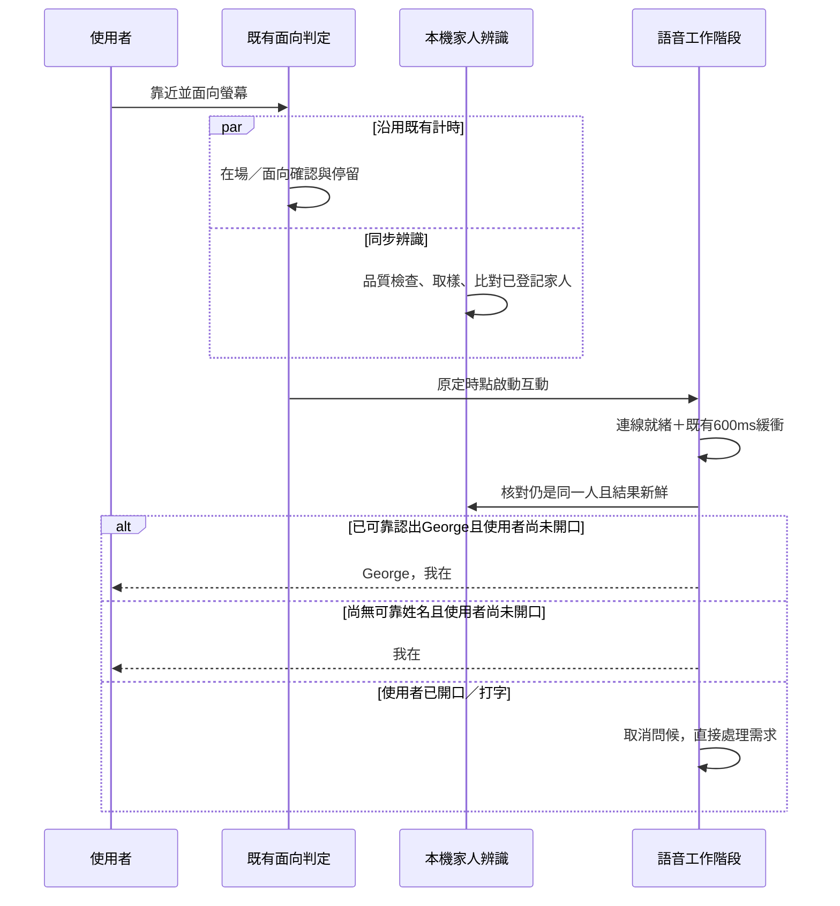

# 靠近時辨識已登記家人，互動後稱名問候

日期：2026-10-24。狀態：規劃；**ID-00 部分交付**：[ADR-0001 草案](./adr/ADR-0001-local-family-recognition.md)＋不接進產品的 runtime spike（[驗證紀錄](./validation/family-id-00-spike-2026-10-24.md)，只有雲端 CPU／WASM 數字）；ID-00 放行條件待 Mac＋AR0144 實測。**ID-01 有程式、只有雲端驗證**（2026-10-25，分支 `claude/family-id-01`，[驗證紀錄](./validation/family-id-01-2026-10-25.md)）：macOS App 選單列打開的「家人辨識」畫面內可登記、刪除、試認，特徵以 safeStorage 包裝的金鑰加密保存；辨識只在該畫面內運作，**門檻未校準**；George 2026-10-25 在 Mac 實測登記、試認與手掌停止正常，偵測器定案 YuNet 2023mar 640。**ID-02 有程式、只有雲端 fixture 驗證**（2026-10-25，分支 `claude/family-id-02`，[驗證紀錄](./validation/family-id-02-2026-10-25.md)）：macOS App 在看著說話的面向等待期間同步辨識，語音就緒＋600 ms 後由核心決定稱不稱名，從固定清單挑一句短的開場（George 2026-10-25 要求多一點變化：例如「George，我在」「嗨，George」「早安，George」「我在」，依本機時段、避開上一次），兩條語音路徑都用核心挑的句子；George 決定**未校準門檻先稱名**（照實標未校準），稱名設定預設開、可關；瀏覽器版只說「我在」。實際音訊與模型是否照念（I12）待 Mac 實測，門檻校準屬 ID-03。程式查核基準：AIOS main `96297c0d4d948da2297d233809398a2e5a0ee938`。

依使用者要求納入 repo，入口見 [文件索引](./README.md) 與 [目前實作狀態](./Current_Implementation_Status.md)。規劃發布當時（`5af2c24`）只有規劃與導覽更新，沒有新增辨識程式、家人資料或通過任何實機 gate；之後的 ID-00 進度見上方狀態行。

本規劃將人臉辨識與既有「看著說話」的面向等待同步執行。認出熟人只建立短暫的稱呼候選；使用者面向滿足已設定條件、啟動互動且語音就緒後，才說「George，我在」。不為了叫出姓名而延後對話。

## 1. 本次已確認的產品方向

- 先支援已主動登記的家人，初版以單一互動者為範圍。
- 認出人不立即打招呼、不自動浮出個人資料、不自動執行動作。
- 利用現有面向判定的 delay 同步辨識，不新增一段必等的辨識倒數。
- 已可靠認出時說「George，我在」；沒有可靠結果時說「我在」。
- 使用者先開口或打字就直接處理需求，不搶話補問候。
- 身分只用於稱呼，不能用來解鎖私人資料或放行外部動作。

本批次先接既有鏡頭 `look_to_talk` 啟動路徑。使用者已開啟看著說話並同意收音時，面向停留達門檻即為既有互動啟動條件。按鈕、語音指令及同意說明後的 `user` 路徑目前不自動問候，本批次沿用；將來若要在按鈕啟動時也稱名，另以同一套決策接入，不把「看著說話時先打招呼」開關偷偷擴成所有入口。

## 2. 現有 delay 的精確意義

程式判定的是頭部是否面向螢幕，不是眼球精準注視。下表為原碼常數與設定值，不是本次硬體量測。

| 時段 | 現有值 | 用途 |
|---|---:|---|
| 首次在場確認 | 500 ms | 連續偵測到人，才進入 present |
| 面向確認 | 300 ms | 過濾短暫轉頭 |
| 後續面向停留 | 預設 1200 ms | 由設定 1.5 秒扣除面向確認 0.3 秒 |
| 語音連線 | 不定 | 建立當次語音工作階段，取決於路徑及網路 |
| 語音就緒後的問候緩衝 | 600 ms | 讓先開口的使用者取消問候，與前面面向 delay 不同 |

已在場者的面向判定設計值約為 1.5 秒。剛入鏡且立即面向者，因現有 processor 先等在場，理論上約 0.5＋0.3＋1.2＝2 秒才開始語音連線。感測約每 80 ms、控制器約每 200 ms 更新，實際時間仍有排程誤差。

人臉取樣從「辨識已啟用、近距離、有效臉與鏡頭皆可用」開始，與上述流程並行。模型冷啟動或辨識較慢時照原時間啟動語音，不更改使用者設定的面向秒數。

模型可以在連線期間繼續補充同一追蹤對象的證據，但不能因辨識晚到重新問候，也不能把新出現的人套入已開始的舊互動。

## 3. 身分候選與問候的規則

辨識結果與問候生命週期分開。辨識模組回報 `matched`、`unknown`、`ambiguous` 或 `unavailable`；問候仍使用 `pending`、`sent`、`skipped`，不能用「辨識成功」直接觸發播音。

每次辨識嘗試保留追蹤 ID、追蹤世代、結果時間、最新看見時間、模型版本及登記資料版本。`matched` 才能帶已登記的 person ID，其餘狀態沒有可用姓名。

在 `startRealtime` 建立當次互動 ID 並綁定當下的追蹤對象。真正送出問候前，再檢查以下條件：

1. 相同互動與相同追蹤世代仍有效。
2. 只有一位可用互動者，沒有換人、多人或追蹤混淆。
3. 人仍在近距離面向螢幕，臉部品質與最新證據合格。
4. person ID 仍存在於啟用中的登記資料，版本未被刪除或撤回。
5. 問候開關仍開啟，當次尚未送過或取消問候。
6. 使用者尚未開口、打字、收起、關鏡頭或結束互動。

有一項不符合姓名條件就移除姓名，無需阻擋正常對話。使用者已先輸入、取消或關閉問候時則完全不問候。

| 情況 | 預期結果 |
|---|---|
| 正面等待期間認出 George，互動正常開始 | 「George，我在」 |
| 認出 George，但尚未開始互動 | 保持安靜 |
| 不認識、品質不足、尚未載入或辨識逾時 | 如原定開始互動，只說「我在」 |
| 已辨識，但使用者先說需求或打字 | 不問候，直接處理需求 |
| 模型在通用問候後才認出 | 本次不再補叫姓名 |
| George 離開，另一人接近 | 清除姓名與舊停留，重新判定，不繼承 George 的等待 |
| 同時出現多張臉 | 不稱名，不任選最大或最近的臉；正常互動可走通用問候 |
| 等待／連線中刪除該家人 | 送出前撤銷姓名資格 |
| live 建立失敗後改 API key 路徑 | 同次互動共用問候狀態，最多發起一次 |
| 首次遇到語音同意說明，過一段時間才同意 | 舊身分候選作廢；沿用既有 `user` 啟動，不突然叫舊姓名 |

現有 PresenceTracker 要 60 秒未看到人才判離開，不可用這個時間維持身分。身分失效要用獨立的短時追蹤規則；未知、關鏡頭及追蹤遺失不能維持上一人的姓名。

先開口的取消訊號也有路徑差異：API key 依語音開始事件，live 依使用者逐字稿。既有 600 ms 不保證所有說話都能及時被回報；實機須對照原聲與事件時間。若仍容易搶話，補本機語音活動偵測作取消來源，不能把「尚未收到逐字稿」當成確定沒有說話。

## 4. 辨識範圍與可調參數

先沿用 AR0144 單眼畫面進行本機偵測、對齊與特徵比對，不要求左右眼都做完整辨識。共用現有影像來源，避免第二次開鏡頭搶占裝置。候選模型為 YuNet＋SFace，先以 spike 確認 runtime、模型版本、授權與打包可行性，不在規劃階段宣稱已相容。

以下只是實測起點，不是準確率保證或安全認證門檻：

| 參數 | 提議起點 | 實測後的調整依據 |
|---|---|---|
| 靠近辨識區 | 約 0.6–1.5 m | 鏡頭解析度、臉寬、距離估計品質 |
| 臉部寬度 | 約 100 px 以上才嘗試稱名 | 側臉、光線與保留資料上的誤認率 |
| 取樣頻率 | 約 4 Hz，一次最多一個待處理推論 | 每次推論耗時與現有感測負擔 |
| 穩定證據 | 至少 3 個不同畫格，跨至少 500 ms，一致指向同一人 | 熟人與陌生人的實測分布 |
| 比對結果新鮮度 | 問候前不超過 1 秒，且持續看得到同一人 | 轉頭、遮擋、換人測試 |
| 追蹤斷開 | 超過約 500 ms 未能持續確認同一臉，撤銷候選 | 不能為提高辨識率而沿用舊人身分 |

目前雙目距離未完成真校正，不能把距離數字當成精準安全界線。距離未知時，本版採保守通用問候；臉部品質不足也不強行匹配。相似度門檻須用登記以外的保留樣本與陌生人校準，不直接複製模型範例常數。

面向秒數改成 0.5 秒時，可能沒有足夠姓名證據，仍照常開始；改成 5 秒只是有更多既有時間可取樣，不擴大資料保留範圍。模型在功能啟用後預載，背景推論不可阻塞既有 80 ms 感測迴圈。

## 5. 登記、保存與資料範圍

由已解鎖、可管理的本機設定明確開始登記，選擇姓名並提供多角度樣本。登記不是單靠對鏡頭說「我是 George」就覆蓋現有人物。第一版規劃 2–5 位家人，未登記者只標未知。

原始影像只在本機記憶體短暫處理，不保存、不進 trace、不上雲；保存的是有版本、可刪除並加密的辨識特徵與人物檔案。特徵同樣是敏感識別資料，不能當成匿名資料。刪除、停用與鏡頭關閉要清掉 worker 及當次問候使用中的候選，延後回來的推論也要被世代檢查拒絕。

使用雲端語音時，姓名會成為語音供應商收到的短句文字。功能啟用說明需交代這點，提供「辨識開啟，但不在雲端語音稱名」選項；這不代表可上傳臉部影像、特徵或其他家人的名單。

多人偵測不能依靠現有 `numPoses: 1` 證明畫面中只有一人；新增人臉偵測需明確回報臉數及追蹤是否可靠。初版不做多人身分控制權自動轉移，不做聲紋、Quest 遮臉辨識或照片／影片的安全防偽認證。

## 6. 兩條語音路徑的必要改動

目前 API key 路徑會取用 `GreetingOnce.take()` 的指示。ChatGPT live 路徑卻在前端送固定 `LIVE_GREETING_TEXT`，server 又忽略客戶端文字並重新送固定文字。因此只改前端常數或 `GreetingOnce.instructions`，無法讓兩路都稱名。

規劃新增結構化的 `GreetingDecision`，攜帶當次互動 ID、person ID 或無姓名、追蹤世代、證據及登記版本。核心檢查 person ID 存在，從受管理人物檔案取得允許的口語名稱，組成受限招呼。名稱須限制長度並拒絕控制字元、標記與指令注入，不能直接信任客戶端傳入的任意 prompt。

兩條路徑共用同一個問候決策與一次性狀態：熟人目標文字為「George，我在」，未知為「我在」。姓名只是低信任的個人化訊號，不構成登入憑證。稱名功能關閉或對應資料已撤回時，核心也不得補回姓名。

即時語音模型可能改寫文字。只加入「請照念」提示不能當成已保證固定短句。驗收要檢查兩路實際逐字稿及播音；若模型會加話、猜名或重複，該路徑不得標為通過，需改用確定文字的 TTS 播放並共用播音互斥與插話取消。此替代路線需額外量測音色切換與播放延遲。

## 7. 程式整合點

以下是規劃當時的提案，延伸既有原型，不重寫核心或語音系統。ID-01、ID-02 的實際落點見 [ADR-0001](./adr/ADR-0001-local-family-recognition.md) §2.1.1、§11（例如身分比對與組句在 `server/identity-service.ts`，同步辨識的取樣在 `src/sense/identity-ambient.ts`）。

| 檔案／模組 | 計畫責任 |
|---|---|
| `shared/identity.ts`，新增 | 人物、辨識狀態、證據有效期與問候決策的版本化型別 |
| `src/sense/identity-worker.ts`，新增 | 本機模型預載、偵測與比對，受限取樣與取消 |
| `src/sense/pipeline.ts` | 共用畫格給身分模組，維持既有 pose／手勢流程與隱私邊界 |
| `src/sense/controller.ts`、`trackers.ts` | 同步現有面向 delay，換人時重置當次候選與累計，不增加等待 |
| `src/main.ts` | 建立互動 ID、綁定當次追蹤來源，取消時撤回候選 |
| `src/realtime-session.ts` | `GreetingOnce` 送出前讀取決策，跨路徑保持最多一次 |
| `src/realtime.ts`、`src/live-voice.ts` | 使用共用決策，保留先開口、打字、關閉與結束取消 |
| `server/live-route.ts`、`server/realtime.ts` | 從受管理名稱產生短句，維持原有文字長度、封包切段與拒絕任意 prompt 的邊界 |
| 核心人物／特徵儲存，新增 | 登記、停用、刪除、加密與模型版本管理，僅本機可管理 |
| `tests/camera-privacy.test.ts` 及相關語音測試 | 為受限本機推論補明確邊界，不直接刪掉現有防護或把允許範圍擴成整個前端 |

目前純瀏覽器能否提供同等加密儲存與受限 worker 邊界需要 spike。第一輪可先以 Electron 桌面完成閉環，瀏覽器不支援時明示關閉辨識，仍保留原有對話。

## 8. 驗收與故障案例

| 編號 | 必須觀察到的結果 |
|---|---|
| I1 | 熟人在場但不啟動互動，零問候、零私人畫面 |
| I2 | 辨識與面向計時同步，既定啟動事件不等待模型、比對或磁碟 IO |
| I3 | 熟人證據有效時只稱正確名字一次；未知、多人、過期及品質不足時不稱名 |
| I4 | 使用者先說話或打字，兩路均取消問候，不在回答後補問候 |
| I5 | 換人、轉開、臉消失、關鏡頭、sensor degraded、模型錯誤後，不沿用舊姓名 |
| I6 | live→API key fallback 整次最多發起一次問候；送出狀態未知時不盲目重送 |
| I7 | 面向時間分別為 0.5、1.5、5 秒時，不增加辨識等待；額外影像運算沒有拖慢既有停止手勢 |
| I8 | 同意說明延後、設定關閉、刪除人物與晚到推論皆不造成突然稱名 |
| I9 | 登記刪除後重啟、worker 重建及新 session 皆不能使用已刪除人物 |
| I10 | 封包與檔案檢查無原始影像落盤、無未加密特徵落盤、無影像或特徵外傳；只有允許的加密特徵保存，雲端只收到允許的短句 |
| I11 | 人物名稱包含換行、特殊標記、過長文字或指令內容時被拒，不能變成語音模型指令 |
| I12 | 兩路實際說出固定短句；fixture 的文字成功不替代音訊實測 |

先用假時鐘、合成身分事件和假的推論結果驗證競態，永久標示為 fixture。之後再用家人自願登記的保留樣本驗證真實辨識。

真機測試至少涵蓋 0.8、1.0、1.5 m，明暗、戴眼鏡、正面／輕側臉；另測陌生人、多人交錯、照片與手機播放。初步品質目標為受測條件下熟人成功稱名 ≥95%、100 次陌生人互動零錯誤稱名；這只是 MVP 門檻，少量零誤認不代表安全認證或普遍錯誤率為零。必須同時列出拒認率、錯認率及未辨識比例，不能只報總正確率。

記錄面向開始、在場確認、互動啟動、語音就緒、問候決策、實際首音的時間，將本機辨識耗時與網路／語音延遲分開。比較辨識關閉及開啟的啟動延遲與既有感測負擔，不只檢查新計時器是否存在。

## 9. 交付批次與估時

下列為工程估計，以一位熟悉 repo 的工程師搭配 AI 計，1 人日以 8 小時換算，不含等待真人測試與硬體採購。各數字尚未由本機辨識實作量測。

| 批次 | 交付與放行條件 | 估計 |
|---|---|---:|
| ID-00 | ADR 草案、資料生命週期、鏡頭／runtime spike；現有 delay 內可否取得可用樣本及效能證據 | 1–2 人日 |
| ID-01 | 登記／刪除、加密特徵、本機辨識、品質及失效狀態；未知不能硬配人 | 2–3 人日 |
| ID-02 | delay 並行、互動綁定、核心短句、兩路問候與所有取消／fallback fixture | 1–2 人日 |
| ID-03 | 真鏡頭、家人保留樣本、兩路真語音、隱私與換人故障驗收 | 1–2 人日 |

合計約 5–9 人日，即 40–72 小時。若模型無法穩定照念、需獨立 TTS，或既有鏡頭品質不足，另行評估增加工作，不先承諾確切完成日。

先讓 Claude 核心端完成 ID-00 至 ID-02；ChatGPT／Codex 可協助獨立審查時序與驗收。Quest 及聲紋留後續，避免擴大這次的靠近稱名 MVP。

## 10. 查核來源與本次交付界線

- [現有面向、在場與停留計時](https://github.com/pcpcchen-coder/AIOS/blob/96297c0d4d948da2297d233809398a2e5a0ee938/prototype/ambient-shell/src/sense/trackers.ts)
- [面向須先 present 的組裝](https://github.com/pcpcchen-coder/AIOS/blob/96297c0d4d948da2297d233809398a2e5a0ee938/prototype/ambient-shell/src/sense/processor.ts)
- [互動啟動與問候物件](https://github.com/pcpcchen-coder/AIOS/blob/96297c0d4d948da2297d233809398a2e5a0ee938/prototype/ambient-shell/src/main.ts#L709)
- [GreetingOnce 與就緒後 600 ms](https://github.com/pcpcchen-coder/AIOS/blob/96297c0d4d948da2297d233809398a2e5a0ee938/prototype/ambient-shell/src/realtime-session.ts)
- [live 前端固定招呼](https://github.com/pcpcchen-coder/AIOS/blob/96297c0d4d948da2297d233809398a2e5a0ee938/prototype/ambient-shell/src/live-voice.ts#L306) 與 [server 固定招呼](https://github.com/pcpcchen-coder/AIOS/blob/96297c0d4d948da2297d233809398a2e5a0ee938/prototype/ambient-shell/server/live-route.ts#L475)
- [AR0144 名目幾何與現有身分辨識政策](https://github.com/pcpcchen-coder/AIOS/blob/96297c0d4d948da2297d233809398a2e5a0ee938/docs/11_Stereo_Camera_Interaction_2026-10.md)

以下為規劃發布當時的狀態：規劃階段僅讀取程式、核對時序並產出文件；該次依使用者要求發布規劃與導覽。沒有啟動鏡頭、建立家人資料、修改 runtime 或進行辨識實測。ID-00 之後的交付見上方狀態行。
