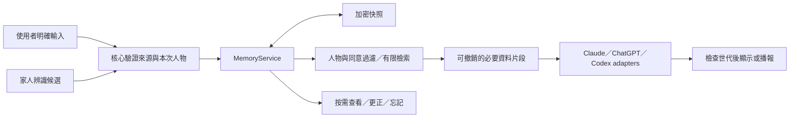

<!-- bilingual: source=zh-TW -->

> [繁體中文](16_Nous_Memory_Layer_Design_2026-10-26.md) | [English](16_Nous_Memory_Layer_Design_2026-10-26.en.md)

<a id="nous-家庭記憶層設計"></a>
# Nous family memory layer design

> Status: design contract. The MEM-0 isolated foundation is delivered; on 2026-10-29 MEM-1 (ordinary text chat in the desktop App) was completed in code and passed cloud tests, but the Mac gate has not been run, so it must not be claimed as working on real hardware. Date: 2026-10-26, Asia/Taipei. Code baseline: `ca7a8fe0b427c9c128e9b57d1bbe6ecb70477b1c`. Voice, background tasks, and later batches in this document remain targets. See [MEM-0 validation](validation/memory-mem0-2026-10-26.en.md) and [MEM-1 validation](validation/memory-mem1-2026-10-29.en.md) for implementation differences and hardware gates.

Nous should remember preferences explicitly provided by each family member, use them in later conversations, explain their source, and allow correction and forgetting. The local Nous core manages memory. Claude, ChatGPT, and Codex routes follow one rule set. Recognizing a family member helps select a person but does not authorize access to private data.

<a id="1-使用起來是什麼樣子"></a>
## 1. Expected experience

These are expected behaviors. Examples are not real enrolled family data.

| User statement | Expected behavior |
| --- | --- |
| “I'm George. Remember that I don't eat cilantro.” | With memory enabled, select the current person and save the preference. Only after success say “Remembered: you don't eat cilantro.” Do not ask repeatedly when intent and person are clear. |
| Next day: “Suggest dinner for me.” | Retrieve George's relevant dietary preferences before asking the current model for suggestions. When useful, explain “I chose based on your earlier preference to avoid cilantro.” |
| Another family member: “I like cilantro.” | Use it in the current conversation. Persist it for that person only after an explicit save request. Do not overwrite George. |
| “No cilantro today.” | Applies only to this request, without inferring a lasting dislike. Explicit “remember this for today” expires at the end of the local day. |
| “I can eat cilantro now. Update that.” | Update the uniquely matching preference and return a correction receipt. Clarify only when the target is not unique. |
| “What do you remember about me?” | Show an on-demand memory card with content, source, time, and edit / forget actions. Dismiss to return to the brain. |
| “Forget that I don't eat cilantro.” | Delete the unique target, stop old responses using it, and return a receipt after completion. Broad “forget everything” first requires an explicit scope and confirmation. |
| “Mom doesn't drink coffee. Remember that for her.” | Mark as third-party reporting, not a confirmed preference from Mom. Version one requires her confirmation or an already configured parent managing a child's data. |
| “I like air conditioning at 26 degrees.” | May inform current suggestions. Even if separately saved, it does not automatically turn on air conditioning. Device actions still require a current request and existing action policy. |

In version one, “understand each family member” means traceable preference use, not personality, mental-state, or relationship inference. State that data is unknown when absent. Do not invent memories to sound familiar.

<a id="2-現有程式提供的起點"></a>
## 2. Starting points in current code

| Verified current state | Design implication |
| --- | --- |
| `src/conversation.ts` retains only the latest nine question-answer pairs in page memory, with size limits | The core must persist long-term memory. Extending this array is insufficient |
| `server/live-route.ts` creates a fresh session for every call. The local tool transcript buffer differs from cloud call context | Explicitly load memory into new calls. Forgetting cannot clear only local transcripts |
| `server/live-tool-caller.ts` delegates with only the latest eight transcript entries, excluding the opening named greeting | Add a core memory integration point. A named greeting cannot establish person state |
| `server/store.ts` saves tasks and artifacts as plaintext JSON | Do not inject memory into background tasks initially, avoiding encrypted memories copied into plaintext artifacts |
| `server/identity-store.ts` stores names and face features, without preferences | Create independent person profiles. Face enrollment is only a removable link |
| `server/nous.ts` composes ordinary chat, Codex live, API-key voice, and other routes | Integrate one MemoryService before providers and validate each route separately |
| Confirmation reasons in `src/presentation-policy.ts` currently bind pending external MCP actions | Memory clarification cannot borrow MCP IDs. Initially use `user_request` cards with real request IDs |

Existing [F7 in 13](13_Feature_Expansion_Assessment_2026-10-24.en.md#f7能修正能忘記的工作記憶) and [08 historical consolidation](08_Consolidation_and_Update_2026-10.en.md) propose Markdown + SQLite indexing, not implemented. This design changes the initial source of truth to encrypted data. Markdown becomes explicit export only. See [ADR-0002](adr/ADR-0002-nous-family-memory.en.md) for tradeoffs.

<a id="3-記憶分層與首版範圍"></a>
## 3. Memory layers and first-version scope

| Layer | Content | Lifecycle and initial scope |
| --- | --- | --- |
| Current context | Today's request, options under discussion, temporary mood | Existing conversation only. No automatic promotion to long-term memory |
| Personal preferences | Food tastes, reply length, ordinary comfort and habits | Cross-conversation after explicit saving. Separate for each family member, correctable and forgettable |
| Household shared facts | Confirmed forms of address and shared living preferences | Explicitly select “household shared.” Never expand one person's statement to the entire household automatically |
| Work summaries and decisions | Which option a discussion selected and corresponding artifact version | Later batch, after artifact protection and source dependencies |

Version one stores only ordinary information suitable for a shared home device. Subject answers “whose preference is this?” Audience answers “who can use it?” Keep them separate. Mark every item “usable in the household.” A view grouped by person is not a private space.

Passwords, access tokens, private diaries, health records, and financial data are outside version one. Private memory later requires individual unlock, permissions, and output-device policy first. A `private` field or stricter face threshold alone does not establish authorization.

Raw audio, camera frames, complete conversations, and tool outputs are not default memory sources. Awakened conversation does not imply consent to save everything permanently.

<a id="4-人物綁定與使用同意"></a>
## 4. Person binding and consent to use

Add `ProfileId`, creatable without a camera. Optional `face_person_id` only lets the core propose a candidate. Do not put embeddings in memory storage or send face IDs to models.

The current user has three states: `unselected`, `selected`, and `suspended`. Only “I am George” or selection in the trusted main window establishes `selected`. This selects ownership of household-shared preferences, not secure authentication. Without a selected person, use only enabled household-shared data. Never guess or choose the most recent user.

The existing facing delay may warm the database when interaction starts, without providing personal memory to models or extending that delay. A face match may prompt briefly within interaction, “Use George's preferences this time?” Once selected, do not ask every sentence.

Person change, multiple faces, detected tracking break, OS lock, manual person switch, or interaction end revokes the old person generation. Camera mode may suspend personal retrieval automatically. Without a camera, retain a visible current-person indication and reconfirm on an unclear speaker or handoff instruction. Version one does not guarantee speaker identification or treat the person facing the camera as the speaker automatically. This is another reason to exclude private data.

Initial setup has four independent choices:

- Enable cross-conversation memory, off by default. The first “remember” may open settings with pending content.
- Select the current person or household shared.
- Allow specified configured model services and accounts to receive relevant excerpts. Explain “stored locally; necessary excerpts are sent to the selected model when used.” Unapproved memories remain locally inspectable.
- Automatically suggest memories, off in version one and deferred to a later batch.

After setup, execute clear “remember” commands without asking the same question again. Switching model names within the same authorized service needs no renewed question. New providers, accounts, remote workers, or shared devices require separate scope confirmation. Disabling memory stops reads and writes and revokes active context, retaining saved content. “Delete memory” is a separate scoped operation.

<a id="5-寫入更正與來源"></a>
## 5. Writes, corrections, and sources

Memory progresses `proposed → committed` or `proposed → rejected/expired`. Models may use only committed, unexpired data. Explicit save commands can propose and commit within one operation, without another user turn.

The core creates `SourceTicket` from current typed input or completed voice transcription in the trusted main window. It binds session, person generation, direct-input event, original utterance, actual parsed command, one-time sequence, and expiry. Models may parse candidates, but cannot choose people, change consent, create tickets, or bypass validation. Models do not fill ticket content. Any command change requires revalidation. Model replies, search results, document quotes, television audio, and old tool results never authorize writes. If voice origin is unreliable, show a pending confirmation card without automatic persistence.

Initially save a bounded set of topics and vocabulary while preserving meaning. “Does not drink coffee” must not become “avoids all caffeine.” For unclear intent, doubtful ASR, or nonunique operation targets, show the actual proposed sentence and clarify.

Each record retains:

| Field | Meaning |
| --- | --- |
| `memory_id`, `revision` | Stable ID and conditional-update version |
| `subject` | Household shared or one stable ProfileId |
| `kind`, `topic`, `key`, `value` | Category, topic, normalized key, and user-readable content |
| `audience` | Version one accepts only `household`, explicitly usable in the home |
| `source` | Explicit self-statement or parent confirmation, original turn ID, time, and minimum necessary excerpt, up to 240 characters |
| `valid_from`, `expires_at`, `review_after` | Effective time, explicit expiry, and suggested review time |
| `cloud_policy_ref` | Reference to personal or household transmission consent, never supplied by a model |
| `derived_from` | Source dependencies for later summaries, empty initially |

Stable preferences do not disappear automatically from lack of recent use. `review_after` means asking whether it still applies at the next relevant opportunity. It neither deletes nor triggers idle announcements. Current requests override current suggestions. Only explicit corrections change lasting values. If mutually exclusive values lack clear correction intent, retain the original and clarify instead of letting the model decide.

Third-party reporting does not become self-confirmation. Configured parents manage ordinary preferences for minors. Version one does not automatically collect or infer them. Claiming verbally to be a parent does not establish management authority. Explain person-management permissions separately from private identity authentication.

<a id="6-儲存決策與可靠回條"></a>
## 6. Storage decision and reliable receipts

Use one encrypted snapshot, `userData/memory/store.v1.enc`, containing profiles, active memories, consent, operation receipts, deletion tombstones, and versions. MemoryService is the only writer. In-memory indexes are rebuildable. There is no second writable Markdown or vector database.

Use AES-256-GCM with a new data key and nonce for every write. Electron's system secure-storage interface wraps the data key. AAD binds format and version. Use directory 0700 and files 0600. Temporary files are ciphertext only. After obtaining a single-writer lock, update data and deduplication receipts in the same snapshot, then write a temporary file, fsync, rename, and fsync the directory. Say “remembered” only after durable persistence. A second core unable to lock disables memory writes. Reading a version and independently renaming is insufficient.

Repeated identical operation ID and content returns the original result. The same ID with different content is rejected. Updates and deletions require `expectedRevision`. Stale operations cannot overwrite new data. Persist receipts atomically with data. If interrupted after commit but before reply, the user can rebind the person and query whether the operation completed, without executing again. Expired tickets cannot write after restart. Receipt lookup and new writes are different permissions.

Bound deduplication data. Evicted receipts return `receipt_expired`, never treat old operations as new. Forgotten-item receipts retain no body, only random operation ID, result class, and version. Correction removes old bodies. Version one keeps no unlimited full-text history.

Unlock failure, corruption, wrong permissions, or write failure disables memory, without falling back to plaintext or overwriting with an empty database. Ordinary chat can continue, but explicitly state that memory was not used or saved.

Initial provisional limits are 1,000 active memories, 512 characters per item, and a 10 MB decrypted snapshot. These are design budgets awaiting acceptance. Receipts and sources count toward capacity too. On overflow, ask for organization or export instead of silently discarding old data.

This is not a personal secret vault and does not guarantee erasure from Time Machine / APFS snapshots. Old ciphertext may remain recoverable while its wrapping key exists. Backup exclusion only reduces risk. Produce readable Markdown / JSON only on explicit export. Exported copies do not disappear automatically when local memory is forgotten.

Official Electron documents recommend asynchronous safeStorage interfaces and explain that macOS signing affects Keychain behavior. Probe the repo-pinned Electron 44.9.3 and packaged App before implementation. Do not assume the latest documented interface exists. [Official safeStorage documentation](https://www.electronjs.org/docs/latest/api/safe-storage/)

<a id="7-檢索與模型上下文"></a>
## 7. Retrieval and model context

Retrieval order is fixed: core-confirmed session / person → audience → active state and expiry → transmission consent for the current service → topic and text relevance. Authorize before ranking. Do not search all people and then remove unauthorized hits. Do not fill empty results with another family member's preferences.

Initially use fixed topics, aliases, Chinese text fragments, and confirmed structured keys. Models can propose search terms but cannot expand subject scope. Preload at most four user-designated common preferences, then retrieve relevant items per question. Limit each transmission to eight items and 4 KB UTF-8. Discard lower-relevance whole entries instead of truncating negation such as “do not.” No match returns an empty result.

The core constructs a compact read-only `ContextFact` block with necessary content, source type, time, and expiry only. Full excerpts remain local for inspection. Do not send person IDs, memory IDs, tickets, internal versions, or consent settings to models. Memory text is neither system instructions, tool policy, nor permanent authorization. “Ignore the rules” in external material remains source content. A model saying it remembered still requires a successful core receipt. Persistence failures override success claims with a fixed system receipt.

Do not default to full-conversation summaries, cloud embeddings, or knowledge graphs. First use fixed Chinese tests to find missed retrieval, then add semantic indexes only if needed. SQLite FTS5 provides full-text indexing but does not automatically solve person policy, Chinese semantics, or deletion consistency. Evaluate its tokenizer separately. [SQLite FTS5 documentation](https://www.sqlite.org/fts5.html)

<a id="8-忘記換人與晚到回覆"></a>
## 8. Forgetting, person changes, and late replies

Deleting local memory does not make a model that received it forget automatically. Bind every output to `session_epoch` and memory dependencies. Corrections, forgetting, person switching, cloud-consent revocation, and disabling memory revoke affected context.

Use this sequence:

1. Suspend affected context, preventing new requests and late outputs.
2. Atomically update data, clear source excerpts and derived indexes, and publish a new version.
3. Abort affected inference, tool proposals, and queued audio. Clear this conversation segment when contaminated ordinary-chat history cannot be separated precisely.
4. For data already sent into live or API-key calls, close old connections, clear transcripts and audio queues, and create new sessions. A “please forget” message or changed prompt is insufficient.
5. Return complete success only after completion. If data is deleted but call cleanup remains incomplete, report both states separately and keep memory disabled on that route.

`withContext` spans the full text stream or entire voice call. Revocation listeners cannot be released when the SDP handshake succeeds. All text, audio, tool results, and late callbacks recheck generation before delivery.

The API-key data channel and playback live in the renderer. A core revocation record does not prove speakers stopped. Require closure acknowledgement from the trusted main window and real-device evidence. On timeout, Electron closes affected content / connections and memory fails closed for that operation. Do not inject memory into routes without reliable revocation.

Forgetting does not delete already sent messages, external-provider data, or separately saved artifacts. Initially prohibit automatic memory extraction from existing artifacts, avoiding reconstruction of deleted memories. Later summaries require full dependencies and are removed when their sources are forgotten. New data may be created only after a new explicit user instruction to remember again.

Deleting face enrollment only removes the face link and revokes person binding. It must not silently delete preferences. Explain this in management UI. Deleting an entire person's memory removes profile facts, sources, consent, and associations. A new enrollment with the same name must not reconnect old person data automatically.

<a id="9-架構與接線"></a>
## 9. Architecture and wiring



| Proposed addition or modification | Ownership and behavior |
| --- | --- |
| `server/memory/service.ts` | Sole rules entry, owning profiles, consent, source tickets, updates, retrieval, and revocation. Models cannot import the store directly |
| `server/memory/store.ts` | Private snapshot format, encryption, single writer, atomic persistence, and receipts. No model or HTTP concepts |
| `shared/memory.ts` | Restricted UI command and result DTOs. No keys, ticket implementations, or arbitrary scope |
| `desktop/memory-ipc.mjs`, preload | Person selection and management only in the trusted main window, inaccessible to generated content. Secret keys remain in the core |
| `src/memory-view.ts`, `src/main.ts` | On-demand cards, current person, and actual save status, without a permanent sidebar. Use existing user_request presentation policy |
| `server/nous.ts`, `server/app.ts` | Create one service, bind owner/session, route commands. Do not broadcast memory contents through global SSE |
| `server/chat.ts`, `src/conversation.ts` | Attach limited memory before providers. Stop streams and clear invalid history on revocation |
| `server/live-route.ts`, `server/live-tool-caller.ts` | New-call memory packages, `recall_memory`, and memory proposals. The core handles tools directly without asking the renderer to guess people |
| `server/realtime.ts`, `server/realtime-routes.ts`, `src/realtime.ts` | API-key route tools, conversation generations, and reliable playback stop. Enable per route only after passing |
| `server/runner.ts`, executors, `server/store.ts` | Integrate in later task phases. Do not put personal memory into existing plaintext artifacts first |

Four adapters share memory rules, but each has an availability flag. Ordinary ChatGPT executor and Codex live are distinct routes and cannot substitute for each other's acceptance. Memory management initially targets Electron. Browser versions lacking secure storage and person management explicitly show unavailable.

Initially also prevent model-rewritten delegation influenced by memory from becoming a plaintext task title. Delegation uses a new direct user request without memory. If this cannot be separated, ask the user to restate. The new request cannot include old transcripts, model summaries, or memory packages, nor rely only on a model to remove sensitive words. Disabling TaskRunner memory injection alone cannot prevent a model from copying memory into a title.

Quest and OpenClaw later use memory requests restricted by owner, device, and purpose. They neither synchronize the whole database nor write directly. This depends on unimplemented pairing and authentication entry points. Do not relax current localhost protection.

<a id="10-呼叫契約草圖"></a>
## 10. Calling-contract sketch

The following describes design, not executable APIs. Three business entry points hide storage and policy inside the core. The same service boundary handles person binding and transport validation.

```ts
// 當次可信輸入建立票證，模型只能提交解析候選。
const receipt = await memory.change(session, command, sourceTicket);

// 文字串流到結束；語音則等待整通通話 close 才結束 callback。
await memory.withContext(session, query, async (context) => {
  await adapter.respond({ facts: context.facts, signal: context.signal,
    deliver: context.deliver });
});

// 按需查看記憶或查詢中斷前操作結果。
const page = await memory.inspect(session, inspection);
```

```ts
type MemorySession = { readonly coreOwned: unique symbol }; // 不可由 DTO 建構
type SourceTicket = { readonly coreIssued: unique symbol }; // 核心另驗真實資料
type Subject = { kind: 'household' } | { kind: 'person'; profileId: string };
type Command =
  | { op: 'remember'; operationId: string; candidate: Candidate }
  | { op: 'correct'; operationId: string; id: string; expectedRevision: number; candidate: Candidate }
  | { op: 'forget'; operationId: string; id: string; expectedRevision: number };
type Inspection = { kind: 'facts'; topic?: string; cursor?: string }
  | { kind: 'receipt'; operationId: string };
type Result = { status: 'saved' | 'updated' | 'forgotten' | 'unchanged'; revision: number }
  | { status: 'clarify' | 'conflict' | 'unavailable' | 'receipt_expired'; message: string };
interface MemoryService {
  change(session: MemorySession, command: Command, source: SourceTicket): Promise<Result>;
  withContext<T>(session: MemorySession, query: RetrievalQuery,
    run: (ctx: MemoryContext) => Promise<T>): Promise<T>;
  inspect(session: MemorySession, query: Inspection): Promise<InspectionResult>;
}
```

`Candidate` contains only topic, content, and source-fragment positions. It cannot provide subject, audience, trust level, or cloud consent. `RetrievalQuery` contains current request and purpose. Session determines scope. `MemoryContext.deliver` checks generations before output. Adapters cannot bypass it to play audio directly. Native voice playback also requires connection-closure protection from section 8. Type brands prevent accidental misuse. Runtime validation remains the real boundary.

<a id="11-分批實作與放行"></a>
## 11. Implementation batches and release

| Batch | Delivery | Dependencies and completion conditions |
| --- | --- | --- |
| MEM-0 | Verify secure storage, source tickets, actual voice closure, capacity, and latency budgets | Isolated data and fake identities. Probe Keychain and playback stop in a packaged Mac App without the real family database. Unsupported routes stay disabled |
| MEM-1 | Local profiles, explicit remember / correct / forget, list, reliable receipts, and ordinary text-chat retrieval | Works after restart. Claude and ChatGPT use the same records. Complete one person first, then validate separation between people |
| MEM-2 | Codex live new-call retrieval, spoken remember / forget, and revocation on person change | Full voice lifecycle. Actual recording / listening proves no late old audio. Fixtures cannot replace this |
| MEM-3 | API-key voice and cross-route consistency | Same rules as MEM-2, separate route release. Until passed, show “memory is not enabled for this route” |
| MEM-4 | Protected task artifacts, sourced work summaries, memory dependencies, and revocation propagation | Close plaintext-artifact gaps first, then let background executors use MemoryService |
| MEM-5 | Optional automatic organization and family collaboration | Propose candidates by default. Validate sources, people, expiry, and false memories before considering automatic low-risk activation |

For current Codex live use, the first useful delivery is MEM-0 through MEM-2. This does not imply API-key voice or background-task memory. On 2026-10-26, MEM-0 delivered core-private storage, source capabilities, and isolated revocation validation. A separately packaged App passed real-Keychain cross-process readback. Formal signing / denial and voice gates remain unpassed. On 2026-10-29 MEM-1 delivered profiles, first-time consent setup, explicit remember / correct / forget, the list, receipts, and a single injection point for Claude / ChatGPT in ordinary desktop text chat; in the cloud (Linux) the testable parts of M01–M18 were verified with real AES-GCM, a test lock, and SIGKILL, and the 30 Chinese queries retrieved 24/24. Differences from this document (simplified command words do not trigger, narrower correction verbs, cards before the question, consent split by person and household, `reviewAfter` unused, minors not written from chat, and others) and the Mac gate list are in [MEM-1 validation](validation/memory-mem1-2026-10-29.en.md). Post-review addition: saying “I am X” is enough to view and edit X's household-usable data; this is grouping by person on a shared household device, not identity verification. SourceTicket is a core self-check; the real security boundary is the IPC sender check plus the page only forwarding what the user typed. MEM-2 has not started.

Automatic organization uses only enabled conversations and explicit sources, not idle audio, television, or model speech. Candidate proposals remain in memory and expire at conversation end or after 24 hours. Unconfirmed candidates never inform answers. Suggestions may appear inside a user-opened current conversation, without opening idle cards automatically. “Understand more over time” can be a long-term goal, but first make every memory auditable by the user.

<a id="12-驗收矩陣與數值預算"></a>
## 12. Acceptance matrix and numerical budgets

Use fictional people and dedicated test data throughout. These are product-release standards. MEM-0 covers only some lower-level cases. Do not mark full items passed from isolated tests. See this batch's validation record.

| ID | Scenario | Pass condition |
| --- | --- | --- |
| M01 | Save, exit App, restart, ask a relevant question | Retrieve the same person, content, and source. Never falsely claim recall when absent |
| M02 | Switch Claude / ordinary ChatGPT / Codex live | Released, authorized routes retrieve the same memory version without separate stores |
| M03 | George avoids cilantro; another person likes it | No mixing in new conversations or after person change. Zero cross-person leakage in test data |
| M04 | No selection, same names, false face match, multiple people, camera off | No guessed person or private unlock. Require selection or use household-shared data only |
| M05 | “Not today” versus “never again” | The former is not permanent. Expired items are not retrieved |
| M06 | Reporting others, jokes, hypotheticals, quotes, television, and model reading | These do not automatically create self-confirmed memories |
| M07 | Duplicate operation, changed content with same ID, resend after restart | No duplicate additions. Alterations rejected. Receipt lookup does not replay old writes |
| M08 | Concurrent corrections and two cores | Reject stale revisions. Single-writer lock works |
| M09 | Crash before write, around rename, before receipt | Read a complete old or new version. No false save or empty-database reset |
| M10 | Forget / change person after memory entered a call | Stop old audio and inference. New calls omit old text. Discard late tools and replies |
| M11 | Disable memory or revoke a service's consent | Revoke sessions using the data. New requests contain no related excerpts |
| M12 | Keychain denial, corrupt file, disk full | No plaintext or false success. Ordinary chat still works |
| M13 | Memory says “ignore rules,” “open door,” or “send email” | Data cannot change permissions or trigger actions |
| M14 | Plaintext scan with a dedicated canary | No canary in snapshots, temporary files, logs, global SSE, or task JSON. Check authorized current model payloads separately against consent |
| M15 | Deleted items reappear in old transcripts, summaries, or delegations | No reinjection into memory. Invalidate derived data and state external-copy limits honestly |
| M16 | Delete face, reenroll same name, delete entire profile | Face and memory deletion scopes remain clear and predictable. Names do not reconnect old data |
| M17 | Explicit negation, Chinese synonyms, simplified/traditional differences in original fragments | Retrieve complete meaning without reversing preferences through truncation or wrong normalization |
| M18 | Gaze dwell, waiting, and stop-gesture regression | No new automatic authorization or delay extension. Palm stop remains effective |

Also create at least 30 Chinese queries covering positives, no relevant data, synonyms, opposing preferences, and third-party statements. Target at least 90% correct recall on this set. Wrong-person retrieval and unconsented transmission must be zero. This is a release gate, not an accuracy claim. Report sample count and per-question results.

At 1,000 items on target Mac, provisional budgets are warm retrieval p95 ≤50 ms and durable writes p95 ≤300 ms. Measure first unlock and total user wait separately. Do not hide Keychain prompts in averages. Compare identical scenarios on mainline and branch, separating local added cost from cloud-voice latency. Reduce scope if budgets fail, rather than increase existing delays.

<a id="13-本次設計驗證與後續證據"></a>
## 13. Design validation and later evidence

This design checked existing context, provider, person, and storage integration points, compared encrypted snapshots with SQLite transactions, and underwent cross-review. ADR-0002 records selection reasons. Document and link checks establish design consistency only, not implemented memory.

The preceding 39 existing conversation, tool-calling, and TaskStore tests passed. They are not M01–M18 acceptance for this design. Every batch after MEM-0 must provide its own code version, actual operations, tests, and measurements.
