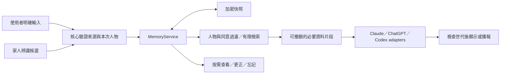

<!-- bilingual: source=zh-TW -->

> [繁體中文](16_Nous_Memory_Layer_Design_2026-10-26.md) | [English](16_Nous_Memory_Layer_Design_2026-10-26.en.md)

# Nous 家庭記憶層設計

> 狀態：設計契約。MEM-0 隔離基礎已交付；2026-10-29 MEM-1（桌面版一般文字聊天）程式完成、雲端測試通過；2026-10-30 MEM-2（ChatGPT 方案即時語音）程式完成、雲端測試通過；同日 MEM-3（OpenAI API key 即時語音）程式完成、雲端測試通過，這條路徑的記憶預設關閉。三者的 Mac gate 都未執行，不能宣稱真機可用。日期：2026-10-26，Asia/Taipei。程式基準：`ca7a8fe0b427c9c128e9b57d1bbe6ecb70477b1c`。本文件的背景任務與後續批次仍為目標；實作差異與真機 gate 見 [MEM-0 驗證](validation/memory-mem0-2026-10-26.md)、[MEM-1 驗證](validation/memory-mem1-2026-10-29.md)、[MEM-2 驗證](validation/memory-mem2-2026-10-30.md) 與 [MEM-3 驗證](validation/memory-mem3-2026-10-30.md)。

Nous 應能記住每位家人明確交代的喜好，在下次對話使用，也能說清楚從哪裡知道、讓人修改與忘記。記憶由 Nous 本機核心管理；Claude、ChatGPT 與 Codex 路徑使用同一套規則。辨識出家人只協助選擇人物，不構成私密資料的存取授權。

## 1. 使用起來是什麼樣子

以下是預期行為，例子不是已登記的真實家人資料。

| 使用者說的話 | 預期行為 |
| --- | --- |
| 「我是 George。記住，我不吃香菜。」 | 在已啟用的記憶功能中，選定本次人物，保存這項偏好；成功後回「記住了，你不吃香菜」。語意與人物清楚時不再重複詢問。 |
| 隔天：「幫我想晚餐。」 | 取用 George 的相關飲食偏好，再請當前模型建議；有需要時可說明「我依照你之前交代的不吃香菜來選」。 |
| 另一位家人：「我喜歡香菜。」 | 當次對話可使用。只有明確要求保存，才寫進該人的記憶；不覆蓋 George。 |
| 「今天不要放香菜。」 | 只影響當次要求，不推論成長期討厭香菜。明說「記住今天」才保存至當地當日結束。 |
| 「我現在可以吃香菜了，改一下。」 | 找到唯一對應偏好後更新，給出更正回條；沒有唯一對象才澄清。 |
| 「你記得我什麼？」 | 顯示按需記憶卡，列出內容、來源、時間與修改／忘記操作。收起後回電子腦。 |
| 「忘記我不吃香菜這件事。」 | 刪除唯一目標，停止使用它的舊回答，完成後回條。泛稱「全部忘記」須先列明範圍再確認。 |
| 「媽媽不喝咖啡，幫她記住。」 | 標示為轉述；不直接變成媽媽已確認的偏好。首版請本人確認，或由已設定的家長管理兒童資料。 |
| 「我喜歡冷氣 26 度。」 | 當次可供建議。即使另行記住，也不因此自動開冷氣；設備操作仍需要當次要求與既有動作政策。 |

「懂每位家人」在首版是可追溯的偏好取用，不是推測性格、心理狀態或家人關係。找不到資料就說不知道，不為了顯得熟悉而編造回憶。

## 2. 現有程式提供的起點

| 已驗證現況 | 對設計的影響 |
| --- | --- |
| `src/conversation.ts` 只在頁面記憶體保留最近九組問答，另有大小限制 | 長期記憶需由核心保存，不能靠延長這個陣列完成 |
| `server/live-route.ts` 每次新通話建立新 session；本機工具逐字稿緩衝與雲端通話上下文是不同事物 | 新通話需明確載入記憶，忘記後不能只清本機逐字稿 |
| `server/live-tool-caller.ts` 交辦只帶最近八則逐字稿，並排除開場稱名 | 必須新增核心記憶接點，不能期待姓名問候建立人物狀態 |
| `server/store.ts` 以明文 JSON 保存任務與成果 | 首版不向背景任務注入記憶，避免把加密記憶抄成明文成果 |
| `server/identity-store.ts` 保存姓名與臉部特徵，沒有偏好 | 新建獨立人物 profile，臉部登記只作可移除的連結 |
| `server/nous.ts` 組裝一般聊天、Codex live、API key 語音等路徑 | 在 provider 之前接同一個 MemoryService，各路分別驗收 |
| `src/presentation-policy.ts` 的確認理由目前綁外部 MCP 待確認動作 | 記憶澄清不能冒用 MCP ID；首版使用有真實 request ID 的 `user_request` 卡 |

既有 [13 的 F7](13_Feature_Expansion_Assessment_2026-10-24.md#f7能修正能忘記的工作記憶) 及 [08 歷史匯總](08_Consolidation_and_Update_2026-10.md) 提議 Markdown＋SQLite 索引，尚未實作。本設計把首版準據改為加密資料，Markdown 僅作明確匯出；取捨見 [ADR-0002](adr/ADR-0002-nous-family-memory.md)。

## 3. 記憶分層與首版範圍

| 層 | 內容 | 生命週期與首版範圍 |
| --- | --- | --- |
| 當次上下文 | 今天的要求、正在討論的選項、暫時心情 | 沿用當次對話；不自動升級為長期記憶 |
| 個人偏好 | 飲食口味、回答長短、一般舒適度與習慣 | 明確保存後跨對話有效；每位家人分開，能更正與忘記 |
| 家庭共用事項 | 經確認的稱呼、共用生活偏好 | 必須明確選擇「全家共用」，不能從某人的話自動擴為全家 |
| 工作摘要與決定 | 哪次討論選了哪個方案、對應成果版本 | 後續批次；需成果保護與來源依賴完成後才能啟用 |

首版只保存家中共用裝置可使用的普通資料。人物歸屬回答「這是誰的喜好」；可見範圍回答「誰能取用」，兩者分開。首版每筆都標示「家中可使用」，不能把按人物分類的畫面宣稱為私密空間。

密碼、存取權杖、私密日記、健康紀錄與金融資料不納入首版記憶。未來若加入私密記憶，須先完成每人解鎖、權限與輸出裝置政策；新增 `private` 欄位或提高臉部門檻均不足以完成授權。

原始音訊、攝影機畫格、整段聊天及工具輸出不作預設記憶來源。已喚醒的對話也不等於同意永久保存全部內容。

## 4. 人物綁定與使用同意

新增 `ProfileId`，可在沒有相機時建立。可選的 `face_person_id` 只供核心提出候選；不把 embedding 放進記憶庫，也不把臉部 ID 交給模型。

本次使用者有三種狀態：`unselected`、`selected`、`suspended`。使用者說「我是 George」或在可信主視窗選人物，才能成為 `selected`。這是家庭共用偏好的歸屬選擇，並非安全認證。若沒有選定人物，僅可使用已啟用的家庭共用資料，不能猜測或取最近使用者。

開始互動時可利用既有面向 delay 暖載資料庫，但暖載不提供人物記憶給模型，也不額外延長 delay。臉部命中後可在互動內簡短確認「這次用 George 的偏好？」。本次選定後不每句重問。

換人、多人入鏡、偵測到追蹤中斷、作業系統鎖定、手動切人物或互動結束，都撤銷舊人物世代。相機模式可自動暫停人物取用；無相機模式則保留可見的本次人物標示，遇到不明說話者或交接指令重新確認。首版不保證能識別誰在說話，不把看著鏡頭的人自動當成發話者。這也是首版不保存私密資料的理由。

首次設定包含四個獨立選項：

- 啟用跨對話記憶，預設關閉；首次「記住」可開啟設定並帶入待保存內容。
- 選擇本次人物，或全家共用。
- 允許哪些已設定的模型服務及帳號取得相關片段；說明「保存在本機，取用時會把必要片段送給所選模型」。未允許的記憶仍可本機查看。
- 自動提出記憶建議，首版關閉，待後續批次才提供。

設定完成後，清楚的「記住」直接執行，不再問相同問題。切換同一已允許服務的模型名稱不用重新詢問；新增供應商、帳號、遠端 worker 或共享裝置須另確認範圍。關閉記憶會停止讀寫並撤銷活動上下文，已存內容保留；「刪除記憶」是另一個有明確範圍的操作。

## 5. 寫入、更正與來源

記憶依序經過 `proposed → committed`，或 `proposed → rejected/expired`。只有已提交且未到期的資料可被模型取用。明確保存指令可在同一操作內完成提案與提交，無須多一個使用者回合。

核心從可信主視窗的當次打字或已完成語音轉錄建立 `SourceTicket`，綁定 session、人物世代、直接輸入事件、原語句、解析後的實際命令、一次性序號與到期時間。模型可以解析成候選，不能自行指定人物、改變同意、製造票證或繞過驗證。票證內容不由模型填入，命令一旦變更就須重新驗證。模型回覆、搜尋結果、文件引文、電視聲音和舊工具結果都不能當寫入授權。語音來源無法可靠區分時，只顯示待確認卡，不自動落盤。

> **2026-10-30 George 的決定（與上一句不同）：** ChatGPT 方案即時語音（MEM-2）的記住、更正、忘記以「用說的確認」為主要方式，畫面卡片作為替代方式。核心出確認卡並送一句確認問句；只有在模型照念了問句、使用者在問句播完之後才開口、問句念完後 15 秒內、sideband 的使用者 final 逐字稿整句錨定比對到「確認記住」「確認更正」「確認忘記」（或英文 confirm remember／change／forget；「好」「是」這類泛稱不算）、不是回音、人物世代沒有變、同一張卡只確認一次時，才把這句話當成直接輸入（`voice_confirmed`）寫入；說「取消」或逾時就作廢，畫面上的卡仍可點擊。**殘餘風險：電視或旁人剛好在時窗內說出確認詞時，可能誤存。** 核心沒有說話者辨識，時窗、播完後才開口的門檻、錨定比對、回音規則與世代檢查只能降低機率。模型自己念出的話不能建立記憶（M06）。沒有 codex 同意時，語音指令只出畫面卡，不念任何句子。拒絕規則（未成年、敏感資料、第三人轉述等）照舊；未成年仍不准從聊天或語音寫入。細節與 Mac 驗證步驟見 [MEM-2 驗證](validation/memory-mem2-2026-10-30.md)。

首版以有限主題及詞彙保存，保留使用者原意。例如「不喝咖啡」不擴寫成「避免所有咖啡因」。判斷不清楚、ASR 文字有疑義或操作目標不唯一時，顯示實際要記住的句子並澄清。

每筆保留：

| 欄位 | 意義 |
| --- | --- |
| `memory_id`、`revision` | 穩定 ID 與條件更新版本 |
| `subject` | 家庭共用，或一個穩定 ProfileId |
| `kind`、`topic`、`key`、`value` | 類別、主題、標準化鍵、使用者可讀內容 |
| `audience` | 首版只接受 `household`，明示為家中可使用 |
| `source` | 本人明示或家長確認、原始 turn ID、時間、最短必要摘錄，最多 240 字 |
| `valid_from`、`expires_at`、`review_after` | 生效、明示期限與建議複查時間 |
| `cloud_policy_ref` | 指向人物或家庭的傳送同意，不能由模型提供 |
| `derived_from` | 後續摘要的來源依賴，首版為空 |

穩定偏好不因最近沒用就自動消失。`review_after` 只代表下次相關時可問是否仍適用，不代表刪除，也不觸發待機廣播。當下要求可覆蓋本次建議，只有明確更正才改長期值。兩個互斥值無明確更正意圖時，維持原記錄並澄清，不交給模型自行裁決。

第三人轉述不提高為本人確認。未成年人由已設定的家長管理普通偏好，首版不自動蒐集或推論；語音自稱家長不能建立管理資格。人物管理權限與私密身分驗證須各自說清楚。

## 6. 儲存決策與可靠回條

首版採一份加密快照 `userData/memory/store.v1.enc`，包含人物、有效記憶、同意、操作回條、刪除墓碑與版本。MemoryService 是唯一寫入者；記憶體索引可重建，沒有第二份可寫的 Markdown 或向量資料庫。

採 AES-256-GCM，每次寫入產生新資料金鑰與 nonce，資料金鑰由 Electron 的系統安全儲存介面包裝，AAD 綁住格式與版本。目錄 0700、檔案 0600，暫存檔也只能是密文。取得單寫入者鎖後，在同一快照完成更新與去重回條，再經暫存檔寫入、fsync、rename、目錄 fsync；持久化完成才說「記住了」。第二個核心無法取得鎖就停用記憶寫入，不能只靠讀版本再各自 rename。

相同操作 ID 與相同內容重送時回傳原結果；相同 ID 但內容不同拒絕。修改及刪除要求 `expectedRevision`，過期操作不覆蓋新資料。操作回條與資料同時持久化。提交後、回覆前中斷，可在重新綁定人物後查詢該操作是否完成，不再執行一次。過期票證不能在重啟後寫入；回條查詢與新寫入是不同權限。

去重資料設上限，已淘汰的操作回條回 `receipt_expired`，不得把舊操作當新指令。已忘記項目的回條也不保留正文；只剩隨機操作 ID、結果類別與版本。更正清掉舊正文；首版不保存無限全文版本史。

無法解鎖、檔案損壞、權限不符或寫入失敗時停用記憶，不退回明文、不覆蓋成空庫。一般聊天可繼續，但必須照實說這次未取用或未保存記憶。

第一版容量上限暫定 1,000 筆有效記憶、每筆 512 字、解密快照 10 MB；這些是待驗收的設計預算。操作回條與來源也計入容量。超額時提示整理或匯出，不靜默丟掉舊資料。

此方案不提供個人秘密保險箱，也不保證抹除 Time Machine／APFS 舊快照。舊密文若仍有可解包金鑰，可能被恢復；備份排除只能降低風險。使用者明確要求匯出時才產生可讀 Markdown／JSON，匯出副本不會隨本機「忘記」自動消失。

Electron 官方文件已建議改用非同步 safeStorage 介面，且說明 macOS 簽章影響 Keychain 行為。實作前必須探測 repo 鎖定的 Electron 44.9.3 與打包 App，不能直接假設最新文件介面已可用。[官方 safeStorage 文件](https://www.electronjs.org/docs/latest/api/safe-storage/)

## 7. 檢索與模型上下文

檢索順序固定為：核心確認的 session／人物 → 可見範圍 → 有效狀態與期限 → 當前服務的傳送同意 → 主題與文字相關性。先過權限再排序，不能跨人物搜尋後才刪除不該看的結果，也不拿其他家人的偏好補足空結果。

首版採固定主題、別名與中文字片段搜尋，配合已確認的結構化鍵。模型可以提出查詢詞，但無權放寬人物範圍。預載最多四筆使用者指定常用偏好，按問題另取相關項目；單次送出總上限八筆、4 KB UTF-8，超額按完整條目捨去低相關資料，不截斷「不要」等否定語意。沒有命中就回空結果。

核心以精簡 `ContextFact` 組成只讀資料區塊，只含必要內容、來源種類與時間／期限。完整來源摘錄留在本機檢視；人物 ID、記憶 ID、票證、內部版本與同意設定不交給模型。記憶中的文字不成為 system 指令、工具政策或永久授權。外部文件即使含「忽略規則」也只是來源內容。模型若說記住了，仍需有核心成功回條；持久化失敗時以固定系統回條覆蓋成功說法。

不預設全文對話摘要、雲端 embedding 或知識圖譜。先用固定中文測試集檢查漏取；確有需求後再加入語意索引。SQLite FTS5 是全文索引能力，不自動解決人物政策、中文語意與刪除一致性；其 tokenizer 需另評估。[SQLite FTS5 文件](https://www.sqlite.org/fts5.html)

## 8. 忘記、換人與晚到回覆

刪除本機記憶不會讓已收到內容的模型自動失憶。每次輸出都須綁 `session_epoch` 與記憶依賴，更新、忘記、切人物、撤銷雲端同意或關閉記憶時撤銷受影響上下文。

操作順序如下：

1. 暫停受影響上下文的使用，阻止新請求與晚到輸出。
2. 原子更新資料、清除來源摘錄與衍生索引，發布新版本。
3. 中止受影響推論、工具提案與待播音訊。一般對話無法精確分離污染歷史時清空本段歷史。
4. 已送進 live 或 API key 通話的資料，透過關閉舊連線、清逐字稿與音訊佇列，再建立新 session 取代；不能只發一則「請忘記」或改 prompt。
5. 完成後才給完整成功回條。若資料已刪但通話清理未完成，分別回報狀態，保持該路記憶停用。

`withContext` 的生命週期對文字涵蓋整次串流，對語音涵蓋整通通話，不能在 SDP 握手成功時就釋放撤銷監聽。所有文字、聲音、工具結果與晚到 callback 在交付前都重驗世代。

API key 路徑的資料通道和播放在 renderer。核心撤銷記錄不等於喇叭已停止；必須收到可信主視窗的關閉回報並有真機證據。逾時則由 Electron 關閉受影響內容／連線，該次記憶功能失敗關閉。做不到可靠撤銷的路徑不注入記憶。

忘記不等於刪掉已發出的訊息、外部供應商資料或使用者另存的成果。首版禁止對既有成果做自動記憶抽取，避免從舊成果重建已刪記憶。後續摘要須記錄完整依賴；來源被忘記時同步清除。使用者之後以新的明確指令重新記住，才可建立新資料。

刪除臉部登記只解除 face link 並撤銷人物綁定，不默默刪掉偏好；管理畫面必須說清楚。刪除整個人物記憶則清除該 profile 的事實、來源、同意與關聯。相同名字的新登記不能自動接回舊人物資料。

## 9. 架構與接線



| 擬新增或修改位置 | 所有權與行為 |
| --- | --- |
| `server/memory/service.ts` | 唯一規則入口，擁有 profile、同意、來源票證、更新、檢索與撤銷。不得由模型直接 import store |
| `server/memory/store.ts` | 私有快照格式、加密、單寫入者、原子保存與回條；沒有模型或 HTTP 概念 |
| `shared/memory.ts` | 受限 UI 命令與結果 DTO；不暴露金鑰、票證實作或任意 scope |
| `desktop/memory-ipc.mjs`、preload | 僅可信主視窗的人物選擇與管理入口。生成內容不能使用。秘密金鑰留核心 |
| `src/memory-view.ts`、`src/main.ts` | 按需卡、本次人物、真實保存狀態；不加常駐側欄。使用既有 user_request 呈現政策 |
| `server/nous.ts`、`server/app.ts` | 建立唯一服務、綁 owner/session、路由命令；記憶內容不放入全體 SSE 廣播 |
| `server/chat.ts`、`src/conversation.ts` | provider 前附有限記憶資料；撤銷時停止串流、清失效歷史 |
| `server/live-route.ts`、`server/live-tool-caller.ts` | 新通話記憶包、`recall_memory` 與記憶提案；工具由核心直接處理，不借 renderer 猜人物 |
| `server/realtime.ts`、`server/realtime-routes.ts`、`src/realtime.ts` | API key 路徑的工具、對話世代與可靠停播；逐路通過才啟用 |
| `server/runner.ts`、各 executor、`server/store.ts` | 後續任務階段再接入；不可先把個人記憶放進現有明文 artifacts |

四個 adapter 使用同一套記憶規則，但各自有可用旗標。一般 ChatGPT executor 與 Codex live 是不同路徑，不能互相代替驗收。記憶管理暫以 Electron 為首個實作平台；瀏覽器版缺少安全儲存與人物管理能力時明示不可用。

第一版也不把「受記憶影響後由模型改寫的交辦內容」直接寫入明文任務標題。需要交辦時使用使用者新提出、不帶記憶的直接要求；分不開就請使用者重述。這個新請求不得夾帶舊逐字稿、先前模型摘要或記憶包，也不能只請模型自行去除敏感字詞。僅關閉 TaskRunner 的記憶注入，無法防止模型已把記憶抄進 title。

Quest 與 OpenClaw 後續只使用帶 owner、裝置與用途限制的記憶請求，不同步完整資料庫、不直接寫庫。這要依賴尚未實作的配對與認證入口，不能放寬現有 localhost 防護。

## 10. 呼叫契約草圖

以下只描述設計，不是可執行 API。三個業務入口把資料儲存與政策藏在核心；人物綁定及傳輸驗證由同一服務的邊界處理。

```ts
// 當次可信輸入建立票證，模型只能提交解析候選。
const receipt = await memory.change(session, command, sourceTicket);

// 文字串流到結束；語音則等待整通通話 close 才結束 callback。
await memory.withContext(session, query, async (context) => {
  await adapter.respond({ facts: context.facts, signal: context.signal,
    deliver: context.deliver });
});

// 按需查看記憶或查詢中斷前操作結果。
const page = await memory.inspect(session, inspection);
```

```ts
type MemorySession = { readonly coreOwned: unique symbol }; // 不可由 DTO 建構
type SourceTicket = { readonly coreIssued: unique symbol }; // 核心另驗真實資料
type Subject = { kind: 'household' } | { kind: 'person'; profileId: string };
type Command =
  | { op: 'remember'; operationId: string; candidate: Candidate }
  | { op: 'correct'; operationId: string; id: string; expectedRevision: number; candidate: Candidate }
  | { op: 'forget'; operationId: string; id: string; expectedRevision: number };
type Inspection = { kind: 'facts'; topic?: string; cursor?: string }
  | { kind: 'receipt'; operationId: string };
type Result = { status: 'saved' | 'updated' | 'forgotten' | 'unchanged'; revision: number }
  | { status: 'clarify' | 'conflict' | 'unavailable' | 'receipt_expired'; message: string };
interface MemoryService {
  change(session: MemorySession, command: Command, source: SourceTicket): Promise<Result>;
  withContext<T>(session: MemorySession, query: RetrievalQuery,
    run: (ctx: MemoryContext) => Promise<T>): Promise<T>;
  inspect(session: MemorySession, query: Inspection): Promise<InspectionResult>;
}
```

`Candidate` 只含主題、內容與來源片段位置，不能自行提供 subject、audience、信任等級或雲端同意。`RetrievalQuery` 含目前請求及用途；scope 由 session 推導。`MemoryContext.deliver` 是帶世代檢查的輸出入口，不能由 adapter 繞過直接播音；語音原生播放還必須由第 8 節的連線關閉保護。型別品牌只防誤用，真正的邊界仍要在執行時驗證。

## 11. 分批實作與放行

| 批次 | 交付 | 依賴與完成條件 |
| --- | --- | --- |
| MEM-0 | 驗證安全儲存、來源票證、實際語音關閉能力，確認容量與延遲預算 | 隔離資料、假身分；Mac 打包程式探測 Keychain 與停播，不接真家人庫。無法保證的路徑維持不啟用 |
| MEM-1 | 本機 profile、明示記住／更正／忘記、清單、可靠回條、一般文字聊天取用 | 重啟後可用；Claude 與 ChatGPT 同一筆資料；單人物先完整跑通，再驗多人物分開 |
| MEM-2 | Codex live 的新通話取用、語音記住與忘記、換人撤銷 | 完整語音生命週期；真實錄製／聽測證明沒有晚到舊聲音，不用 fixture 代替 |
| MEM-3 | API key 語音及跨路徑一致性 | MEM-2 規則相同；兩路分開放行。未通過前顯示「此路徑未啟用記憶」 |
| MEM-4 | 受保護的任務成果、帶來源工作摘要、記憶依賴與撤銷傳播 | 先補明文成果缺口，再讓 background executors 使用同一 MemoryService |
| MEM-5 | 選擇性自動整理與家庭協同 | 預設僅提出候選；先驗來源、人物、時效與誤記率，再考慮自動生效的低風險範圍 |

對現在使用 Codex live 的情境，首個實用交付是 MEM-0 至 MEM-2；這不代表 API key 路徑或背景任務也已具備記憶。2026-10-26 已交付 MEM-0 的核心私有儲存、來源 capability 與撤銷隔離驗證，獨立打包 App 的真 Keychain 跨程序讀回通過。正式簽章／拒絕與語音 gate 未過。2026-10-29 MEM-1 交付桌面版一般文字聊天的 profile、首次同意設定、明示記住／更正／忘記、清單、回條與 Claude／ChatGPT 同一處注入；雲端（Linux）以真 AES-GCM、測試鎖與 SIGKILL 驗證 M01–M18 的可測部分，30 組中文查詢召回 24/24。與本文件的差異（簡體指令詞不觸發、更正動詞收窄、卡片先於問題、同意分人物與全家共用、`reviewAfter` 未用、未成年聊天不寫入等）與 Mac gate 清單見 [MEM-1 驗證](validation/memory-mem1-2026-10-29.md)。審查後補充：自稱「我是 X」即可檢視與修改 X 在家中可用的資料，這是家中共用裝置上的人物分類，不是身分驗證；SourceTicket 是核心自我核對，真正的安全邊界是 IPC 發送者檢查加上頁面只轉送使用者打的字。

2026-10-30 MEM-2 交付 ChatGPT 方案即時語音的記憶，程式完成、雲端（Linux）測試通過，Mac gate 未執行：新通話只帶釘選的記憶（最多 4 筆，獨立同意鍵 `codex`，不沿用 ChatGPT 的同意），看著說話時等臉部候選確認（語音「是」只限選人）後用 commentary 補上；依問題取用由核心工具 `recall_memory`（唯讀）處理；lease 涵蓋整通通話。語音記住、更正、忘記依 George 的決定以說出確認詞為主、畫面卡片為替代（見 §5 的註記與殘餘風險）。忘記、更正與換人時舊通話停播（頁面回報停播，1.5 秒內沒有回報就強制靜音並停用這條路徑的記憶到重啟），再自動重建新通話，第一句是不含內容的固定句。帶著記憶的通話不自動交辦，改出原句卡。主要放行條件仍是用真實錄音證明沒有晚到的舊聲音。與本文件的差異與 Mac 第 0–11 步見 [MEM-2 驗證](validation/memory-mem2-2026-10-30.md)。MEM-3（API key 語音）見下一段。

2026-10-30 MEM-3 交付 OpenAI API key 即時語音的記憶與跨路徑一致性，程式完成、雲端（Linux）測試通過，Mac gate 未執行，**這條路徑的記憶預設關閉**（`NOUS_MEMORY_ROUTES` 列出 `api_key` 才打開；沒打開時請求和 MEM-2 之前一個位元組都不差，狀態列顯示「此路徑未啟用記憶」）。核心從 `/realtime/calls` 回應的 `Location` 取 call ID，用 API key 開旁路（`wss://api.openai.com/v1/realtime?call_id=…`），把它當作這條路徑記憶的唯一可信控制面：只有旁路上的語音辨識逐字稿算使用者語音；記憶用旁路的 `session.update` 帶入（先取得 lease、送出、等 ack，之後才回 answer）；旁路連不上時這一通完全不帶記憶。撤銷有兩道停止：頁面停播回報（1.5 秒內沒有回報就強制靜音並停用這條路徑的記憶）與核心 hangup。同意鍵是獨立的 `openai_realtime`。用說的確認、回音防護、沒有同意時不念中繼資料、臉部候選、交辦封鎖與重建都照 MEM-2 的規則（重建走被撤銷那通的路徑）。兩路分開放行：boundary 有每條路徑的放行表與停用原因，停用一條不影響另一條。旁路能不能接上、收得到哪些事件沒有官方保證，Mac 的線路探測 P1 或 P2 不成立時 MEM-3 不放行。差異、第 8 節的預設決定（等 George 確認）與 Mac 第 0–15 步見 [MEM-3 驗證](validation/memory-mem3-2026-10-30.md)。

2026-10-30 George 決定把 MEM-4 拆成三批，依序進行：**HIST-1** 先做一般（明文）任務與成果的成果紀錄，App 內按需 Surface 與獨立網頁 `/history` 兩者都做，閱讀器可以刪除（原生確認）；**MEM-4a** 再做記憶安全（全部任務與成果加密並一次性搬遷、撤銷傳播、背景任務自動帶記憶）；**MEM-4c** 最後把受保護成果接進同一個搜尋。HIST-1 的 API 已留下 `source`／`protected` 欄位與可插拔的搜尋來源，讓 MEM-4c 併入；HIST-1 本身不碰記憶、不加密。HIST-1 的範圍、測試與 Mac 驗證步驟見 [HIST-1 驗證](validation/history-hist1-2026-10-30.md)。帶來源的工作摘要（work_summary）延到 MEM-5。

2026-10-30 MEM-4a 交付任務加密、背景任務自動帶記憶與撤銷傳播，程式完成、雲端（Linux）測試通過，Mac gate 未執行。依 George 的決定：macOS App **加密全部任務**（`tasks.json` 只留受保護外殼，任務與成果在 `userData/data/sealed/` 一筆一檔、每檔一把資料金鑰、AES-256-GCM、safeStorage 包裝），舊明文在 App 內搬遷一次（讀 → 加密 → 逐筆解密驗證 → 備份到 `plaintext-backup-<日期>/` → 切換），備份保留到使用者在畫面上確認刪除，任何一步失敗明文都不動；瀏覽器版不加密。SSE、`/api/tasks`、`/api/history` 只看到外殼，`/api/artifacts` 回 404；對話提示、即時語音指示與 `get_tasks` 只有在那個目標（對話的服務帳號、live 的 `codex`、API key 的 `openai_realtime`）有記憶同意時才放真實標題，帶記憶的任務另外要同意對象相同、人物是全家共用或本次人物（George 2026-10-30）；真實內容只經可信主視窗的 IPC（App 內成果紀錄也經 IPC 搜尋，是 MEM-4c 的一部分）。背景任務**預設不帶記憶**（`NOUS_MEMORY_ROUTES` 列出 `task` 才打開）：打開時，可信主視窗打字的一輪交辦改走受保護交辦——標題是使用者原句、依原句檢索（8 筆、4 KB、任務引擎的 claude／chatgpt 同意）、先寫依賴索引（記憶快照第一次有受保護成果時才升到 version 3）再建立任務；模擬引擎不帶記憶；即時語音的交辦仍是 M15 原句卡。撤銷傳播（Q3-A）在同一次提交裡算出：忘記、更正、撤回同意、刪除人物、關閉記憶或過期，讓執行中的任務以 `memory_revoked` 停止且不產生成果，已完成的成果刪除加密檔、只留外殼與重做；換人與閒置不中止。同日依獨立審查修正（1 個 blocker、4 個 major、8 個 minor）：讀不到加密檔時不再當成孤兒刪除或重寫；任務沒有真正加密保存時不做受保護交辦；只有使用者原句的任務重做時才重新取用記憶；搬遷切換後失敗不刪加密檔與備份；記憶關閉後當機、依賴索引超過上限、記憶過期都會撤回；App 內清單與搜尋依本次人物顯示（其他家人的帶記憶任務要從選單列「成果紀錄…」打開）。差異、殘餘風險（上網查詢可能帶到記憶、刪除不是安全抹除、記憶檔損壞會失去依賴索引、舊版 App 讀不了 version 3）與 Mac 第 1–11 步見 [MEM-4a 驗證](validation/memory-mem4a-2026-10-30.md)。

自動整理只處理已啟用對話與明確來源，不讀待機音訊，不用電視或模型自己的話學習。候選暫存於記憶體，對話結束或 24 小時即丟棄，未確認不參與回答。記憶建議可在使用者主動開啟的當次對話中提出，不自動打開待機卡。長期目標可以是「越用越懂」，但先讓每筆記憶能被使用者查核。

## 12. 驗收矩陣與數值預算

全部使用虛構人物與專用測試資料。下列是產品放行標準；MEM-0 僅覆蓋部分底層情境，不能把隔離測試標為整項通過，詳見本批驗證紀錄。

| 編號 | 情境 | 通過條件 |
| --- | --- | --- |
| M01 | 保存後結束 App、重新啟動並提相關問題 | 取回同一個人物、內容與來源；無資料時不假稱記得 |
| M02 | 切 Claude／一般 ChatGPT／Codex live | 已放行且允許的路徑取同版記憶，不各自另存 |
| M03 | George 不吃香菜、另一人喜歡香菜 | 新對話與換人後不混用；測試資料跨人物洩漏為零 |
| M04 | 未選人物、相同姓名、臉誤認、多人、鏡頭關閉 | 不猜人物、不解鎖私密內容；要求選擇或僅用家庭共用 |
| M05 | 「今天不要」與「以後都不要」 | 前者不成永久偏好；期限到後不再檢索 |
| M06 | 轉述、玩笑、假設、引用、電視與模型朗讀 | 不憑這些內容自動建立本人已確認記憶 |
| M07 | 重送同一操作、同 ID 換內容、重啟後重送 | 不重複新增；變造拒絕；只查回條不重放舊寫入 |
| M08 | 兩個更正同時到達、兩個核心開啟 | 過期 revision 拒絕；單寫入者鎖生效 |
| M09 | 寫入前、rename 前後、回條前中斷 | 讀回完整舊版或新版；不假報保存、不重置成空庫 |
| M10 | 記憶已進通話後忘記／換人 | 停止舊音訊與推論，新通話不帶原句；晚到工具與回覆丟棄 |
| M11 | 關記憶或撤回某服務同意 | 已用到內容的 session 被撤銷；新的請求無相關片段 |
| M12 | Keychain 拒絕、檔案損壞、磁碟滿 | 不保存明文、不報成功；一般聊天仍可用 |
| M13 | 記憶含「忽略規則、開門、寄信」等字句 | 資料不能改權限或觸發動作 |
| M14 | 明文掃描專用 canary | 快照、暫存、日誌、全體 SSE 與任務 JSON 不出現 canary；授權的當次模型 payload 另按同意檢查 |
| M15 | 舊逐字稿、摘要或交辦再出現已刪項目 | 不回灌記憶；相關派生資料失效，外部副本界線照實說明 |
| M16 | 刪臉、重登記同名、刪整個 profile | 臉與記憶刪除範圍一致可預期；不靠姓名重新連結舊資料 |
| M17 | 原始片段原本有明確否定、中文同義詞或簡繁差異 | 正確取用完整意思，不因截斷或錯誤正規化反轉偏好 |
| M18 | 視線停留、等待與停止手勢回歸 | 不新增自動授權或延長既有 delay；手掌停止仍有效 |

另建立至少 30 組中文查詢，涵蓋正例、無相關資料、同義詞、相反偏好與第三人陳述。測試集正確召回目標至少 90%；錯人或未同意外送必須為零。這是發版門檻，不是準確率宣稱；樣本數與逐題結果須一併報告。

在目標 Mac 的 1,000 筆負載下，暫定暖檢索 p95 ≤50 ms、持久寫入 p95 ≤300 ms。另量首次解鎖與完整使用者等待，不把 Keychain 提示時間藏在平均數中。比較主線與分支的相同場景，分開記本機增加成本與雲端語音延遲；未達標先縮範圍，不用增加既有 delay 掩蓋。

## 13. 本次設計驗證與後續證據

本次已核對現有上下文、provider、人物與儲存接點，比較加密快照及 SQLite 交易兩種設計，再交叉審查；選型理由見 ADR-0002。文件與連結檢查只證明設計文件自洽，不能證明記憶功能已實作。

前一輪對現有程式的 39 項對話、工具呼叫與 TaskStore 測試通過，不是本設計的 M01–M18 驗收。MEM-0 之後的每個批次須另附程式版本、實際操作、測試與量測證據。
