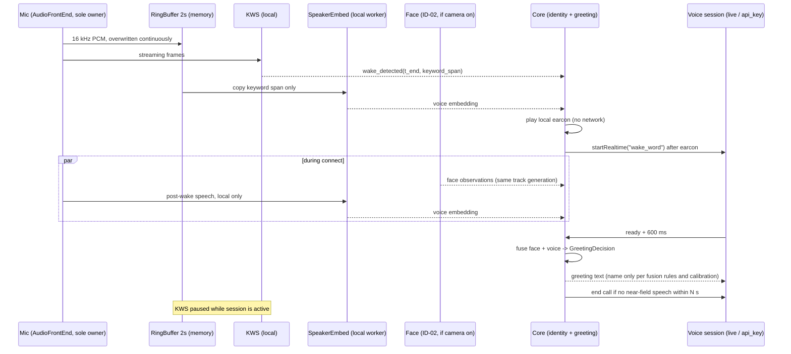

<!-- bilingual: source=zh-TW -->

> [繁體中文](17_Wake_Word_and_Speaker_Recognition_Plan_2026-10.md) | [English](17_Wake_Word_and_Speaker_Recognition_Plan_2026-10.en.md)

# Local wake word and family voice recognition plan

Date: 2026-10-29, Asia/Taipei. Status: **planned, unimplemented**; revised the same day after an independent review and updated with George's nine decisions of the same day (§14). This document adds no wake, always-on capture, or voice recognition code. It made no recordings, created no family voice data, and passed no hardware gate. Code review baseline: AIOS main `876eeaaf7697cf4a3847e0687430c536f4a1d9a7`. External versions, licenses, and model cards were checked on 2026-10-29; sources are in §15.

**Status on 2026-11-01 (wake word changed to Hello Nous):** WK-01a, WK-01b and WK-02 are merged and wake works inside the App (flag `NOUS_WAKE`, off by default). George's WK-00 Mac trial on 2026-10-31 showed that neither model recognised his natural 「哈囉努斯」, so George switched to the English **Hello Nous** (zh-en-3M ARPAbet; Nous as nose / nows / noose; boost 1.5, threshold 0.15; §3.3, §14 ①). After a capture AudioWorklet bug was fixed (#72), George woke it 4/4 times in the App. Numbers and open items: [WK-00 Mac trial](validation/wk-00-mac-2026-10-31.en.md). The rest of this document is the 2026-10-29 plan; where it uses 「哈囉努斯」 as the example, read Hello Nous.

**2026-10-31 update (WK-01a):** Following George's decisions of the same day (§14.1), WK-01 is split into WK-01a and WK-01b. WK-01a has added the always-on wake listening foundation on branch `claude/wk-01` (based on main `9778b41`, not yet committed or merged): `AudioFrontEnd`, AudioWorklet → worker capture, the 2-second ring buffer, preferences and automatic resume, self-trigger protection, the local earcon, menu bar and brain indicators, and the feature flag `NOUS_WAKE` (off by default). **The real wake engine is not connected yet:** the product detector honestly reports `runtime_missing`, never opens the microphone, and never detects; the Mac gate has not been run. See [WK-01a validation](validation/wk-01a-2026-10-31.en.md). The same day, the preparatory part of WK-01b was also done (the GitHub Actions workflow that self-builds the wasm, `wake:setup -- --product`, the manifest format, and the worker load path; the workflow has not run yet, and nothing can detect); see [WK-01b preparatory batch validation](validation/wk-01b-prep-2026-10-31.en.md). WK-02 was also done the same day (branch `claude/wk-02`, based on main `40d92fb`, not yet committed or merged): the `wake_word` start source, a limit of 3 per minute (resuming automatically when the time is up), always greeting after a wake, automatic end after 5 s of silence, F6 cost records, the Companion `activation=wake` contract, and the rewritten `NSMicrophoneUsageDescription`. Because there is no engine yet, the product never triggers and there are only fixture tests; see [WK-02 validation](validation/wk-02-2026-10-31.en.md). The rest of this document is still a plan.

Entry points are the [document index](README.en.md) and [current implementation status](Current_Implementation_Status.en.md). This plan extends [14 Family recognition and named greetings](14_Family_Recognition_and_Greeting_Plan_2026-10.en.md), [ADR-0001](adr/ADR-0001-local-family-recognition.en.md), [15 Companion Mode](15_Companion_Mode_Spec_2026-10-24.en.md), and [16 Family memory layer](16_Nous_Memory_Layer_Design_2026-10-26.en.md). It does not replace them.

## 1. George's requirements and this document's answers

George stated four requirements on 2026-10-29. The table summarizes this document's answers; the sections give details.

| Requirement | Answer in this document |
|---|---|
| Wake word: list candidates before deciding | Do not use “Nous” alone. Recommend 「哈囉努斯」 (“Hello Nous”) first and 「嘿努斯」 (“Hey Nous” in Mandarin) second. Decide from WK-00 living-room measurements of false accepts and false rejects (§3) |
| Always-on listening: switchable, local detection, red lines unchanged | Off by default. When on, microphone audio enters only a 2-second in-memory ring buffer and a local detector. Unwoken audio is never written to disk, never enters traces, and never leaves the device. The App shows its own capture indicator, and the state comes from device events (§5). With the preference on, listening resumes automatically after the App reopens and after sleep or lock, with a resume notice (§5.8). After a wake, a local earcon plays before the call opens, and the call ends automatically without speech, because a false wake opens a paid call and sends living-room audio to the cloud (§5.7) |
| Voice recognition: names, cross-check with face, convenience limits, link memory | Enroll in the “Family recognition…” screen. Voice and face bind to the same `person_id`. Only face-voice agreement counts as confident; on disagreement, use no name. Command limits are convenience only and **not security authorization**, and apply only when a minor is enrolled (§8). Memory is read and written only after the core selects a person; identity only proposes a candidate (§6–§9). Voice-only enrollment is allowed; after threshold calibration, a wake can produce a named greeting from voice alone, and before calibration the greeting carries no name (§4.4) |
| Wake and voice share audio and integrate with existing routes | The wake-word audio also feeds voice recognition. Speech after the wake word adds local evidence. Wake becomes a third interaction start source and reuses both live voice routes and the greeting decision; `AudioFrontEnd` is the only microphone owner (§4, §10) |

State the memory dependency chain first: MEM-1 in [16 §11](16_Nous_Memory_Layer_Design_2026-10-26.en.md#11-分批實作與放行) covers only ordinary text chat. Memory for ChatGPT plan (live) voice waits for MEM-2, and memory for API key voice waits for MEM-3. When this plan's SP-02 ships, it provides **only the person-candidate interface**; no voice route reads or writes memory early (§9, §13.4).

The product boundaries of this document are:

- Identity is used only for names, personalization, and convenience limits. Identity cannot unlock private data, pass the Action Gate, or replace an explicit confirmation for the current action (same as [ADR-0001 §2.5](adr/ADR-0001-local-family-recognition.en.md#25-身分不作授權依據)).
- External side effects such as sending, publishing, paying, and permanent deletion still need the Action Gate and an explicit confirmation each time. A voice recognition result does not change this rule.
- Voices can be recorded, synthesized, or imitated. This plan makes no claim of replay or imitation resistance (§7.4).

## 2. Current state: no wake or always-on capture exists

The following was checked against code at `876eeaa`. Note of 2026-10-31: line numbers moved after WK-01a (baseline `9778b41` plus WK-01a). The API key route calls `getMicrophone()` at `src/realtime.ts:288` and the live route at `src/live-voice.ts:180`; `browserRealtimeDeps().getMicrophone` is at `src/realtime.ts:891`, and live reaches it through `base.getMicrophone` at `src/main.ts:520`. With `NOUS_WAKE=on`, `wakeMicrophone()` at `src/main.ts:552` switches to leasing from `AudioFrontEnd` (§10.3). The table below keeps the content as of `876eeaa`.

| Item | Current code | Impact on this plan |
|---|---|---|
| Wake or keyword detection | None. The header comment of `src/voice.ts` says “no background wake, no saved audio”; push-to-talk in `src/main.ts` is also marked “explicit start, no background wake” | Wake is a new capability that needs new modules and privacy tests |
| Push-to-talk | Web Speech API, `continuous = false`. Chrome / Edge send audio to the browser vendor's cloud recognizer; first use requires consent (`localStorage` key `nous.voice.cloud-consent.v1`) | Web Speech is cloud recognition and **must not be used to detect the wake word**, or unwoken audio would leave the device |
| Continuous voice conversation | Web Speech `continuous = true`, sending audio to cloud recognition while the mode is on; separate consent key `nous.voice.continuous-consent.v1` | Same as above. This mode opens its own capture, so `AudioFrontEnd` must release the microphone completely while it runs (§10.3) |
| Live voice | Two routes: ChatGPT plan (live, `src/live-voice.ts`) and OpenAI API key (`src/realtime.ts`). Both get the microphone through `getMicrophone()`: the API key route calls it at `src/realtime.ts:185`, the live route at `src/live-voice.ts:155`. Both use `browserRealtimeDeps().getMicrophone` at `src/realtime.ts:548`, which is `getUserMedia({ audio: { echoCancellation, noiseSuppression, autoGainControl } })` (live reaches the same function through `base.getMicrophone` at `src/main.ts:258`). Whole-call audio is sent over WebRTC, and all tracks stop at the end | These are the routes a wake event must start. `getMicrophone` must change to lease from `AudioFrontEnd` (§10.3) |
| Start sources | `RealtimeStartSource = "look_to_talk" \| "user"` (`src/realtime-session.ts`, `server/realtime-routes.ts`). Only `look_to_talk` gets a core-issued interaction ID and a greeting decision | Add a `wake_word` source (§10) |
| Camera | `src/sense/pipeline.ts` opens the camera with `audio: false` | Camera and microphone are currently separate streams |
| Electron permissions | `desktop/main.mjs` grants `media` only to pages at the core URL; `NSMicrophoneUsageDescription` in `desktop/scripts/package.mjs` says “Audio is sent to your selected voice service” | When always-on local detection ships, rewrite this system text and provide both languages |
| Family recognition | ID-01 / ID-02: face only. The gallery is `userData/identity/gallery.v1.json`; each person has `person_id`, name, `minor`, and face features | Voice features extend the same gallery (§11) |
| Smart home | H1b AIFA air conditioning currently sends a voice or text request directly (H1 defaults to allow); results report only sent / unknown | Convenience limits must not regress this current behavior (§8) |
| Memory | MEM-0: in `server/memory/boundary.ts`, only the core calls `MemoryBoundary.openSession(subject)`. `Subject` is `household` or `person` + `profileId`. The module always rejects the `live` and `api_key` routes. `server/memory/store.ts` is the encrypted snapshot. Product memory is not enabled | Identity can only propose a person candidate; the core flow from MEM-1 onward selects the person (§9) |
| Companion Mode | Only the [15 specification](15_Companion_Mode_Spec_2026-10-24.en.md); no code. The spec says “no family voiceprints by default” | Companion's `activation=wake` can share the wake engine. Voice recognition in Companion needs separate consent (§10.4) |
| Brain auditory region | In `shared/domain.ts`, the auditory region lights only from conversation topic keywords; its help text says it “does not mean capture is active” | Always-on listening must not light the auditory region; build a separate capture indicator (§5.4) |

Conclusion: capture happens today only after an explicit user start (button, look-to-talk, continuous voice mode), and every path hands audio to a cloud service. The repo has no local wake, local VAD, local ASR, or voiceprint code.

## 3. Wake word candidates and recommendation

### 3.1 How to judge false-trigger risk

Picovoice's guidance: words with fewer than 6 phonemes are harder to detect and false-trigger more; a prefix such as “Hey” or “OK” helps; avoid words that resemble everyday speech, names, or common commands; varied vowels and phonemes help; avoid very long phrases ([Picovoice: Choosing a wake word](https://picovoice.ai/docs/tips/choosing-a-wake-word/), read 2026-10-29). Sensory's guide says many successful wake words have about 3 syllables ([Sensory 2026 guide](https://sensory.com/custom-wake-words-branded-voice-ux-guide-2026/)). These are vendor experience, not measurements in this repo.

Nous's home has two extra risks:

1. The LG TV in the living room plays programs all day ([15 §1](15_Companion_Mode_Spec_2026-10-24.en.md)). English “news” (/nuːz/) differs from “Nous” (/nuːs/) by only the final phoneme, and English news programs say it constantly.
2. Nous's TTS and model replies may say “Nous / 努斯” themselves and trigger the detector.

### 3.2 Candidate comparison

Counting method: English uses ARPAbet phonemes (Nous is not in common dictionaries; it is read as N UW1 S after Greek νοῦς). Mandarin uses sherpa-onnx `ppinyin` units, that is, each character's initial plus toned final. The official example 「你好军哥」 is `n ǐ h ǎo j ūn g ē`, 8 units ([sherpa-onnx KWS pretrained models](https://k2-fsa.github.io/sherpa/onnx/kws/pretrained_models/index.html)). Pinyin units and English phonemes are different units, so comparisons are rough; WK-00 measures the actual false accepts.

| Candidate | Syllables | Phonemes / units | Similarity to everyday speech | Assessment |
|---|---:|---:|---|---|
| “Nous” | 1 | 3 (N UW1 S) | Nearly identical to English “news”; Mandarin 努 / 怒 are common | **Not recommended**. Shortest and closest to TV content |
| 「嘿 Nous」 / Hey Nous | 2 | 5 (HH EY1 N UW1 S) | 「嘿」 is a common interjection; “hey news” can occur in programs | Below 6 phonemes. Usable as an English alias, not as the only wake word |
| “OK Nous” | 3 | 6 (OW2 K EY1 N UW1 S) | “OK” is extremely common in Taiwanese speech | Not recommended; the prefix is too common |
| 「嘿努斯」 | 3 | 6 (`h ēi n ǔ s ī`) | 「努斯」 is rare in Mandarin; 「嘿」 is common | **Second choice**. Short and easy to say, but exactly at the 6 boundary |
| 「哈囉努斯」 | 4 | 8 (`h ā l uō n ǔ s ī`) | 「哈囉」 is a common greeting, but the whole phrase is rare; vowels a / uo / u / i vary | **First choice**. Balances length and rarity |
| 「你好努斯」 | 4 | 8 (`n ǐ h ǎo n ǔ s ī`) | 「你好」 is among the most common words in TV dialogue; it also undergoes third-tone sandhi | Not recommended; the prefix overlaps TV too much |
| 「努斯同學」 | 4 | 8 (`n ǔ s ī t óng x ué`) | 「同學」 is common; the style resembles 「小愛同學」 | Backup option, depending on whether the family likes it |
| A Mandarin nickname, for example 「小諾」 | 2 | 4 (`x iǎo n uò`) | 「小」 is a very common prefix | Not recommended; too short |

Notes:

- Confirm first how the family actually pronounces “Nous” (努斯, 諾斯, or English /nuːs/). The sherpa-onnx keyword file describes words by pronunciation units, so one word can be registered with two pronunciations. Each extra pronunciation adds some false-accept opportunity.
- Taiwanese Mandarin tones can differ from standard `ppinyin` tones. WK-00 checks with real family recordings whether tones need relaxing.
- The wake word must also avoid sentences Nous often says. The detector pauses while Nous mentions its own name (§5.3), but negative tests still cover this.

### 3.3 Recommendation

Recommend 「哈囉努斯」 first and 「嘿努斯」 second. Add the English alias “Hey Nous” only if George needs English wake. Reasons:

1. 4 syllables and 8 pinyin units are roughly close to and above Picovoice's 6-phoneme minimum (different units, so only a rough estimate), without being as hard to say as phrases of 6+ syllables.
2. 「努斯」 is rare in Mandarin and avoids the near-homophone with English “news”; “Nous” alone cannot avoid it.
3. sherpa-onnx open-vocabulary KWS needs no recordings or training, so WK-00 can test two or three candidates at once and decide from data.

On 2026-10-29 George chose 「哈囉努斯」 (§14 ①). WK-00 still measures false accepts per hour with the TV on and the success rate over 30 family wake attempts; if the data is clearly poor, report back to George instead of changing the word unilaterally.

**Word changed on 2026-10-31:** in the Mac trial both models barely recognised George saying 「哈囉努斯」 (0/20 live, at most 1/10 across 116 offline settings). Following the rule above, this was reported to George, who switched to the English **Hello Nous**. zh-en-3M has English ARPAbet units; George's "Nous" is close to "nose" (`N OW1 S`), and the original `N UW1 S` scored 0/10. The setting is three lines `HH AH0 L OW1 N {OW1,AW1,UW1} S` with boost 1.5 and threshold 0.15: George 9/10 offline, 7/10 live on the command line, 4/4 in the App, and "Hello" alone 0/6. The TV negative and other family members are not measured yet; see [WK-00 Mac trial](validation/wk-00-mac-2026-10-31.en.md).

## 4. Timing of wake, voice, face, and voice routes

### 4.1 The flow of one wake

1. When always-on listening is on, `AudioFrontEnd` owns the only microphone stream. It writes 16 kHz mono PCM into a 2-second ring buffer and streams it to KWS.
2. When KWS detects the wake word, it reports the end time and the keyword span. Only that span is copied from the ring buffer to the voice recognition worker. Audio before the span is not used and disappears as the buffer overwrites it.
3. The core first plays a local earcon (no network). Only after the earcon ends does it start live voice with the `wake_word` source, reusing the existing connection, billing notice, and live→API key route change (§5.7).
4. During connection, if the camera is on, existing ID-02 face sampling continues. Speech after the wake word keeps adding voice evidence locally.
5. At voice readiness + 600 ms, the core uses the fusion rules in §7 to decide whether the greeting includes a name, reusing `GreetingOnce` and `GreetingDecision`.
6. After the call starts, KWS pauses so it does not treat Nous's own playback or the user's later speech as a wake (§5.3). If local VAD detects no near-field speech within N seconds after the wake, the call ends automatically (§5.7).

### 4.2 Why the wake segment is not enough to identify a person

The wake word lasts about 0.6–1.2 seconds (estimated from syllable count and speech rate; WK-00 measures the actual length). Speaker verification error rises sharply on short speech. Table 3 of a July 2026 arXiv paper ([Kang et al., arXiv:2609.25007](https://arxiv.org/abs/2609.25007)) lists VoxCeleb1-O results: the WavLM + ECAPA-TDNN baseline (pre-trained and fine-tuned on 3-second segments, with large-margin fine-tuning on 6-second segments; training data is the VoxCeleb2 development set) has 2.393% EER on 3-second test segments, rising to 18.437% on 1-second segments. The same architecture trained on 1-second segments drops to 10.346%, and the authors' VAM-ECAPA reaches 8.334%.

Limits of these numbers: the model is WavLM + ECAPA, not the CAM++ this plan recommends; the data is English celebrity interviews; it is not a home microphone. They cannot represent CAM++ in this home. They only show that “a 1-second wake segment alone, without calibration in this home, should not produce a name”.

The plan therefore uses two kinds of evidence:

- **Wake segment (about 1 second)**: available before the greeting decision. It is compared text-dependently against the enrolled wake-word samples only; until `calibrated_keyword` is done, it is weak evidence and alone never produces a name (§4.4, §7.2).
- **Post-wake speech (2–3 seconds or more accumulated)**: for example, 「幫我想晚餐」 (“help me plan dinner”) in 「哈囉努斯，幫我想晚餐」. This evidence usually becomes sufficient after the greeting decision. It feeds revocation checks and convenience limits, not a late name (as in 14 §3: “if the model recognizes only after the generic greeting, do not add the name this time”).

### 4.3 Speech said in the same breath as the wake word

Users often say 「哈囉努斯，開燈」 (“Hello Nous, turn on the light”). Both live voice routes use a live WebRTC audio track, so audio before the connection completes cannot naturally enter the call. First version (decided in §14 ⑦):

- Speech between the wake and connection completion stays only in local memory for VAD and voice recognition. It is **not sent to the cloud** and is dropped when the connection completes or times out (8-second limit).
- After the greeting, the user repeats the request. On a slow connection, the existing subtitles show “connecting”.
- On 2026-10-29 George decided not to forward it to the cloud (§14 ⑦). Forwarding later (for example by appending audio through Realtime events) would widen what leaves the device and needs a separate decision.

### 4.4 Identify by voice and greet by name

On 2026-10-29 George asked that once a voice is recognized, Nous greets the person by name (face-based naming already has code in ID-02). The design reuses ID-02 instead of building a second mechanism:

- **Same decision and sentences**: the same `GreetingDecision`, the same fixed sentence list (`GREETING_TEMPLATES` in `shared/sense.ts`), the same `speakableName` name check, the same one-time cloud naming notice (no name until it has been seen, reason `notice_unseen`), and the “Use recognized family names in greetings” setting (when off, never a name).
- **Only core-issued interaction IDs**: `greeting` accepts only an interaction ID the core issued for `wake_word`, bound to a voice session that is actually connected, within 20 seconds of connecting (following ID-02's `claimGreeting`, §11.2).
- **Decision time unchanged**: still voice readiness + 600 ms. The core uses only the voice evidence that “already exists” at that moment: the wake-word segment, plus any local-only speech the user happens to say during the earcon and connection. **It never delays the greeting to wait for more speech**; with insufficient evidence it says a sentence without a name, and a later recognition never adds the name (as in 14 §3 and ID-02).
- **Why not wait for the first seconds of call speech**: by §4.2's reference numbers, text-independent EER on 1-second segments is 10.346%–18.437%, and reliable naming usually needs 2–3 seconds of speech or more. But under §14 ⑦ the user usually states the request only after hearing the greeting, so waiting for speech would delay the greeting and often never get enough. The first version therefore uses only existing evidence and drops the name when it is not enough.
- **Making the wake segment more useful**: the wake word is fixed text. Enrollment records the wake word 5 times (§11.3) and stores them as text-dependent matching templates; the wake segment is compared only with these templates, not with the read sentences. Text-dependent matching is usually more accurate than text-independent matching of the same length, but the numbers for this home are unknown and §4.2's paper figures do not apply; only SP-03 can measure them with family holdout samples.
- **Calibration per segment type**: `calibrated_keyword` (wake segment, text-dependent) and `calibrated_utterance` (speech of 2 seconds or more) are tracked separately. With voice only, a name is allowed only after the matching segment type is calibrated; before that, the greeting is a sentence without a name, such as 「我在」 (“I'm here”) or 「嗨，我在」 (“Hi, I'm here”). SP-03's release condition is S7's 0 wrong names in 100 (an MVP threshold, not a claim of zero general error), with the false-reject rate reported separately; if it is not met, naming stays off, and the threshold is never lowered to make the numbers work.
- **With a face**: when both face and voice exist, follow §7.3 fusion; no name when they disagree.
- **Switch relationship**: the wake segment and pre-connection speech belong to the wake itself and depend on “Always-on wake listening” and whether the person enrolled a voice. “Recognize speaker during calls” (off by default, §14 ⑧) governs only per-utterance checks after connection and does not affect the named greeting at wake.
- **Disclosure**: where names go in the cloud is the same as ADR-0001 §2.4. The naming notice gains a line saying recognition “may also be by voice”, within ADR-0003's scope (§11.2).
- **Expected experience**: before calibration, every wake hears a sentence without a name; after calibration, sufficient evidence yields for example 「嗨，George」 (“Hi, George”), and otherwise still 「我在」.

## 5. Privacy and power design for always-on listening

### 5.1 State comes from device events

Preferences and actual state are stored separately, as in [15 §2.2](15_Companion_Mode_Spec_2026-10-24.en.md#22-啟用與真正收音是兩回事).

| State | Meaning | When entered |
|---|---|---|
| `off` | Preference off; microphone not opened | Fresh install, unreadable or invalid settings (fail-closed) |
| `armed` | Preference on, acquiring the microphone, no track `live` yet | Entered automatically when the App starts or returns from sleep / lock; while permission is pending |
| `listening_local` | Source track is `live` and KWS is running locally | After the track `live` event and the AudioWorklet starts processing |
| `in_call` | The source track is leased to live voice; KWS paused | When live voice leases the microphone from `AudioFrontEnd` |
| `released` | `AudioFrontEnd` stopped the source track for a mode that opens its own capture | When Web Speech push-to-talk or continuous voice mode starts |
| `error` | Permission denied, device removed, model hash mismatch | The corresponding error event |

The interface shows “listening for the wake word” only in `listening_local`. A checked box, a settings file, or a mode name never stands in for a device event. George decided on 2026-10-29 (§14 ③, different from the original recommended default): with the preference on, always-on listening resumes automatically after the App reopens, and consistently after sleep or screen lock as well. Resuming enters `armed` first and moves to `listening_local`, showing listening, only after a track `live` event; denied permission or a missing device enters `error` and is reported honestly. See §5.8 for the resume notice and privacy mitigations.

### 5.2 Audio stays in memory

| Data | Location | Retention | Rules |
|---|---|---|---|
| Unwoken audio | AudioWorklet ring buffer | 2 seconds, continuously overwritten | Never written to disk, never in traces / logs, never over IPC or HTTP, never sent out. 16 kHz × 16 bit × 2 seconds = 64,000 bytes; 128,000 bytes if stored as float32 |
| Wake word span | Voice worker memory | One feature computation | Copy only the span the detector reports; discard after computing |
| Post-wake speech (before connection) | Voice worker and VAD memory | Until connection completes or the 8-second timeout | Local evidence only; not sent to the cloud (§4.3) |
| Voice feature vector | Worker → IPC → core memory | Discarded after matching | Not logged; traces record only state and duration. IPC carries features only, never audio |
| Detection event | Core memory and trace | Per existing trace rules | Records only time, keyword index, and whether the score passed the threshold; no audio, no person ID or name |

Why 2 seconds: the buffer must cover a wake word of up to about 1.2 seconds plus detection latency, with some margin. A longer buffer keeps more unwoken conversation in memory. After WK-00 measures the actual wake-word length, the buffer may only shrink. Buffer length is an engineering decision, not one of George's decisions. Look-back is used only for the wake word itself. Speech before the wake word is never sent to the model or to voice recognition.

### 5.3 Prevent self-triggering and microphone contention

- KWS pauses during live voice (`in_call`). After the call ends, it returns to `listening_local` if the preference is still on, within the same run, and device events confirm the source track is still `live`.
- **This rule deliberately differs from [15 §3.1](15_Companion_Mode_Spec_2026-10-24.en.md#31-事件與所有權)**: Companion does not resume capture automatically after another voice mode ends, and a cold start enters only `armed` (15 §2.2), because Companion sends gated content to a model. Always-on wake detects only locally, the user turns it on precisely to stay wakeable between calls, and George decided on 2026-10-29 that it also resumes automatically after the App reopens and after sleep (§5.8). 15 now carries a cross-reference. If the user turns the preference off during a call, it does not resume afterwards.
- After a Web Speech mode ends (`released`), reacquiring the microphone means restarting capture: within the same run it may reopen automatically, but it shows listening only after a track `live` event.
- KWS pauses during Nous playback and for 1.5 seconds after it ends. 1.5 seconds is a starting point; WK-01 adjusts it from measured echo.
- No second trigger fires within 3 seconds of a wake, so one wake cannot open two calls.
- The existing `startRealtime` already ignores a start when `realtime.on || realtimeStarting`, so simultaneous look-to-talk and wake open only one call.

### 5.4 Clear capture indicators

- The macOS orange dot means an App uses the microphone, but when a camera is also in use, only the green dot shows ([Apple: Control Center indicators](https://support.apple.com/guide/mac-help/mchl50f94f8f)). Nous often has the camera on, so it **cannot rely on the system indicator alone**.
- The App provides two indicators: the menu bar “Camera and voice settings” shows “Wake listening: listening locally / in call / paused / unavailable”; the brain screen keeps a minimal local-listening icon (06's `ambient` state already reserves “keep a minimal indicator if a wake microphone is enabled”).
- Always-on listening **does not light the auditory region**. The auditory region still lights only from real conversation topics (the CLAUDE.md brain requirement). Only after a successful wake, when capture starts, does the existing voice state show listening.
- Indicator text and accessible labels use the shared localization catalog in both Traditional Chinese and English.
- WK-01a implementation (2026-10-31): the last section of the menu bar “Camera and voice settings”, “Wake word”, shows “Wake listening: Listening locally / Starting / In a call / Paused / Microphone handed over / Unavailable / Off” with the reason, and the state comes only from device events reported by the page; the small microphone icon below the brain shows only in `listening_local` and does not change region activity.

### 5.5 How to turn it off

- The menu bar checkbox “Always-on wake listening”: turning it off synchronously stops the `AudioFrontEnd` source track (during a call, it stops when the call ends and does not resume), clears the ring buffer, and ends the KWS and voice workers, then saves the preference. If saving fails, capture still stops first and the save failure is shown.
- The “Pause listening” shortcut stops only until the current run ends and leaves the preference unchanged. While paused, returning from sleep or lock does not resume; reopening the App does resume, and the subtitle says so. To stop for good, turn off the menu bar switch.
- System sleep, screen lock, logout, microphone removal, or permission revocation always stop capture. After sleep or lock, listening resumes automatically per §14 ③ (first `armed`, listening shown only after a track `live` event, with a resume notice, §5.8); removal and revocation enter `error`, with no automatic switch to another microphone and no repeated background retries.
- Saying “stop listening” is handled by the existing voice flow only during a call. The wake detector recognizes only the wake word, so speech cannot be the only way to turn it off.

### 5.6 Power and CPU

The Mac mini has no battery, so the concern is CPU and heat, and not slowing the existing 80 ms sensing loop or palm stop. Design:

- Filter with sherpa-onnx's built-in VAD first, so KWS decoding does not run without speech. WK-00 compares whether this actually saves CPU.
- Use one 16 kHz mono stream; do not open a second microphone stream for KWS.
- Stop on screen lock and sleep.
- Budget: WK-00 first measures CPU, memory, and 80 ms loop latency for KWS + VAD alone and together with the camera pipeline. The proposed release condition is “single-core average ≤ 10%, and the existing sensing loop p95 degrades by no more than 10%”. Both numbers are proposals, not measurements. The only external reference is openWakeWord's claim that one Raspberry Pi 3 core runs 15–20 openWakeWord models in real time ([openWakeWord README](https://github.com/dscripka/openWakeWord)), which is neither sherpa-onnx nor a Mac.

### 5.7 The cost of a false wake and the buffers against it

A false wake (for example, the TV saying a similar phrase) is not harmless: it **opens a live call**. The API key route bills by usage; the ChatGPT plan route also uses account quota. During the call, living-room audio picked up by the microphone (TV, other people's conversation) goes over WebRTC to the cloud voice provider until the call ends. Design:

1. **Play a local earcon first**: after detecting the wake word, play a short local earcon (about 0.3–0.5 seconds, no network), and open the call only after it ends. During this time the user can press Esc, use the palm stop, or dismiss to cancel; a cancel opens no call. The earcon is only a buffer; it cannot stop a false wake the user does not notice.
2. **End automatically without speech**: after the call is ready, if local VAD detects no near-field speech within N seconds, end the call automatically and return to listening. N starts at 5 seconds; WK-01 adjusts it to the family's actual reaction time. TV dialogue is also speech, so this rule can only shorten, not eliminate, what a false wake sends out.
3. **Cost record**: every `wake_word` call goes into the cost record of [13 F6](13_Feature_Expansion_Assessment_2026-10-24.en.md#f6單一收音者可分辨的停止與費用紀錄): route, connected seconds, whether it ended automatically for “no speech”, and usage received. Without unit prices or account usage evidence, mark the cost “unknown” and never extrapolate a definite bill.
4. **Rate limit**: at most 3 `wake_word` calls per minute (the same as ADR-0001's `greeting` limit). Beyond that, pause listening and show the reason, preventing false-wake loops or page scripts repeatedly opening calls (§11.2).

### 5.8 Automatic resume and the resume notice

George decided on 2026-10-29 that, with the preference on, always-on listening resumes automatically after the App reopens and after sleep or screen lock (§14 ③). The red lines and honesty rules do not change:

1. **Trigger**: the preference is on and “Pause listening” was not used in this run; resume starts when the App launches or the system wakes / unlocks. This feature does not handle “open the App at macOS login”, which is a separate setting.
2. **Device events decide**: `armed` → `getUserMedia` → track `live` and the AudioWorklet starts processing → `listening_local`. Only the last step shows “listening locally”.
3. **Resume notice**: on each successful automatic resume, the main window shows a one-time subtitle 「已恢復常駐喚醒聆聽（只在本機偵測『Hello Nous』）」 (“Always-on wake listening resumed (detects “Hello Nous” only on this device)”) for about 5 seconds, and the menu bar state updates. The subtitle uses the existing subtitle component and the shared localization catalog. If the main window is not shown, the menu bar state is authoritative, and the subtitle appears once the next time the main window shows.
4. **Report failures honestly**: denied microphone permission, a missing previously used microphone (different `deviceId`), or a model load or hash failure all enter `error`. The subtitle and menu bar state the reason, for example “Microphone permission denied; always-on listening is off” or “The previously used microphone was not found”, and offer the existing “Open system microphone settings” menu item. Never switch to another microphone, never show listening, never retry repeatedly in the background.
5. **Privacy mitigations**: after a reopen, users may not remember that it is listening. Mitigations:
   - The explanation shown when the switch is first turned on says “Listening resumes automatically after the App reopens and after sleep, until you turn this switch off.”
   - Every resume shows the one-time subtitle and the menu bar state; the brain screen's minimal local-listening icon stays visible throughout `listening_local` (§5.4).
   - “Pause listening” lasts only until the current run ends; stopping for good requires turning off the menu bar switch, and the screen says so honestly.
   - Automatic resume does not change what leaves the device: unwoken audio still stays only in the 2-second ring buffer (§5.2), and false wakes still get §5.7's earcon, automatic end, cost record, and rate limit.
   - macOS still manages microphone permission; revoking it in System Settings stops capture immediately.

## 6. Wake engine comparison and recommendation

### 6.1 Comparison (checked 2026-10-29)

| Engine | Version and license | Chinese and custom words | Where it runs here | False accept / reject data | Conclusion |
|---|---|---|---|---|---|
| sherpa-onnx KWS | npm `sherpa-onnx-node`: 1.13.8 (2026-09-10), 2.0.0 (2026-10-23), 2.0.1 (2026-10-26); PyPI `sherpa-onnx` 2.0.1. Code Apache-2.0 | Open vocabulary: write pronunciation units in a keyword file, with boost `:1.5` and trigger threshold `#0.35`; **no recordings or retraining**. Chinese model `sherpa-onnx-kws-zipformer-wenetspeech-3.3M-2024-01-01`; Chinese-English model `sherpa-onnx-kws-zipformer-zh-en-3M-2025-12-20` (`phone+ppinyin`) | Node addon (`sherpa-onnx-node` ships the `test_keyword_spotter_transducer_microphone.js` example). Browser wasm needs a custom build with `build-wasm-simd-kws.sh`, with models packed into wasm assets; the npm `sherpa-onnx` package is wasm for Node, not a browser build | No published false-accept rate; must measure | **Recommended**; the training-data license risk is in §14 ② |
| openWakeWord | PyPI 0.6.0 (2024-02-11). Code Apache-2.0; **bundled pretrained models are CC BY-NC-SA 4.0** | English only; custom words need thousands of TTS-generated samples plus training | Python; the README says a JavaScript version would need substantial porting and is not on the roadmap | Targets < 5% false reject and < 0.5 false accepts per hour (measured on DiPCo, about 5.5 hours) | **Excluded**: NC model license violates CLAUDE.md; no Chinese |
| microWakeWord | Code Apache-2.0; README calls it an early release where training “is still very difficult” | Synthesized with the Piper sample generator, whose LibriTTS-R generator supports English only | TFLite Micro for microcontrollers such as ESP32 | No usable numbers for this home | **Excluded**: no Chinese sample generator; high training cost |
| Picovoice Porcupine | `pvporcupine` 4.0.3, `@picovoice/porcupine-web` 4.0.1. SDK source is Apache-2.0, but running it requires an AccessKey; custom words are generated as `.ppn` in Picovoice Console | Console supports Chinese custom words, generated quickly | Web and Node SDKs exist | Public benchmark exists | **Excluded**: a community post relays Picovoice's reply that “the Free Tier ends 2026-06-30 and no non-commercial tier is planned”; as of 2026-10-29 this could not be verified on an official Picovoice page. Either way, running it requires an AccessKey and is bound by Picovoice's license terms. Re-evaluate if George is willing to buy |
| Snowboy | Originally Apache-2.0 | Needs personal recordings | — | — | **Excluded**: official service ended 2020-12-31; community support only |
| Apple native | `SpeechDetector` (VAD) and `SpeechTranscriber` since macOS 26; `SNClassifySoundRequest` (since macOS 10.15) accepts a custom Core ML sound classifier; `requiresOnDeviceRecognition` keeps `SFSpeechRecognizer` audio on device | No public custom wake-word API. Options are “on-device transcription + text match” or a “Create ML sound classifier (requires recording and training)” | Needs a Swift native module and signing | None | **Not first choice**: continuous transcription costs far more than KWS; the classifier needs recorded training. `SpeechDetector` is a VAD fallback |
| Web Speech API | Built into the browser | — | renderer | — | **Forbidden** for wake: Chrome / Edge send audio to the cloud, violating “unwoken audio must not leave the device” |

### 6.2 Recommendation and training-data risk

Recommend sherpa-onnx KWS, comparing the Chinese-English model `zh-en-3M-2025-12-20` with the Chinese model `wenetspeech-3.3M-2024-01-01`. Reason: it is the only candidate that needs no recorded training, supports Chinese and code-mixed Chinese-English, has Apache-2.0 code, and runs in Node and wasm. The same dependency also provides VAD and speaker embeddings (§7), matching the speech-stack direction of [08](08_Consolidation_and_Update_2026-10.en.md) P6.

Record the license risk honestly. It is the same kind as the [pending SFace item in ADR-0001 §9](adr/ADR-0001-local-family-recognition.en.md#9-george-的決定與仍待決事項):

- The `wenetspeech-3.3M` model page says it was trained on WenetSpeech L (10,000 hours). The official WenetSpeech website says, verbatim, “available to download for non-commercial purposes under a Creative Commons Attribution 4.0 International License”. CC BY 4.0 itself permits commercial use, yet the same sentence restricts use to non-commercial purposes, so **the terms contradict themselves**. The OpenSLR page lists only CC BY 4.0. The official site also says audio copyright stays with the owners of the original video or audio; WenetSpeech does not own it. The model weights carry no separate NC label.
- The `zh-en-3M-2025-12-20` documentation does not state its training data.
- The English model was trained on GigaSpeech XL. The GigaSpeech repo is Apache-2.0, but the data terms sit behind an application form that could not be read for this review.

Nous is currently a household prototype that is not sold. On 2026-10-29 George decided to **accept and record** this risk (§14 ②). If it is ever sold or distributed, re-evaluate or train KWS on clearly licensed data, at far higher cost than this plan's estimate.

Version pinning: 2.0.0 and 2.0.1 are new major versions released within a week before this review. WK-00 compares 1.13.8 with 2.0.x and pins an exact version, not a range.

## 7. Voice recognition: models, states, and rules

### 7.1 Speaker model comparison (checked 2026-10-29)

| Model | Weight license | Training data and its terms | Chinese | Published numbers (self-reported) | Availability in sherpa-onnx | Conclusion |
|---|---|---|---|---|---|---|
| 3D-Speaker CAM++ `speech_campplus_sv_zh-cn_16k-common` | Apache-2.0 (ModelScope model card; 3D-Speaker repo Apache-2.0) | “A large Chinese speaker dataset of about 200k speakers”; dataset name and terms not published | Yes | ModelScope model card: CN-Celeb test EER 4.32%. 3D-Speaker repo benchmark: CAM++ 7.2M parameters (that table trains each model on a single public dataset, so it is not the same model as the 200k version; the two numbers come from different sources) | Listed in the sherpa-onnx export script; the Node addon has a `SpeakerEmbeddingExtractor` example | **Recommended**, with the undisclosed training data as a risk |
| 3D-Speaker ERes2Net / ERes2NetV2 zh-cn common | Apache-2.0 | Same, about 200k speakers | Yes | Repo benchmark (trained and tested per dataset): ERes2NetV2 EER 6.14% on CN-Celeb, 17.8M parameters | Export script lists `speech_eres2netv2_sv_zh-cn_16k-common` and others | Backup; larger and slower |
| 3D-Speaker models trained on the 3D-Speaker dataset | Apache-2.0 | 3D-Speaker dataset; the site lists CC BY-SA 4.0 (whether it covers audio is not stated) | Yes | 3D-Speaker test EER in the repo | The Node example uses `3dspeaker_speech_eres2net_base_sv_zh-cn_3dspeaker_16k.onnx` | Backup; training-data terms clearer than the 200k version |
| WeSpeaker `cnceleb_resnet34` | WeSpeaker docs give the rule “pretrained model … follows the license of its corresponding dataset” and name only the VoxCeleb version as CC BY 4.0; by that rule the CN-Celeb version is inferred to be CC BY-SA 4.0 | CN-Celeb (OpenSLR 82, CC BY-SA 4.0) | Yes | See WeSpeaker docs | Listed in the export script | Usable, but ShareAlike obligations need review |
| SpeechBrain ECAPA-TDNN `spkrec-ecapa-voxceleb` | Apache-2.0 | VoxCeleb 1 + 2; the VoxCeleb2 page lists metadata as CC BY-SA 4.0, and the site no longer provides audio or video | No (mostly English celebrities) | VoxCeleb1 EER 0.80% | Needs own export | Not recommended: Chinese performance unknown |
| NVIDIA TitaNet-Large | CC BY 4.0 | VoxCeleb, Fisher, Switchboard, LibriSpeech, SRE 2004–2010 (the latter are LDC-licensed) | No (en-US) | VoxCeleb1 EER 0.66%; about 23M parameters | Needs own export | Not recommended: English, larger |
| pyannote `embedding` / `wespeaker-voxceleb-resnet34-LM` | MIT (`embedding`; download requires agreeing to share Hugging Face information) / CC BY 4.0 | VoxCeleb | No | `embedding` VoxCeleb1 EER 2.8% | Mainly for diarization | Not recommended: wrong purpose and language; model cards suggest pyannoteAI for production |

All EER values above are self-reported by each model's authors on public datasets under different conditions. They cannot be ranked against each other, and they do not represent recognition rates in this home. No model publishes numbers for “1–3 seconds of Mandarin, home microphone, closed set of 2–5 people”. Only SP-00 and SP-03 can measure that.

Browser execution risk: sherpa-onnx's browser wasm has KWS and diarization builds, but no separate browser API for speaker embeddings; the npm `sherpa-onnx` package is wasm for Node. If SP-00 cannot build one, the fallback is to run the CAM++ ONNX directly with the project's existing `onnxruntime-web` 1.30.0, write the fbank feature front end ourselves, and cross-check against sherpa-onnx Node output. The SP-00 and SP-01 estimates include this buffer (§13.4).

### 7.2 Recognition result states

Reuse the state names from [ADR-0001](adr/ADR-0001-local-family-recognition.en.md), with a separate set for voice:

- `VoiceObservation.state`: `matched` (carries `person_id`), `unknown`, `ambiguous`, `unavailable`.
- Reasons for `unavailable`: `no_enrollment`, `too_short` (not enough valid speech), `noisy`, `model_unavailable`, `paused`, `switch_off` (“Recognize speaker during calls” is off).
- Each observation carries `wake_id` (this wake), `segment` (`keyword` or `utterance`), valid speech milliseconds, `model_id`, `gallery_version`, and per-segment calibration states `calibrated_keyword` and `calibrated_utterance` (both false until SP-03 completes).
- Evidence rules (starting point, calibrated in SP-03): a voice `matched` needs a top score ≥ `match` and a lead over second place ≥ `margin`; `segment=keyword` is compared text-dependently only against the enrolled wake-word templates, and alone is not enough for a name while `calibrated_keyword` is false; if two segments point to different people, the whole wake is `ambiguous`. Responses contain no scores; logs contain no `person_id`, name, or score.

Two separate switches (decided in §14 ⑧; “Recognize speaker during calls” is off by default):

- “Always-on wake listening”: controls whether the microphone stays open for local wake detection.
- “Recognize speaker during calls”: controls whether, during an already-woken call, a branch of the same stream feeds per-utterance voice recognition. When off, post-connection voice is always `unavailable` (`switch_off`), and fusion falls back to face only (ID-02 behavior). Look-to-talk also follows this switch. The wake segment and pre-connection speech are not affected by this switch (§4.4).
- Per George's decision of 2026-10-31 (§14.1 D3), WK-01a already places a **disabled** 「通話中辨認說話者」 checkbox in the menu bar (English UI label “Recognise speaker during calls”) with the note “Available after SP-02”; it cannot be clicked and does nothing until SP-02 enables it.

### 7.3 Face-voice fusion rules

The core fuses at the greeting decision and at the end of each user utterance. Face state comes from the same ID-02 track generation; voice comes from the same `wake_id`. The convenience column's “adult / minor / unknown” is used in §8.

| Face | Voice | Fusion result | Name | Memory person candidate (§9) | Convenience limit (§8) |
|---|---|---|---|---|---|
| matched P | matched P | `confirmed(P)` | Yes | P, confirmed per §9.2 | Per P's `minor` |
| matched P | matched Q (Q≠P) | `conflict` | **No name** | None | Unknown |
| matched P | unknown / ambiguous | `face_only(P)`, voice does not support | No name | None; user selects | Unknown |
| matched P | unavailable (for example, no speech yet, switch off) | `face_only(P)` | Per current ID-02 rules | P, needs confirmation | Per P's `minor` |
| Multiple faces | matched P | `voice_multi(P)` | No name | **None** (as in 14 §3 and 16 §4: no person selection with several people in view) | Per voice P's `minor` |
| unknown (stranger's face seen) | matched P | `conflict` (speaker may be off camera) | No name | **None** | Unknown |
| No face data (camera off, not facing) | matched P (including utterance segment) | `voice_only(P)` | Yes only when `calibrated_utterance` is true; no name before (§4.4, §14 ④) | P, needs confirmation | Per P's `minor` |
| No face data | matched P (keyword segment only) | `voice_weak(P)` | Yes only when `calibrated_keyword` is true; no name before (§4.4, §14 ④) | After calibration P, needs confirmation; before calibration none | After calibration per P's `minor`; before calibration unknown |
| Any | unknown / ambiguous / unavailable, and face is not matched either | `none` | No name | None | Unknown |

Two notes:

- “matched P + unavailable” keeps existing ID-02 behavior, so adding voice never makes look-to-talk worse. This row differs from “matched P + unknown”: the former has no voice evidence; the latter has voice that does not support P, so it gets no name.
- A fusion result is valid only for the current interaction. A person change, multiple faces, a broken track, the end of the interaction, or deleting the person invalidates it (as in 14 §3).
- Naming from voice alone is George's 2026-10-29 decision (§14 ④), conditional on the matching segment type being calibrated; with multiple faces, a stranger's face, or face-voice disagreement there is still no name.

### 7.4 State of replay and imitation defense

Research has the ASVspoof challenges and anti-spoofing models such as AASIST (AASIST code is MIT; ASVspoof 2019 data is under the Open Data Commons Attribution License). These models are trained on specific attack datasets, and home microphones, TVs, and phone playback differ greatly. This plan **adds no anti-spoofing model and makes no claim to detect recordings or imitation**. Therefore:

- Anyone who plays a recording of George on a phone may be recognized as George.
- This affects only names, personalization, and convenience limits. Every external side effect still needs the Action Gate and an explicit confirmation; a voice result cannot pass it.
- SP-03 still runs a replay test, to record honestly that “recordings are accepted”, not to claim it is blocked.

## 8. Convenience limits (not authorization)

George asks, for example, that “only adults can control the air conditioner”. This rule is a **convenience limit against children's accidental use**, not a security control:

- Recordings, imitation, a child standing next to an adult, or an adult speaking on someone's behalf can all bypass it.
- The limit can only make Nous **do less** (decline or ask an adult to confirm). It can never make Nous **do more** than an action normally allows because it recognized an adult.
- Sending, publishing, paying, permanent deletion, and H2 device policy for appliances still go through the existing Action Gate and explicit confirmation.

When it applies and defaults (decided by George on 2026-10-29, §14 ⑥):

- **It applies only when the gallery has at least one family member with `minor = true`**. Without an enrolled minor, the whole rule is off, and H1b air conditioning keeps today's direct-send behavior.
- Default is **relaxed mode**: decline only when “a minor is recognized and no modality points to an adult”; otherwise follow the existing policy. **Strict mode** must be turned on explicitly by George in settings.
- The first version suggests limiting only the air conditioner.

| Situation | Relaxed mode (default) | Strict mode (optional) |
|---|---|---|
| Fusion says adult (per §7.3), no modality points to a minor | Existing policy (H1 currently defaults to allow; the air conditioner is sent directly) | Same |
| Any modality points to a minor and none points to an adult | Decline: 「這個要請大人來設定喔」 (“please ask a grown-up to set this”); send no command | Same |
| Fusion says unknown (`conflict`, `voice_weak`, `none`) | Existing policy; no extra step | Do not execute; ask an adult to press confirm in the main window; do not accept a spoken “I am an adult” |
| Always-on listening off, camera off, or neither provides identity data (no evidence at all) | Existing policy, the same as today | Do not execute; ask an adult to press confirm in the main window |
| Typing or a button in the main window | Existing policy. Typing and buttons carry no voice evidence; if the camera currently recognizes a minor and no adult, still decline | Typing or a button is itself a main-window action and counts as confirmation; existing policy |
| No minor enrolled at all | Rule off | Rule off |

Logs say “convenience limit: not passed (reason minor / unknown)”, never “verification failed”, so nobody mistakes this for a security mechanism. WK / SP acceptance confirms that in relaxed mode the air conditioner's current direct execution does not regress (S9).

## 9. Memory linking rules (aligned with 16)

The main purpose of recognizing people is to link conversation and memory to the right family member. The rules below follow [16 Family memory layer](16_Nous_Memory_Layer_Design_2026-10-26.en.md). Changes to 16's rules are listed as George's decisions or as proposed additions to 16; this document does not change them on its own.

Dependency chain: MEM-1 in 16 §11 covers only ordinary text chat; live voice memory waits for MEM-2, and API key voice memory waits for MEM-3. Until the matching MEM batch passes, the voice rules in this section stop at “person candidate” and read or write no memory.

### 9.1 Memory isolation per family member

- 16 §4's `ProfileId` is the person key for memory. ADR-0001's `person_id` (shared by face and voice) maps to a `ProfileId` only through a removable link. Voice features never enter the memory store, and `person_id` is never given to a model.
- Each family member's memory is the data under `Subject = { kind: "person", profileId }`. MEM-0's `MemoryBoundary` binds one subject per session. Retrieval order is “core-confirmed person → visibility → validity → cloud consent → relevance”, filtering by person before ranking (16 §7).
- In the first version every memory's `audience` is only `household` (usable at home); there is no private memory (16 §3). So in the first version, “do not read out someone else's private memory” concretely means: **never put another person's preferences into the current context**, and never fill an empty result with someone else's data. Private memory waits for per-person unlock and output-device policy; no voice or face threshold is high enough to replace them.

### 9.2 Identity only proposes; the core selects the person

| Fusion result | Memory read | Memory write |
|---|---|---|
| `confirmed(P)` | Ask a short confirmation 「這次用 George 的偏好？」 (“Use George's preferences this time?”); after confirmation, read P + household. Keep the confirmation (decided in §14 ⑤) | After P is selected, write to P only on an explicit “remember” |
| `face_only(P)`, `voice_only(P)` | Same as above; confirmation is always required | Write only after selection |
| `conflict`, `voice_multi`, `voice_weak`, `none` | Read household data only | No personal writes. When the user says “remember…”, ask “Under whose name, or for the whole household?”, selected through the trusted main window or “I am George” (16 §4) |

After selection, if “Recognize speaker during calls” is on, each utterance still gets one voice check, used as a **revocation** signal, never as new authorization:

- The utterance's voice is `matched` to another person Q: revoke the current person (16 §8 person-change flow), write nothing, and say 「好像換人了，這次要用誰的偏好？」 (“Looks like someone else is speaking. Whose preferences should I use?”).
- The utterance's voice is `ambiguous`: write no personal memory for this sentence; show a pending confirmation card instead.
- The utterance is too short (`too_short`) or the switch is off, so voice cannot decide: whether to write falls back to 16 §4's original rule. The current person is a choice the user confirmed, and stays valid as long as it has not been revoked (person change, several people in view, broken tracking, OS lock, end of interaction). The camera is used only to detect these revocation events; it **never treats the person facing the camera as the speaker**. Receipts always name the person, for example 「記在 George 名下了」 (“Saved under George”).
- In no-camera mode, follow 16 §4: the screen keeps a visible “Current person: George” label, and an unclear speaker or a hand-over command triggers reconfirmation.
- Writes still need the `SourceTicket` from MEM-1 onward. An identity result can neither create nor replace a ticket.
- The per-utterance check depends on §10.3's premise: the call microphone is leased from `AudioFrontEnd`, so the local worker can take a branch of the same stream.

### 9.3 Consequences and correction of misidentification

| Misidentification | Consequence | Correction flow |
|---|---|---|
| Wrong name | Awkward; no action is allowed | The user says “I'm not George”: revoke the name and person candidate for this interaction; the core records only a “corrected” count |
| Reading after selecting the wrong person | Suggestions use someone else's preferences (for example, cilantro) | “Not me” → revoke the session (16 §8: stop affected context, close the old call, start a new one) |
| Writing after selecting the wrong person | A preference is saved under the wrong person | Receipts always name the person, so the user can notice on the spot. Correction lists the entries written in this session; each can be “moved to Amy” or “deleted”. A move = `forget` under the original person + `remember` under the new person, each needing new direct input and a ticket (16 §5 correct / forget operations) |
| Parent data triggered by a child's voice | Cannot happen: management rights are never established by voice or face (16 §5) | — |

Misidentification rates can be reported only after SP-03 measurements, with false rejects, false accepts, and `conflict` rates listed separately.

### 9.4 Deleting a family member

Consistent with ADR-0001's deletion and key rotation:

1. Deleting a person in the “Family recognition…” screen, after native confirmation, removes the person's face and voice features from the encrypted gallery, rotates the data key, and increments `gallery_version` and the key generation.
2. Deleting only the voice while keeping the face uses the same removal + rotation.
3. The same native confirmation offers an explicit option “Also delete this person's memory (N entries)”, showing the count. Default (decided in §14 ⑨): unchecked for adults; checked for minors or members marked as “moved out”. Unchecked, deletion only removes the link between `person_id` and `ProfileId` and revokes active person sessions, without silently deleting memory (16 §8); checked, it runs 16's “delete the whole person's memory”.
4. A memory profile that has lost its link stays visible in the memory management screen, labeled “no linked family recognition data”, and can be viewed, exported, or deleted.
5. Re-enrolling the same name does not automatically reconnect the old memory profile (16 §8, M16). To reconnect, after enrollment choose “Link to existing person” in the memory management screen, which lists unlinked profiles; the link is created only after native confirmation. This relink flow is a proposed addition to 16, to be confirmed together with 16 during MEM-1 design.
6. After deletion, late voice features are dropped because `gallery_version` no longer matches.

### 9.5 Minor family members

- Enrollment: the child is present, and the parent (George) checks consent in the native confirmation, as in ADR-0001 §9. Voice enrollment reuses the same `minor` and `guardian_confirmed`.
- Memory: 16 §5 says a configured parent manages ordinary preferences and the first version does not collect or infer automatically. **Proposed addition** (not a rule already aligned with 16): when a child says 「記住我喜歡恐龍」 (“remember I like dinosaurs”), create a card for parent confirmation instead of writing directly. Whether to adopt it is decided together with 16 during MEM-1 design.
- A child's voice or face cannot obtain parent management rights; neither can a recording of an adult.
- Convenience limits follow §8.

## 10. Integration with existing routes

### 10.1 Three start sources

| Source | Start condition | Face recognition | Voice recognition | Greeting |
|---|---|---|---|---|
| Look-to-talk (`look_to_talk`) | Existing facing dwell | ID-02 unchanged | When “Recognize speaker during calls” is on, sample from a branch of the leased call stream; otherwise `unavailable` | As ID-02; fusion rules in §7.3 |
| Wake word (new `wake_word`) | Local KWS trigger, after the local earcon | When the camera is on and a face is near, sample during connection | Wake segment + post-wake speech | The core issues a `wake_word` interaction ID; reuse `GreetingOnce` and 600 ms; `greeting` accepts only that ID (§11.2) |
| Button, voice command, after consent (`user`) | Explicit user action | None | None | No greeting (2026-10-23 rule unchanged) |

### 10.2 The two live voice routes

- Both ChatGPT plan (live) and API key routes accept `wake_word`. A live→API key route change shares the same greeting object and interaction ID, with at most one greeting.
- Where the name appears in the cloud is the same as ADR-0001 §2.4.1. Voice features, audio segments, and the family list are not uploaded.
- In-call voice recognition takes a branch of the same microphone stream; it opens no new stream (§10.3). Call audio already goes to the cloud; branching it to a local worker does not widen what leaves the device.
- Memory injection still follows MEM-0's route limits: `live` waits for MEM-2 and `api_key` waits for MEM-3. This plan only provides person candidates and does not open those routes early.

### 10.3 Microphone ownership: `AudioFrontEnd` is the only owner

This plan picks one model: **`AudioFrontEnd` is the only module in the renderer that calls `getUserMedia` for the microphone**. Other components are not additional owners; they lease from it or register as consumers.

- The source stream opens with live voice's current constraints, `{ echoCancellation: true, noiseSuppression: true, autoGainControl: true }`, so two constraint sets never compete on one device. WK-00 and SP-00 measure KWS and speaker embeddings under this processing.
- **Live voice leases instead**: with `NOUS_WAKE=on`, `browserRealtimeDeps().getMicrophone` (formerly `src/realtime.ts:548`, `src/realtime.ts:891` after WK-01a) is replaced by `AudioFrontEnd.lease()` through `wakeMicrophone()` at `src/main.ts:552`, which returns a clone of the source stream (`MediaStream.clone()`). The API key route (formerly `src/realtime.ts:185`, now `:288`) and the live route (formerly `src/live-voice.ts:155`, now `:180`, through `base.getMicrophone` at `src/main.ts:520`) both call this function, so both routes change together. At call end both routes still call `stop()` on their own track, which stops the clone, not the source, and then call the new optional `RealtimeDeps.releaseMicrophone(stream)` with their own stream, returning only that lease (two sites per route; a stale session never stops a newer call's clone). When the call phase becomes off and no call is active or starting, the page returns any remaining leases as a safeguard. With the flag off, `getMicrophone` stays the original function.
- **With always-on listening off**: the source opens only when leased and stops when the last lease ends, the same behavior as today.
- **With always-on listening on**: KWS pauses during calls (`in_call`), and the source stays open; if “Recognize speaker during calls” is on, the speaker worker keeps sampling as a consumer. The per-utterance voice check in §9.2 depends on this premise.
- **Web Speech modes**: push-to-talk and continuous voice open their own capture, and `SpeechRecognition.start(audioTrack)` is still marked experimental with limited availability on MDN ([MDN](https://developer.mozilla.org/en-US/docs/Web/API/SpeechRecognition/start)). So when these modes start, `AudioFrontEnd` stops the source completely (`released`); there is no wake and no voice recognition during that time.
- **Companion**: Companion's local VAD / ASR also registers as an `AudioFrontEnd` consumer and opens no capture of its own.

Execution location comparison:

| Option | Approach | Advantages | Disadvantages |
|---|---|---|---|
| A: AudioWorklet + wasm in the renderer (recommended) | `AudioFrontEnd` feeds the source to an `AudioWorkletNode`; KWS and speaker embedding run in dedicated workers with wasm; only events and feature vectors go to the core over IPC | Audio never leaves the renderer, consistent with ADR-0001's “pixels stay in the renderer, only features move”; no native module or extra signing | wasm KWS needs a custom build, and there is no ready browser API for speaker embeddings (§7.1); whether the AudioWorklet keeps running when the window is hidden must be tested on Electron 44.9.3 |
| B: native addon in the Electron main process | `sherpa-onnx-node` + native microphone capture | Independent of the renderer lifecycle | Creates a second microphone owner, violating the single-owner model above; native modules need signing and microphone entitlement checks |
| B': capture in the renderer, send PCM to the main process over IPC | — | — | **Rejected**: it creates a new raw-audio channel, exactly what the red line avoids |

Recommend A. Re-evaluate B only if A cannot pass WK-00 performance, and then design separately how to keep a single owner.

### 10.4 Companion Mode and F6 single capture owner

- [13 F6](13_Feature_Expansion_Assessment_2026-10-24.en.md#f6單一收音者可分辨的停止與費用紀錄) and [15 §3.1](15_Companion_Mode_Spec_2026-10-24.en.md#31-事件與所有權) require only one capture owner at a time. §10.3's `AudioFrontEnd` is that owner; `companion` and `realtime` use it, and it releases completely when `voice_conversation` or `push_to_talk` (Web Speech) starts.
- Returning to wake detection after a call is a rule deliberately different from 15 §3.1 (§5.3).
- Companion's `activation=wake` uses this plan's wake engine directly; `natural` mode has its own local VAD / ASR flow within 15's scope.
- 15 §6 says “no family voiceprints by default”. If Companion uses voice to judge “is a family member speaking”, its consent flow must explain this and obtain consent separately. Voice enrollment in this plan does not automatically extend to Companion.

## 11. Data lifecycle, encryption, and threat model

### 11.1 Reuse the ADR-0001 gallery

| Data | Stored where | Retention | Rules |
|---|---|---|---|
| Enrollment recording | Enrollment screen worker memory | One feature computation | No wav, no trace; same as faces' “no photos saved” |
| Voice features (several per person) | Core, encrypted gallery | Until deleted | Stored under the same `person_id` record as face features; AES-256-GCM with a data key wrapped by `safeStorage`; new key on each write; rotation on deletion |
| Model version | Same | Same | Each voice feature records `speaker_model_id` (for example `campplus-zh-cn-16k-common@<sha256>`) and the preprocessing version; a model change requires re-enrollment, with no cross-model conversion |
| Enrollment metadata | Same | Same | Recording environment (which microphone), valid speech seconds, enrollment time; used to judge cross-device effects |
| Recognition result | Core memory | Bound to `wake_id`, discarded at interaction end | Only `matched` carries `person_id` |

The residual risks recorded in ADR-0001 §2.2 also apply: old gallery files in Time Machine or APFS snapshots may still be decryptable on the same Mac; strings in the V8 heap cannot be zeroed actively; there is no rollback protection.

### 11.2 Scope of the ADR-0003 draft

Open **ADR-0003 “Local wake and voice recognition”**. This is an engineering-process decision: adopt it directly and notify George; it is not a pending decision. Reasons: an always-on microphone is a new red-line surface that needs its own threat model; the gallery moves from v1 to v2 (each person may have face, voice, or both) with migration rules; the wake engine and the speaker model each have training-data license risks, clearer to track separately from the SFace item.

The ADR-0003 draft (delivered in WK-00) must include:

1. **What it supersedes and updates in ADR-0001**: ADR-0003 supersedes the “no background always-on recognition” item of ADR-0001 §2.1.1 (always-on wake detection is background always-on capture; voice recognition still runs only inside a woken interaction), and updates ADR-0001 §2.4's naming and cloud disclosure text to cover names decided with voice input. ADR-0001's own text changes in an implementation batch (WK-01 / SP-01); this plan does not edit it first.
2. **The core cannot verify a wake event**: KWS runs in the renderer, so a “wake word detected” event reaching the core is only the renderer's claim. A page script can fabricate a wake event and call `/api/realtime/start` (source `wake_word`) itself to open a real call. Countermeasures follow ID-02:
   - Calls started by `wake_word` are limited to 3 per minute (§5.7), with the existing live voice indicator and billing notice, so the user can see them.
   - A new op `voice_probe` (submitting voice features) follows `ambient_probe`: no management session needed, but **the response contains no result** and a rejection gives no reason; the rate limit is at most 4 per second with at most one pending; it is accepted only while always-on listening or “Recognize speaker during calls” is on and the family recognition management screen is closed.
   - `greeting` accepts only an interaction ID that the core issued at `/api/realtime/start` (source `wake_word`), that is unused, whose voice session is actually connected and still active, and within 20 seconds of connecting, following ID-02's `claimGreeting`. An ID made up by the page gets only a greeting without a name.
3. **How the residual risk widens**: ADR-0001 §2.1.1 already records that a page script can actually open a look-to-talk call, submit synthetic or obtained face features, and read the named sentence from the IPC response on the API key route. With voice added:
   - A page script can compute voice features from a recording and submit them to `voice_probe`, adding one more input to the same class of name leak; the rate limits and “greeting returns only the assembled sentence” stay unchanged.
   - A new class of risk: code in the renderer can open paid calls repeatedly with fake wakes. Rate limits, visible indicators, and the cost record control it but cannot eliminate it.
   - While the always-on microphone is open, any code in the renderer could in principle read `AudioFrontEnd` audio. This matches today's `media` permission for pages at the core URL, but the exposure grows from “during calls” to “all the time it is on”. Generated UI still must not touch the preload API, core HTTP, or audio modules (CLAUDE.md red line), checked statically by `tests/audio-privacy.test.ts`.
4. Gallery v2 format, migration, deletion, and rotation rules; voice-only family members are allowed (decided in §14 ④); storage of the text-dependent wake-word templates and the two calibration states; adding “may also be by voice” to ADR-0001 §2.4's naming notice.
5. The license review table and pending risks for the wake engine and the speaker model (§14 ②).

### 11.3 Enrollment UX

Reuse the ID-01 entry point and protections; add no persistent screen:

1. The menu bar “Camera and voice settings → Family recognition…” opens the screen (a management session opens only within 10 seconds of the click, as in ADR-0001 §2.1.1); `visibility_reason` is `user_request`.
2. Each family member's row gains “Add voice”. George decided to allow voice-only family members (§14 ④): a new person can be added without enrolling a face first.
3. A native confirmation dialog (`dialog.showMessageBox`) shows the consent text: voice features are stored encrypted on this Mac; voices can be recorded or imitated and are used only for names, personalization, and convenience limits, **not security verification**; they can be deleted at any time. Minors need the parent's checkbox. Recording starts only when it returns true.
4. Recording prompts: the wake word 5 times + 3 short sentences read aloud, about 20–30 seconds of valid speech in total. This is a starting point: sherpa-onnx's Node example uses 3 enrollment files per person, and this plan adds wake words so enrollment resembles the short segments used in practice; these 5 wake-word recordings are also stored as text-dependent matching templates (§4.4). SP-03 adjusts from calibration results.
5. The screen shows live quality (volume, noise, valid speech seconds). On insufficient quality, re-record; never save low-quality samples.
6. After recording, show “Voice added” and the microphone name used. If the microphone later changes (for example Mac built-in to XVF3800), suggest that re-enrollment may be needed.

## 12. Code integration points (proposed)

These are proposals that extend the existing prototype, without rewriting the core or the voice system.

| File / module | Planned responsibility |
|---|---|
| `shared/wake.ts`, new | Wake preferences, both switches, states (§5.1), `WakeEvent` type |
| `shared/identity.ts` | `VoiceObservation`, fusion result, source field on `GreetingDecision` (face, voice, or both), `calibrated_keyword` / `calibrated_utterance` |
| `src/audio/front-end.ts`, new | The single `getUserMedia`, `lease()`, AudioWorklet, 2-second ring buffer, consumer registration, release and resume |
| `src/realtime.ts` (`browserRealtimeDeps().getMicrophone`, formerly line 548, line 891 after WK-01a), `src/main.ts` (formerly line 258, line 520 and `wakeMicrophone()` after WK-01a) | Lease from `AudioFrontEnd` instead; callers in `src/realtime.ts` and `src/live-voice.ts` stay unchanged except that they call `releaseMicrophone` after stopping their own track |
| `src/audio/wake-worker.ts` (WK-01a; the file name does not name the engine, originally planned as `kws-worker.ts`), `speaker-worker.ts` (SP-01) | wasm inference; output only events and feature vectors; no network or local storage |
| `src/main.ts`, `src/realtime-session.ts` | Automatic resume and the one-time resume subtitle, local earcon, `startRealtime("wake_word")`, interaction binding, pause KWS during calls, end automatically without speech |
| `server/realtime-routes.ts` | Add `wake_word` to `RealtimeStartSource` and issue interaction IDs for it; rate-limit `wake_word` per minute; let `claimGreeting` accept `wake_word` |
| `server/identity-service.ts`, `identity-store.ts` | Voice gallery, matching, fusion, `voice_probe` rate limits, v2 format migration, deletion rotation |
| `desktop/identity-ipc.mjs`, `preload.cjs` | Add voice enrollment, deletion, and `voice_probe` to the op allowlist; shape filtering |
| `src/family-view.ts`, `src/family-enroll.ts` | “Add voice” flow, quality hints, memory option on deletion |
| `desktop/settings-menu.mjs`, `server/voice-settings.ts` | “Always-on wake listening” and “Recognize speaker during calls” switches, actual state, pause |
| `desktop/scripts/package.mjs` | Rewrite `NSMicrophoneUsageDescription` to explain local wake detection |
| `server/home-bridge.ts` | Convenience-limit check point (§8), active only when a minor is enrolled |
| Cost record (F6) | Route, seconds, automatic-end reason, and usage of `wake_word` calls |
| MEM-1 `server/memory/service.ts` | Receive person candidates; identity never opens a session directly |
| `tests/audio-privacy.test.ts`, new | Modeled on `tests/camera-privacy.test.ts`: audio files forbid `MediaRecorder`, file writes, network, and `/api/`; the ring buffer is not serializable; only `src/audio/front-end.ts` may call `getUserMedia({ audio })` |
| `src/i18n.ts` and each `messages.en.json` | All new strings in both languages |

## 13. Failures, acceptance, and delivery batches

### 13.1 Failure and fault cases

| Situation | Expected behavior |
|---|---|
| Microphone permission denied or revoked | `error` with the reason; never show listening; text and button entry points work |
| Microphone removed or device changed | Track `ended` → `error`; do not switch to another microphone automatically; ask the user |
| System sleep, lock | Stop; on return, resume automatically: first `armed`, listening shown only after a track `live` event, with a resume notice (consistent with §5.5, §5.8, and W10); no resume while paused |
| Microphone permission denied or previous microphone missing when the App reopens | `error`; the subtitle and menu bar state the reason and offer the System Settings entry; no switch to another microphone, no listening indicator |
| Voice only, not yet calibrated | The greeting says a sentence without a name; the greeting is never delayed to wait for more speech |
| TV says a similar phrase (false wake) | **Opens a paid live call and sends living-room audio (TV, other people's conversation) to the cloud** until the call ends. Buffers: the local earcon first, which the user can cancel; after the call is ready, end automatically if there is no near-field speech within N seconds (starting at 5); record it in the cost record; at most 3 per minute (§5.7). TV dialogue can defeat the automatic end; this is a residual risk |
| Nous itself says 「努斯」 | KWS is paused during playback and 1.5 seconds after; no trigger |
| Wake while live voice is already on | No second call; KWS is already paused in `in_call` |
| Wake while Web Speech is on | `AudioFrontEnd` is `released`; cannot happen |
| KWS or speaker model hash mismatch, load failure | `error`; never fall back to Web Speech; never pretend to listen |
| Keychain cannot unlock, gallery corrupt | Voice recognition `unavailable`; wake still works, and the greeting carries no name |
| Two people speak at once | Voice `ambiguous`; no name, no person selection |
| Cold, whisper, shouting | May be `unknown`; no name; conversation continues |
| Enrollment and use on different microphones | Scores may drop; SP-03 measures cross-device and suggests re-enrollment if needed |
| Playing a family member's recording on a phone | May be recognized as that person (§7.4); affects only names and convenience limits |
| A child imitates an adult | May pass the convenience limit; external side effects still need the Action Gate and confirmation |
| A page script fabricates a wake event | A real call opens (visible indicator, billing, rate limit); it gets no name except through the residual-risk path recorded in §11.2 |
| Core restart | Detector and workers end; late features are dropped because the generation no longer matches |
| High CPU, slower sensing loop | Apply WK-00 release conditions; if exceeded, lower update rates or re-evaluate the option; never lengthen existing delays |

### 13.2 Wake acceptance W1–W12

| ID | Required observation |
|---|---|
| W1 | With the preference off, the microphone never opens (system and App indicators, track count) |
| W2 | After turning on or automatic resume, “listening locally” appears only after a track `live` event; never on denied permission or a missing device, and the reason is stated honestly |
| W3 | File and packet checks: for unwoken audio, zero disk writes, zero trace entries, zero audio over IPC (IPC carries only events and feature vectors), and zero network requests (5 minutes unwoken with zero inference API requests, as in 07 §6.4) |
| W4 | Wake feedback p95 ≤ 300 ms (07 §6.4: from detector event to Shell showing listening), at least 30 trials, reporting p50 / p95 / max; also record the time from earcon end to call ready |
| W5 | 30 wake attempts per family member (quiet and TV-on sets), success rates reported separately; initial target ≥ 95%, referencing openWakeWord's < 5% false-reject target |
| W6 | TV on, no one waking, at least 8 continuous hours (including a news channel): false-accept count and hourly rate; initial target ≤ 1 per 8 hours, stricter than openWakeWord's 0.5 per hour because the living-room TV is on all day. Match each false accept against the F6 cost record: how many calls opened, connected seconds of each, whether each ended automatically for no speech, and usage received |
| W7 | Nous playback of a sentence containing the wake word causes zero self-triggers |
| W8 | Only one source track during live voice (the lease is a clone); zero double capture while Web Speech or Companion is on; resume per §5.3 afterwards |
| W9 | Turning the switch off stops the source track within 1 second and clears the ring buffer |
| W10 | With the preference on, listening resumes automatically after the App reopens and after sleep or lock, each time with a one-time resume subtitle and menu bar state; no resume while paused; after microphone removal, enter `error` with no switch to another microphone |
| W11 | With camera and KWS running together, CPU and the 80 ms sensing loop meet §5.6's release condition, and palm stop still works |
| W12 | Both voice routes start with `wake_word`, and each audibly delivers the earcon and greeting; on fallback, at most one greeting per interaction; without speech, the call ends automatically within N seconds |

### 13.3 Voice acceptance S1–S13

| ID | Required observation |
|---|---|
| S1 | Enrollment starts only from the menu bar “Family recognition…”, and recording begins only after native confirmation returns true; minors need the parent's checkbox |
| S2 | Zero wav and zero unencrypted features written during enrollment and recognition; the gallery holds only ciphertext |
| S3 | After deleting a voice or a whole person, restarting, or rebuilding workers, the person can no longer be matched; the key generation increments |
| S4 | The memory option on deletion follows its default and shows the count; unchecked, only the link is removed and the unlinked profile is visible in memory management; re-enrolling the same name does not reconnect old memory automatically |
| S5 | `confirmed` only when face and voice agree; zero names and zero memory candidates in every `conflict` and `voice_multi` case |
| S6 | Zero names from the wake segment alone while `calibrated_keyword` is false; zero names from voice alone while `calibrated_utterance` is false |
| S7 | Family holdout samples: false-reject, false-accept, and `conflict` rates reported separately; initial target is 0 wrong names in 100 attempts by strangers or other family members. This is only an MVP threshold and does not mean a general error rate of zero |
| S8 | A speaker change during speech revokes the person session; nothing is written under the original person; `voice_probe` responses contain no result and are rejected beyond the rate limit; an interaction ID made up by the page gets no name |
| S9 | Without an enrolled minor, air-conditioner behavior is the same as today; with an enrolled minor who is recognized, an air-conditioner command is declined and zero commands are sent; in relaxed mode an unknown identity proceeds as usual |
| S10 | Replay test results are recorded honestly; regardless of the result, external side effects still show a confirmation |
| S11 | Logs, traces, SSE, and validation evidence contain no `person_id`, name, or score |
| S12 | Score distributions for the wake segment (text-dependent) and 1-, 2-, and 3-second speech on different microphones are reported as the basis for both thresholds; both calibration states stay false until the report is complete |
| S13 | Voice-only named greeting (§4.4): after calibration, both voice routes audibly deliver a listed sentence with the name; with insufficient evidence, a sentence without a name; time from voice readiness to first audio is not later than with voice recognition off; late evidence never adds the name; no name under `notice_unseen` or with the naming setting off; an interaction ID made up by the page gets no name |

Verify races and rules first with fake clocks, synthetic features, and fake detection events, permanently labeled as fixtures. Passing fixtures cannot replace hardware results for W4–W7, W11–W12, and S7–S13.

### 13.4 Delivery batches and estimates

Engineering estimates assume one engineer familiar with the repo working with AI, at 8 hours per person-day, excluding waiting for family testing and hardware purchases. The numbers are not measurements.

| Batch | Deliverable and release condition | Estimate |
|---|---|---:|
| WK-00 | Spike disconnected from the product: Node and wasm KWS with sherpa-onnx 1.13.8 and 2.0.x, both models, 2–3 candidate words; CPU, memory, actual wake-word length; false accepts per hour on TV negatives. Negatives are **counted only, not recorded**; the cost is that false accepts cannot be replayed for later analysis, only logged with the time and the program playing; ADR-0003 draft | 1.5–2.5 person-days |
| WK-01a | (split out on 2026-10-31 per §14.1; implemented, not verified on the Mac) `AudioFrontEnd` and `getMicrophone` changed to leasing, preferences and actual state, automatic resume after App reopen and sleep with a one-time resume subtitle, menu bar switch and indicators (the “Recognize speaker during calls” row present but disabled), 2-second ring buffer, detector interface and worker, release and resume, self-trigger protection, local earcon, no-voice timer (delivered, not wired into calls), static audio privacy tests, feature flag `NOUS_WAKE`; the product detector honestly reports `runtime_missing` | 2.5–3.5 person-days (WK-01a and WK-01b together, same as the original WK-01; not estimated separately) |
| WK-01b | Waits for George's Mac WK-00 results: KWS wasm self-built by GitHub Actions (pinned emsdk and sherpa-onnx v2.0.1), artifact hashes written to `shared/wake-runtime.json`, keyword file (after the pronunciation units are settled), `SherpaWasmDetector` actually loading and detecting. (On 2026-10-31 the **preparatory part** was done first: the workflow `.github/workflows/wake-wasm.yml` (emsdk 4.0.23, KWS only, GPL espeak-ng/piper check, nothing published on pull_request), `npm run wake:setup -- --product`, the manifest format (release hashes empty and marked `pending_first_build`, keywords an empty placeholder), the worker's real load path, and the worker network lock (network globals locked before any third-party module is imported). **The workflow has not run yet, and nothing can detect**; see [WK-01b preparatory batch validation](validation/wk-01b-prep-2026-10-31.en.md). Update 2026-10-31: the workflow has run, the release `wake-runtime-2.0.1-5961b4196003` is published, and the manifest is now `built` with the hashes. Remaining: keywords and threshold settled from George's numbers, and real detection on the Mac) | Included above |
| WK-02 | `wake_word` start source and rate limit, `claimGreeting` extension, greeting and fallback on both voice routes, **wiring of automatic end without speech** (WK-01a already delivers `NoVoiceWatchdog`), F6 cost record fields, shared interface for Companion `activation=wake`, rewritten `NSMicrophoneUsageDescription`. (Implemented on 2026-10-31, not verified on the Mac, following George's decisions of that day: always greet after a wake, pause above 3 per minute and resume automatically, end after 5 s of silence; cost records cover every call and are not tied to the wake switch (the one intentional difference with the flag off); until the engine is connected the product never triggers; see [WK-02 validation](validation/wk-02-2026-10-31.en.md)) | 1–2 person-days |
| WK-03 | Mac hardware: W1–W12, including at least 8 hours of TV negatives and family wake tests | 2–3 person-days |
| SP-00 | Speaker model spike: feature parity and latency for CAM++ and one backup in Node and the browser; the browser has no ready speaker API, so this includes a risk buffer for the `onnxruntime-web` + hand-written fbank fallback; 1–3 second score distributions (with volunteers or public test data) | 1.5–2.5 person-days |
| SP-01 | “Add voice” enrollment, gallery v2 migration, encrypted storage, deletion and rotation, memory option on deletion, IPC allowlist and `voice_probe` rate limits; includes a risk buffer for wasm integration | 2.5–3.5 person-days |
| SP-02 | Recognition from wake segment (text-dependent templates) + utterance, face-voice fusion, the voice-based named greeting decision (reusing `GreetingDecision` and `claimGreeting`; always without a name before calibration, verified by fixtures), convenience limits, **only the person-candidate interface** (memory reads and writes follow the MEM batches) | 2.5–3.5 person-days |
| SP-03 | Family holdout samples, calibration of both wake-segment and speech thresholds, cross-microphone tests, replay test; once targets are met, enable voice-only naming and test it on both voice routes; S1–S13 hardware acceptance | 2.5–4 person-days |

Total: WK series 7–11 person-days, SP series 9–13.5 person-days, together 16–24.5 person-days, or 128–196 hours. That is 1.5–2 person-days more than the 14.5–22.5 person-days (116–180 hours) before George's decisions: WK-01 adds 0.5 for automatic resume and the resume notice, SP-02 adds 0.5 for the voice-based naming decision, and SP-03 adds 0.5–1 for the two calibrations and named-greeting tests. The voice-based named greeting gets no separate batch: the decision code sits in SP-02 (it never names before calibration), and naming is enabled in SP-03 once calibration targets are met.

Dependency chain:

- SP-02's person-candidate interface affects text-chat memory only after 16's MEM-1 is connected; MEM-1 covers only ordinary text chat.
- Live voice memory reads and writes wait for MEM-2, and API key voice waits for MEM-3. Until then, wake and voice affect only names and convenience limits.
- If sherpa-onnx wasm performance requires re-evaluating option B, or KWS must be trained in-house, estimate separately.

Suggested order: WK-00 and SP-00 can run in parallel; then WK-01 → WK-02 → WK-03 and SP-01 → SP-02 → SP-03. The Claude core side owns all batches; ChatGPT / Codex can independently review timing and privacy tests.

## 14. George's decisions (2026-10-29)

George decided the following nine items on 2026-10-29. Items ③ and ④ differ from the original recommended defaults; they are marked, and the whole document was revised to match.

| # | Item | Decision | Versus original recommended default | Affected batches |
|---|---|---|---|---|
| ① | Wake word | 「哈囉努斯」; changed to the English Hello Nous after the 2026-10-31 WK-00 Mac trial (§3.3) | Same | WK-01 (keyword file) |
| ② | Model training-data license risk (wake model and speaker model) | Accept and record: the sherpa-onnx KWS models (WenetSpeech terms contradict themselves; the Chinese-English model does not state its training data) and CAM++ zh-cn common (about 200k speakers of undisclosed data) | Same | WK-01, SP-01 |
| ③ | Always-on behavior | **With the preference on, always-on listening resumes automatically after the App reopens**, and consistently after sleep or lock. On resume, capture indicators follow device events, a one-time resume notice appears, and failures are reported honestly (§5.1, §5.8). The 2-second ring buffer is an engineering decision | **Different**: the original default was that a cold start enters only `armed` | WK-01 |
| ④ | Voice only | Voice-only enrollment without a face is allowed; no name before threshold calibration. **George also asked for a named greeting once a voice is recognized**: reuse ID-02's greeting mechanism; after calibration, voice alone can produce a name, and before calibration the greeting has no name (§4.4, §7.3) | **Different**: the original default said only “no name before calibration”, with no voice-based named greeting design | SP-01, SP-02, SP-03 |
| ⑤ | Memory without confirmation | Keep one confirmation before writing personal memory (16 §4) | Same | SP-02 candidate interface, MEM-1 |
| ⑥ | Convenience limits | Air conditioner only; relaxed mode; active only when a minor is enrolled | Same | SP-02 |
| ⑦ | Post-wake experience | Play a local earcon first; do not forward speech said right after the wake word to the cloud | Same | WK-02 |
| ⑧ | “Recognize speaker during calls” | Separate switch from always-on listening, off by default | Same | SP-02 |
| ⑨ | Memory when deleting a family member | Adults: memory not deleted by default; minors or members who moved out: deleted by default; show the count before deletion | Same | SP-01 |

Notice only (no decision needed): opening ADR-0003 is an engineering-process matter and is adopted directly (§11.2).

### 14.1 Batching decisions of 2026-10-31 (WK-01)

George decided the following three items on 2026-10-31. They affect only the delivery order and do not change the nine decisions in §14.

| # | Item | Decision |
|---|---|---|
| D1 | Splitting WK-01 | Do WK-01a first (foundation, detector interface and wiring; without an engine the product detector honestly reports `runtime_missing` and does not pretend to detect; the fake detector exists only in tests). WK-01b (the real engine) waits for George's Mac WK-00 trial results (5 attempts per person). (George's 2026-10-31 trial: neither model recognised "哈囉努斯", so the wake word changed to the English Hello Nous, zh-en-3M, boost 1.5, threshold 0.15; see [WK-00 Mac trial](validation/wk-00-mac-2026-10-31.en.md); other family members and the TV negative still to do) |
| D2 | Building the wasm | Built by GitHub Actions (pinned emsdk and sherpa-onnx v2.0.1, artifact hashes written to the manifest) in WK-01b. WK-01a only defines `shared/wake-runtime.json` (empty list), and the core's `/wake-runtime/` serves only listed files whose hashes match, as face-runtime does. If option A fails, the first fallback is main-thread wasm; option B is a last resort and needs a separate ADR |
| D3 | “Recognize speaker during calls” | Add the menu row now, **disabled** (not clickable, no effect), labelled as available after SP-02 |

## 15. Sources checked

These sources were read on 2026-10-29. External services, versions, and terms can change; recheck before implementation.

Code (AIOS main `876eeaa`):

- [`src/voice.ts`](https://github.com/pcpcchen-coder/AIOS/blob/876eeaaf7697cf4a3847e0687430c536f4a1d9a7/prototype/ambient-shell/src/voice.ts): Web Speech, cloud recognition and consent, “no background wake”
- [`src/realtime.ts`](https://github.com/pcpcchen-coder/AIOS/blob/876eeaaf7697cf4a3847e0687430c536f4a1d9a7/prototype/ambient-shell/src/realtime.ts), [`src/live-voice.ts`](https://github.com/pcpcchen-coder/AIOS/blob/876eeaaf7697cf4a3847e0687430c536f4a1d9a7/prototype/ambient-shell/src/live-voice.ts): `getMicrophone` on both live voice routes
- [`src/main.ts`](https://github.com/pcpcchen-coder/AIOS/blob/876eeaaf7697cf4a3847e0687430c536f4a1d9a7/prototype/ambient-shell/src/main.ts), [`server/realtime-routes.ts`](https://github.com/pcpcchen-coder/AIOS/blob/876eeaaf7697cf4a3847e0687430c536f4a1d9a7/prototype/ambient-shell/server/realtime-routes.ts): `startRealtime` and `RealtimeStartSource`
- [`shared/identity.ts`](https://github.com/pcpcchen-coder/AIOS/blob/876eeaaf7697cf4a3847e0687430c536f4a1d9a7/prototype/ambient-shell/shared/identity.ts): recognition states, `minor`, `GreetingDecision`
- [`server/home-bridge.ts`](https://github.com/pcpcchen-coder/AIOS/blob/876eeaaf7697cf4a3847e0687430c536f4a1d9a7/prototype/ambient-shell/server/home-bridge.ts): H1b AIFA air-conditioner send path
- [`server/memory/boundary.ts`](https://github.com/pcpcchen-coder/AIOS/blob/876eeaaf7697cf4a3847e0687430c536f4a1d9a7/prototype/ambient-shell/server/memory/boundary.ts), [`server/memory/store.ts`](https://github.com/pcpcchen-coder/AIOS/blob/876eeaaf7697cf4a3847e0687430c536f4a1d9a7/prototype/ambient-shell/server/memory/store.ts): MEM-0
- [`desktop/main.mjs`](https://github.com/pcpcchen-coder/AIOS/blob/876eeaaf7697cf4a3847e0687430c536f4a1d9a7/prototype/ambient-shell/desktop/main.mjs), [`desktop/scripts/package.mjs`](https://github.com/pcpcchen-coder/AIOS/blob/876eeaaf7697cf4a3847e0687430c536f4a1d9a7/prototype/ambient-shell/desktop/scripts/package.mjs): media permissions and microphone description

Wake engines:

- [sherpa-onnx KWS documentation](https://k2-fsa.github.io/sherpa/onnx/kws/index.html) and [pretrained models](https://k2-fsa.github.io/sherpa/onnx/kws/pretrained_models/index.html); [sherpa-onnx repo (Apache-2.0)](https://github.com/k2-fsa/sherpa-onnx); [Node addon examples](https://github.com/k2-fsa/sherpa-onnx/tree/master/nodejs-addon-examples); npm `sherpa-onnx-node` release times queried with `npm view sherpa-onnx-node time`
- [WenetSpeech official website license section](https://wenet-e2e.github.io/WenetSpeech/), [OpenSLR 121](https://www.openslr.org/121); [GigaSpeech repo](https://github.com/SpeechColab/GigaSpeech)
- [openWakeWord README and license](https://github.com/dscripka/openWakeWord) (PyPI 0.6.0)
- [microWakeWord](https://github.com/kahrendt/microWakeWord); [piper-sample-generator](https://github.com/rhasspy/piper-sample-generator)
- [Picovoice wake-word guidance](https://picovoice.ai/docs/tips/choosing-a-wake-word/); [Home Assistant community: Picovoice Free Tier ending](https://community.home-assistant.io/t/fyi-picovoice-confirmed-free-tier-accesskeys-will-stop-working-after-june-30-2026/1012744) (post of 2026-06-04, relayed by the community; not verifiable on an official page as of 2026-10-29)
- [Snowboy README](https://github.com/Kitt-AI/snowboy)
- Apple documentation: [`SpeechDetector`](https://developer.apple.com/documentation/speech/speechdetector), [`SpeechTranscriber`](https://developer.apple.com/documentation/speech/speechtranscriber), [Sound Analysis](https://developer.apple.com/documentation/soundanalysis), [`requiresOnDeviceRecognition`](https://developer.apple.com/documentation/speech/sfspeechrecognitionrequest/requiresondevicerecognition)
- [Sensory wake-word guide](https://sensory.com/custom-wake-words-branded-voice-ux-guide-2026/)

Speaker recognition:

- [3D-Speaker repo (Apache-2.0)](https://github.com/modelscope/3D-Speaker); [CAM++ zh-cn common model card](https://www.modelscope.cn/models/iic/speech_campplus_sv_zh-cn_16k-common); [3D-Speaker dataset](https://3dspeaker.github.io/)
- [WeSpeaker pretrained models and license note](https://github.com/wenet-e2e/wespeaker/blob/master/docs/pretrained.md); [CN-Celeb (OpenSLR 82)](https://www.openslr.org/82/)
- [SpeechBrain ECAPA model card](https://huggingface.co/speechbrain/spkrec-ecapa-voxceleb); [VoxCeleb2 page](https://www.robots.ox.ac.uk/~vgg/data/voxceleb/vox2.html)
- [NVIDIA TitaNet-Large model card](https://huggingface.co/nvidia/speakerverification_en_titanet_large)
- [pyannote embedding](https://huggingface.co/pyannote/embedding), [pyannote wespeaker-voxceleb-resnet34-LM](https://huggingface.co/pyannote/wespeaker-voxceleb-resnet34-LM)
- [Kang et al., Beyond Short Segments (arXiv:2609.25007, 2026-07-26)](https://arxiv.org/abs/2609.25007), Table 3
- [AASIST (MIT)](https://github.com/clovaai/aasist); [ASVspoof 2019 dataset](https://datashare.ed.ac.uk/handle/10283/3336)
- [onnxruntime-web](https://www.npmjs.com/package/onnxruntime-web) (the project pins 1.30.0)

Browser and system:

- [MDN: `SpeechRecognition.start()`](https://developer.mozilla.org/en-US/docs/Web/API/SpeechRecognition/start)
- [Apple: Control Center and privacy indicators on Mac](https://support.apple.com/guide/mac-help/mchl50f94f8f)

Delivery boundary: this batch only read code, checked external sources, and produced the planning document, navigation updates, and the cross-reference in 15. It did not change product code, open a microphone, download or run any model, or create family data.

The 2026-10-31 update changes only this document's status note, the §2 line-number note, §5.4, §7.2, §10.3, §12, §13.4, and the new §14.1, matching the WK-01a code (see [WK-01a validation](validation/wk-01a-2026-10-31.en.md)); the same day's WK-02 changes only the status note and the WK-02 row in §13.4 (see [WK-02 validation](validation/wk-02-2026-10-31.en.md)).
