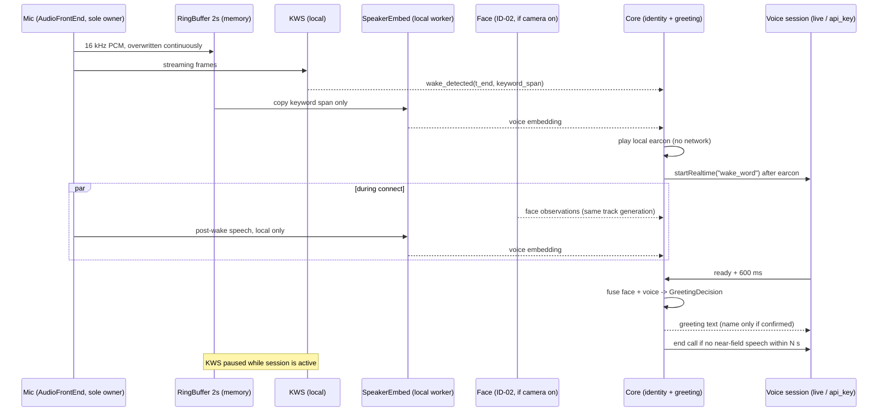

<!-- bilingual: source=zh-TW -->

> [繁體中文](17_Wake_Word_and_Speaker_Recognition_Plan_2026-10.md) | [English](17_Wake_Word_and_Speaker_Recognition_Plan_2026-10.en.md)

# 本機喚醒詞與家人音色辨認規劃

日期：2026-10-29，Asia/Taipei。狀態：**規劃，未實作**；同日依獨立審查修訂。本文件沒有新增任何喚醒、常駐收音或音色辨認程式，沒有錄音、沒有建立家人聲音資料，也沒有通過任何實機 gate。程式查核基準：AIOS main `876eeaaf7697cf4a3847e0687430c536f4a1d9a7`。外部版本、授權與模型卡於 2026-10-29 查核，來源列在 §15。

入口見 [文件索引](README.md) 與 [目前實作狀態](Current_Implementation_Status.md)。本規劃延伸 [14 家人辨識與稱名問候](14_Family_Recognition_and_Greeting_Plan_2026-10.md)、[ADR-0001](adr/ADR-0001-local-family-recognition.md)、[15 Companion Mode](15_Companion_Mode_Spec_2026-10-24.md) 與 [16 家庭記憶層](16_Nous_Memory_Layer_Design_2026-10-26.md)，不取代它們。

## 1. George 的需求與本文件的回答

George 於 2026-10-29 提出四項需求。下表是本文件的回答摘要，細節在各節。

| 需求 | 本文件的回答 |
|---|---|
| 喚醒詞：先列候選再決定 | 不用單獨的「Nous」。建議首選「哈囉努斯」、次選「嘿努斯」，以 WK-00 在客廳的實測誤報與漏報決定（§3） |
| 常駐聆聽：可開關、本機偵測、紅線不變 | 預設關閉。開啟後麥克風音訊只進記憶體中的 2 秒環形緩衝與本機偵測器；未喚醒音訊不寫檔、不進 trace、不外傳。App 自己顯示收音指示，狀態取自裝置事件（§5）。喚醒後先播本機提示音再開通話；沒有人聲就自動結束，因為誤喚醒會開一次付費通話並把客廳聲音送上雲（§5.7） |
| 音色辨認：稱呼、與臉交叉確認、便利性限制、連結記憶 | 在「家人辨識…」畫面註冊，聲音與臉綁同一個 `person_id`。臉聲一致才算有把握；不一致不稱名。限制指令只是便利性，**不是安全授權**，只在登記了未成年家人時生效（§8）。記憶只在核心選定人物後讀寫，身分只提出候選（§6–§9） |
| 喚醒與音色共用音訊，並與既有路徑整合 | 喚醒詞那段音訊同時送音色辨認；喚醒後的話語在本機累積更多證據。喚醒成為第三種互動啟動來源，沿用兩條即時語音路徑與問候決策；`AudioFrontEnd` 是唯一的麥克風擁有者（§4、§10） |

記憶的依賴鏈要先說清楚：[16 §11](16_Nous_Memory_Layer_Design_2026-10-26.md#11-分批實作與放行) 的 MEM-1 只涵蓋一般文字聊天；ChatGPT 方案（live）語音的記憶要等 MEM-2，API key 語音要等 MEM-3。本規劃的 SP-02 交付時**只有人物候選接口**，不會讓任何語音路徑提早取用或寫入記憶（§9、§13.4）。

本文件的產品界線如下：

- 身分只用於稱呼、個人化與便利性限制。身分不能解鎖私密資料、不能放行 Action Gate、不能代替當次明確確認（同 [ADR-0001 §2.5](adr/ADR-0001-local-family-recognition.md#25-身分不作授權依據)）。
- 寄出、發布、付費、永久刪除等外部副作用，仍須 Action Gate 與當次確認。聲音辨認結果不改變這條規則。
- 聲音可以被錄音、合成或模仿。本規劃不承諾防重播或防模仿（§7.4）。

## 2. 現況核對：目前沒有喚醒或常駐收音

以下依 `876eeaa` 的程式核對。

| 項目 | 程式現況 | 對本規劃的影響 |
|---|---|---|
| 喚醒或關鍵詞偵測 | 沒有。`src/voice.ts` 開頭註解寫明「不做背景喚醒、不保存音訊」；`src/main.ts` 的按下說話也標「明確啟動，不做背景喚醒」 | 喚醒是新能力，須新增模組與隱私測試 |
| 按下說話 | Web Speech API，`continuous = false`。Chrome／Edge 會把音訊送到瀏覽器供應商的雲端辨識；首次使用要同意（`localStorage` 鍵 `nous.voice.cloud-consent.v1`） | Web Speech 是雲端辨識，**不能拿來偵測喚醒詞**，否則未喚醒音訊會外傳 |
| 連續語音對話 | Web Speech `continuous = true`，模式開著時持續送雲端辨識；另有同意鍵 `nous.voice.continuous-consent.v1` | 同上。這個模式自己開擷取，開啟時 `AudioFrontEnd` 要完全讓出麥克風（§10.3） |
| 即時語音 | 兩條路徑：ChatGPT 方案（live，`src/live-voice.ts`）與 OpenAI API key（`src/realtime.ts`）。兩路都經 `getMicrophone()` 取得麥克風：API key 路徑在 `src/realtime.ts:185` 呼叫，live 路徑在 `src/live-voice.ts:155` 呼叫；實作都是 `src/realtime.ts:548` 的 `browserRealtimeDeps().getMicrophone`，即 `getUserMedia({ audio: { echoCancellation, noiseSuppression, autoGainControl } })`（live 經 `src/main.ts:258` 的 `base.getMicrophone` 取用同一個函式）。經 WebRTC 送出整段通話音訊，結束時停止所有 track | 喚醒後要接的就是這兩條路徑。`getMicrophone` 要改成向 `AudioFrontEnd` 租用（§10.3） |
| 啟動來源 | `RealtimeStartSource = "look_to_talk" \| "user"`（`src/realtime-session.ts`、`server/realtime-routes.ts`）。只有 `look_to_talk` 會由核心發出互動 ID 並做問候決策 | 需新增 `wake_word` 來源（§10） |
| 鏡頭 | `src/sense/pipeline.ts` 開鏡頭時 `audio: false` | 鏡頭與麥克風目前是分開的串流 |
| Electron 權限 | `desktop/main.mjs` 只允許核心網址的頁面取得 `media`；`desktop/scripts/package.mjs` 的 `NSMicrophoneUsageDescription` 寫「音訊會送到你選的語音服務」 | 常駐本機偵測上線時，這段系統說明要改寫並提供雙語 |
| 家人辨識 | ID-01／ID-02：只有人臉。gallery 為 `userData/identity/gallery.v1.json`，每人有 `person_id`、名稱、`minor`、臉部特徵 | 聲音特徵要擴充同一份 gallery（§11） |
| 智慧家庭 | H1b 的 AIFA 冷氣目前由語音或文字要求直接送出（H1 預設 allow），結果只報送出／未知 | 便利性限制不得讓這個現行行為退步（§8） |
| 記憶 | MEM-0：`server/memory/boundary.ts` 的 `MemoryBoundary.openSession(subject)` 只由核心呼叫，`Subject` 是 `household` 或 `person`＋`profileId`；`live` 與 `api_key` 路徑在模組內一律拒絕。`server/memory/store.ts` 是加密快照。產品記憶未啟用 | 身分只能提出人物候選；選定人物仍由 MEM-1 起的核心流程決定（§9） |
| Companion Mode | 只有 [15 規格](15_Companion_Mode_Spec_2026-10-24.md)，沒有程式。規格寫明「預設不建立家庭成員聲紋」 | 喚醒引擎可供 Companion 的 `activation=wake` 共用；聲音辨認進 Companion 須另取同意（§10.4） |
| 電子腦聽覺區 | `shared/domain.ts` 的聽覺區只依對話主題關鍵字亮起，說明文字為「不代表正在收音」 | 常駐聆聽不得點亮聽覺區；收音指示另做（§5.4） |

結論：目前收音只在使用者明確啟動時發生（按鈕、看著說話、連續語音模式），而且都把音訊交給雲端。repo 內沒有本機喚醒、本機 VAD、本機 ASR 或任何聲紋程式。

## 3. 喚醒詞候選與推薦

### 3.1 判斷誤觸發風險的依據

Picovoice 的選詞建議是：音素少於 6 個的詞較難偵測、較容易誤報；可以加「Hey」「OK」之類的前綴；不要選像日常對話、人名或常用指令的詞；母音與音素多樣比較好；也不要太長（[Picovoice：Choosing a wake word](https://picovoice.ai/docs/tips/choosing-a-wake-word/)，2026-10-29 讀取）。Sensory 的指南提到成功的喚醒詞多半約 3 個音節（[Sensory 2026 指南](https://sensory.com/custom-wake-words-branded-voice-ux-guide-2026/)）。這些是廠商經驗，不是本 repo 的量測。

Nous 的家中環境還有兩個特別風險：

1. 客廳的 LG 電視整天播放節目（[15 §1](15_Companion_Mode_Spec_2026-10-24.md)）。英文 news（/nuːz/）與 Nous（/nuːs/）只差最後一個音素，英語新聞節目會不斷出現。
2. Nous 的 TTS 和模型回覆可能自己說出「Nous／努斯」，造成自我觸發。

### 3.2 候選比較

計算方式：英文以 ARPAbet 音素計數（Nous 不在一般字典，依希臘文 νοῦς 讀作 N UW1 S）；中文以 sherpa-onnx `ppinyin` 的單元計數，即每個字的聲母＋帶調韻母，例如官方範例「你好军哥」為 `n ǐ h ǎo j ūn g ē` 共 8 個單元（[sherpa-onnx KWS 預訓練模型](https://k2-fsa.github.io/sherpa/onnx/kws/pretrained_models/index.html)）。拼音單元與英文音素不是同一種單位，只能粗估比較；實際誤報要以 WK-00 量測。

| 候選 | 音節 | 音素／單元 | 與日常語音的相似處 | 評估 |
|---|---:|---:|---|---|
| 「Nous」 | 1 | 3（N UW1 S） | 幾乎等於英文 news；中文「努」「怒」常見 | **不建議**。最短、最像電視內容 |
| 「嘿 Nous」／Hey Nous | 2 | 5（HH EY1 N UW1 S） | 「嘿」是常見語助詞；hey news 也可能出現在節目中 | 未達 6 個音素；可當英文別名，不建議當唯一喚醒詞 |
| 「OK Nous」 | 3 | 6（OW2 K EY1 N UW1 S） | 台灣口語大量使用「OK」 | 不建議，前綴太常見 |
| 「嘿努斯」 | 3 | 6（`h ēi n ǔ s ī`） | 「努斯」在中文很少見；「嘿」常見 | **次選**。短、好叫，但剛好在 6 的邊界 |
| 「哈囉努斯」 | 4 | 8（`h ā l uō n ǔ s ī`） | 「哈囉」是常見招呼，但整句罕見；母音 a／uo／u／i 多樣 | **首選**。長度與罕見度平衡 |
| 「你好努斯」 | 4 | 8（`n ǐ h ǎo n ǔ s ī`） | 「你好」是電視對白最常見的詞之一；「你好」連讀有三聲變調 | 不建議，前綴與電視重疊太多 |
| 「努斯同學」 | 4 | 8（`n ǔ s ī t óng x ué`） | 「同學」常見；風格接近「小愛同學」 | 可列備選，看家人是否喜歡這種稱呼 |
| 中文暱稱，例如「小諾」 | 2 | 4（`x iǎo n uò`） | 「小」是極常見的前綴 | 不建議，過短 |

注意事項：

- 家人實際怎麼念「Nous」要先確認（努斯、諾斯或英文 /nuːs/）。sherpa-onnx 的關鍵詞檔以發音單元描述，同一個詞可以登記兩種念法；每多一種念法，誤報機會也多一些。
- 台灣華語的聲調與 `ppinyin` 標準調可能不同，WK-00 要用家人實際錄音核對是否需要放寬。
- 喚醒詞也要避開 Nous 自己常說的句子。回覆中提到自己名字時，偵測器已暫停（§5.3），但仍要在負例中測試。

### 3.3 推薦

推薦「哈囉努斯」為首選、「嘿努斯」為次選，英文別名「Hey Nous」只在 George 需要英語喚醒時加入。理由：

1. 4 個音節、8 個拼音單元，粗估接近並高於 Picovoice 建議的 6 個音素下限（單位不同，只是粗估），又不像 6 個以上音節那麼難念。
2. 「努斯」在中文罕見，能避開英文 news 的近音問題；「Nous」單字則完全無法避開。
3. sherpa-onnx 的開放詞彙 KWS 不需錄樣本或訓練，可以在 WK-00 同時測兩、三個候選，再依數據定案。

最終選擇由 George 決定（§14 ①）。決定依據是 WK-00 在家中電視開著時的每小時誤報次數，以及家人 30 次喚醒的成功率，不是本表的單元數。

## 4. 喚醒、音色、臉與語音路徑的時序

### 4.1 一次喚醒的流程

1. 常駐聆聽開啟時，`AudioFrontEnd` 持有唯一的麥克風串流，把 16 kHz 單聲道 PCM 寫入 2 秒環形緩衝，同時串流給 KWS。
2. KWS 偵測到喚醒詞時回報結束時間與關鍵詞區間。只有這段區間會從環形緩衝複製給音色辨認 worker；區間之前的音訊不使用，隨緩衝覆寫消失。
3. 核心先在本機播放提示音（不連網），提示音結束才以 `wake_word` 來源開始即時語音，沿用既有連線、計費說明與 live→API key 改路徑（§5.7）。
4. 連線期間，若鏡頭開著，既有 ID-02 的臉部取樣照常進行；麥克風收到的喚醒後話語在本機繼續累積聲音證據。
5. 語音就緒＋600 ms 後，核心依 §7 的融合規則決定問候是否帶名字，沿用 `GreetingOnce` 與 `GreetingDecision`。
6. 通話開始後 KWS 暫停，避免把 Nous 自己的播音或使用者後續話語誤當喚醒（§5.3）。若喚醒後 N 秒內本機 VAD 都沒有偵測到近場人聲，自動結束通話（§5.7）。

### 4.2 為什麼喚醒片段不夠認人

喚醒詞約 0.6–1.2 秒（依音節數與語速估計，WK-00 量測實際長度）。短語音的講者驗證錯誤率明顯上升。2026 年 7 月的 arXiv 論文（[Kang et al., arXiv:2609.25007](https://arxiv.org/abs/2609.25007)）Table 3 列出 VoxCeleb1-O 結果：WavLM＋ECAPA-TDNN 基線（以 3 秒片段預訓練與微調、6 秒片段大邊界微調；訓練資料為 VoxCeleb2 開發集）在 3 秒測試片段 EER 為 2.393%，1 秒測試片段升到 18.437%；同一架構改以 1 秒片段訓練可降到 10.346%，作者提出的 VAM-ECAPA 為 8.334%。

這些數字的限制：模型是 WavLM＋ECAPA，不是本規劃建議的 CAM++；資料是英語名人訪談；不是家中麥克風。它們不能代表 CAM++ 在本家的表現，只足以說明「只靠 1 秒的喚醒片段不該稱名」。

所以規劃是兩段證據：

- **喚醒片段（約 1 秒）**：可在問候決策前提供，但只當弱證據。單獨使用時不稱名（§7.2）。
- **喚醒後話語（累積 2–3 秒以上）**：例如「哈囉努斯，幫我想晚餐」中的「幫我想晚餐」。這段證據通常在問候決策之後才足夠，用於撤銷檢查與便利性限制，不用於補稱名（同 14 §3「模型在通用問候後才認出，本次不再補叫姓名」）。

### 4.3 喚醒後同一口氣說的話

使用者常說「哈囉努斯，開燈」。目前兩條即時語音路徑都是即時 WebRTC 音軌，連線完成前的音訊無法自然送進通話。第一版的做法（§14 ⑦ 的建議預設）：

- 喚醒後到連線完成前的話語只留在本機記憶體，供 VAD 與音色辨認，**不送雲端**，連線完成或逾時（上限 8 秒）即丟棄。
- 問候後使用者再說一次需求。連線慢時，介面以既有字幕顯示「連線中」。
- 是否把這段話補送給雲端（例如經 Realtime 事件附加音訊），屬於擴大外傳範圍，須 WK-00 確認 API 可行性並由 George 決定。

## 5. 常駐聆聽的隱私與耗電設計

### 5.1 狀態以裝置事件為準

偏好與實際狀態分開保存，同 [15 §2.2](15_Companion_Mode_Spec_2026-10-24.md#22-啟用與真正收音是兩回事)。

| 狀態 | 意義 | 何時進入 |
|---|---|---|
| `off` | 偏好關閉，麥克風不開 | 首次安裝、設定讀不到或格式錯誤時（fail-closed） |
| `armed` | 偏好開啟，但尚未取得麥克風 | 冷啟動後、睡眠或鎖定回來後、權限待確認 |
| `listening_local` | 來源 track 為 `live`，KWS 正在本機運作 | 收到 track `live` 與 AudioWorklet 開始處理的事件之後 |
| `in_call` | 來源 track 正供即時語音租用；KWS 暫停 | 即時語音向 `AudioFrontEnd` 租用麥克風時 |
| `released` | `AudioFrontEnd` 已停止來源 track，交給自己開擷取的模式 | Web Speech 的按下說話或連續語音模式開始時 |
| `error` | 權限被拒、裝置拔除、模型雜湊不符 | 對應的錯誤事件 |

介面上的「正在聆聽喚醒詞」只在 `listening_local` 顯示。勾選開關、設定檔內容或模式名稱都不能代替裝置事件。冷啟動只進 `armed`，使用者按一次「開始聆聽」才開麥克風（§14 ③ 的建議預設）。

### 5.2 音訊只在記憶體

| 資料 | 位置 | 保存時間 | 規則 |
|---|---|---|---|
| 未喚醒音訊 | AudioWorklet 的環形緩衝 | 2 秒，持續覆寫 | 不寫檔、不進 trace／log、不經 IPC 或 HTTP、不外傳。16 kHz × 16 bit × 2 秒 = 64,000 bytes；若以 float32 保存則 128,000 bytes |
| 喚醒詞區間 | 音色 worker 記憶體 | 單次特徵計算 | 只複製偵測器回報的區間，算完即丟 |
| 喚醒後話語（連線前） | 音色 worker 與 VAD 記憶體 | 連線完成或 8 秒逾時 | 只供本機證據；不送雲端（§4.3） |
| 聲音特徵向量 | worker → IPC → 核心記憶體 | 比對完成即丟 | 不記 log；trace 只記狀態與耗時。IPC 只傳特徵，不傳音訊 |
| 偵測事件 | 核心記憶體與 trace | 依既有 trace 規則 | 只記時間、關鍵詞編號、分數是否過門檻；不記音訊、不記 person ID 或名字 |

選擇 2 秒的理由：要涵蓋最長約 1.2 秒的喚醒詞與偵測延遲，留一些餘裕。秒數越長，記憶體裡留著的未喚醒對話越多；WK-00 量測實際喚醒詞長度後只縮不增。緩衝長度屬工程決定，不列為 George 決定事項。回溯只用於喚醒詞本身，喚醒詞之前的話不送給模型，也不送音色辨認。

### 5.3 避免自我觸發與搶麥克風

- 即時語音期間 KWS 暫停（`in_call`）。通話結束後，若偏好仍開、同一次執行中、而且裝置事件確認來源 track 仍為 `live`，回到 `listening_local`。
- **這是與 [15 §3.1](15_Companion_Mode_Spec_2026-10-24.md#31-事件與所有權) 刻意不同的規則**：Companion 在其他語音模式結束後不自動恢復收音，因為 Companion 會把通過 gate 的內容送往模型；常駐喚醒只在本機偵測，使用者開啟它的目的就是在通話之間持續可喚醒。15 已加交互引用。若使用者在通話中關掉偏好，結束後不恢復。
- Web Speech 模式結束後（`released`），重新取得麥克風等同重新開始擷取：同一次執行中可自動重開，但只在收到 track `live` 後才顯示聆聽。
- Nous 播音期間與播音結束後 1.5 秒內，KWS 暫停。1.5 秒是起點，WK-01 以實際回聲量測調整。
- 喚醒觸發後 3 秒內不重複觸發，避免一次喚醒開兩次通話。
- 既有的 `startRealtime` 已在 `realtime.on || realtimeStarting` 時忽略重複啟動，看著說話與喚醒同時發生也只開一次。

### 5.4 清楚的收音指示

- macOS 的橘色點表示有 App 使用麥克風；但鏡頭同時使用時只會顯示綠色點（[Apple：Control Center 指示燈](https://support.apple.com/guide/mac-help/mchl50f94f8f)）。Nous 經常開鏡頭，所以**不能只靠系統指示燈**。
- App 自己提供兩處指示：選單列「鏡頭與語音設定」顯示「喚醒聆聽：本機聆聽中／通話中／已暫停／無法使用」；電子腦畫面保留一個最小的本機聆聽圖示（06 的 `ambient` 狀態已預留「如有啟用喚醒麥克風則保留最小指示」）。
- 常駐聆聽**不點亮聽覺區**。聽覺區仍只依真實對話主題亮起（CLAUDE.md 腦區要求）。喚醒成功、開始收音時，才依既有語音狀態顯示聆聽。
- 指示文字與無障礙標籤使用共用翻譯表，同時提供繁中與英文。

### 5.5 關閉方式

- 選單列勾選框「常駐喚醒聆聽」：關閉時同步停止 `AudioFrontEnd` 的來源 track（通話中則在通話結束時停止，且不恢復）、清空環形緩衝、結束 KWS 與音色 worker，再保存偏好。保存失敗時仍先停止收音，並顯示保存失敗。
- 「暫停聆聽」快捷操作：只停止本次執行，不改偏好。
- 系統睡眠、螢幕鎖定、使用者登出、麥克風拔除或權限撤銷：一律停止。睡眠或鎖定回來後只進 `armed`，等使用者按「開始聆聽」；拔除與撤銷進 `error`。不默默重開。
- 語音說「不要再聽」只在通話中由既有語音流程處理；喚醒偵測器本身只認喚醒詞，不能當成唯一的關閉方式。

### 5.6 耗電與 CPU

Mac mini 沒有電池，重點是 CPU 與發熱，以及不拖慢既有 80 ms 感測迴圈與手掌停止。設計：

- 以 sherpa-onnx 內建的 VAD 先過濾，沒有人聲時不跑 KWS 解碼。這是否真的省 CPU 要在 WK-00 比較。
- 只用一個 16 kHz 單聲道串流；不為 KWS 另開第二個麥克風串流。
- 螢幕鎖定與睡眠時停止。
- 預算：WK-00 先量 KWS＋VAD 單獨與鏡頭管線同時運作時的 CPU、記憶體與 80 ms 迴圈延遲。暫定放行條件是「單核平均 ≤ 10%，且既有感測迴圈 p95 不變差超過 10%」；這兩個數字是提案，不是量測結果。可參考的外部數字只有 openWakeWord 的說法：Raspberry Pi 3 單核可即時跑 15–20 個 openWakeWord 模型（[openWakeWord README](https://github.com/dscripka/openWakeWord)），但那不是 sherpa-onnx，也不是 Mac。

### 5.7 誤喚醒的代價與緩衝

誤喚醒（例如電視說出相近的詞）不是無害的：它會**開一次即時通話**。API key 路徑依用量計費；ChatGPT 方案路徑也會使用帳號額度。通話期間麥克風收到的客廳聲音（電視、旁人對話）會經 WebRTC 送到雲端語音供應商，直到通話結束。設計：

1. **先播本機提示音**：偵測到喚醒詞後，先在本機播放短提示音（約 0.3–0.5 秒，不連網），結束後才開通話。這段時間使用者可以按 Esc、張掌停止或收起來取消，取消時不開通話。提示音只是緩衝，擋不住使用者沒注意到的誤喚醒。
2. **沒有人聲就自動結束**：通話就緒後，若本機 VAD 在 N 秒內沒有偵測到近場人聲，自動結束通話並回到聆聽。N 的起點為 5 秒，WK-01 依家人實際反應時間調整。電視聲音本身也是人聲，所以這一條只能縮短、不能消除誤喚醒的外傳時間。
3. **費用紀錄**：每次 `wake_word` 通話都記入 [13 F6](13_Feature_Expansion_Assessment_2026-10-24.md#f6單一收音者可分辨的停止與費用紀錄) 的費用紀錄：路徑、連線秒數、是否因「無人聲」自動結束、已收到的 usage。缺單價或帳號用量證據就標「未知」，不推算成確定帳單。
4. **限速**：`wake_word` 通話每分鐘最多 3 次（與 ADR-0001 的 `greeting` 限速相同）；超過時暫停聆聽並顯示原因，避免誤喚醒迴圈或頁面腳本反覆開通話（§11.2）。

## 6. 喚醒引擎比較與推薦

### 6.1 比較表（2026-10-29 查核）

| 引擎 | 版本與授權 | 中文與自訂詞 | 在本專案的執行位置 | 誤報／漏報資料 | 結論 |
|---|---|---|---|---|---|
| sherpa-onnx KWS | npm `sherpa-onnx-node`：1.13.8（2026-09-10）、2.0.0（2026-10-23）、2.0.1（2026-10-26）；PyPI `sherpa-onnx` 2.0.1。程式 Apache-2.0 | 開放詞彙：在關鍵詞檔寫發音單元，可設提升分數 `:1.5` 與觸發門檻 `#0.35`，**不需錄樣本或重新訓練**。中文模型 `sherpa-onnx-kws-zipformer-wenetspeech-3.3M-2024-01-01`；中英模型 `sherpa-onnx-kws-zipformer-zh-en-3M-2025-12-20`（`phone+ppinyin`） | Node addon（`sherpa-onnx-node` 有 `test_keyword_spotter_transducer_microphone.js` 範例）。瀏覽器 wasm 需以 `build-wasm-simd-kws.sh` 自建，模型打包進 wasm 資產；npm 的 `sherpa-onnx` 套件是給 Node 用的 wasm，不是瀏覽器版 | 官方文件沒有公布誤報率；需自行量測 | **推薦**，訓練資料授權風險列入 §14 ② |
| openWakeWord | PyPI 0.6.0（2024-02-11）。程式 Apache-2.0；**內附預訓練模型為 CC BY-NC-SA 4.0** | 只支援英文；自訂詞要以 TTS 產生數千個合成樣本並訓練 | Python；README 說 JavaScript 版本需要大量移植，不在路線圖 | 目標為誤拒 < 5%、誤報 < 0.5 次／小時（以 DiPCo 約 5.5 小時測） | **排除**：預訓練模型 NC 授權違反 CLAUDE.md；沒有中文 |
| microWakeWord | 程式 Apache-2.0；README 自稱早期版本，訓練「仍然非常困難」 | 以 Piper 樣本產生器合成；產生器的 LibriTTS-R 模型只支援英文 | 面向 ESP32 等微控制器的 TFLite Micro | 無本家可用數字 | **排除**：無中文樣本產生器，訓練成本高 |
| Picovoice Porcupine | `pvporcupine` 4.0.3、`@picovoice/porcupine-web` 4.0.1。SDK 原始碼 Apache-2.0，但執行需要 AccessKey；自訂詞在 Picovoice Console 產生 `.ppn` | Console 支援中文自訂詞，產生快 | 有 Web、Node SDK | 有公開 benchmark | **排除**：社群轉述 Picovoice 回覆「免費方案 2026-06-30 停用、沒有非商業方案」；截至 2026-10-29 未能由 Picovoice 官方頁面核實。不論屬實與否，執行都需要 AccessKey 並受 Picovoice 授權條款約束。若 George 願意購買可重新評估 |
| Snowboy | 原為 Apache-2.0 | 需個人錄音 | — | — | **排除**：官方 2020-12-31 停止服務，只剩社群維護 |
| Apple 原生 | `SpeechDetector`（VAD）與 `SpeechTranscriber` 自 macOS 26 提供；`SNClassifySoundRequest`（自 macOS 10.15）可用自訂 Core ML 聲音分類器；`requiresOnDeviceRecognition` 可要求 `SFSpeechRecognizer` 不外傳 | 沒有公開的自訂喚醒詞 API。可用「本機轉寫＋文字比對」或「Create ML 聲音分類器（要自行錄樣本訓練）」 | 需要 Swift 原生模組與簽章流程 | 無 | **不作首選**：常駐轉寫的運算量遠大於 KWS；分類器需錄音訓練。`SpeechDetector` 可列為 VAD 備案 |
| Web Speech API | 瀏覽器內建 | — | renderer | — | **禁止**用於喚醒：Chrome／Edge 會把音訊送雲端，違反「未喚醒音訊不得外傳」 |

### 6.2 推薦與訓練資料風險

推薦 sherpa-onnx KWS，模型先比較中英模型 `zh-en-3M-2025-12-20` 與中文模型 `wenetspeech-3.3M-2024-01-01`。理由：唯一同時符合「不需錄音訓練、支援中文與中英混用、程式 Apache-2.0、可在 Node 與 wasm 執行」的候選；同一個依賴也提供 VAD 與講者特徵（§7），符合 [08](08_Consolidation_and_Update_2026-10.md) P6 的語音堆疊候選方向。

授權風險要照實記錄，性質與 [ADR-0001 §9 的 SFace 待決項](adr/ADR-0001-local-family-recognition.md#9-george-的決定與仍待決事項) 相同：

- `wenetspeech-3.3M` 模型頁寫明以 WenetSpeech L（10,000 小時）訓練。WenetSpeech 官方網站原句為 “available to download for non-commercial purposes under a Creative Commons Attribution 4.0 International License”：CC BY 4.0 本身允許商業使用，但同一句又限非商業用途，**條款本身互相矛盾**。OpenSLR 頁面只標 CC BY 4.0。官網另寫明音訊版權屬原影片或音訊的擁有者，WenetSpeech 不擁有版權。模型權重本身沒有另行標示 NC。
- `zh-en-3M-2025-12-20` 的文件沒有寫訓練資料。
- 英文模型以 GigaSpeech XL 訓練；GigaSpeech repo 是 Apache-2.0，但資料條款在申請表單內，本次無法讀到。

Nous 目前是家用、未販售的原型。建議預設是**接受並記錄**這個風險（§14 ②）；若日後要販售或分發，需重新評估或自行以授權清楚的資料訓練 KWS，成本遠高於本規劃的估時。

版本鎖定：2.0.0 與 2.0.1 是查核前一週內發布的新大版本。WK-00 比較 1.13.8 與 2.0.x，鎖定精確版本，不用範圍版本。

## 7. 音色辨認：模型、狀態與規則

### 7.1 講者模型比較（2026-10-29 查核）

| 模型 | 權重授權 | 訓練資料與其條款 | 中文 | 公布數字（模型方自報） | 在 sherpa-onnx 的可用性 | 結論 |
|---|---|---|---|---|---|---|
| 3D-Speaker CAM++ `speech_campplus_sv_zh-cn_16k-common` | Apache-2.0（ModelScope 模型卡；3D-Speaker repo Apache-2.0） | 「約 200k 個說話人的大型中文資料集」，資料集名稱與條款未公開 | 是 | ModelScope 模型卡：CN-Celeb 測試 EER 4.32%。3D-Speaker repo 基準表：CAM++ 7.2M 參數（該表各模型以單一公開資料集訓練，與 200k 版不是同一個模型，兩個數字來源不同） | sherpa-onnx 匯出腳本列有此模型；Node addon 有 `SpeakerEmbeddingExtractor` 範例 | **推薦**，訓練資料來源未公開列為風險 |
| 3D-Speaker ERes2Net／ERes2NetV2 zh-cn common | Apache-2.0 | 同上，約 200k 說話人 | 是 | repo 基準表（各資料集分別訓練與測試）：ERes2NetV2 在 CN-Celeb EER 6.14%、17.8M 參數 | 匯出腳本列有 `speech_eres2netv2_sv_zh-cn_16k-common` 等 | 備選，較大較慢 |
| 3D-Speaker 以 3D-Speaker 資料集訓練的版本 | Apache-2.0 | 3D-Speaker 資料集，網站標示 CC BY-SA 4.0（是否涵蓋音訊未說明） | 是 | 3D-Speaker 測試集 EER 見 repo | Node 範例使用 `3dspeaker_speech_eres2net_base_sv_zh-cn_3dspeaker_16k.onnx` | 備選，訓練資料條款比 200k 版清楚 |
| WeSpeaker `cnceleb_resnet34` | WeSpeaker 文件的規則是「pretrained model … follows the license of its corresponding dataset」；文件只明列 VoxCeleb 版為 CC BY 4.0，CN-Celeb 版依此規則推論為 CC BY-SA 4.0 | CN-Celeb（OpenSLR 82，CC BY-SA 4.0） | 是 | 見 WeSpeaker 文件 | 匯出腳本列有 | 可用，但 ShareAlike 義務要評估 |
| SpeechBrain ECAPA-TDNN `spkrec-ecapa-voxceleb` | Apache-2.0 | VoxCeleb 1＋2；VoxCeleb2 頁面標示中繼資料 CC BY-SA 4.0，音訊與影片已不再由該站提供 | 否（英語名人為主） | VoxCeleb1 EER 0.80% | 需自行匯出 | 不推薦：中文表現未知 |
| NVIDIA TitaNet-Large | CC BY 4.0 | VoxCeleb、Fisher、Switchboard、LibriSpeech、SRE 2004–2010（後幾項為 LDC 授權資料） | 否（en-US） | VoxCeleb1 EER 0.66%；約 23M 參數 | 需自行匯出 | 不推薦：英語、較大 |
| pyannote `embedding`／`wespeaker-voxceleb-resnet34-LM` | MIT（`embedding`，下載須同意分享 Hugging Face 資訊）／CC BY 4.0 | VoxCeleb | 否 | `embedding` VoxCeleb1 EER 2.8% | 主要用於分段（diarization） | 不推薦：用途與語言不符；模型卡建議商用改用 pyannoteAI |

以上 EER 都是各模型方在公開資料集上的自報數字，量測條件不同，不能互相比大小，也不代表本家的辨識率。沒有任何一個模型公布「1–3 秒中文、家中麥克風、2–5 人封閉集合」的數字。這只能靠 SP-00 與 SP-03 自行量測。

瀏覽器執行的風險：sherpa-onnx 的瀏覽器 wasm 有 KWS 與分段（diarization）的建置，但沒有單獨匯出講者特徵的瀏覽器 API；npm `sherpa-onnx` 是 Node 用的 wasm。SP-00 若無法自建，備案是用專案已有的 `onnxruntime-web` 1.30.0 直接執行 CAM++ 的 ONNX，再自寫 fbank 特徵前處理，並以 sherpa-onnx Node 的輸出交叉核對。SP-00 與 SP-01 的估時已加入這段緩衝（§13.4）。

### 7.2 辨識結果狀態

沿用 [ADR-0001](adr/ADR-0001-local-family-recognition.md) 的狀態名稱，聲音另外一組：

- `VoiceObservation.state`：`matched`（帶 `person_id`）、`unknown`、`ambiguous`、`unavailable`。
- `unavailable` 的原因：`no_enrollment`、`too_short`（有效語音不足）、`noisy`、`model_unavailable`、`paused`、`switch_off`（「通話中辨認說話者」關閉）。
- 每筆觀測帶 `wake_id`（本次喚醒）、`segment`（`keyword` 或 `utterance`）、有效語音毫秒數、`model_id`、`gallery_version`、`calibrated: false`。
- 證據規則（起點，SP-03 校準）：聲音 `matched` 需最高分 ≥ `match` 且領先第二名 ≥ `margin`；`segment=keyword` 單獨不足以稱名；兩個片段指向不同人時整段為 `ambiguous`。回應不含分數；log 不含 `person_id`、名字或分數。

兩個開關分開（§14 ⑧）：

- 「常駐喚醒聆聽」：控制麥克風是否常駐開著做本機喚醒偵測。
- 「通話中辨認說話者」：控制已喚醒的通話期間，是否從同一串流分支做逐句音色辨認。關閉時聲音一律 `unavailable`（`switch_off`），融合結果退回只看臉（ID-02 行為）。看著說話也適用這個開關。

### 7.3 臉聲融合規則

核心在問候決策時與每段使用者話語結束時融合。臉的狀態來自 ID-02 的同一追蹤世代；聲音來自同一個 `wake_id`。便利性一欄的「成人／未成年／未知」用於 §8。

| 臉 | 聲音 | 融合結果 | 稱名 | 記憶人物候選（§9） | 便利性限制（§8） |
|---|---|---|---|---|---|
| matched P | matched P | `confirmed(P)` | 可以 | P，依 §9.2 確認 | 依 P 的 `minor` |
| matched P | matched Q（Q≠P） | `conflict` | **不稱名** | 無 | 未知 |
| matched P | unknown／ambiguous | `face_only(P)`，聲音不支持 | 不稱名 | 無；需使用者自選 | 未知 |
| matched P | unavailable（例如還沒說話、開關關閉） | `face_only(P)` | 依 ID-02 現行規則 | P，需確認 | 依 P 的 `minor` |
| 多張臉 | matched P | `voice_multi(P)` | 不稱名 | **無**（同 14 §3、16 §4：多人入鏡不選人物） | 依聲音 P 的 `minor` |
| unknown（看到陌生臉） | matched P | `conflict`（講話者可能在鏡頭外） | 不稱名 | **無** | 未知 |
| 無臉資料（鏡頭關、沒看鏡頭） | matched P（含 utterance 片段） | `voice_only(P)` | 校準前不稱名（§14 ④） | P，需確認 | 依 P 的 `minor` |
| 無臉資料 | matched P（只有 keyword 片段） | `voice_weak(P)` | 不稱名 | 無 | 未知 |
| 任一 | unknown／ambiguous／unavailable，且臉也沒有 matched | `none` | 不稱名 | 無 | 未知 |

兩項補充：

- 「matched P＋unavailable」保留 ID-02 的既有行為，讓看著說話不因加了聲音而變差。這一列與「matched P＋unknown」不同：前者沒有聲音證據，後者有聲音但不支持 P，所以後者不稱名。
- 融合結果只在本次互動有效。換人、多臉出現、追蹤斷開、互動結束或刪除人物時，結果作廢（同 14 §3）。

### 7.4 防重播與防模仿的現況

研究界有 ASVspoof 挑戰與 AASIST 等防偽模型（AASIST 程式 MIT；ASVspoof 2019 資料以 Open Data Commons Attribution 授權），但這些模型是針對特定攻擊資料集訓練，家中麥克風、電視與手機播放的條件差很多。本規劃**不引入防偽模型，也不宣稱能分辨錄音或模仿**。因此：

- 任何人用手機播放 George 的錄音，都可能被認成 George。
- 這只會影響稱呼、個人化與便利性限制；任何外部副作用仍須 Action Gate 與當次確認，聲音結果不能放行。
- SP-03 仍要做重播測試，目的是照實記錄「錄音會被接受」，不是宣稱擋得住。

## 8. 便利性限制（不是授權）

George 要求例如「只有大人能控制冷氣」。這條規則的定位是**防小孩誤操作的便利性限制**，不是安全控制：

- 錄音、模仿、小孩站在大人旁邊、大人代說，都能繞過。
- 限制只能讓 Nous **少做**事（婉拒或請大人確認），不能讓 Nous 因為認出大人而**多做**原本需要確認的事。
- 寄出、發布、付費、永久刪除與家電的 H2 設備政策，仍走既有 Action Gate 與當次確認。

生效條件與預設（§14 ⑥ 的建議預設）：

- **只在 gallery 中至少有一位 `minor = true` 的家人時生效**。沒有登記未成年家人時，整條規則不啟用，H1b 冷氣維持現在的直接送出行為。
- 預設**寬鬆模式**：只有「認出未成年、且沒有任何模態指向成人」才婉拒；其他情況照既有政策。**嚴格模式**需 George 在設定中明確開啟。
- 首版受限能力只建議冷氣。

| 情況 | 寬鬆模式（預設） | 嚴格模式（選用） |
|---|---|---|
| 融合結果為成人（依 §7.3），沒有模態指向未成年 | 照既有政策（H1 目前預設 allow，冷氣直接送出） | 同左 |
| 任一模態指向未成年，且沒有模態指向成人 | 婉拒：「這個要請大人來設定喔」，不送出任何指令 | 同左 |
| 融合結果為未知（`conflict`、`voice_weak`、`none`） | 照既有政策，不增加步驟 | 不執行，請大人在主視窗按確認；不接受口頭「我是大人」 |
| 常駐聆聽關閉、鏡頭關閉或兩者都沒有身分資料（也就是沒有任何證據） | 照既有政策，與今天行為相同 | 不執行，請大人在主視窗按確認 |
| 主視窗打字或按鈕 | 照既有政策。打字與按鈕沒有聲音證據；若鏡頭當下認出未成年且沒有成人，仍婉拒 | 打字或按鈕本身就是主視窗操作，視為確認，照既有政策 |
| 沒有登記任何未成年家人 | 規則不啟用 | 規則不啟用 |

log 寫「便利性限制：未通過（原因 minor／unknown）」，不寫「驗證失敗」，避免讓人誤以為這是安全機制。WK／SP 的驗收要確認寬鬆模式下，冷氣的現行直接執行行為沒有退步（S9）。

## 9. 記憶連結規則（與 16 對齊）

認人的主要目的，是把對話與記憶連到正確的家人。以下規則以 [16 家庭記憶層](16_Nous_Memory_Layer_Design_2026-10-26.md) 為準；如需改變 16 的規則，列為 George 決定事項或 16 的增補提案，不在本文件自行修改。

依賴鏈：16 §11 的 MEM-1 只涵蓋一般文字聊天；live 語音記憶要等 MEM-2，API key 語音要等 MEM-3。本節的語音相關規則，在對應 MEM 批次通過前只停在「人物候選」，不會讀寫記憶。

### 9.1 每位家人的記憶隔離

- 16 §4 的 `ProfileId` 是記憶的人物鍵。ADR-0001 的 `person_id`（臉與聲音共用）只透過可移除的連結對應到 `ProfileId`；聲音特徵不放進記憶庫，`person_id` 不交給模型。
- 每位家人的記憶就是 `Subject = { kind: "person", profileId }` 下的資料。MEM-0 的 `MemoryBoundary` 一個 session 只綁一個 subject；檢索順序是「核心確認的人物 → 可見範圍 → 有效期 → 雲端同意 → 相關性」，先過人物再排序（16 §7）。
- 首版每筆記憶的 `audience` 只有 `household`（家中可使用），沒有私密記憶（16 §3）。所以「不讀出他人私密記憶」在首版的具體意義是：**不把其他人物的偏好放進本次上下文**，也不拿別人的資料補空結果。私密記憶要等每人解鎖與輸出裝置政策完成，聲音或臉的門檻再高都不夠。

### 9.2 身分只提出候選，核心選定人物

| 融合結果 | 記憶讀取 | 記憶寫入 |
|---|---|---|
| `confirmed(P)` | 提出「這次用 George 的偏好？」短確認；確認後讀 P＋家庭共用。維持確認（§14 ⑤ 的建議預設） | 選定 P 後，明確「記住」才寫入 P |
| `face_only(P)`、`voice_only(P)` | 同上，一定要確認 | 選定後才寫 |
| `conflict`、`voice_multi`、`voice_weak`、`none` | 只讀家庭共用 | 不寫個人記憶。使用者說「記住…」時，問「要記在誰名下，還是全家共用？」，由可信主視窗或「我是 George」選定（16 §4） |

選定之後，若「通話中辨認說話者」開著，每段話仍做一次聲音檢查，作為**撤銷**訊號，不作為新的授權：

- 話語的聲音 `matched` 到其他人 Q：撤銷本次人物（16 §8 的換人流程），不寫入，說明「好像換人了，這次要用誰的偏好？」。
- 話語的聲音 `ambiguous`：這一句不寫個人記憶，改顯示待確認卡。
- 話語太短（`too_short`）或開關關閉，無法用聲音判斷：寫入與否回到 16 §4 的原規則。本次人物是使用者確認過的選擇，只要沒有被撤銷（換人、多人入鏡、追蹤中斷、作業系統鎖定、互動結束）就仍有效；鏡頭只用來偵測這些撤銷事件，**不把看著鏡頭的人當成說話者**。回條一律寫出人物名字，例如「記在 George 名下了」。
- 無鏡頭模式依 16 §4：畫面保留可見的「本次人物：George」標示；遇到不明說話者或交接指令時重新確認。
- 寫入仍需 MEM-1 起的 `SourceTicket`。身分結果不能產生或替代票證。
- 本節的逐句檢查依賴 §10.3 的前提：通話麥克風由 `AudioFrontEnd` 租出，本機 worker 才能從同一串流分支取得音訊。

### 9.3 誤認的後果與更正

| 誤認類型 | 後果 | 更正流程 |
|---|---|---|
| 稱錯名字 | 尷尬；不放行任何動作 | 使用者說「我不是 George」：本次撤銷名字與人物候選；核心只記「已更正」計數 |
| 選錯人物後讀取 | 建議用到別人的偏好（例如香菜） | 「不是我」→ 撤銷 session（16 §8：停止受影響的上下文、關閉舊通話、重新建立） |
| 選錯人物後寫入 | 偏好記到錯的人名下 | 回條一律說出人物名字，使用者當場可以發現。更正時列出本次 session 寫入的條目，每條可「移到 Amy」或「刪除」；移動 = 在原人物 `forget`＋在新人物 `remember`，各自需新的直接輸入與票證（16 §5 的 correct／forget 操作） |
| 家長資料被小孩聲音觸發 | 不會發生：管理權不由聲音或臉建立（16 §5） | — |

誤認率只能在 SP-03 量測後回報，並分列拒認率、錯認率、`conflict` 比例。

### 9.4 刪除家人

與 ADR-0001 的刪除與金鑰輪換一致：

1. 在「家人辨識…」畫面刪除某人，經原生確認後，從加密 gallery 移除此人的臉與聲音特徵，輪換資料金鑰，遞增 `gallery_version` 與金鑰世代。
2. 只刪聲音、保留臉，也是同樣的移除＋輪換。
3. 同一個原生確認提供明確選項「同時刪除此人的記憶（N 筆）」，顯示筆數。建議預設：成人不勾選；未成年或標示為「已離家」的成員預設勾選（§14 ⑨）。不勾選時只解除 `person_id` 與 `ProfileId` 的連結並撤銷進行中的人物 session，不默默刪記憶（16 §8）；勾選時執行 16 的「刪除整個人物記憶」。
4. 失去連結的記憶 profile 在記憶管理畫面看得到，標示「沒有連結的家人辨識資料」，可以查看、匯出或刪除。
5. 相同名字重新登記，不會自動接回舊的記憶 profile（16 §8、M16）。若要接回，在登記完成後的記憶管理畫面選「連結到既有人物」，列出沒有連結的 profile，經原生確認後才建立連結。這個重新連結流程是 16 的增補提案，待 George 決定（§14 ⑨）。
6. 刪除後，晚到的聲音特徵因 `gallery_version` 不符而被丟棄。

### 9.5 未成年家人

- 登記：本人在場，家長（George）在原生確認中勾選同意，同 ADR-0001 §9。聲音登記沿用同一個 `minor` 與 `guardian_confirmed`。
- 記憶：16 §5 規定由已設定的家長管理普通偏好，首版不自動蒐集或推論。**增補提案**（不是已與 16 對齊的規則）：小孩說「記住我喜歡恐龍」時，建立待家長確認的卡，不直接寫入。是否採用需在 MEM-1 設計時與 16 一起決定。
- 小孩的聲音或臉不能取得家長管理權；大人的錄音也不能。
- 便利性限制依 §8。

## 10. 與既有路徑的整合

### 10.1 三種啟動入口

| 入口 | 啟動條件 | 臉部辨識 | 聲音辨識 | 問候 |
|---|---|---|---|---|
| 看著說話（`look_to_talk`） | 既有面向停留 | ID-02 照舊 | 「通話中辨認說話者」開著時，從租出的通話串流分支取樣；否則 `unavailable` | 照 ID-02，融合規則見 §7.3 |
| 喚醒詞（新增 `wake_word`） | 本機 KWS 觸發，本機提示音之後 | 鏡頭開著且臉在近距離時，於連線期間同步取樣 | 喚醒片段＋喚醒後話語 | 核心發出 `wake_word` 互動 ID，沿用 `GreetingOnce` 與 600 ms；`greeting` 只接受這個 ID（§11.2） |
| 按鈕、語音指令、同意後（`user`） | 使用者明確操作 | 不做 | 不做 | 不問候（沿用 2026-10-23 規則） |

### 10.2 兩條即時語音路徑

- ChatGPT 方案（live）與 API key 兩路都接受 `wake_word`。live→API key 改路徑時共用同一個問候物件與互動 ID，最多問候一次。
- 名字在雲端出現的範圍與 ADR-0001 §2.4.1 相同；聲音特徵、音訊片段與家人名單不上傳。
- 通話期間的音色辨認從同一個麥克風串流分支取得，不另開串流（§10.3）。通話音訊本來就送往雲端；分支到本機 worker 不擴大外傳。
- 記憶注入仍受 MEM-0 的路徑限制：`live` 要等 MEM-2、`api_key` 要等 MEM-3 才注入記憶。本規劃只提供人物候選，不提早打開這兩路。

### 10.3 麥克風所有權：`AudioFrontEnd` 是唯一擁有者

本規劃選定一種模型：**`AudioFrontEnd` 是 renderer 內唯一呼叫 `getUserMedia` 取得麥克風的模組**。其他元件不是另一個擁有者，而是向它租用或登記為消費者。

- 來源串流以即時語音目前的約束開啟：`{ echoCancellation: true, noiseSuppression: true, autoGainControl: true }`，避免同一裝置兩種約束互相影響。KWS 與講者特徵在這組處理下的表現由 WK-00、SP-00 量測。
- **即時語音改為租用**：`src/realtime.ts:548` 的 `browserRealtimeDeps().getMicrophone` 改成 `audioFrontEnd.lease("realtime")`，回傳 `new MediaStream([sourceTrack.clone()])`。API key 路徑（`src/realtime.ts:185`）與 live 路徑（`src/live-voice.ts:155`，經 `src/main.ts:258` 的 `base.getMicrophone`）都呼叫這個函式，所以兩路一起改。通話結束時兩路照舊對自己的 track 呼叫 `stop()`，停的是複製品，不是來源。
- **常駐聆聽關閉時**：租用時才開來源串流，最後一個租用結束就停止來源，行為等同今天。
- **常駐聆聽開啟時**：通話期間 KWS 暫停（`in_call`），來源串流不關；若「通話中辨認說話者」開著，講者 worker 繼續作為消費者取樣。§9.2 的逐句聲音檢查依賴這個前提。
- **Web Speech 模式**：按下說話與連續語音會自己開擷取，而 `SpeechRecognition.start(audioTrack)` 在 MDN 仍標為實驗性、可用性有限（[MDN](https://developer.mozilla.org/en-US/docs/Web/API/SpeechRecognition/start)）。所以這兩個模式啟動時，`AudioFrontEnd` 完全停止來源（`released`），這段期間沒有喚醒，也沒有音色辨認。
- **Companion**：Companion 的本機 VAD／ASR 也登記為 `AudioFrontEnd` 的消費者，不另開擷取。

執行位置比較：

| 方案 | 做法 | 優點 | 缺點 |
|---|---|---|---|
| A：renderer 的 AudioWorklet＋wasm（建議） | `AudioFrontEnd` 把來源接到 `AudioWorkletNode`；KWS 與講者特徵在專用 worker 以 wasm 執行；只有事件與特徵向量經 IPC 到核心 | 音訊不離開 renderer，與 ADR-0001「像素留在 renderer、只傳特徵」一致；不需原生模組與額外簽章 | wasm KWS 要自建、講者特徵沒有現成瀏覽器 API（§7.1）；視窗隱藏時 AudioWorklet 是否持續運作須在 Electron 44.9.3 實測 |
| B：Electron 主程序的原生 addon | `sherpa-onnx-node`＋原生麥克風擷取 | 不依賴 renderer 生命週期 | 會出現第二個麥克風擁有者，違反上面的單一擁有者模型；原生模組需簽章與麥克風 entitlement 驗證 |
| B'：renderer 擷取、經 IPC 傳 PCM 給主程序 | — | — | **不採用**：新增一條原始音訊通道，正是紅線要避免的 |

建議 A。B 只在 A 的效能無法通過 WK-00 時才重新評估，且必須另行設計如何維持單一擁有者。

### 10.4 Companion Mode 與 F6 單一收音者

- [13 F6](13_Feature_Expansion_Assessment_2026-10-24.md#f6單一收音者可分辨的停止與費用紀錄) 與 [15 §3.1](15_Companion_Mode_Spec_2026-10-24.md#31-事件與所有權) 要求同時只有一個收音擁有者。§10.3 的 `AudioFrontEnd` 就是這個擁有者；`companion`、`realtime` 是它的使用者，`voice_conversation`、`push_to_talk`（Web Speech）啟動時它完全讓出。
- 通話結束後回到喚醒偵測，是與 15 §3.1 刻意不同的規則（§5.3）。
- Companion 的 `activation=wake` 直接使用本規劃的喚醒引擎；`natural` 模式另有本機 VAD／ASR 流程，屬 15 的範圍。
- 15 §6 寫明「預設不建立家庭成員聲紋」。Companion 若要用音色判斷「是不是家人在說話」，須在 Companion 的同意流程中另外說明並取得同意；本規劃的聲音登記不自動延伸到 Companion。

## 11. 資料生命週期、加密與威脅模型

### 11.1 沿用 ADR-0001 的 gallery

| 資料 | 存放 | 保存期間 | 規則 |
|---|---|---|---|
| 登記錄音 | 登記畫面的 worker 記憶體 | 單次特徵計算 | 不存 wav、不進 trace；與臉部「不存照片」相同 |
| 聲音特徵（每人多筆） | 核心，加密 gallery | 直到刪除 | 與臉部特徵放在同一個 `person_id` 記錄下；AES-256-GCM、`safeStorage` 包裝的資料金鑰；每次寫入換新金鑰；刪除時輪換 |
| 模型版本 | 同上 | 同上 | 每筆聲音特徵記 `speaker_model_id`（例如 `campplus-zh-cn-16k-common@<sha256>`）與前處理版本；換模型時須重新登記，不做跨模型轉換 |
| 登記中繼資料 | 同上 | 同上 | 錄音環境（哪支麥克風）、有效語音秒數、登記時間；用於跨裝置判斷 |
| 辨識結果 | 核心記憶體 | 綁 `wake_id`，互動結束即丟 | 只有 `matched` 帶 `person_id` |

ADR-0001 §2.2 已記錄的殘餘風險同樣適用：Time Machine 或 APFS 快照中的舊 gallery 檔可能仍可被同一台 Mac 解開；V8 heap 中的字串無法主動清零；沒有防回滾。

### 11.2 ADR-0003 草案範圍

另開 **ADR-0003「本機喚醒與聲音辨識」**。這是工程流程決定，直接採用並通知 George，不列為待決事項。理由：常駐麥克風是新的紅線面，需要獨立的威脅模型；gallery 要從 v1 升到 v2（每人可有臉、聲音或兩者）並定義遷移；喚醒引擎與講者模型各有訓練資料授權風險，與 SFace 的待決項分開追蹤比較清楚。

ADR-0003 草案（WK-00 交付）必須包含：

1. **取代與更新 ADR-0001 的條文**：ADR-0003 取代 ADR-0001 §2.1.1「沒有背景常駐辨識」那一條（常駐喚醒偵測是背景常駐收音；音色辨認仍只在已喚醒的互動內）；並更新 ADR-0001 §2.4 的稱名與雲端揭露說明，涵蓋由聲音參與決定的稱名。ADR-0001 本身的文字留到實作批次（WK-01／SP-01）再改，本規劃不先修改。
2. **喚醒事件無法由核心驗證**：KWS 在 renderer 執行，核心收到的「偵測到喚醒詞」只是 renderer 的說法。頁面腳本可以假造喚醒事件、自行呼叫 `/api/realtime/start`（source 為 `wake_word`）開一次真的通話。對策比照 ID-02：
   - `wake_word` 開始的通話每分鐘最多 3 次（§5.7），並沿用既有的即時語音指示與計費說明，讓使用者看得到。
   - 新 op `voice_probe`（送出聲音特徵）比照 `ambient_probe`：不需要管理 session，但**回應不含任何結果**、被拒時不說原因；限速為每秒最多 4 次、同時最多一個待處理；只在常駐聆聽或「通話中辨認說話者」開啟、且家人辨識管理畫面沒開時接受。
   - `greeting` 只接受核心在 `/api/realtime/start`（source 為 `wake_word`）發出、尚未使用、對應的語音工作階段真的連上而且還在進行、連上後 20 秒內的互動 ID，比照 ID-02 的 `claimGreeting`；頁面自己編的 ID 只得到不含名字的問候。
3. **殘餘風險如何擴大**：ADR-0001 §2.1.1 已記錄頁面腳本可以真的開一次看著說話的通話，再送合成或取得的臉部特徵，在 API key 路徑從 IPC 回應讀到含名字的短句。加入聲音後：
   - 頁面腳本可以從錄音算出聲音特徵送給 `voice_probe`，同一類的名字外洩多了一個輸入來源；限速與「greeting 只回組好的短句」維持不變。
   - 新增一類風險：renderer 內的程式可以用假喚醒反覆開付費通話；靠限速、可見指示與費用紀錄控制，無法完全消除。
   - 常駐麥克風開著時，renderer 內任何程式理論上都能讀到 `AudioFrontEnd` 的音訊。這與今天核心網址頁面本來就有 `media` 權限相同，但暴露時間從「通話期間」擴大到「常駐期間」。生成 UI 仍不得接觸 preload API、核心 HTTP 或音訊模組（CLAUDE.md 紅線），並以 `tests/audio-privacy.test.ts` 靜態檢查。
4. gallery v2 格式、遷移、刪除與輪換規則；是否允許只登記聲音的家人（§14 ④）。
5. 喚醒引擎與講者模型的授權查核表與待決風險（§14 ②）。

### 11.3 註冊 UX

沿用 ID-01 的入口與保護，不新增常駐畫面：

1. 選單列「鏡頭與語音設定 → 家人辨識…」打開畫面（10 秒內點擊才可開管理 session，同 ADR-0001 §2.1.1），`visibility_reason` 為 `user_request`。
2. 每位家人的列加上「加入聲音」。建議預設允許只登記聲音的家人（§14 ④）：新增人物時可以先不登記臉。
3. 原生確認對話框（`dialog.showMessageBox`）顯示同意文字：聲音特徵會加密保存在這台 Mac；聲音可被錄音或模仿，只用於稱呼、個人化與便利性限制，**不是安全驗證**；可以隨時刪除。未成年須家長勾選。回 true 才開始錄。
4. 錄音提示：喚醒詞 5 次＋朗讀 3 句短句，有效語音合計約 20–30 秒。這是起點：sherpa-onnx 的 Node 範例每人用 3 個登記檔，本規劃加上喚醒詞是為了讓登記與實際使用的短片段相近。SP-03 依校準結果調整。
5. 畫面即時顯示品質（音量、雜訊、有效語音秒數），品質不足就重錄，不保存低品質樣本。
6. 錄完顯示「已加入聲音」與登記用的麥克風名稱。之後若換麥克風（例如 Mac 內建改為 XVF3800），提示可能需要補錄。

## 12. 程式整合點（提案）

以下為提案，延伸既有原型，不重寫核心或語音系統。

| 檔案／模組 | 計畫責任 |
|---|---|
| `shared/wake.ts`，新增 | 喚醒偏好、兩個開關、狀態（§5.1）、`WakeEvent` 型別 |
| `shared/identity.ts` | `VoiceObservation`、融合結果、`GreetingDecision` 的來源欄位 |
| `src/audio/front-end.ts`，新增 | 唯一的 `getUserMedia`、`lease()`、AudioWorklet、2 秒環形緩衝、消費者登記、讓出與恢復 |
| `src/realtime.ts`（`browserRealtimeDeps().getMicrophone`，第 548 行）、`src/main.ts`（第 258 行） | 改向 `AudioFrontEnd` 租用；`src/realtime.ts:185`、`src/live-voice.ts:155` 的呼叫端不變 |
| `src/audio/kws-worker.ts`、`speaker-worker.ts`，新增 | wasm 推論；只輸出事件與特徵向量；禁網路與本機儲存 |
| `src/main.ts`、`src/realtime-session.ts` | 本機提示音、`startRealtime("wake_word")`、互動綁定、通話期間暫停 KWS、無人聲自動結束 |
| `server/realtime-routes.ts` | `RealtimeStartSource` 加 `wake_word`，對它發出互動 ID；`wake_word` 每分鐘限速；`claimGreeting` 接受 `wake_word` |
| `server/identity-service.ts`、`identity-store.ts` | 聲音 gallery、比對、融合、`voice_probe` 限速、v2 格式遷移、刪除輪換 |
| `desktop/identity-ipc.mjs`、`preload.cjs` | op 白名單加入聲音登記、刪除與 `voice_probe`；形狀過濾 |
| `src/family-view.ts`、`src/family-enroll.ts` | 「加入聲音」流程、品質提示、刪除時的記憶選項 |
| `desktop/settings-menu.mjs`、`server/voice-settings.ts` | 「常駐喚醒聆聽」與「通話中辨認說話者」兩個開關、真實狀態、暫停 |
| `desktop/scripts/package.mjs` | 改寫 `NSMicrophoneUsageDescription`，說明本機喚醒偵測 |
| `server/home-bridge.ts` | 便利性限制的檢查點（§8），只在有未成年登記時啟用 |
| 費用紀錄（F6） | `wake_word` 通話的路徑、秒數、自動結束原因與 usage |
| MEM-1 的 `server/memory/service.ts` | 接收人物候選，不讓身分直接開 session |
| `tests/audio-privacy.test.ts`，新增 | 仿 `tests/camera-privacy.test.ts`：音訊相關檔案禁止 `MediaRecorder`、寫檔、網路與 `/api/`；環形緩衝不可序列化；只有 `src/audio/front-end.ts` 可呼叫 `getUserMedia({ audio })` |
| `src/i18n.ts` 與各 `messages.en.json` | 所有新文字雙語 |

## 13. 失敗、驗收與交付批次

### 13.1 失敗與故障案例

| 情況 | 預期行為 |
|---|---|
| 麥克風權限被拒或撤銷 | `error`，顯示原因；不顯示聆聽中；文字與按鈕入口照常 |
| 麥克風拔除、換裝置 | track `ended` → `error`；不自動改用別的麥克風，請使用者確認 |
| 系統睡眠、鎖定 | 停止；回來後只進 `armed`，等使用者按「開始聆聽」（與 §5.5、W10 一致） |
| 電視說出相似詞（誤喚醒） | **會開一次付費的即時通話，並把客廳聲音（電視、旁人對話）送上雲**，直到通話結束。緩衝：先播本機提示音，使用者可取消；通話就緒後 N 秒（起點 5 秒）沒有近場人聲就自動結束；記入費用紀錄；每分鐘最多 3 次（§5.7）。電視人聲可能讓自動結束失效，這是殘餘風險 |
| Nous 自己說出「努斯」 | 播音期間與結束後 1.5 秒內 KWS 暫停，不觸發 |
| 喚醒時即時語音已開 | 不重複開；KWS 本來就在 `in_call` 暫停 |
| 喚醒時 Web Speech 開著 | `AudioFrontEnd` 已 `released`，不會發生 |
| KWS 或講者模型雜湊不符、載入失敗 | `error`，不退回 Web Speech，不假裝在聽 |
| Keychain 解不開、gallery 損壞 | 聲音辨識 `unavailable`；喚醒仍可用，問候不帶名字 |
| 兩人同時說話 | 聲音 `ambiguous`，不稱名、不選人物 |
| 感冒、耳語、大聲喊 | 可能 `unknown`；不稱名，對話照常 |
| 登記與使用的麥克風不同 | 可能分數下降；SP-03 量測跨裝置，必要時提示補錄 |
| 用手機播放家人錄音 | 可能被認成該家人（§7.4）；只影響稱呼與便利性限制 |
| 小孩模仿大人 | 可能通過便利性限制；外部副作用仍要 Action Gate 與確認 |
| 頁面腳本假造喚醒事件 | 會真的開通話（可見指示、計費、限速）；拿不到名字，除非走 §11.2 記錄的殘餘風險路徑 |
| 核心重啟 | 偵測與 worker 結束，晚到的特徵因世代不符被丟棄 |
| CPU 過高、感測迴圈變慢 | 依 WK-00 放行條件；超出時降低更新頻率或重新評估方案，不延長既有 delay |

### 13.2 喚醒驗收 W1–W12

| 編號 | 必須觀察到的結果 |
|---|---|
| W1 | 偏好關閉時麥克風從未開啟（系統與 App 指示、track 計數） |
| W2 | 開啟後只有在收到 track `live` 事件後才顯示「本機聆聽中」；權限拒絕時不顯示 |
| W3 | 檔案與封包檢查：未喚醒音訊零寫檔、零 trace、零音訊 IPC（IPC 只出現事件與特徵向量）、零網路請求（未喚醒 5 分鐘、零推理 API 請求，同 07 §6.4） |
| W4 | 喚醒回饋 p95 ≤ 300 ms（07 §6.4：從 detector 事件到 Shell 顯示聆聽），30 次以上，報 p50／p95／最大值；另記提示音結束到通話就緒的時間 |
| W5 | 家人每人 30 次喚醒（安靜與電視開著兩組），分別回報成功率；初步目標 ≥ 95%，參考 openWakeWord 誤拒 < 5% 的目標 |
| W6 | 電視開著、無人喚醒，連續至少 8 小時（含新聞台）：誤報次數與每小時比率；初步目標 ≤ 1 次／8 小時，比 openWakeWord 的 0.5 次／小時嚴格，因為客廳全天開電視。每次誤報要對照 F6 費用紀錄：開了幾次通話、各自連線秒數、是否因無人聲自動結束、收到的 usage |
| W7 | Nous 播音中說出喚醒詞的句子，零自我觸發 |
| W8 | 即時語音期間只有一個來源 track（租出的是複製品）；Web Speech、Companion 開啟時零雙重擷取；結束後依 §5.3 恢復 |
| W9 | 關閉開關 1 秒內停止來源 track，環形緩衝清空 |
| W10 | 睡眠、鎖定回來只進 `armed`；拔麥克風後進 `error`；都不默默重開 |
| W11 | 鏡頭與 KWS 同時運作時，CPU 與 80 ms 感測迴圈符合 §5.6 的放行條件，手掌停止仍有效 |
| W12 | 兩條語音路徑以 `wake_word` 啟動，各自實際聽到提示音與問候；fallback 時整次最多問候一次；無人聲時 N 秒內自動結束 |

### 13.3 音色驗收 S1–S12

| 編號 | 必須觀察到的結果 |
|---|---|
| S1 | 登記只能從選單列「家人辨識…」開始，原生確認回 true 才錄；未成年需家長勾選 |
| S2 | 登記與辨識過程零 wav、零未加密特徵落盤；gallery 只有密文 |
| S3 | 刪除聲音或整個人後重啟、worker 重建，都無法再比對到此人；金鑰世代遞增 |
| S4 | 刪除時的記憶選項照預設勾選並顯示筆數；不勾選只解除連結，失去連結的 profile 在記憶管理畫面看得到；同名重新登記不自動接回舊記憶 |
| S5 | 臉聲一致才 `confirmed`；任一 `conflict`、`voice_multi` 情境零稱名、零記憶候選 |
| S6 | 只有喚醒片段時零稱名 |
| S7 | 家人保留樣本：分列拒認率、錯認率、`conflict` 比例；初步目標錯認名字為 0／100 次陌生人或其他家人嘗試，這只是 MVP 門檻，不代表普遍錯誤率為零 |
| S8 | 換人說話時撤銷人物 session，不寫入原人物；`voice_probe` 回應不含結果，超過限速被拒；頁面自編的互動 ID 拿不到名字 |
| S9 | 沒有登記未成年時，冷氣行為與現在相同；有登記未成年且被認出時，冷氣指令被婉拒且零指令送出；寬鬆模式下未知身分照常執行 |
| S10 | 錄音重播測試照實記錄結果；不論結果如何，外部副作用仍出確認 |
| S11 | log、trace、SSE 與驗證證據不含 `person_id`、名字或分數 |
| S12 | 1、2、3 秒片段與不同麥克風的分數分布報告，作為門檻依據；`calibrated` 在報告完成前一律為 false |

所有競態與規則先用假時鐘、合成特徵與假偵測事件驗證，永久標示為 fixture。fixture 通過不能代替 W4–W7、W11–W12、S7–S12 的實機結果。

### 13.4 交付批次與估時

工程估計，以一位熟悉 repo 的工程師搭配 AI 計，1 人日以 8 小時換算，不含等待家人測試與硬體採購。數字不是量測值。

| 批次 | 交付與放行條件 | 估計 |
|---|---|---:|
| WK-00 | 不接產品的 spike：sherpa-onnx 1.13.8 與 2.0.x 的 Node 與 wasm KWS、兩個模型、2–3 個候選詞；CPU、記憶體、喚醒詞實際長度；電視負例的每小時誤報。負例**只計數、不錄音**，代價是誤報無法事後重播分析，只能記下時間與當時播放的節目名稱；ADR-0003 草案 | 1.5–2.5 人日 |
| WK-01 | `AudioFrontEnd` 與 `getMicrophone` 改為租用、偏好與真實狀態、選單列兩個開關與指示、2 秒環形緩衝、KWS worker、讓出與恢復、自我觸發防護、本機提示音、無人聲自動結束、音訊隱私靜態測試 | 2–3 人日 |
| WK-02 | `wake_word` 啟動來源與限速、`claimGreeting` 擴充、兩條語音路徑的問候與 fallback、F6 費用紀錄欄位、Companion `activation=wake` 共用接口、`NSMicrophoneUsageDescription` 改寫 | 1–2 人日 |
| WK-03 | Mac 實機：W1–W12，含至少 8 小時電視負例與家人喚醒測試 | 2–3 人日 |
| SP-00 | 講者模型 spike：CAM++ 與一個備選在 Node 與瀏覽器的特徵一致性與耗時；瀏覽器沒有現成講者 API，含 `onnxruntime-web`＋自寫 fbank 備案的風險緩衝；1–3 秒片段的分數分布（以自願者或公開測試資料） | 1.5–2.5 人日 |
| SP-01 | 「加入聲音」登記、gallery v2 遷移、加密保存、刪除與輪換、刪除時的記憶選項、IPC 白名單與 `voice_probe` 限速；含 wasm 整合的風險緩衝 | 2.5–3.5 人日 |
| SP-02 | 喚醒片段＋話語的辨識、臉聲融合、問候規則、便利性限制、**只交付人物候選接口**（記憶讀寫依 MEM 批次） | 2–3 人日 |
| SP-03 | 家人保留樣本、門檻校準、跨麥克風、重播測試、S1–S12 實機驗收 | 2–3 人日 |

合計：WK 系列 6.5–10.5 人日，SP 系列 8–12 人日，共 14.5–22.5 人日，即 116–180 小時。

依賴鏈：

- SP-02 的人物候選接口要接上 16 的 MEM-1 才有文字聊天的記憶效果；MEM-1 只涵蓋一般文字聊天。
- live 語音的記憶讀寫要等 MEM-2，API key 語音要等 MEM-3。在那之前，喚醒與音色只影響稱呼與便利性限制。
- 若 sherpa-onnx wasm 效能不足需重新評估方案 B，或需要自行訓練 KWS，另行估計。

建議順序：WK-00 與 SP-00 可平行；之後 WK-01 → WK-02 → WK-03，SP-01 → SP-02 → SP-03。Claude 核心端負責全部批次；ChatGPT／Codex 可協助獨立審查時序與隱私測試。

## 14. 需 George 決定的事項

每項附建議預設，並標明擋住哪一批。George 沒有表示意見時，依建議預設進行。

| # | 事項 | 建議預設 | 擋住 |
|---|---|---|---|
| ① | 喚醒詞 | 「哈囉努斯」；確認家人怎麼念「Nous」；英文別名「Hey Nous」只在需要時加入；WK-00 數據不佳再改「嘿努斯」 | WK-01（關鍵詞檔） |
| ② | 模型授權風險（喚醒模型與講者模型） | 接受並記錄：sherpa-onnx KWS 模型（WenetSpeech 條款矛盾、中英模型未寫訓練資料）與 CAM++ zh-cn common（約 200k 說話人資料未公開）；備選為 3D-Speaker 資料集版或 WeSpeaker CN-Celeb 版（依規則推論為 CC BY-SA） | WK-01、SP-01（產品採用；spike 可先做） |
| ③ | 常駐行為 | 冷啟動不自動恢復，只進 `armed`；睡眠或鎖定回來也只進 `armed`。環形緩衝 2 秒屬工程決定 | WK-01 |
| ④ | 只有聲音時 | 允許只登記聲音、沒有臉的家人；校準（SP-03）前，只有聲音時不稱名 | SP-01、SP-02 |
| ⑤ | 記憶免確認 | 維持 16 §4 的確認：臉聲一致也要一次短確認 | SP-02 的候選接口、MEM-1 |
| ⑥ | 便利性限制 | 只限冷氣；寬鬆模式；只在 gallery 有未成年家人登記時生效 | SP-02 |
| ⑦ | 喚醒後體驗 | 喚醒後同一口氣的話不補送雲端；先播本機提示音再開通話 | WK-02 |
| ⑧ | 「通話中辨認說話者」是否與常駐聆聽分開開關 | 分開；預設關閉，SP-03 校準完成後再建議開啟 | SP-02 |
| ⑨ | 刪除家人時是否預設一併刪除記憶 | 顯示筆數的明確選項；成人預設不勾選，未成年或已離家成員預設勾選；另提供重新連結到既有記憶 profile 的確認流程（16 的增補提案） | SP-01 |

另行通知（不需決定）：另開 ADR-0003 屬工程流程，直接採用（§11.2）。

## 15. 查核來源

以下為 2026-10-29 讀取的來源。外部服務、版本與條款可能變動，實作前需重新核對。

程式（AIOS main `876eeaa`）：

- [`src/voice.ts`](https://github.com/pcpcchen-coder/AIOS/blob/876eeaaf7697cf4a3847e0687430c536f4a1d9a7/prototype/ambient-shell/src/voice.ts)：Web Speech、雲端辨識與同意、「不做背景喚醒」
- [`src/realtime.ts`](https://github.com/pcpcchen-coder/AIOS/blob/876eeaaf7697cf4a3847e0687430c536f4a1d9a7/prototype/ambient-shell/src/realtime.ts)、[`src/live-voice.ts`](https://github.com/pcpcchen-coder/AIOS/blob/876eeaaf7697cf4a3847e0687430c536f4a1d9a7/prototype/ambient-shell/src/live-voice.ts)：兩條即時語音路徑的 `getMicrophone`
- [`src/main.ts`](https://github.com/pcpcchen-coder/AIOS/blob/876eeaaf7697cf4a3847e0687430c536f4a1d9a7/prototype/ambient-shell/src/main.ts)、[`server/realtime-routes.ts`](https://github.com/pcpcchen-coder/AIOS/blob/876eeaaf7697cf4a3847e0687430c536f4a1d9a7/prototype/ambient-shell/server/realtime-routes.ts)：`startRealtime` 與 `RealtimeStartSource`
- [`shared/identity.ts`](https://github.com/pcpcchen-coder/AIOS/blob/876eeaaf7697cf4a3847e0687430c536f4a1d9a7/prototype/ambient-shell/shared/identity.ts)：辨識狀態、`minor`、`GreetingDecision`
- [`server/home-bridge.ts`](https://github.com/pcpcchen-coder/AIOS/blob/876eeaaf7697cf4a3847e0687430c536f4a1d9a7/prototype/ambient-shell/server/home-bridge.ts)：H1b AIFA 冷氣送出路徑
- [`server/memory/boundary.ts`](https://github.com/pcpcchen-coder/AIOS/blob/876eeaaf7697cf4a3847e0687430c536f4a1d9a7/prototype/ambient-shell/server/memory/boundary.ts)、[`server/memory/store.ts`](https://github.com/pcpcchen-coder/AIOS/blob/876eeaaf7697cf4a3847e0687430c536f4a1d9a7/prototype/ambient-shell/server/memory/store.ts)：MEM-0
- [`desktop/main.mjs`](https://github.com/pcpcchen-coder/AIOS/blob/876eeaaf7697cf4a3847e0687430c536f4a1d9a7/prototype/ambient-shell/desktop/main.mjs)、[`desktop/scripts/package.mjs`](https://github.com/pcpcchen-coder/AIOS/blob/876eeaaf7697cf4a3847e0687430c536f4a1d9a7/prototype/ambient-shell/desktop/scripts/package.mjs)：media 權限與麥克風說明

喚醒引擎：

- [sherpa-onnx KWS 文件](https://k2-fsa.github.io/sherpa/onnx/kws/index.html) 與 [預訓練模型](https://k2-fsa.github.io/sherpa/onnx/kws/pretrained_models/index.html)；[sherpa-onnx repo（Apache-2.0）](https://github.com/k2-fsa/sherpa-onnx)；[Node addon 範例](https://github.com/k2-fsa/sherpa-onnx/tree/master/nodejs-addon-examples)；npm `sherpa-onnx-node` 版本時間以 `npm view sherpa-onnx-node time` 查詢
- [WenetSpeech 官方網站授權段落](https://wenet-e2e.github.io/WenetSpeech/)、[OpenSLR 121](https://www.openslr.org/121)；[GigaSpeech repo](https://github.com/SpeechColab/GigaSpeech)
- [openWakeWord README 與授權](https://github.com/dscripka/openWakeWord)（PyPI 0.6.0）
- [microWakeWord](https://github.com/kahrendt/microWakeWord)；[piper-sample-generator](https://github.com/rhasspy/piper-sample-generator)
- [Picovoice 選詞建議](https://picovoice.ai/docs/tips/choosing-a-wake-word/)；[Home Assistant 社群：Picovoice 免費方案停用](https://community.home-assistant.io/t/fyi-picovoice-confirmed-free-tier-accesskeys-will-stop-working-after-june-30-2026/1012744)（2026-06-04 貼文，社群轉述；截至 2026-10-29 未能由官方頁面核實）
- [Snowboy README](https://github.com/Kitt-AI/snowboy)
- Apple 文件：[`SpeechDetector`](https://developer.apple.com/documentation/speech/speechdetector)、[`SpeechTranscriber`](https://developer.apple.com/documentation/speech/speechtranscriber)、[Sound Analysis](https://developer.apple.com/documentation/soundanalysis)、[`requiresOnDeviceRecognition`](https://developer.apple.com/documentation/speech/sfspeechrecognitionrequest/requiresondevicerecognition)
- [Sensory 喚醒詞指南](https://sensory.com/custom-wake-words-branded-voice-ux-guide-2026/)

講者辨識：

- [3D-Speaker repo（Apache-2.0）](https://github.com/modelscope/3D-Speaker)；[CAM++ zh-cn common 模型卡](https://www.modelscope.cn/models/iic/speech_campplus_sv_zh-cn_16k-common)；[3D-Speaker 資料集](https://3dspeaker.github.io/)
- [WeSpeaker 預訓練模型與授權說明](https://github.com/wenet-e2e/wespeaker/blob/master/docs/pretrained.md)；[CN-Celeb（OpenSLR 82）](https://www.openslr.org/82/)
- [SpeechBrain ECAPA 模型卡](https://huggingface.co/speechbrain/spkrec-ecapa-voxceleb)；[VoxCeleb2 頁面](https://www.robots.ox.ac.uk/~vgg/data/voxceleb/vox2.html)
- [NVIDIA TitaNet-Large 模型卡](https://huggingface.co/nvidia/speakerverification_en_titanet_large)
- [pyannote embedding](https://huggingface.co/pyannote/embedding)、[pyannote wespeaker-voxceleb-resnet34-LM](https://huggingface.co/pyannote/wespeaker-voxceleb-resnet34-LM)
- [Kang et al., Beyond Short Segments（arXiv:2609.25007，2026-07-26）](https://arxiv.org/abs/2609.25007)，Table 3
- [AASIST（MIT）](https://github.com/clovaai/aasist)；[ASVspoof 2019 資料集](https://datashare.ed.ac.uk/handle/10283/3336)
- [onnxruntime-web](https://www.npmjs.com/package/onnxruntime-web)（專案已鎖 1.30.0）

瀏覽器與系統：

- [MDN：`SpeechRecognition.start()`](https://developer.mozilla.org/en-US/docs/Web/API/SpeechRecognition/start)
- [Apple：Mac 的控制中心與隱私指示燈](https://support.apple.com/guide/mac-help/mchl50f94f8f)

本次交付界線：只讀取程式、查核外部資料並產出規劃文件、導覽更新與 15 的交互引用。沒有修改產品程式、沒有開啟麥克風、沒有下載或執行任何模型，也沒有建立家人資料。
