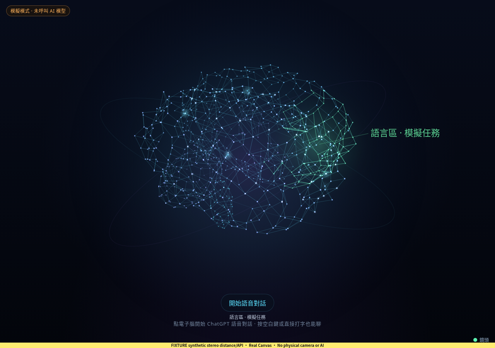
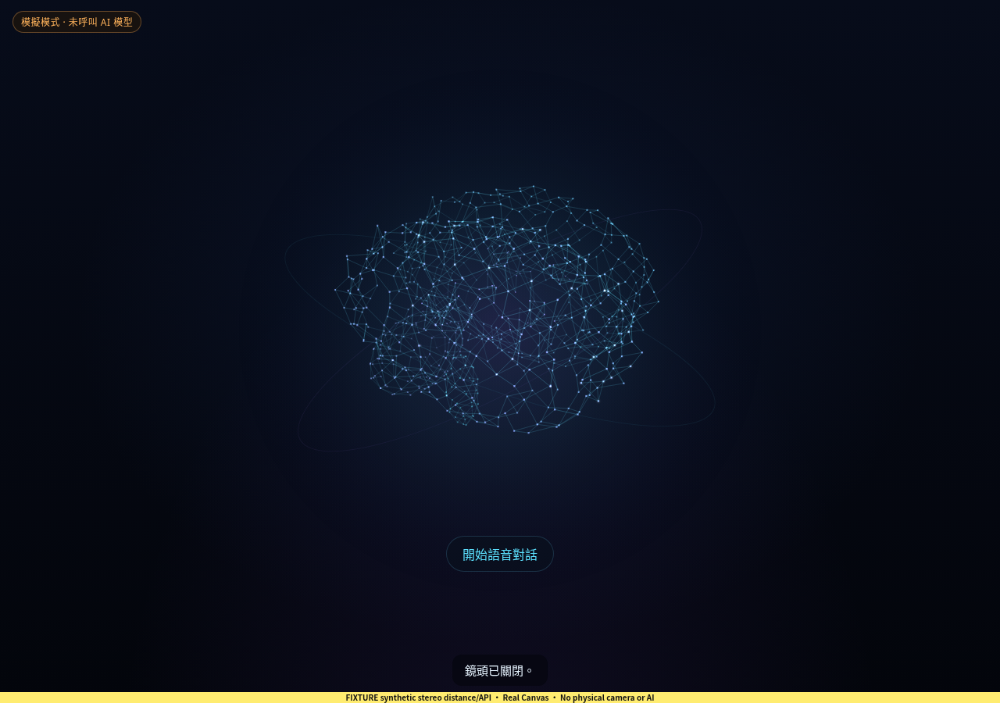

# 電子腦雙目距離縮放驗證

2026-10-22；基底 `16dc63cafd949a0e195d94e693afd3ba0d823d1d`。本紀錄隨電子腦距離縮放功能交付。

電子腦現在接收既有 `SenseController.setScale` 的距離比例。待機與頂端圖形、光環、投影和點擊範圍共用實際半徑；任務與對話更新保留比例。距離事件為空、判定離開，以及鏡頭 off/error/degraded 時沿用控制器的重設。`starting` 保留最近比例；原有 60 秒離開判定不變。

## 距離與畫面量測

比例沿用 `clamp(round(D / 2 × 100) / 100, 0.75, 1.5)`。半徑另受視窗可用空間限制，包含光環與呼吸動畫的邊界。以下是 Chromium 1280 × 900、減少動態效果模式下，直接觀察原生 Canvas 繪圖所得：

| 模擬距離 | 控制器比例 | 實際半徑 |
| --- | --- | --- |
| 1.5 m | 0.75 | 135 px |
| 2 m | 1 | 180 px |
| 3 m | 1.5 | 248.824 px，受視窗限制 |
| 關閉鏡頭 | 1 | 180 px |

每次觀察均等待要求之後的兩個穩定原生繪圖 frame，記錄 frame 編號與時間戳。手機與短橫向的頂端來源列，在三種距離下與面板均保留 6 px 間隔。

## 變更檔案

| 檔案 | 用途 |
| --- | --- |
| `prototype/ambient-shell/src/main.ts` | 既有距離回呼同步通知 Brain |
| `prototype/ambient-shell/src/brain.ts` | 獨立距離輸入、半徑限幅、標籤邊界與 CSS 半徑發布 |
| `prototype/ambient-shell/src/style.css` | 跟隨有效半徑安排入口、輸入框與來源列；面板距離縮放維持一次 |
| `prototype/ambient-shell/tests/brain-distance.test.ts` | 18 項新增繪圖與控制器行為測試 |
| `prototype/ambient-shell/tests/brain-regions.test.ts` | 更新既有 renderer 的 DOM fixture |
| `scripts/verify-distance-brain-browser.mjs` | 實際建置頁面的合成距離瀏覽器驗證 |
| `prototype/ambient-shell/README.md`、`docs/11_Stereo_Camera_Interaction_2026-10.md` | 說明縮放行為與限制 |
| 本紀錄與 `evidence/brain-distance-2026-10-22/` | 設計、審查、量測與原始截圖 |

## pstack 流程

依 Feature playbook 執行 how → architect → checkpoint → implement → verify → review → report。兩個獨立設計比較後，由獨立評選選擇 `Brain.setDistanceScale`：距離與一般視覺快照有不同更新週期，控制器仍是距離政策唯一來源。checkpoint 固定一位程式修改者，瀏覽器、文件與審查分開負責；所有角色沿用父模型，沒有宣稱模型多樣性。

採用 Model the Domain 保留輸入生命週期、Laziness Protocol 延伸既有幾何與重設、Test Behavior Not Implementation 檢查可見繪圖與點擊結果、Prove It Works 實測建置頁面。新增註解審查無需刪除或抑制規則。未要求 commit 或 PR，因此跳過對應步驟；原生 Cursor UI 工具不可用，以 Chromium/Playwright 驗證實際頁面。

[設計 A](./evidence/brain-distance-2026-10-22/design-a.md)、[設計 B](./evidence/brain-distance-2026-10-22/design-b.md)、[評選](./evidence/brain-distance-2026-10-22/judgment.md)、[獨立審查](./evidence/brain-distance-2026-10-22/review.md)、[計畫](./evidence/brain-distance-2026-10-22/plan.md)。

[pstack run](https://github.com/pcpcchen-coder/AIOS/blob/telemetry/pstack/observability/public/runs/run-20261022010402-0fb7c0.json) 已透過專案核准的 sidecar 發布去識別化階段資料。初次預設傳輸失敗後，改用 Git 傳輸成功；未發布原始碼或私人對話。

## 驗證結果

- `node scripts/check-pstack.mjs`：通過上游檔案完整性與技能註冊檢查。
- `node scripts/verify-aios.mjs`：型別檢查、32 檔共 307 項測試、建置、隔離模擬 HTTP 任務與文字對話流程通過。[測試輸出](./evidence/brain-distance-2026-10-22/test-output.txt)、[HTTP 報告](./evidence/brain-distance-2026-10-22/mock-http-report.json)。
- 獨立審查另跑 3 檔共 35 項相關測試通過。完整套件及此測試早於最後的 CSS 間距修正；修正後重新建置，並在最後資產執行全部瀏覽器案例。
- 六組 Chromium 驗證通過，無頁面錯誤：距離與 SSE 更新、空值與感測器重設、頂端圖形與單次面板縮放、桌面/手機/短橫向/resize/DPR2、六腦區標籤與完整輸入框、實際點擊及「鏡頭關掉」指令。[原始量測報告](./evidence/brain-distance-2026-10-22/report.json)。
- 瀏覽器發現近距離來源列原本與面板重疊約 1.42 px；改用共用面板位置計算後，最終案例通過。遠距離原有設定面板的 CSS zoom 溢出仍存在，包含部分螢幕上的關閉按鈕超出視窗；報告保留其 bounds，使用 Esc 關閉。此既有問題未在本批修改。

最終瀏覽器報告包含逐檔 source/shared/dist hash、實際回傳資產 hash，以及合成管線替換前後的 hash；已核對與工作區一致，驗證期間 source/dist 未變更。原始 JSON 保留當時的暫存輸出路徑；同名 PNG 完整複製至本紀錄旁的 evidence 目錄。

| 輸入 | SHA-256 |
| --- | --- |
| 前端 source 集合 | `6ad0c29e7016b10715183119bb42b3c333bcce4996b9c32b18ef43c583d57bbe` |
| dist 集合 | `90ffda33c32c8aa6e82705d7aa26dcfacda4e9e2774200e698edfdcce9e05318` |
| 瀏覽器腳本 | `963d1367239fbc4520d22a606de72732df08f703d52bb1827ccb67db433786d1` |

### 畫面證據

所有圖片標示 fixture；圖中帳號、事件與距離皆為合成輸入。沒有相機原始影像。

| 遠距離待機 | 關鏡頭恢復預設 |
| --- | --- |
|  |  |

[手機六腦區](./evidence/brain-distance-2026-10-22/active-390x844-far-fixture.png)、[短橫向六腦區](./evidence/brain-distance-2026-10-22/active-844x390-far-fixture.png)、[手機頂端圖形](./evidence/brain-distance-2026-10-22/top-390x844-far-fixture.png)。

## 啟動與重現

```bash
cd prototype/ambient-shell
npm ci
npm start
```

開啟 `http://localhost:8787`。使用實體鏡頭需依原型 README 在 `.env` 設 `NOUS_CAMERA=on`，先執行 `npm run vision:setup`，並確認鏡頭設定為開啟。此批未修改環境變數、下載模型或開啟任何實體裝置。

重現自動檢查，在 repo 根目錄執行：

```bash
node scripts/check-pstack.mjs
node scripts/verify-aios.mjs
PLAYWRIGHT_MODULE=/path/to/playwright/index.mjs CHROMIUM_PATH=/usr/bin/chromium \
  node scripts/verify-distance-brain-browser.mjs --output /tmp/aios-distance-check
```

瀏覽器腳本需要可用的 Playwright 與 Chromium，使用前一步產出的 dist。此雲端使用 Node 24.19.0、Chromium 154.0.8037.57。

## 未完成與下一個 gate

此輪只替換外部 `SensePipeline` 模組並提供模擬 API，實際主程式、控制器、Canvas 與指標事件均有執行。未驗證實體雙目影像處理、測距準確度、真實帳號、語音或觸控。減少動態效果模式驗證最終幾何；一般動畫插值由程式審查覆蓋。

下一個 gate 是依 `docs/11` §7 在實體雙目設備校正後，測試 1.5/2/3 m、移動時的穩定度與鏡頭中斷重設。此紀錄不改變正式硬體或 AI gate 狀態。設定面板既有的小螢幕溢出需另行處理。
