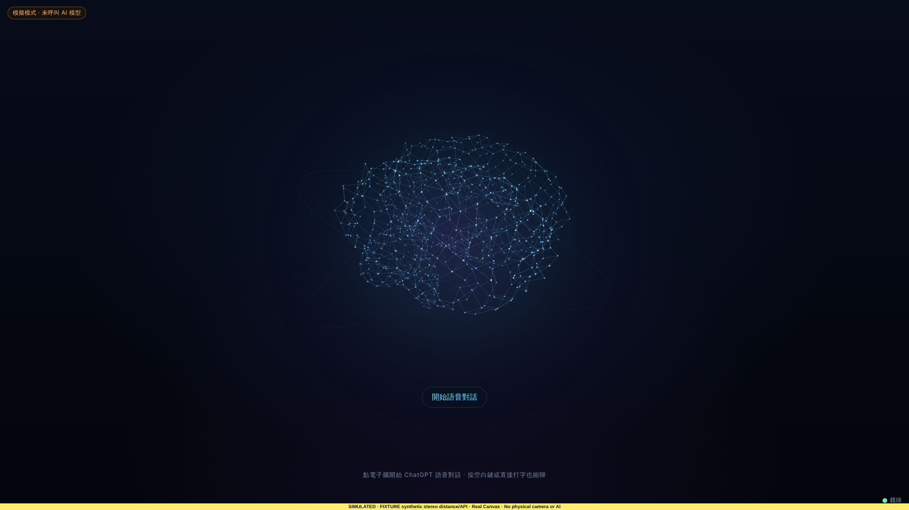
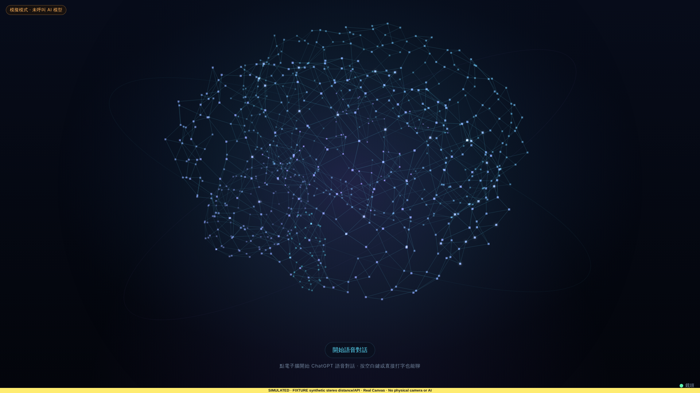

<!-- bilingual: source=zh-TW -->

> [繁體中文](brain-proximity-zoom-2026-10-23.md) | [English](brain-proximity-zoom-2026-10-23.en.md)

<a id="電子腦靠近放大驗證"></a>
# Brain proximity-zoom validation

2026-10-23; base `e3270c33656d64036b18670f08796016aeedafb8`. This record accompanies “enlarge the brain when approaching.”

<a id="決定"></a>
## Decisions

After home stereo-camera testing, George said: “The brain should enlarge when I approach. Let me set zoom in the menu; the current distance-to-size relationship is too weak and size changes are not obvious.”

Previously ambient brain and text shared `distanceScale = clamp(D ÷ 2, 0.75, 1.5)`, shrinking on approach and changing only 0.75–1× between 1.5–2 m. They are now separate.

- Text, content panels, and top thumbnail stay unchanged at × D ÷ 2.0 m from docs/10 §2, growing farther away. The top thumbnail retains text scaling because panel placement follows it.
- Ambient brain uses `brainZoom(D, max)`: 1× beyond 2.5 m (`BRAIN_ZOOM_FAR_M`), `max` within 0.6 m (`BRAIN_ZOOM_NEAR_M`), linear interpolation rounded to 0.01 between. PresenceTracker reports only 0.5–4 m, so the 0.6 m near point makes maximum reachable.
- New `brain_zoom_max`, “靠近時電子腦放大倍率” (“brain enlargement when approaching”), is a `factor` preference: 1–3× in 0.1 steps, default 2×, menu choices 1/1.5/2/2.5/3. Validation is as strict as durations: out-of-range, off-step, and wrong types return 400 rather than silent clamping. Settings −/+ and macOS duration/zoom menu update it immediately without restart.
- Null distance, camera off/error/degraded, or departure resets zoom to 1. `starting` retains the latest distance as text scaling does.

<a id="對照表程式算出"></a>
## Program-generated comparison table

Generated by `npx tsx scripts/brain-zoom-table.ts` in `prototype/ambient-shell`, directly calling `brainZoom`, `distanceScale`, and `brainGeometry`, not calculated by hand.

Ambient radii use 1920×1080; 1× = 216.0 px.

| Distance | Text factor, unchanged | Zoom, max 2 | Radius, max 2 | Zoom, max 3 | Radius, max 3 |
| --- | --- | --- | --- | --- | --- |
| 3 m | 1.5 | 1 | 216.0 px (1.00×) | 1 | 216.0 px (1.00×) |
| 2.5 m | 1.25 | 1 | 216.0 px (1.00×) | 1 | 216.0 px (1.00×) |
| 2.2 m | 1.1 | 1.16 | 250.6 px (1.16×) | 1.32 | 285.1 px (1.32×) |
| 2 m | 1 | 1.26 | 272.2 px (1.26×) | 1.53 | 330.5 px (1.53×) |
| 1.8 m | 0.9 | 1.37 | 295.9 px (1.37×) | 1.74 | 375.8 px (1.74×) |
| 1.55 m | 0.78 | 1.5 | 324.0 px (1.50×) | 2 | 432.0 px (2.00×) |
| 1.5 m | 0.75 | 1.53 | 330.5 px (1.53×) | 2.05 | 442.8 px (2.05×) |
| 1.2 m | 0.75 | 1.68 | 362.9 px (1.68×) | 2.37 | 461.5 px (2.14×, viewport-limited) |
| 1 m | 0.75 | 1.79 | 386.6 px (1.79×) | 2.58 | 461.5 px (2.14×, viewport-limited) |
| 0.8 m | 0.75 | 1.89 | 408.2 px (1.89×) | 2.79 | 461.5 px (2.14×, viewport-limited) |
| 0.6 m | 0.75 | 2 | 432.0 px (2.00×) | 3 | 461.5 px (2.14×, viewport-limited) |
| 0.5 m | 0.75 | 2 | 432.0 px (2.00×) | 3 | 461.5 px (2.14×, viewport-limited) |
| No distance / camera off / departure | 1 | 1 | 216.0 px | 1 | 216.0 px |

Ambient viewport limits, actual factor when requesting 3×:

| Viewport | 1× radius | No progress ring | Real progress ring |
| --- | --- | --- | --- |
| 1920×1080 | 216.0 px | 2.14× | 1.57× |
| 1366×768 | 153.6 px | 2.14× | 1.57× |
| 1280×900 | 180.0 px | 2.14× | 1.57× |
| 390×844 | 78.0 px | 2.00× | 1.67× |
| 844×390 | 78.0 px | 2.14× | 1.57× |

“Viewport-limited” means the body, 1.25 R horizontally and 1.1 R vertically, stays inside the viewport. Measured body rises 1.07 R and extends down only 0.78 R, so upward room limits growth. With a real task progress ring, the 1.5 R ring sets the limit to keep its top starting point visible. Only faint outer orbits may leave the viewport; the 1.32 R listening halo can exceed top/bottom at large zoom while remaining visible at the sides. Keeping the original 1.7 R whole-orbit constraint would cap 16:9 enlargement at 1.38×, making every setting above 2× look identical.

Thus 16:9 reaches full 2× with maximum 2. Settings 2.5/3 both stop near 2.14× close up, but larger settings grow earlier; maximum 3 reaches 2× at 1.55 m.

<a id="自動檢查"></a>
## Automated checks

| Command in `prototype/ambient-shell` | Result |
| --- | --- |
| `npx tsc --noEmit` | Pass |
| `npx vitest run` | 723 tests in 45 files pass (693 before batch; initial delivery 720, review added three) |
| `npx vite build` | Pass |
| `node --check desktop/main.mjs` | Pass |
| Repository root `node scripts/verify-aios.mjs` | PASS |

Added or rewritten tests:

- `tests/sense-controller.test.ts`: `brainZoom` near/far/midpoint 1.55 m/null at max 1.5/2/3; no enlargement for 1× or invalid maximum; controller driven only by presence events/settings; no duplicate notification for unchanged zoom; changed setting applies next tick; null/departure/off/error/degraded reset; text `distanceScale` unchanged over 0.6–4 m.
- `tests/camera-prefs.test.ts`: default `brain_zoom_max: 2`, factor −/+, rejection of range violations 0.9/3.1, off-step 1.25/2.05, and wrong types.
- `tests/prefs.test.ts`: factor choices/default consistency; menu factor row position, five choices, checkmark/current item, disabled when camera unavailable, note when camera off; `describeSeconds` retains only duration rows and original duration tests stay unchanged.
- `tests/http.test.ts`: `POST /api/settings/camera` rejects invalid factors, saves camera.json, and updates response factor row.
- `tests/brain-distance.test.ts`: ambient approach zoom, growing click area (body-fitting ellipse after review), per-viewport growth, no enlargement at 1×, normal-motion easing/CSS radius, particles inside viewport, and progress-ring bounds when present.

Changed old assertions that encoded shared brain/text scale: in `tests/brain-distance.test.ts`, 1.5 m shrink/3 m growth; reset and `starting` now use 0.6 m; viewport bounds now inspect body/ring; resize 0.75 → 1.53×; invalid inputs use `setProximityZoom`. `tests/http.test.ts` setting keys and `tests/camera-prefs.test.ts` defaults add `brain_zoom_max`.

<a id="審查修正同日"></a>
## Same-day review fixes

A review probe loaded real `Brain` with `tsx`, drew 2,000 normal-motion frames, and measured particle extents.

| Item | Correction |
| --- | --- |
| Incorrect overlap claim | Body extents are up 1.067 R, down 0.775 R, left 1.217 R, right 1.189 R at 1/2/2.14×. At 1920×1080 bottom edges are 675/842/865 px, all above button 940 px without overlap. Corrected final remaining-work item and `ZOOM_FIT_EXTENT` comment: 1.06 R is upward extent. |
| Easing duration too short | Replaced “about 0.4 seconds” with time constant about 0.2 seconds and 95% in about 0.55 seconds at 30 fps, calculated below. Updated record/README/docs/11/brain comment and added easing test. |
| Region names grow too | Kept `max(12, R ÷ 11)` px because labels are part of the brain; INSTALL and hardware step 4 now distinguish enlarged labels from panels/subtitles following docs/10. |
| Click area too large | Old 1.35 R circle had 583 px radius at 2× and empty space below the brain started conversation. Replaced with `HIT_EXTENT` ellipse: horizontal 1.25 R, up 1.1 R, down 0.85 R, adding 0.03–0.07 R margin (7–16 px at 1×). At 2× bottom is 875 px and (960, 950) no longer hits; 5 px beyond body edges at 1× still hits. Added tests. |
| Endpoint floating-point errors | `parsePrefsPatch` checked raw range before step tolerance 1e-6, rejecting 3.0000000000000004/0.9999999999999999 but accepting 1.1000000001. It now snaps to step before range check, shared by durations. Review examples 2.9 + 0.1 and 0.7 + 0.3 equal exactly 3 and 1 in double precision (asserted); noisy examples are literals and 0.3 × 3 + 0.1 = 0.9999999999999999. Added tests. |
| George's home test | Step 5 notes that stepping sideways out of view at 0.6 m can take up to 60 seconds to reset, by design. |

After rebuilding, all seven `scripts/verify-distance-brain-browser.mjs` cases pass, including `scaled-hit-area-and-camera-off-command`: a point at 1.5 R does not hit at 1× but hits at 2×.

Three tests added, 720 → 723: 30 fps easing-frame count and body-fitting click ellipse (1× edges, 2× interior, no hit at (960, 950)) in `tests/brain-distance.test.ts`, and floating-point endpoint tolerance in `tests/camera-prefs.test.ts`.

<a id="瀏覽器量測simulated"></a>
## Browser measurements, SIMULATED

`scripts/verify-distance-brain-browser.mjs` loads the actual built page in Chromium 141 with Node 22.22.0. Only external `SensePipeline` is replaced by a synthetic-event fixture; APIs are fixtures too. Main, `SenseController`, Canvas, and clicks are real. All seven cases pass without page errors; source/dist stay unchanged.

Before this batch four harness cases already failed because the settings fixture omitted `realtime.routes`, preventing settings from opening. This batch fixes that fixture, updates ambient assertions in the first two and responsive/hit-area cases, and adds `proximity-zoom-factor-1-and-2-and-settings-row`.

At 1920×1080 with reduced motion, ambient radii exactly match the table: max 2 at 3/2.5/2/1.55/1.2/0.6 m gives 216/216/272.2/324/362.9/432 px; max 3 gives 216/216/330.5/432/461.5/461.5 px.

Under normal motion, jumping from 3 m to 0.6 m with max 2 and target 432 px, drawing-radius samples roughly every 60–90 ms are 219 → 301 → 336 → 381 → 396 → 415 → 424 → 431 → 433 → 436 → 437 → 438. Values above 432 are ±1.8% breathing, not a direct jump. Breathing prevents reading exact 95% timing from samples. Code calculation: per-frame k = min(1, dt × 5); at 30 fps k = 1/6, remaining error multiplies by 5/6 each frame. Time constant (1/30) ÷ ln(6/5) ≈ 0.18 s (continuous limit 1/5 = 0.2 s), frame six at 0.2 s reaches 63%; ln(0.05) ÷ ln(5/6) ≈ 16.4 frames ≈ 0.55 s to 95%, actually frame 17 at about 0.57 s. The easing test in `tests/brain-distance.test.ts` counts frames using CSS `--brain-r` to check both values.

Settings fixture sets off-menu 2.3; row shows 2.3×. Pressing + submits `{ brain_zoom_max: 2.4 }` and updates to 2.4×.

| 1× at 3 m | 2× at 0.6 m |
| --- | --- |
|  |  |

[Settings factor row](./brain-proximity-zoom-2026-10-23/settings-brain-zoom-row-SIMULATED.png). All three images have a yellow SIMULATED label at the bottom. Distances are synthetic events, with no camera images.

Reproduce:

```bash
cd prototype/ambient-shell && npx vite build && cd ../..
PLAYWRIGHT_MODULE=/path/to/playwright/index.mjs CHROMIUM_PATH=/path/to/chrome \
  node scripts/verify-distance-brain-browser.mjs --output /tmp/aios-zoom-check --screenshots docs/validation/brain-proximity-zoom-2026-10-23
```

<a id="什麼是-fixture什麼是真的"></a>
## Fixtures and real evidence

| Item | Status |
| --- | --- |
| Distance-to-zoom, validation, menu data, HTTP persistence | Unit/HTTP tests, real code with fake inputs |
| Canvas size, easing, click area, settings | Actual Chromium page; fixture distance events/APIs, SIMULATED |
| macOS menu zoom submenu | `node --check` only; core-generated rows tested on Linux, Electron not run |
| Physical stereo ranging and stability while moving | Unvalidated; needs George's home tests |

<a id="george-在家的測試步驟"></a>
## George's home steps

1. Update, `npm start` or reopen macOS app; confirm green bottom-right camera dot.
2. Duration/zoom menu → proximity brain zoom → **2×**, or settings −/+.
3. Stand around 3 m with brain ambient and no settings/other views. This is normal size.
4. Approach 2 m, 1.5 m, 1 m, and 0.6 m, stopping 2–3 seconds each. Growth starts within 2.5 m and reaches about double radius at 0.6 m, nearly filling a 1080p height. Subtitle/start button move downward. Region labels are part of the brain and grow at max(12, R ÷ 11) px; panel/subtitle text does not follow brain enlargement and still uses docs/10.
5. Return to 3 m; normal size returns in a little over half a second (time constant about 0.2 s, 95% at about 0.55 s).
   - Stepping sideways out of camera at 0.6 m instead retains enlargement for up to about 60 seconds, by design. No new distance is sent without a visible person; only after `PresenceTracker.LEAVE_MS` 60 seconds does absence reset zoom to 1. Scaling follows actual presence events without guessing.
6. Select **3×** and repeat 3–5. Growth should occur earlier, reaching about 2× near 1.5 m; close-up on 16:9 still caps near 2.14×.
7. Select **1×**; approaching should make no difference.
8. If zoom jitters, record distance and appearance. Distance updates only every 10 cm and visuals ease, so theory predicts no jitter.

Report impressions at each distance, whether enlargement is too early/late, and whether 2× or 3× feels better.

<a id="未完成與下一個-gate"></a>
## Remaining work and next gate

- Hardware: stereo accuracy/stability at 0.6–3 m and the experience while moving await George's home tests, docs/11 §7 V1.
- macOS zoom submenu has not run on Mac.
- On 16:9, close-up 2.5/3× look the same, about 2.14×. Larger requires George to choose clipping the body or moving it to screen center while zooming.
- On 1080p, body and start-voice button do not overlap. Body is asymmetric, up 1.07 R/down 0.78 R/horizontal max 1.22 R. At 2× R = 432 px, bottom ≈842 px; 2.14× R = 461.5 px, bottom ≈865 px. Button top is min(47vh + 1.35 R + 20 px, 100vh − 140 px) = 940 px, at least 75 px below either body. Initial 822/996 px claims were wrong: 996 px used upward 1.06 R as downward, 507.6 + 1.06 × 461.5 ≈997; corrected.
- This record does not change formal hardware or AI gate status.

<a id="2026-10-25-補記"></a>
## Addition, 2026-10-25

For close-up 2.5/3× looking identical on 16:9, George chose centering the enlarged brain without leaving the screen. Landscape maximum is now about 2.56×, with numbers through 2× unchanged. Tables/measurements here remain the 2026-10-23 record; see [three small decisions](small-decisions-2026-10-25.en.md) for new numbers.
