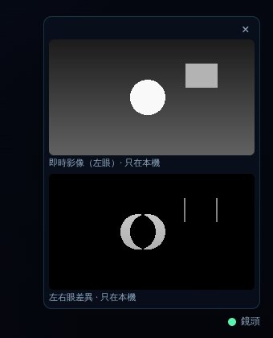
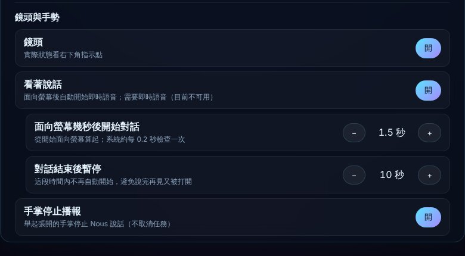

<!-- bilingual: source=zh-TW -->

> [繁體中文](camera-preview-2026-10-21.md) | [English](camera-preview-2026-10-21.en.md)

# Camera preview windows and camera settings validation

Date: 2026-10-21. Platform: Linux cloud environment, Node.js 22.22.0, and headless Chromium. This validates the prototype and does not change G0–G3 acceptance status.

## Results

| Check | Result | Scope |
| --- | --- | --- |
| `npx vitest run` | Pass | Added camera preference table, `camera.json` persistence, privacy static checks (no pixel-readback APIs in `src/`), idempotent camera pipeline start/stop and model-leak fixes, and controller cases for look-to-talk, palm stop, and camera enable/disable. |
| `node scripts/verify-aios.mjs` | Pass | Type checking, all tests, frontend build, and isolated mock task and chat HTTP journeys. |
| Chromium plus real MediaPipe plus **synthetic stereo video** | Pass | See the next section. |

## Browser checks with synthetic video, not physical hardware

Chromium uses `--use-file-for-fake-video-capture` to play a custom 2560×720 side-by-side video. Each half has a bright circle (near object, displaced 60 px between eyes) and a square (far object, displaced 8 px). The circle sways horizontally. `NOUS_CAMERA_LABEL=stereo.y4m` selects this video as the camera. MediaPipe models downloaded with `npm run vision:setup` are actually loaded and run. **This is not AR0144 hardware video.** The scene has no people, so it checks the image pipeline and display, not detection accuracy.

| Action | Observation |
| --- | --- |
| Start | Indicator turns green with `data-state="ok"`. |
| Enter “顯示鏡頭畫面” (“show camera view”) | Two small windows appear above the indicator with `data-visibility-reason="user_request"` and the current request ID. |
| Live image, left eye | Shows the left half with the circle and square. |
| Left/right difference | The near circle has wide crescent-shaped paired edges; the far square has only two thin edges against a black background, matching the expected disparity. |
| Open a fresh page with the preview closed, then click the indicator | Preview opens. This row uses a separate new page, not the state after the voice command above. |
| Open “鏡頭設定” (“camera settings”), press + twice for facing-screen duration, then press look-to-talk once | `camera.json` changes to `look_to_talk_s: 1.7` and `look_to_talk: false`; the onscreen switch reads “關” (“off”). |
| “鏡頭關掉” (“turn camera off”), then refresh | Indicator stays hidden and the camera does not reopen. |
| “打開鏡頭” (“turn camera on”) | Indicator returns to green. |

## Not yet validated

- **AR0144 hardware:** actual left/right order (`NOUS_CAMERA_LEFT_FIRST`), difference images in real scenes, and actual look-to-talk and palm-stop triggers with the new durations.
- **Performance:** time spent drawing three additional thumbnails per frame has not been measured on George's Mac.
- **Realtime voice:** look-to-talk requires `OPENAI_API_KEY`, unavailable in the cloud environment. Automatic conversation start has only been tested with a fake clock.
- **Desktop app:** the Electron version was not tested.
