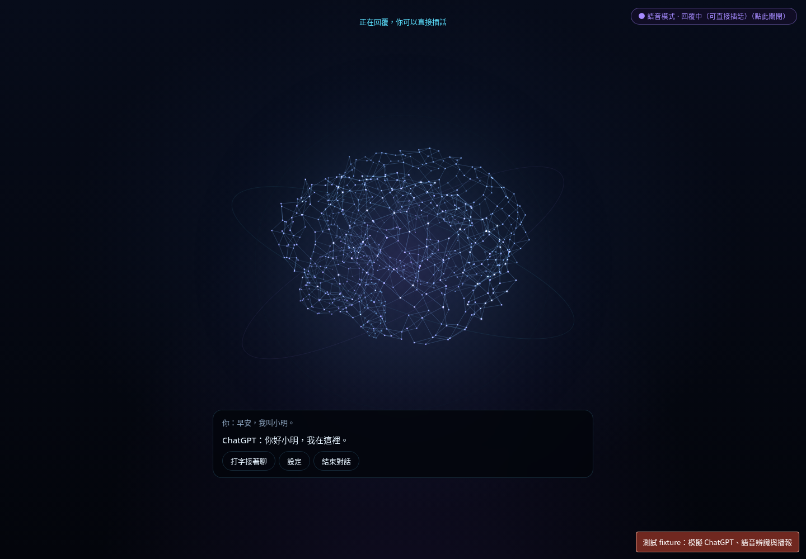

<!-- bilingual: source=zh-TW -->

> [繁體中文](chatgpt-conversation-2026-10-20.md) | [English](chatgpt-conversation-2026-10-20.en.md)

# Brain ChatGPT conversation validation

Date: 2026-10-20. Platform: Linux cloud environment, Node.js 24.19.0, npm 11.9.0, and headless Chromium. This validates the prototype conversation journey and does not change G0–G3 acceptance status.

## Results

| Check | Result | Scope |
| --- | --- | --- |
| `node scripts/verify-aios.mjs` | Pass | Type checking, 130 tests in 16 test files, frontend build, and isolated mock task and direct-chat HTTP journeys through the real server entry point. |
| Chromium conversation journey | 10 cases pass | Login entry, microphone consent, listening and speaking states, shared voice/text history, interruption, closure, permission denial, disconnect recovery, and authorization-error recovery. |
| Chromium engine-switch race | 2 cases pass | When state SSE arrives before the engine-switch HTTP response, the first message is still sent once; pressing Esc during switching prevents later submission or expansion. |
| Chromium delayed delegation | 1 case passes | On closure, background work still completes and retains its artifact without a cancellation request or reopening the response, task foreground, microphone, or TTS. |
| `node scripts/check-pstack.mjs` | Pass | Pinned official skills, hashes, skill links for both clients, and role configuration. |
| `git diff --check` | Pass | Working-tree diff formatting. |

The browser cases operate buttons, inputs, fetch, and EventSource on the real built page. Accounts, ChatGPT HTTP responses, speech recognition, and speech output all use fixtures at external boundaries. Ordinary questions do not create background tasks; the delayed-delegation case explicitly creates one task. No case has page errors.

Full results and build hashes are in [summary.json](./chatgpt-conversation-2026-10-20/summary.json). Three browser reports and the isolated server report are in the same directory. Tests use the uncommitted working tree. Final `main.ts` SHA-256 is `f667d9e416dbfe8e4846d422e4a3a94cb114c21b849ee8a7c2670857a4129c03`. All three browser reports use the same `index-CJrLsjcm.js` build.

## Review fixes

Review confirmed and fixed two user-visible races. When engine state arrives first, the initial input is no longer dropped. When the task-creation response arrives late, delegated work stays in the background and does not reopen an already closed foreground. All 13 browser cases above were rerun against the final build after the fixes.

Added unit tests cover old responses contaminating history, cancellation, collapse, retry, account reset, message byte limits, split SSE, premature EOF, incomplete model replies, and actual speech start/end events. Dependencies and lockfile are unchanged.

## Not yet validated

Real ChatGPT account login, plan inference authorization, and model replies were not completed. The current cloud proxy policy denied the official SIWC documentation request; the restriction was not bypassed. A network draft was saved with `developers.openai.com`, `auth.openai.com`, and `api.openai.com`, along with startup instructions that retain the HTTPS proxy. A configuration draft does not mean it has been applied or published.

Physical microphones, speakers, webcams, native ChatGPT realtime audio, and Tauri were not validated. This version still uses browser STT, ChatGPT text streaming, and browser TTS.

For real validation, first review and publish the stored environment settings, ensure the running environment has the required network access, then follow the [installation guide](../../prototype/ambient-shell/INSTALL.en.md) to start the app, sign in, and explicitly start microphone capture. Confirm the account actually has inference authorization, then test replies, interruption, permission denial, and microphone shutdown after closure. Handle every secret in the official authorization screen or environment configuration.
