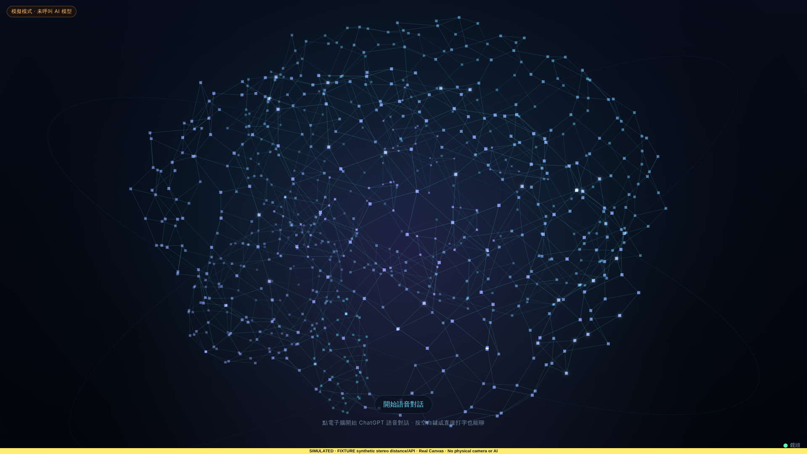
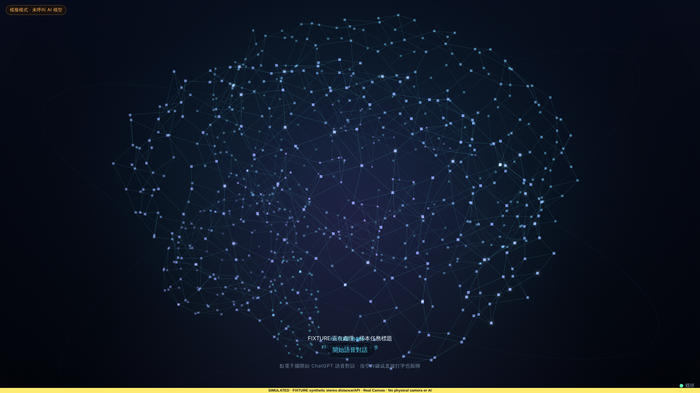
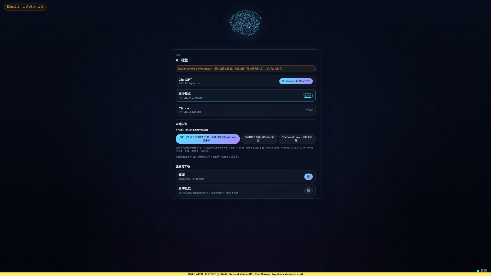

<!-- bilingual: source=zh-TW -->

> [繁體中文](small-decisions-2026-10-25.md) | [English](small-decisions-2026-10-25.en.md)

# 三項小決定的實作與驗證

2026-10-25；基底 `96297c0`；Linux 雲端環境，Node.js 22.22.0。George 對三個先前提出的問題做了決定，本紀錄是這三項的實作，包括獨立審查之後的修正（George 同日把電子腦的決定改成「真的置中」）。沒有變更 G0 至 G3 的驗收狀態。

| # | 問題 | George 的決定 |
| --- | --- | --- |
| 1 | 16:9 螢幕上電子腦最多只放大到約 2.14 倍（[靠近放大驗證](brain-proximity-zoom-2026-10-23.md)「未完成」） | 要放更大時，把電子腦移到畫面正中間，不超出畫面。腦形可以用整個視窗高度，下緣可以在「開始語音對話」按鈕、提示字、字幕與對話狀態後面，按鈕仍要點得到 |
| 2 | 關 AIFA 冷氣時中控會取消冷氣的定時 | 要讓 AI 說出來 |
| 3 | 冷氣關著時調溫度，讀不到控制器記得的模式，預設用「冷氣」 | 改成「自動」，不分季節 |

## 1. 電子腦放大時移到畫面正中間

### 2.14 倍從哪裡來

待機的電子腦中心固定在 47% 高（`LAYOUT.center.cy = 0.47`），1 倍半徑是 min(寬, 高) × 0.2。放大時腦形要留在視窗內，上下都以 1.1 R 算（`ZOOM_FIT_EXTENT.body.y`）。1920×1080：中心 507.6 px，往上的空間 507.6 ÷ 1.1 = 461.5 px，等於 216 px 的 2.14 倍。限制的是上緣。

### 為什麼最多約 2.56 倍

腦形量到的範圍是往上 1.07 R、往下 0.78 R（[靠近放大驗證](brain-proximity-zoom-2026-10-23.md)「審查修正」）。加上餘裕是往上 1.1 R、往下 0.85 R（和點擊範圍 `HIT_EXTENT` 相同），腦形框高 1.95 R，框的中心（看起來的中心）在 cy − 0.125 R。

用整個視窗高度時 R 最大是 h ÷ 1.95，在 1920×1080 是 553.8 px，等於 2.56 倍。這時框貼齊上下緣，看起來的中心正好是 h ÷ 2。3 倍的腦形框高 1.95 × 0.6 h = 1.17 h（只用量到的範圍也要 1.11 h），比視窗還高，所以在任何橫式視窗，3 倍都放不完整。

### 做法

`src/brain.ts` 的 `brainGeometry` 與 `zoomCenter`：

1. 倍率在原位放得下時，半徑與中心都不變（原本的規則，2 倍以內都是這樣）。
2. 原位放不下時，半徑上限是 min(cx ÷ 1.25, h ÷ 1.95)。中心依「放大了多少」移動：t = (R − 原位上限) ÷ (最大 R − 原位上限)，看起來的中心 = h ÷ 2 − (h ÷ 2 − 原位時看起來的中心) × (1 − t)²。t = 1 時正好在畫面中間。
3. 用 (1 − t)² 而不是直線：直線剛好等於「貼著頂端往下滑」（原位上限時框已經貼頂）。用這條曲線，中間倍率時上緣會離開頂端，1080 高時最多約 21 px，最後平順停在正中間。框的上下緣另外夾在視窗內，保證不出視窗。
4. 受寬度限制的視窗（直式）上限不變，留在原位。有真實進度環時不移動：進度環下方是任務字幕，而且進度環要整圈留在視窗內。

半徑與中心都只是倍率的連續函數，倍率只由實測距離事件與設定決定（`SenseController` → `setBrainZoom`）。`Brain.step()` 用原有的緩動（每幀 k = min(1, dt × 5)）同時移動中心與半徑。往後走時倍率變小，照原路回到原位。沒有距離事件時不移動。

`--brain-cy` 和 `--brain-r` 一起緩動並發布到 CSS。字幕、指令列、「開始語音對話」按鈕與對話狀態原本用 `47vh + k × --brain-r` 排位置，改成 `var(--brain-cy, 47vh) + k × --brain-r`。放大到要移動時，這幾個元素都已經停在各自的最低位置（CSS 的 `100dvh − 120／140／160／170px`，本批之前就有，沒有改）。第一版用過的 JS 常數 `ZOOM_BOTTOM_RESERVE_PX`（照抄 CSS 的 140 px）已經移除，JS 與 CSS 之間沒有要保持一致的常數。

文字「越遠越大」（docs/10 §2）不受影響：字級、內容面板與頂端縮略圖仍是 × D ÷ 2.0 m。有內容面板時電子腦在頂端（`layout: "top"`），不套用放大與置中。

### 數字（程式算出）

由 `npx tsx scripts/brain-zoom-table.ts`（在 `prototype/ambient-shell`）呼叫 `brainGeometry` 輸出。1920×1080，最大 3 倍時：1.42 m 起開始往中間移，1.01 m 以內到上限（距離每 1 cm 掃一次算出）。

| 距離 | 倍率（最大 3） | 實際半徑 | 中心／看起來的中心 |
| --- | --- | --- | --- |
| 3 m、2.5 m | 1 | 216.0 px（1.00×） | 507.6／480.6 px |
| 1.55 m | 2 | 432.0 px（2.00×） | 507.6／453.6 px |
| 1.42 m | 2.14 | 462.2 px（2.14×） | 509.2／451.4 px |
| 1.3 m | 2.26 | 488.2 px（2.26×） | 555.5／494.5 px |
| 1.2 m | 2.37 | 511.9 px（2.37×） | 585.4／521.5 px |
| 1.1 m | 2.47 | 533.5 px（2.47×） | 602.3／535.6 px |
| 1.01 m 以內 | 2.57–3 | 553.8 px（2.56×，受視窗限制） | 609.2／540.0 px |

最大 2 倍時完全照舊：0.6 m 時 432 px，中心 507.6 px。

要求 3 倍時實際能到的倍率：

| 視窗 | 1 倍半徑 | 原本 | 現在 | 看起來的中心／視窗中間 | 有真實進度環 |
| --- | --- | --- | --- | --- | --- |
| 1920×1080 | 216.0 px | 2.14× | 2.56× | 540.0／540.0 px | 1.57× |
| 1512×982 | 196.4 px | 2.14× | 2.56× | 491.0／491.0 px | 1.57× |
| 1440×900 | 180.0 px | 2.14× | 2.56× | 450.0／450.0 px | 1.57× |
| 2560×1440 | 288.0 px | 2.14× | 2.56× | 720.0／720.0 px | 1.57× |
| 1366×768 | 153.6 px | 2.14× | 2.56× | 384.0／384.0 px | 1.57× |
| 1280×900 | 180.0 px | 2.14× | 2.56× | 450.0／450.0 px | 1.57× |
| 390×844 | 78.0 px | 2.00× | 2.00× | 377.2／422.0 px（不移動） | 1.67× |
| 844×390 | 78.0 px | 2.14× | 2.56× | 195.0／195.0 px | 1.57× |

### 和按鈕、字幕的重疊（Chromium 量測，SIMULATED）

`scripts/verify-distance-brain-browser.mjs` 的案例 `proximity-zoom-centered-max-3`，1920×1080、最大 3 倍、0.6 m、減少動態效果（腦形不擺動，量的是一個姿勢；一般動態效果的範圍由單元測試量）。Chromium 141.0.7390.37。

| 項目 | 量到 |
| --- | --- |
| 3 m | 中心 507.6 px、半徑 216 px |
| 0.6 m | 中心 609.23 px、半徑 553.85 px；看起來的中心 540.00 px；CSS `--brain-cy` 609.23 px、`--brain-r` 553.85 px |
| 粒子範圍（775 個） | 上 41.4 px、下 1012.8 px |
| 「開始語音對話」按鈕 | 940–984 px，背景 `rgba(9, 16, 30, 0.74)`、z-index 4；框內有 2 個粒子 |
| 按鈕中心的 `elementFromPoint` | 按鈕本身；實際點擊由按鈕接到（捕捉階段第一個目標是 `start-conversation`），之後開出設定畫面（fixture 沒有登入），電子腦回到頂端 |
| 提示字「點電子腦開始…」 | 997–1015 px，沒有背景；框內有 2 個粒子 |
| 任務字幕（FIXTURE 樣本） | 920–970 px，沒有背景；框內有 17 個粒子 |
| 對話狀態（FIXTURE 樣本） | 923–941 px，沒有背景；框內有 1 個粒子 |
| 走回 3 m | 中心 507.6 px、半徑 216 px |

字幕與對話狀態在這個 fixture 裡不會和置中的電子腦同時出現：任務有進度環時不置中，對話在這裡會開出 Surface。所以案例直接顯示 FIXTURE 樣本文字，只量 CSS 排出的位置和粒子的重疊，不代表真實流程會同時出現。

可讀性（看截圖，不是量測）：按鈕有半透明底，文字清楚。提示字、字幕與對話狀態沒有底色，疊在腦幹與小腦的粒子和連線上。粒子不多（框內 1–17 個），字看得出來，但比沒有放大時雜。樣本截圖裡字幕、對話狀態與按鈕彼此重疊，這是三個元素都停在最低位置（920、923、940 px）造成的。這三個位置本批沒有改，同時顯示時本來就會疊在一起。

| 待機（0.6 m，最大 3 倍） | 樣本字幕與對話狀態 | 按下按鈕之後 |
| --- | --- | --- |
|  |  |  |

截圖底部有黃色 SIMULATED 標示；距離是合成事件，沒有相機影像。重現：

```bash
cd prototype/ambient-shell && npx vite build && cd ../..
PLAYWRIGHT_MODULE=/path/to/playwright/index.mjs CHROMIUM_PATH=/path/to/chrome \
  node scripts/verify-distance-brain-browser.mjs --case proximity-zoom-centered-max-3 --output /tmp/aios-zoom-center \
  --screenshots docs/validation/small-decisions-2026-10-25
```

### 測試

`tests/brain-distance.test.ts` 新增 3 項：

- 最大倍率：2 倍照舊；3 倍時 R = 1080 ÷ 1.95，看起來的中心 540 px，框貼齊上下緣。1366×768 也到正中間；390×844 不動；有進度環時不動。
- 中間倍率：1920×1080、1366×768、844×390 每 0.005 倍掃一次。半徑與中心都單調，每步半徑變化小於 2 px、中心小於 0.3% 視窗高，不出視窗。原位上限之後上緣離開頂端超過 2% 視窗高（不是貼頂下滑），最後看起來的中心等於 h ÷ 2。1.2、1.5、2 倍時中心仍在 47%。
- 渲染器（一般動態效果）：沒有距離事件時不動；0.6 m 時第一幀只走一部分，之後緩動到目標；`--brain-cy`、`--brain-r` 跟著畫面；點擊範圍跟著新的中心。300 幀量到的粒子在視窗內，上下中點離 540 px 不到 3%。走回 3 m 回到原位。

既有的「視窗邊界」測試（最大 3 倍、各視窗、有無進度環、粒子不出視窗）不用改就通過。

## 2. 關冷氣時說出會取消定時

這件事的來源是 George（中控的固定做法）。AIOS 看不到中控程式，也讀不到冷氣的定時，所以照「不知道原本有沒有定時」來說。

`server/home-bridge.ts`：AIFA 冷氣 `power false` 時，依中控的回覆在結果加上 `note`。`note` 只放要念給使用者的句子：

| 中控回覆 | `note` |
| --- | --- |
| 已送出（`unconfirmed`／`one_way`） | `AC_OFF_TIMER_NOTE`：「如果這台冷氣有設定定時，中控關機時會一併取消，需要的話請重新設定。」 |
| 中控沒有回覆、可能收到（`no_reply`） | `AC_OFF_TIMER_NOTE_UNSURE`：「如果中控有執行這次關機，而且這台冷氣有設定定時，定時也會一併取消，需要的話請重新設定。」 |
| 失敗（200 `failed`）、沒有送出、開冷氣、紅外線家電 | 不加 |

不能說的話寫在模型的工具規則 `realtimeToolRules`（`server/realtime.ts`；API key 路徑的語音模型與 ChatGPT 方案路徑的工具執行層用同一段文字）：「關冷氣的 note 提到定時時：AIOS 讀不到定時，不能說確實有定時被取消，也不能說冷氣已經關了。」同一段原本就有「有 note 時照說」。

字幕（`homeControlLine`）不變，仍是「⏳ 客廳 冷氣 關閉：已送出，請確認」。

200 `failed` 時不說：中控回報沒有送出關機，照理定時不受影響。中控在這種情況會不會也取消定時，要等 George 實測（下面步驟）。

### 行為改變：`no_reply` 的系統通知帶附加事實

確認卡之後的結果由 `shared/home.ts` 的 `homeControlNotice` 轉成系統通知。原本只有 `one_way` 與 `cloud_no_reply` 接上附加事實（`factsText`），`no_reply` 不接。這次為了讓「中控沒有回覆」時的定時句子也念到，`no_reply` 也接上。影響範圍不只關冷氣：AIFA 設定的 `no_reply` 通知會多出「送出的設定：…」與「用了預設值：…」，紅外線的 `no_reply` 通知會多出切換鍵的說明。即時語音直接拿結果 JSON 的路徑本來就看得到這些欄位，不受影響。

### 測試

`tests/home-bridge.test.ts` 新增 2 項：

- 關冷氣：已送出時 `note` 等於 `AC_OFF_TIMER_NOTE`，系統通知帶上，字幕不變。兩個句子都不含「不能說」或「AIOS」，不能說的話在 `realtimeToolRules`。中控沒有回覆時是 `AC_OFF_TIMER_NOTE_UNSURE`，系統通知帶上。200 `failed`、409 沒有送出、開冷氣、紅外線電視關機都不提定時。
- `ac_temperature` 加 `no_reply`：系統通知包含「送出的設定：模式冷氣、26 度、風量低、擺風自動。」，不提定時。

## 3. 冷氣關著時，模式預設改成自動

`CLIMATE_DEFAULTS.mode` 從 `"cool"` 改成 `"auto"`。這台冷氣的能力清單沒有自動時，退到清單第一個模式（原本的規則）。用了預設值的項目照舊列在 `defaults_used`，模型照說，例如「控制器沒有回報、用了預設值：模式：自動」。控制器有回報模式時照回報，不用預設。

`sent_settings` 的模式前面加上「模式」：原本「冷氣、26 度、風量低、擺風自動」念起來不清楚是模式，現在是「模式冷氣、26 度、風量低、擺風自動」。

改了的文件字串：`shared/voice-commands.ts` 的「冷氣調 26 度」說明（列出預設值）與 `home_control` 說明（關冷氣會說定時）；`npm run docs:commands` 重產 README 指令表；README 的 AIFA 段落；docs/12 的「AIFA 設定」與「AIFA 開關」；`shared/home.ts` 的 `sent_settings` 註解。H1b 驗證文件與 docs/11 保留原文，加上「2026-10-25 補記」。

測試：`tests/home-bridge.test.ts` 改了 3 個既有預期（冷氣關著說 26 度、讀不到 `/status`、`buildClimate` 的預設清單：`模式：冷氣` 改成 `模式：自動`、送出的 `mode` 改成 `auto`），另外檢查：預設模式是自動；沒有自動的冷氣退到冷氣並說出來；有回報時照回報。`sent_settings` 加「模式」改了 `tests/home-bridge.test.ts` 4 處（另有 `buildClimate` 的 `text` 1 處）、`tests/http.test.ts` 1 處、`tests/realtime-voice.test.ts` 1 處（fixture 結果，原樣交給模型）。

## 自動檢查

| 指令 | 結果 |
| --- | --- |
| `npx tsc --noEmit`（`prototype/ambient-shell`） | 通過 |
| `npx vitest run` | 48 檔 795 項通過（本批前 790 項） |
| `npx vite build` | 通過 |
| `node --check desktop/main.mjs` | 通過 |
| repo 根目錄 `node scripts/verify-aios.mjs` | PASS |
| `git diff --check` | 通過 |
| `scripts/verify-distance-brain-browser.mjs`（全部案例） | 8 個案例通過（SIMULATED） |

## 什麼是 fixture、什麼是真的

| 項目 | 狀態 |
| --- | --- |
| 放大置中的幾何、緩動、點擊範圍、按鈕點擊 | 單元測試與 Chromium 實際頁面；距離事件與 API 是 fixture |
| 字幕、對話狀態和電子腦的重疊 | Chromium 實際 CSS，文字是 FIXTURE 樣本 |
| 關冷氣的定時句子、預設模式 | 假中控（fixture）；沒有真冷氣、沒有真模型說話 |
| 中控關冷氣時取消定時 | George 提供的中控行為；本次沒有讀中控程式，也沒有實測 |
| macOS App、實體雙目鏡頭 | 沒有執行 |

## George 在 Mac／家裡的測試步驟

電子腦：

1. 更新後 `npm start`（或重開 macOS App），右下角鏡頭小點是綠的。
2. 選單列「秒數與倍率設定」→「靠近時電子腦放大倍率」選 **3 倍**。
3. 站在約 3 m 待機，再慢慢走到 2 m、1.4 m、1.2 m、1 m、0.6 m，每個點停 2–3 秒。2.5 m 以內開始變大；約 1.4 m 起除了變大還會往下移，約 1 m 以內到最大，腦形上下幾乎填滿畫面，看起來在畫面正中間。腦的下方會在「開始語音對話」按鈕與提示字後面。
4. 在最大時按「開始語音對話」，要開始對話，不是被當成點電子腦。看提示字讀不讀得清楚。
5. 走回 3 m，電子腦應該在約半秒多回到原本的大小與位置。
6. 改成 **2 倍** 重複 3：2 倍不需要移動，位置不變。
7. 回報：最大時大小合不合適、往中間移的過程順不順、按鈕和提示字疊在腦上時看不看得清楚。

冷氣（接著 [H1b 步驟](smarthome-h1b-2026-10-22.md#george-家裡的實機驗證步驟)）：

1. 先用 AIFA App 或中控設一個冷氣定時，再說「開冷氣」，接著說「關冷氣」。Nous 應該說「如果這台冷氣有設定定時，中控關機時會一併取消，需要的話請重新設定」之類的話，不說「冷氣已經關了」、不說「定時已經取消了」。記下中控或 AIFA App 裡定時是否真的被取消：＿＿。
2. 沒有設定定時時再說一次「關冷氣」：Nous 仍會照同樣的說法提醒（AIOS 不知道有沒有定時）。如果覺得多餘，請回報；要改成只在有定時時說，需要中控在回覆裡提供定時資訊。
3. 關冷氣失敗時（例如 AIFA 帳號連線中斷，字幕「✕ … 關閉：失敗（…）」）：Nous 不會提定時。請看定時是否也被取消了：＿＿。如果失敗時也會取消，要改成失敗時也提醒。
4. 冷氣關著時說「冷氣調 26 度」：Nous 要說模式用了預設的「自動」，而且這個設定不代表會開機。之後開冷氣，記下面板實際顯示的模式與溫度（自動模式下有些冷氣不顯示設定溫度，或顯示別的數字）：模式＿＿、溫度＿＿。

## 未完成與疑慮

- 電子腦：3 倍在橫式視窗放不完整，最多約 2.56 倍。這是幾何限制。最大時腦幹與小腦在按鈕、提示字後面，沒有底色的文字可讀性要 George 在實機看。
- 字幕、對話狀態與按鈕在最低位置彼此重疊（920、923、940 px），本批之前就是這樣，沒有改。真實流程中它們很少同時出現，但沒有逐一驗證。
- 定時：AIOS 不知道冷氣有沒有定時，現在每次關 AIFA 冷氣都會提醒。200 `failed` 時中控會不會也取消定時不知道。
- `no_reply` 系統通知接上附加事實，影響 AIFA 設定與紅外線（見上）。
- 實機：macOS App、雙目測距下的移動感受、真冷氣與真模型說話都沒有驗證。
- 這個紀錄不改變正式硬體或 AI gate 的狀態。下一個 gate 是 George 的 Mac 與家中實測（docs/11 §7 V1、docs/12 H1b）。
