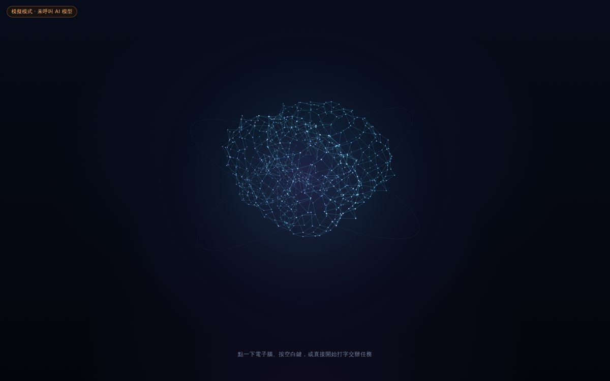
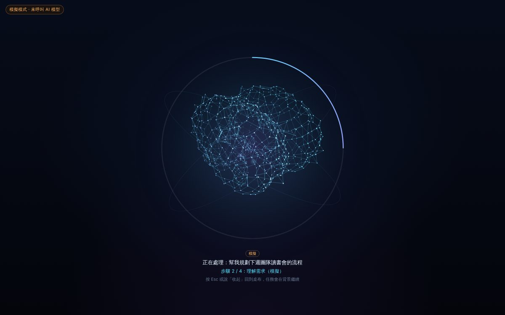
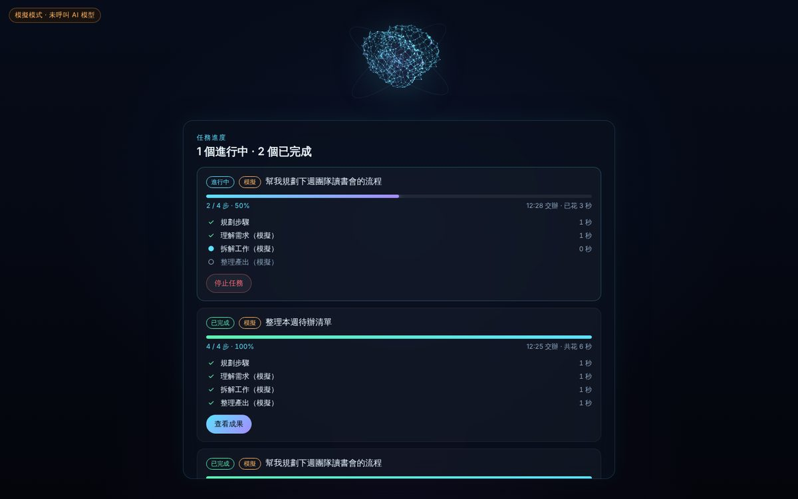
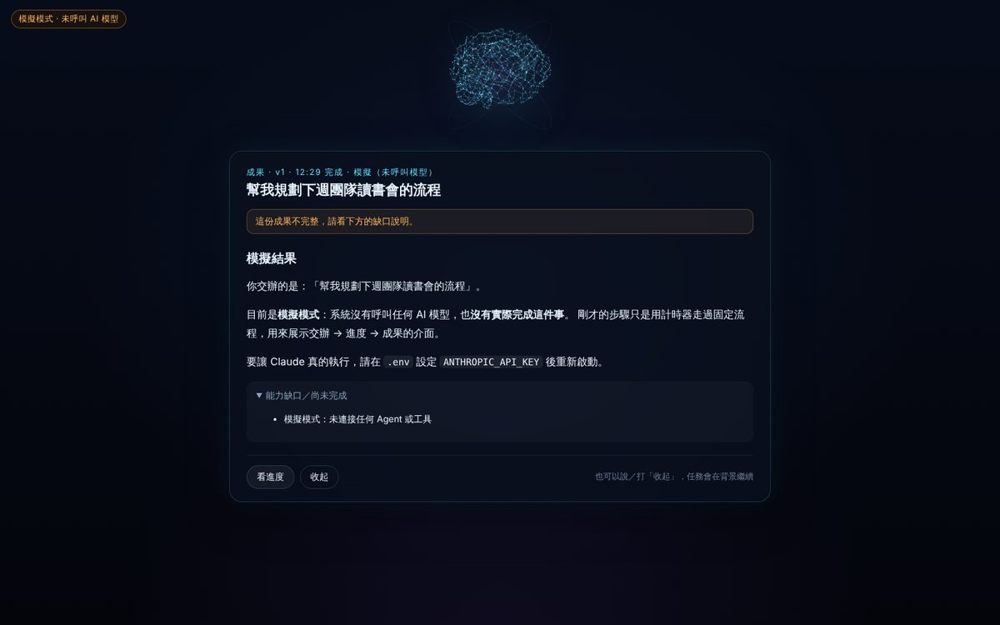
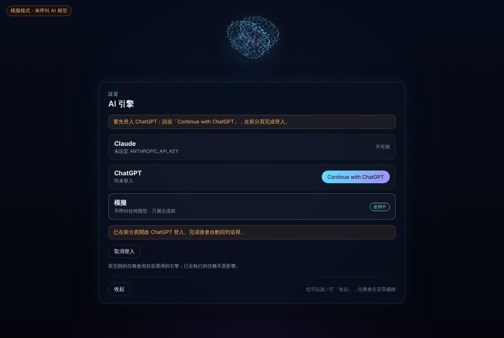

<!-- bilingual: source=zh-TW -->

> [繁體中文](README.md) | [English](README.en.md)

<a id="nous-原型漂浮電子腦--chatgpt-對話--按需任務"></a>
# Nous prototype: floating electronic brain × ChatGPT conversation × on-demand tasks

> Voice conversation presented through an electronic brain. Sign in to your ChatGPT account, then start capture. Interrupt or continue by typing. For longer work, AI can reuse the prototype's background-task flow.
> This prototype does not establish PR-01 or G0 acceptance in 07. See [current implementation status](../../docs/Current_Implementation_Status.en.md) for capabilities, evidence levels, and pending gates, and [2026-10-24 feature assessment](../../docs/13_Feature_Expansion_Assessment_2026-10-24.en.md) for priorities and Quest expansion.

The current runtime is TypeScript, Vite, Node HTTP/SSE, and an Electron macOS wrapper. Tauri, Python kernel, Quest clients, and cross-device synchronization in formal specifications remain planned. OpenClaw informs parts of the realtime voice protocol; this repo does not integrate an OpenClaw agent.



| After delegation (foreground) | Asking for progress | Completed artifact |
|---|---|---|
|  |  |  |

These are mock-mode screenshots of the earlier task flow. See the new [ChatGPT conversation design](../../docs/development/chatgpt-conversation-design.en.md).

New UI and test scope are in the [conversation validation record](../../docs/validation/chatgpt-conversation-2026-10-20.en.md). Accounts, models, and audio in those screenshots are fixtures.

<a id="啟動"></a>
## Start

Requires Node.js 22.12+. First-time installation, Windows commands, and troubleshooting are in **[INSTALL.md](INSTALL.en.md)**.

```bash
cd prototype/ambient-shell
npm ci
npm start                 # 建置前端並啟動本機核心
```

Open <http://localhost:8787>. The server binds only `127.0.0.1`.

Development can use two terminals: `npm run dev:server` (core, 8787) and `npm run dev:web` (Vite, 5173, forwarding `/api` to core). Vite dev/preview and core send the same security headers (`server/page-headers.ts`; dev additionally permits Vite-injected inline CSS). `connect-src 'self'` blocks MediaPipe's built-in usage reports to `odml.pa.googleapis.com` every 60 seconds. Upstream provides no disable option ([google-ai-edge/mediapipe#6291](https://github.com/google-ai-edge/mediapipe/issues/6291)).

Click the brain or “Start voice conversation,” sign in as prompted, then activate voice again and consent to cloud speech recognition. Login never opens the microphone automatically. ChatGPT accounts need authorization through the existing Sign in with ChatGPT preview flow. Real-account login and inference were not verified in this batch, and availability for every plan is not guaranteed. Never put ChatGPT passwords or credentials in `.env`.

<a id="怎麼用"></a>
## Usage

| Action | Response |
|---|---|
| Click the brain or “Start voice conversation” | Sign in if needed, then explicitly start capture. Brain reflects listening, waiting, and playback |
| Press Space or type directly, then Enter | Continue the same conversation. Text replies work without a microphone. Ordinary questions do not become separate tasks |
| Speak over playback or press Esc during speech | Stop current generation and playback, return to listening, and preserve correct turn ordering for the next question |
| Click “End conversation,” say/type “收起,” or press Esc when not speaking | Stop foreground capture/reply, dismiss the view, and end voice. Existing background tasks continue. “結束對話” is not a local command and goes to AI; see the command table |
| “進度如何” or “做到哪了” | Show all task progress: state, `completed steps / total steps · percentage`, per-step state/duration, and streamed character counts |
| “看結果” or “剛才那份” | Show the latest completed artifact |
| “搜尋成果 香菜”, “找之前關於晚餐的成果”, “search past results for dinner”, the progress view's “Search all results” button, or the macOS menu bar item “Results history…” | Open **results history** (HIST-1): search past tasks and results, filter by status, engine, and date, view details, redo, or delete (deletion asks for native confirmation; stop a running task first). You can also open `http://localhost:8787/history` yourself in a browser |
| “停止任務” | Stop directly if exactly one task runs. If several run, list them for selection |
| Microphone button (Chrome / Edge) | Press and speak. First explain that the browser sends audio to cloud recognition; enable only after consent |
| Say/type “開啟語音模式” or click the waveform input button | **Voice conversation mode**, similar to ChatGPT voice: speak directly with AI and hear replies sentence by sentence while generated. **Interrupt while it speaks** and it stops to listen. AI delegates longer work, such as reports/research, to background tasks with normal progress. Commands such as “進度如何,” “停止任務,” and “收起” remain local, except spoken realtime commands go to AI as described below. End with “關閉語音模式,” the top-right indicator, or inactivity (default 1 minute 30 seconds, configurable) |

Only short phrases matching fixed vocabulary are local controls (`src/intent.ts`). “幫我寫一份專案進度報告” is therefore sent to AI rather than mistaken for progress. Brain conversation uses browser STT, streamed ChatGPT text, and browser TTS. Latency and voice depend jointly on recognition service, model, and computer speech.

The latest reply remains readable until dismissal or opening settings/progress/another view. History exists only in current page memory and clears on engine/account changes, logout, or reload.

<a id="語音閒置秒數"></a>
### Voice idle times

| Setting | Default | Range | Timer pauses while |
| --- | --- | --- | --- |
| Voice-mode inactivity before automatic closure | 1 minute 30 seconds | 30–600 seconds, step 10 | Waiting for or reading AI replies |
| Realtime-voice inactivity before automatic end | 2 minutes | 30–600 seconds, step 10 | Replying, researching, running tools, or waiting for confirmation; realtime voice is usage billed |

Browser settings use −/+. macOS App uses menu “Camera and voice settings”; the in-window settings page retains accounts/login only. Changes apply immediately: active voice restarts its timer at the change, inactive voice uses the value next start. Save only changed fields in `~/.config/nous/voice.json` through `POST /api/settings/voice`. Like `camera.json`, invalid fields are individually ignored and logged; unreadable files use defaults. Ranges, choices, and labels live only in `shared/voice-prefs.ts`. Core derives menu choices in `GET /api/settings` `seconds`; this historical field now includes factor/camera-toggle rows, distinguished by `kind` (`seconds` / `factor` / `bool`).

<a id="語音與打字指令表"></a>
### Voice and typed command table

After core starts, open `http://localhost:8787/help/commands` for a version annotated with current settings. macOS App has menu “Voice command table” or ⌘/. The following is generated from `shared/voice-commands.ts` (`npm run docs:commands`). `tests/voice-commands.test.ts` runs each phrase against real matching rules. `tests/commands-doc.test.ts` fails if the original block and code differ.

<!-- voice-commands:begin（由 shared/voice-commands.ts 產生：npm run docs:commands；請勿手改） -->

The original table is generated and every phrase is checked against actual local matching rules (`tests/voice-commands.test.ts`). This English counterpart translates explanations while preserving recognized Chinese input phrases. Typed means the input field, including during realtime voice. Microphone means press once and say one phrase in Chrome/Edge. Voice mode means browser voice conversation. Realtime spoken means speech within realtime voice. macOS App has no browser speech recognition, only typing and realtime voice.

<a id="鏡頭"></a>
#### Camera

Polite words such as 請 or 幫我…吧 are allowed. Negations and questions, such as “不要打開鏡頭” and “鏡頭怎麼關,” are not commands.

| Say | Action | Typed | Microphone | Voice mode | Realtime spoken | Conditions and notes |
|---|---|---|---|---|---|---|
| 「收起鏡頭畫面」「關閉鏡頭畫面」「鏡頭畫面收起來」 | Hide preview only. Camera continues without saving | ✓ | ✓ | ✓ | ✓ | |
| 「顯示鏡頭畫面」「看一下鏡頭畫面」 | Show small camera preview in this page only, without storage/egress | ✓ | ✓ | ✓ | ✓ | Camera running |
| 「關閉看著說話」「看著說話關掉」 | Disable look-to-talk and save | ✓ | ✓ | ✓ | ✓ | Requires .env NOUS_CAMERA=on |
| 「打開看著說話」「開啟看著說話」 | Enable look-to-talk and save | ✓ | ✓ | ✓ | ✓ | Requires .env NOUS_CAMERA=on |
| 「關閉打招呼」「打招呼關掉」 | Disable look-to-talk's initial greeting and save | ✓ | ✓ | ✓ | ✓ | Requires .env NOUS_CAMERA=on |
| 「打開打招呼」「打招呼打開」 | Enable look-to-talk's initial greeting and save | ✓ | ✓ | ✓ | ✓ | Requires .env NOUS_CAMERA=on |
| 「關閉手掌停止」「停用停止手勢」 | Disable palm-stop playback and save | ✓ | ✓ | ✓ | ✓ | Requires .env NOUS_CAMERA=on. Spoken while a realtime confirmation card is open also rejects that card; see ambiguities |
| 「打開手掌停止」「啟用停止手勢」 | Enable palm-stop playback and save | ✓ | ✓ | ✓ | ✓ | Requires .env NOUS_CAMERA=on. Spoken while a realtime confirmation card is open also rejects it |
| 「關掉鏡頭」「鏡頭關起來」「請幫我關掉鏡頭吧」 | Disable camera and save, including across restart | ✓ | ✓ | ✓ | ✓ | Requires .env NOUS_CAMERA=on |
| 「打開鏡頭」「開啟鏡頭」 | Enable camera and save. Check bottom-right state dot | ✓ | ✓ | ✓ | ✓ | Requires .env NOUS_CAMERA=on |

<a id="對話與畫面"></a>
#### Conversation and display

Only phrases of at most 14 characters without delegation verbs qualify.

| Say | Action | Typed | Microphone | Voice mode | Realtime spoken | Conditions and notes |
|---|---|---|---|---|---|---|
| 「開啟語音模式」「語音對話」「打開語音模式」 | Start voice, realtime with OPENAI_API_KEY, otherwise browser voice | ✓ | ✓ | ✓ | — | Typing during realtime changes nothing. Saying during browser voice switches to realtime when available |
| 「關閉語音模式」「結束語音對話」「語音模式關掉」 | End browser or realtime voice, retaining tasks | ✓ | ✓ | ✓ | — | Type this in realtime; spoken goes to AI |
| 「收起」「回桌布」「先這樣」「關閉畫面」 | Dismiss view and end voice, retaining background tasks | ✓ | ✓ | ✓ | — | |
| 「設定」「鏡頭設定」「切換引擎」「打開鏡頭設定」 | Open settings. Browser shows AI engine, voice times, camera. App shows accounts/login and captions direct camera settings to “Camera and voice settings” and engine switching to “AI engine” | ✓ | ✓ | ✓ | — | |
| 「改用 Claude」「換成 Claude」 | Use Claude for delegated work | ✓ | ✓ | ✓ | — | Requires ANTHROPIC_API_KEY |
| 「改用 ChatGPT」「用 GPT」 | Use ChatGPT for delegated work | ✓ | ✓ | ✓ | — | Requires ChatGPT login |
| 「改用模擬模式」 | Use mock engine with fake data, no real AI, for development | ✓ | ✓ | ✓ | — | |

<a id="任務"></a>
#### Tasks

| Say | Action | Typed | Microphone | Voice mode | Realtime spoken | Conditions and notes |
|---|---|---|---|---|---|---|
| 「進度如何」「做到哪了」「好了沒」 | Show progress; voice mode also reads real state. Realtime typed input also gets an AI status lookup/reply | ✓ | ✓ | ✓ | — | |
| 「看結果」「給我看成果」「剛才那份」 | Show latest completed artifact or explain none exists | ✓ | ✓ | ✓ | — | |
| 「搜尋成果 香菜」「找之前關於晚餐的成果」「成果紀錄」「search past results for dinner」 | Open results history: search past tasks and results (titles, steps, result content), filter by status, engine, and date, view details, redo, or delete (deletion asks for confirmation first) | ✓ | ✓ | ✓ | — | Start or end with phrases such as 搜尋成果, 找之前…的成果, or 成果紀錄. If the query reads like a new assignment (然後寫…, 幫我整理…), it is delegated instead; 結果 without 做過 (such as 之前的比賽結果) does not count. Saying only 成果 or 看結果 still opens the latest result. In English, say “my” or “past” results (“search past results for …”, “results history”). In the macOS App, also open it from the menu bar item “Results history…” |
| 「停止任務」「不要做了」「取消」 | Stop the sole running task, otherwise show progress for selection or explain no tasks | ✓ | ✓ | ✓ | — | Spoken realtime does not stop tasks; AI lacks a task-stop tool |

<a id="外部動作確認"></a>
#### External-action confirmation

Confirmation cards appear for sending/publishing through external services or devices whose controller policy requires confirmation. Local fixed phrases decide, never AI paraphrases. No response for 60 seconds or dismissal executes nothing. Smart-home cards await per-device voice policy in H2; current device actions execute directly.

| Say | Action | Typed | Microphone | Voice mode | Realtime spoken | Conditions and notes |
|---|---|---|---|---|---|---|
| 「確認執行」「確定寄出」「確認發布」 | Approve this external/device action | ✓ | — | — | ✓ | Only while a realtime confirmation card is open. 確認/確定 must precede an action: 執行、寄出、送出、寄送、發送、發布、刪除、付款、購買、下單、建立、新增、修改、更新. 好、可以、確認 alone do not count |
| 「算了」「不要執行」「不同意」 | Reject this action | ✓ | — | — | ✓ | Only with an open realtime card. Any 取消、不要、別、算了、停止、不用、不行、不同意、拒絕 means rejection, preferring no action over a mistaken action |
| 「取消」 | Reject this action | — | — | — | ✓ | Only with an open realtime card. Typed 取消 is first interpreted as task stop; see ambiguities |

<a id="插話"></a>
#### Interruption

| Say | Action | Typed | Microphone | Voice mode | Realtime spoken | Conditions and notes |
|---|---|---|---|---|---|---|
| 「停」「停停」「停一下」「暫停」「先停」「等等」「等一下」「等一等」「stop」「wait」 | Stop Nous playback and listen, without cancelling tasks | — | — | ✓ | — | During browser-voice playback. Prefixes also count, including 停止任務 and 等等我. Other utterances of at least two characters unlike Nous's own speech also interrupt. Then process normally. In realtime, speaking triggers OpenAI interruption |

<a id="容易誤會"></a>
#### Common ambiguities

Tests confirm every phrase's matching result.

| Phrase | Actual behavior |
|---|---|
| 「結束對話」 | Not a local command. Typed, microphone, or browser voice sends it to AI. Realtime AI may end, without guarantee. To end reliably, click top-right voice indicator, the “End conversation” button, or type 關閉語音模式 (spoken also works in browser voice) |
| 「開始語音對話」 | Button/menu label, not a spoken/typed command; goes to AI. Say 開啟語音模式, click the button, or press ⌥⌘V in App |
| 「再見」 | Not recognized locally. Only realtime AI may decide to end; otherwise sent as conversation |
| 「停」 | Interrupts browser playback, then still goes to AI as speech; does not stop tasks. Use 停止任務 |
| 「stop」 | Interrupts browser playback, then acts as task stop if any task runs |
| 「取消」 | Typed/microphone/browser voice means task stop. Only spoken with a realtime card means rejection alone. Typed input first stops tasks, replacing the card with progress/notice, which also rejects it; running tasks may stop too |
| 「關閉手掌停止」「停用停止手勢」「打開手掌停止」「啟用停止手勢」 | Spoken with a realtime card changes settings and rejects the card because it includes 停止. Typing does not, as camera rules run first and skip approval parsing |
| 「關掉鏡頭」 | Spoken realtime camera commands execute locally and still reach AI, which may respond separately |
| 「收起」 | Dismisses and ends voice, without stopping tasks |
| 「進度如何」「設定」「看結果」「搜尋成果 香菜」「改用 Claude」「停止任務」 | Typed with a realtime card replaces it with progress/settings/artifact/results history/notice, rejecting the external action even without an approval/cancel phrase. Approve with 確認執行 instead |
| 「停止任務」「進度如何」「收起」 | Spoken realtime goes to AI. AI can query progress, but has no task-stop or dismiss tools. Type 停止任務 or use task buttons to stop. Type 收起, press Esc, or click to dismiss. Esc interrupts/dismisses, not cancels tasks. With a card open, phrases including 停止 reject it |
| 「確認執行停止播放」 | Includes 停止 and therefore rejects the card. Say only 確認執行 to approve, without appending the action |
| 「好」 | Neither approval nor cancellation. Nothing is sent. Card waits for 確認執行 or 取消, then cancels at 60 seconds |
| 「冷氣調 26 度」 | Goes to AI. AIFA first reads controller-remembered settings, then sends 26 degrees. Missing fields use disclosed defaults: auto mode, 26 degrees, auto fan/swing. No physical readback, so only “sent, please confirm,” never “done.” Setting temperature while off does not imply power-on; say 開冷氣. IR air conditioners expose remote buttons only. Color temperature 2500–9000 K applies only to lamps |
| 「客廳的燈全部關掉」 | One device at a time. Room/all requests make AI ask which device rather than control the whole room |
| 「交通狀況如何」 | A phrase ≤14 characters containing 進度、狀態、狀況、好了沒、做到哪 and no delegation verbs such as write/organize/plan means progress. This traffic-status example opens progress instead of AI. Use a complete question or realtime voice |
| 「比賽結果」 | Similarly, short phrases containing 結果、成果、給我看、拿出來 mean artifacts. This match-result example opens the latest artifact instead of AI |

<a id="可以問-ai即時語音由模型判斷不保證"></a>
#### Ask AI (realtime, model decides, no guarantee)

These are not fixed phrases. AI decides whether to use tools from meaning.

| Ask | Possible AI action | Conditions |
|---|---|---|
| 「再見」「結束對話」「先這樣」「不用了」 | Say goodbye and end realtime when AI infers ending, not guaranteed. On ChatGPT-plan route, exact 再見、掰掰、拜拜、結束對話 also cause a fallback end after goodbye playback | Requires realtime |
| 「任務做好了沒」「報告寫到哪了」 | Query actual task state and answer aloud | Requires realtime |
| 「新竹今天會下雨嗎」 | Search online and answer with caption sources | Requires realtime and web search; ChatGPT plan uses Codex quota, API-key route requires OPENAI_API_KEY |
| 「幫我寫一份下週出差規劃」 | Delegate longer work as background tasks with progress below the brain | Requires realtime |
| 「客廳現在幾度」 | Query Wuling Home sensors/device state | Requires realtime and controller SMARTHOME_URL, SMARTHOME_TOKEN |
| 「客廳主燈關掉」「書桌燈調到 60%」「色溫調到 3000K」「冷氣調 26 度」「電視大聲一點」 | Control one device and report controller readback: success only if confirmed; sent/unconfirmed requires checking. AIFA power/temperature/mode/fan and IR one-key commands have no readback, only “sent, please confirm.” Powering off AIFA also cancels controller timers; Nous explains without knowing whether timers existed. One device at a time | Requires realtime and Wuling controller SMARTHOME_URL, SMARTHOME_TOKEN |

<a id="不用說話"></a>
#### Without speaking

| Operation | Effect |
|---|---|
| Esc | During realtime playback, interrupt (ChatGPT plan can only mute this reply, not cancel generation). With a realtime view open, hide view only. During browser voice playback, interrupt. Otherwise dismiss and end voice |
| Click top-right voice indicator | End browser/realtime voice |
| Raise open palm | Stop Nous playback without task cancellation, requiring camera and palm stop |
| Face display | Start look-to-talk after dwell, requiring camera, realtime, and prior realtime consent in this window. Without prior consent, first click Start voice conversation and agree. Default 1.5 seconds, adjustable in App menu or browser settings |
| After look-to-talk starts | With greet-first on, wait 0.6 seconds after connection. If user has not spoken/typed, say a short opening, such as 我在、你好 or time-based 早安. macOS recognized family may hear 嗨，George or George，我在 with naming enabled, thresholds uncalibrated. At most once; button/command/typed startup does not greet |
| After conversation ends | Look-to-talk pause before automatic restart, default 10 seconds, adjustable in App menu/browser settings |
| Voice mode without speech | Automatically close, excluding AI wait/playback; default 1 minute 30 seconds, adjustable |
| Realtime without speech | Automatically end to avoid ongoing billing/quota, excluding reply/research/confirmation wait; default 2 minutes, adjustable |
| ⌥⌘N (App) | Show/hide window |
| ⌥⌘V (App) | Start/end voice conversation |
| ⌘/ (App) | Open voice-command table |

<!-- voice-commands:end -->

<a id="腦區如何連動"></a>
## How brain regions respond

The brain contains six functional regions. Brightness, names, and pulses reflect application events or topic classification, with sources labeled.

| Region | Content and events |
| --- | --- |
| Language | Reading, writing, translation, and actual speech playback. |
| Mathematics | Calculation, logic, data analysis, and programming topics/task steps. |
| Art | Design, stories, aesthetics, and creative topics/task steps. |
| Auditory | Actual browser capture and explicitly labeled audio-related topics. |
| Visual | Image, photo, and observation topic classification; currently no camera or image-analysis flow. |
| Planning | Task planning and decomposition/scheduling topics/task steps. |

Task planners label each step `domain`; Claude, ChatGPT, and mock executors pass it into task events. Old data without domain labels still loads. Conversation topics derive from the current valid input turn. Old replies cannot relight regions after interruption, failure, completion, or dismissal. Background tasks still contribute actual execution activity.

Starting voice mode does not mean capture started. Auditory device activity waits for browser audio-start events and clears on end, denial, or closure. Playback likewise waits for actual start.

Regions illustrate functional classification, not internal model neural activity or human-brain measurement. Mock tasks identify simulated sources. Original three-region screenshots remain in `docs/screenshots/07-region-language.jpg` through `09-region-art.jpg`. New validation records establish six-region results.

<a id="進度怎麼算不灌水"></a>
## Progress calculation without inflation

- Claude first **plans steps**. Until planning completes, show “Planning: step count not determined,” without a percentage.
- Then `percentage = round(completed steps / total steps × 100)`. Claude total is one planning step + n planned steps + one synthesis step. Calculation lives in `shared/progress.ts`, cases in `tests/progress.test.ts`.
- “N characters generated” counts actual streamed characters. Duration is actual clock difference.
- Brain pulses occur only on real events: delegation, step start/completion, stream output, success, or failure. No event means no pulse.

<a id="ai-引擎可切換"></a>
## Switchable AI engines

Say/type “設定” for engine settings, or “改用 ChatGPT,” “改用 Claude,” or “改用模擬模式” directly. Choices persist and affect new tasks only, without changing running tasks.



| Engine | Enable | Behavior |
|---|---|---|
| Claude | Set `ANTHROPIC_API_KEY` in `.env` | Usage billed. Plan → stream steps → synthesize |
| ChatGPT | Press **Continue with ChatGPT** in settings; App account page opens through “AI engine → Login / account settings…”; sign in and consent in browser | Intended to use ChatGPT-plan quota, but actual text-engine authorization/inference is unverified. Based on [Sign in with ChatGPT](https://developers.openai.com/siwc) open-source/local-app flow, invoking `POST /v1/responses` with `store:false`, `stream:true`. Engine line below input says “Using ChatGPT plan · Manage usage” |
| Mock | Explicitly select in settings for development | Timed fixed steps or simulated conversation, **no model calls**, visibly labeled mock throughout. Unauthenticated ChatGPT conversation asks for login |

Claude and ChatGPT background tasks share prompts in `server/prompts.ts`. They search online when supported. If rejected, retry without tools and identify an “unverified” capability gap. Neither provides arbitrary local-file or email tools yet. Realtime MCP and home tools are a separate execution path.

**ChatGPT login details**, implemented from official documents: Dynamically register initially with `client_id=dynamic_agent_client`, then reuse the issued `client_id`. Each computer has one `ext_agent_host_id` (`urn:uuid:…`). Use PKCE + state + nonce with callback `http://127.0.0.1:1455/auth/callback`. Validate ID-token signature via JWKS, issuer, audience, nonce, and `chatgpt.tokens.use.direct` before inference. Access tokens expire after one hour and refresh near expiry. Logout revokes refresh tokens. Credentials are `~/.config/nous/chatgpt-credentials.json` (0600), outside repo and browser storage. Usage-limit and expired-login errors show Manage usage / Open settings.

Models are not hardcoded. Use `NOUS_MODEL` when set, otherwise query Models API on the first task for the latest `NOUS_MODEL_FAMILY`, default `opus`. Server-side refusal fallback defaults on with beta `server-side-fallback-2026-07-01`. Set `NOUS_FALLBACKS=off` if unsupported.

<a id="即時語音模式兩條路徑chatgpt-方案或-openai-api-key"></a>
### Realtime voice: ChatGPT plan or OpenAI API key

With an available route, Start voice conversation uses direct speech-to-speech, like ChatGPT voice. Switch in browser **Settings → Realtime voice** or App menu **Realtime voice → Route**, without `.env` changes or restart. Changes affect the next call only; active calls retain their route.

| Route | Enable | Billing, always displayed |
|---|---|---|
| **ChatGPT plan (Codex login)** | Settings → Realtime voice → “Sign in with ChatGPT plan (Codex),” then browser login | `ChatGPT plan (Codex quota) · gpt-live-1-codex`: voice, delegation inference, and web search use plan Codex quota, no API key |
| **OpenAI API key** | Set `OPENAI_API_KEY` in `.env` | `OpenAI API key billing · gpt-realtime`, usage billed, existing behavior |

Preferences are **Auto** (default: prefer ChatGPT plan, fall back to key), **ChatGPT plan** (never use API-key billing), and **API key**. Auto fallback occurs **only at start**, first saying/displaying “Using OpenAI API key for this conversation (usage billed): <reason>.” Never switch midcall. If neither is available, explain actual reasons, such as not signed into ChatGPT-plan route and no OPENAI_API_KEY. Settings, realtime bar, menu, and engine line show active route and billing. `NOUS_REALTIME_ROUTE` (`auto` / `live` / `api_key`) only supplies the default.

**ChatGPT-plan route (gpt-live-1-codex)** follows OpenClaw's approach, with core signing into Codex directly, without requiring Codex CLI:

- Login: Nous-owned PKCE using public Codex client `app_EMoamEEZ73f0CkXaXp7hrann`, callback `http://127.0.0.1:1455/auth/callback`. If occupied, for example by OpenClaw/Codex login, try 1457; if both occupied, device-code login at `auth.openai.com/codex/device`. Save `~/.config/nous/codex-credentials.json` (0600), separate from `chatgpt-credentials.json`. **Nous never reads, updates, or writes Codex CLI's `~/.codex`**, so it does not log out CLI or OpenClaw. Refresh near expiry only, one refresh at a time. Reject login without a ChatGPT account ID.
- Connection: Core posts `chatgpt.com/backend-api/codex/realtime/calls` with JSON SDP, instructions, voice, and `delegation:{type:"client"}`, omitting model by default, then opens sideband `wss://api.openai.com/v1/live/{callId}`. Tokens remain in core, absent from browser, SSE, HTTP responses, and logs. CSP remains `connect-src 'self'`.
- Tools: `gpt-live-1-codex` lacks function tools and delegates work. Core uses the same Codex login for Codex Responses with **the same tool list and rules** as API-key voice. Each tool goes through **the same page executor** `src/realtime-tools.ts`. Delegation, progress, artifacts, captions, confirmation cards, brain pulses, and spoken completion notices therefore share code. Web queries use Codex hosted `web_search` and quota. Background tasks retain the selected engine.
- Honesty: Listening requires microphone tracks, connected peer, and `session.started`. Responding follows remote volume. Home results follow controller readback. Side-effect tools such as home/delegation with no timely receipt say “result unknown, please confirm,” not failure. Only buttons or user “確認執行／取消” control cards; Codex cannot approve for the user. Sideband loss, expired login, or timeout ends with reasons, without route switching.
- Missing features: Remote MCP (use API-key route) and generation cancellation (Esc mutes the current reply only). One ChatGPT-plan realtime call per core. Reloading/closing its owner page ends it immediately, and a new call can start after reload.
- Voices: `arbor、breeze、cove` (default), `ember、juniper、maple、sol、spruce、vale`, selectable in browser settings/App menu. `NOUS_LIVE_VOICE` sets default. `NOUS_LIVE_MODEL` defaults for display to `gpt-live-1-codex` and is sent only if explicitly set. `NOUS_LIVE_AGENT_MODEL` selects delegation's Codex model; absent, query Codex model list.
- Palm stop (ID-02 F7): by default this route only mutes the current reply and delegation results are still spoken. `NOUS_PALM_QUIET_DELEGATION=on` sends delegation results of the stopped turn back as commentary (not spoken); ending a delegation that way is unverified upstream, so do not turn it on before the Mac check. While connecting and before the greeting, both routes use the local microphone level to tell whether the user has already spoken (`NOUS_EARLY_SPEECH_RMS`, 0.005–0.3, uncalibrated). See [ID-02 Mac findings fixes](../../docs/validation/family-id-02-mac-2026-10-31.en.md#fixes-for-the-mac-findings).
- This uses undocumented OpenAI interfaces, referencing OpenClaw. Automated tests use fake endpoints, sideband, and pages. A separate 2026-10-23 home Mac test has `nous.log` evidence of real Codex login, call creation, sideband, and voice delegation. Temperature lookup after model-list-version correction has only George's verbal success report. Other end-to-end and billing evidence remain incomplete, so the whole route cannot be marked accepted. See [realtime validation §4](../../docs/validation/live-voice-2026-10-23.en.md#4-真實結果george-家中測試).

**OpenAI API-key route (gpt-realtime)** retains earlier behavior, default `gpt-realtime`, adjustable by `NOUS_REALTIME_MODEL` and `NOUS_REALTIME_VOICE`:

- Browser streams microphone to OpenAI through WebRTC. `semantic_vad` detects utterance completion. User speech interrupts current playback.
- SDP exchange goes through core `POST /api/realtime/call`. Core exchanges the key for a 120-second client secret and forwards SDP. API keys never reach browsers. CSP remains `connect-src 'self'`.
- Tools: `web_search` for current weather/news/prices through core `POST /api/realtime/web-search`, using the same key and Responses API `web_search`, default model `gpt-5.5`, Taiwan location, adjustable `NOUS_SEARCH_*`, caption sources; `delegate_task` for longer work **executed by the selected engine**, such as ChatGPT plan, without delegating ordinary queries; `get_tasks` for real progress; `end_conversation` after farewell. Completed-task “system notifications” ask for a one-sentence announcement, queued one response at a time.
- Remote MCP: Set JSON array `NOUS_REALTIME_MCP`; servers attach to the Realtime session and OpenAI invokes them. `require_approval` defaults `always`. Approval-required actions such as sending/publishing show amber cards with service, tool, and arguments, asking the model for a one-sentence explanation. Execute only after **“確認執行”**. “取消,” 60-second timeout, or dismissal executes nothing. Local fixed rules in `shared/approval.ts` decide, not model paraphrases. 好 alone never approves; cancellation words always cancel. No click required.
- Background tasks and text chat also use search when supported: ChatGPT Responses `web_search`; Claude `NOUS_CLAUDE_WEB_SEARCH`, default `web_search_20250305`. Rejection retries without tools and records an unverified gap. Disable with `NOUS_TASK_WEB_SEARCH=off`.
- Typed input joins the same realtime conversation. Esc with a view open closes the view only. Inactivity, default 2 minutes and configurable above, automatically ends billing.
- Distinguish logins: AI-engine **Sign in with ChatGPT** (`chatgpt-credentials.json`) handles tasks and text. Its tokens still cannot support realtime, with observed inference `server_error`. Plan-quota realtime requires separate **Codex login** (`codex-credentials.json`).

<a id="雙目鏡頭docs11"></a>
### Stereo camera (docs/11)

Set `NOUS_CAMERA=on` in `.env` and run `npm run vision:setup` once to copy MediaPipe wasm into `public/vision/` and download Pose/gesture models, about 30 MB. Subsequent `npm start` opens the camera automatically:

| Use | Detection | Action |
| --- | --- | --- |
| Presence and distance | Triangulate left/right nose and shoulders, median depth; 0.5 seconds continuous presence, absence only after 60 seconds | Scale content, captions, top thumbnails by × D ÷ 2.0 m, clamped 0.75–1.5. Idle brain instead enlarges nearby, below. Absence dismisses, ends realtime, and rejects pending external actions |
| Facing display | Nose offset relative to ear midpoint, head direction rather than eye gaze, 0.3-second hysteresis | Slight brain glow; present plus 1.5 seconds since facing start, configurable, starts realtime look-to-talk after prior consent |
| Stop gesture | Open palm with wrist above shoulder for 0.3 seconds, at least 2 seconds between triggers | Stop playback only, no task cancellation or submitted command; switchable off |
| Arm pointing | 3D shoulder-wrist line intersects display plane, left/center/right, stable 0.45 seconds | Highlight selectable items in the zone and tell model which item. Selection only, no expansion/execution |

- Bottom-right dot shows actual camera state: green running, amber starting/degraded, red error, hidden when off.
- **Nearby idle-brain enlargement** (George 2026-10-23): 1× beyond 2.5 m, configured maximum within 0.6 m, default 2×, linear between. With 2× maximum: about 1.26× at 2 m, 1.5× at 1.55 m, 1.68× at 1.2 m. Brain, halo, orbits, region labels, and tight elliptical hit target scale together. Ease to target with about 0.2-second time constant at 30 fps and 0.55 seconds to 95%; reduced-motion jumps directly. Only measured-distance events and settings drive it. Brain shape, or progress ring when present, stays within the window, with only faint outer orbits allowed outside. If original center at 47% height cannot fit, smoothly center the brain, allowing full window height with lower edge behind start-voice button/captions while retaining button clicks (George 2026-10-25). Retreat reverses the same path. Landscape maximum is roughly 2.56×, previously 2.14×; with a progress ring still roughly 1.57× without movement. A full 3× never fits landscape because brain height exceeds the window. See [small decisions validation](../../docs/validation/small-decisions-2026-10-25.en.md).
- Top thumbnails, panels, and captions retain reading scale: 0.75× at 1.5 m, 1× at 2 m, 1.5× at 3 m, enlarging farther away. Ordinary task/voice updates retain latest scale/zoom. Null distance, camera-off/error/degradation, or detected absence resets both to 1×. Absence retains the 60-second rule.
- See [proximity-zoom validation](../../docs/validation/brain-proximity-zoom-2026-10-23.en.md), superseding idle-graphic portions of [10-22 distance validation](../../docs/validation/brain-distance-2026-10-22.en.md), for tests, simulated-distance screenshots, and hardware scope.
- **Camera preview**: Say “顯示鏡頭畫面,” click the dot, or choose Show camera preview in browser settings/App camera-and-voice menu. Two small images appear above the dot: “Live image (left eye)” and “Left/right difference,” absolute left-minus-right, showing double edges nearby and dark distant backgrounds, not depth. No mirroring. Say “收起鏡頭畫面,” click dot again, or × to hide, without stopping the camera. Off/error/absence hides automatically; degradation shows image interrupted. Pipeline draws directly to this page's canvas without readback, files, or egress. AI does not analyze these previews.
- **Camera and gesture settings**: Browser “設定” or “鏡頭設定” opens the camera/gesture section. App uses menu “Camera and voice settings.” Toggles are checked items, disabled with reasons when camera capability is off:

  | Setting | Default | Range | Voice |
  | --- | --- | --- | --- |
  | Camera | On | On/off | 「鏡頭關掉」「打開鏡頭」 |
  | Look-to-talk | `NOUS_LOOK_TO_TALK`, default on | On/off | 「關閉看著說話」「打開看著說話」 |
  | Facing seconds before conversation | 1.5 seconds | 0.5–5, step 0.1 | — |
  | Pause after conversation | 10 seconds | 3–60, step 1 | — |
  | Greet first during look-to-talk | On | On/off | 「關閉打招呼」「打開打招呼」 |
  | Address recognized family members in greetings | On | On/off, macOS App only | — |
  | Palm stops speech | On | On/off | 「關閉手掌停止」「打開手掌停止」 |
  | Nearby brain enlargement | 2× | 1–3, step 0.1; 1× disables enlargement | — |

  “Greet first during look-to-talk” (George 2026-10-23): After actual session connection, API-key `session.created` or ChatGPT-plan microphone+peer+`session.started`, wait another 0.6 seconds (`GREETING_SETTLE_MS`, an unmeasured estimate), then request verbatim “我在,” or “George，我在” for recognized App family members (ID-02 below). Speech during this buffer cancels: API-key `input_audio_buffer.speech_started`, plan-route user transcript including partials. Typing/dismissal also cancels. At most once per call. Live→API-key fallback greets after billing notice and once only. Button, voice-command, typing, and consent-started calls never greet. Read settings at send time, so enabling during connection can allow greeting. ChatGPT-plan core composes and sends with opening marker （開場） and instructions to read only the quoted sentence. Pages submit only interaction IDs; page text never becomes content. Typed text during connecting is queued on both routes and merged after connection. Live→API-key transfers the queue; failure/dismissal does not send. Look-to-talk detects head-facing only; models cannot see images. Instructions forbid claiming sight, describing appearance/environment, or guessing names. Models may rewrite, so actual Mac listening is required. See [look-to-talk greeting validation](../../docs/validation/look-to-talk-greet-2026-10-23.en.md) and [ID-02 validation](../../docs/validation/family-id-02-2026-10-25.en.md).

  App menu toggles are checked items. Two times and enlargement use preset choices, with factors 1, 1.5, 2, 2.5, 3 and an extra “current” item if needed. Facing seconds include the 0.3-second confirmation. Checks occur roughly every 0.2 seconds, potentially adding 0.2. Save only changed fields in `~/.config/nous/camera.json`, synchronize all views, and persist voice camera-off commands. Once saved, reconnect/reload/restart stays off until camera-on. On write/core-connection failure, turn off only this window and explain settings were not saved; reload/restart uses last saved preferences. Ignore/log invalid fields individually; an existing unreadable file keeps camera off. Voice controls require whole short phrases, not negation, questions, or statements. “打開鏡頭設定” opens settings, account-only in App with camera settings in menu. Failed camera startup does not retry automatically; explicit on triggers retry.
- Images remain in this computer's page; only the four event types above leave sensing. CSP remains `connect-src 'self'`, with models/wasm from core. Camera policy permits use only for `NOUS_CAMERA=on`.
- Stereo parameters currently derive from vendor specifications: focal length about 1005 px, baseline 52 mm. **No ChArUco calibration or hardware validation yet.** `NOUS_CAMERA_LEFT_FIRST` chooses eye ordering. Adjust accuracy/thresholds after docs/11 §7 measurement.

<a id="家人辨識docs14-id-01id-02只在-macos-app"></a>
### Family recognition (docs/14 ID-01 / ID-02, macOS App only)

App menu “Camera and voice settings → Family recognition…” opens the Family recognition screen with `visibility_reason=user_request`: family list with name, enrollment date, minor status; add up to five people; delete; trial recognition. Outside this screen, recognition operates only during look-to-talk (ID-02), with no persistent background recognition.

**Named look-to-talk greeting (ID-02)**: With look-to-talk, greet-first, and named-family-greeting all enabled, facing at 0.6–1.5 m during countdown starts concurrent sampling at ≤4 Hz, at most one worker inference, until greeting decision. Facing wait never increases. Slow models start on schedule with “I'm here.” At voice readiness +0.6 seconds, core checks same person, one face, still near/facing, ≥3 evidence frames no older than 1 second, person not deleted, and settings enabled. It chooses a named sentence such as “George, I'm here,” “Hi, George,” or local-time “Good morning, George,” otherwise unnamed “I'm here,” “Hello,” or time greetings. Choose randomly, avoiding the last template, without free model generation. Speaking, typing, or dismissal first cancels. Turning away, leaving, person replacement, multiple faces, camera-off, or errors never retain names; late recognition never adds a second name. Core alone composes names. API-key sentences pass briefly through the page to voice provider; ChatGPT-plan pages send interaction IDs only. Decisions accept only core-issued look-to-talk IDs within 20 seconds of real voice connection, at most three per minute. **First naming requires the notice**: Family recognition explains names reach cloud voice providers (ChatGPT plan or OpenAI API key). Enrollment consent or “I understand” enables naming; beforehand only “I'm here.” Recent transcripts delegated to Codex omit the opening greeting only. Other conversational names can still enter transcripts, delegation, or task titles. Logs contain reasons/numbers only. **Thresholds are uncalibrated**, at George's decision to enable naming first. Wrong/missing names are possible. Identity only addresses people, authorizing nothing. **Actual Mac sentences have not yet been heard.** See [ID-02 validation](../../docs/validation/family-id-02-2026-10-25.en.md).

```bash
npm run face:setup -- --product   # YuNet 2023mar、SFace 與 onnxruntime wasm（約 53 MB）；核對 SHA-256 後裝到 face-runtime/（不進 git），
                                  # macOS 另外複製到 ~/Library/Application Support/Nous/face-runtime/（App 從那裡讀）
```

- **Data**: Save encrypted features/names, never photos. Electron safeStorage wraps data keys and AES-256-GCM encrypts gallery. Rotate keys on every enrollment/deletion. Native confirmation precedes both. Deleted entries cannot be recovered from new data, but preexisting Time Machine/APFS snapshots may retain old encrypted files because the application key does not rotate. UI and confirmation dialogs explain this.
- **Boundaries**: Names, IDs, and features travel only through Electron IPC to core, not local HTTP. `GET /api/settings` `identity` contains availability/count only. Module worker `src/sense/identity-worker.ts` is the sole production pixel reader; pixels remain inside. Models/wasm stay outside `dist`, hash-verified and served by core at `/face-runtime/`. JS responses have `connect-src 'self'` CSP.
- **Enrollment**: Name 1–16 characters, rejecting newlines, controls, angle/curly/square brackets, backticks, double quotes, backslashes → person's presence/consent, plus parental confirmation for minors → seven quality samples automatically following front, slight-left, slight-right, up, down prompts. Multiple faces or >0.5-second interruption restarts the batch → core checks consistency/duplicates without overwriting (“looks already enrolled as X”) → native confirmation before writing.
- **Trial recognition**: Show recognized X / unknown / multiple faces / insufficient quality, labeled uncalibrated. Recognized, unknown, and ambiguous all require ≥3 consistent frames over 0.5 seconds. Until then show recognizing; single frames cannot probe enrollment. Thresholds are uncalibrated starting values, not OpenCV's 0.363 example.
- **Sessions**: Only main-window pages within 10 seconds of menu click can open. Dismissal, 10-minute idle, 15-minute duration, reload/navigation, or core restart ends them. First screen open loads family data; startup does not touch Keychain. Unavailable keys, possibly denied access, allow retry. Only corruption offers clear-all.
- **Development**: Vite `npm run dev:web` proxies `/api` and `/face-runtime/` to core 8787, but browsers cannot open recognition. Use macOS App.
- **Browser unavailable**: No equivalent safeStorage encryption. Full settings truthfully state family recognition unavailable in browser.
- **Hardware**: George verbally reported Mac ID-01 enrollment, recognition, and palm stop working. See [ID-01 validation](../../docs/validation/family-id-01-2026-10-25.en.md). ID-02 awaits Mac. Data/design rules are in [ADR-0001](../../docs/adr/ADR-0001-local-family-recognition.en.md).

<a id="人臉-spikedocs14-id-00開發工具"></a>
### Face spike (docs/14 ID-00, developer tool)

`spike/face/` independently measures browser feasibility and duration for YuNet, MediaPipe Face Detector, and SFace. It **is not** family recognition: no integration with main UI/sensing, enrollment, feature storage, or greeting changes. Main `npm run build` excludes it. ID-01 moved YuNet/SFace preprocessing/postprocessing into `src/sense/face/`; the spike imports production helpers, never vice versa.

```bash
npm run face:setup   # 下載並核對 5 個模型（約 40 MB）與 wasm 到 spike/face/public/（不進 git）
npm run face:spike   # http://127.0.0.1:5180，只在本機
npm run face:bench -- --output <repo 外的資料夾>   # headless 量測（需另裝 Playwright，見驗證紀錄 §9）
```

Select static images or local camera, first acquiring default-camera permission then switching to a name containing CCB. Images remain in page memory without files/network under `connect-src 'self'`. Stopping camera clears frames/reference features. Cosine is a sanity check, not accuracy. See [ADR-0001 draft](../../docs/adr/ADR-0001-local-family-recognition.en.md), [ID-00 measurements and Mac steps](../../docs/validation/family-id-00-spike-2026-10-24.en.md).

<a id="武陵居家電查詢與控制docs12-h0h1h1b"></a>
### Wuling Home queries and control (docs/12 H0, H1, H1b)

Set `.env` `SMARTHOME_URL` and `SMARTHOME_TOKEN` to add two realtime tools. `home_status` answers room temperature, study CO₂, or lamp online state. `home_control` handles lamp off, desk lamp 60%, color temperature 3000K, AC 26 degrees, or louder TV.

- Core HomeBridge (`server/home-bridge.ts`) calls controller with token: queries `GET /api/v1/home` and `GET /api/v1/integrations/aifa` (AIFA AC exists only in this list); controls `POST /api/v1/devices/{id}/commands`; AIFA `…/integrations/aifa/devices/{hub}/children/{child}/power`, `/status`, `/climate`; IR `POST /api/v1/devices/{id}/infrared-commands`. Browser gets results through `POST /api/home/status`, `/api/home/control`, `/api/home/confirm`. Tokens never reach browser or OpenAI session settings. OpenAI sees results only.
- Deterministic name resolution: household → exact device name/alias → room → room + device name → name substring. Multiple candidates return `ambiguous` for clarification, without choosing. Phrases like living-room temperature split into room and metric. Switch to controller resolution when `GET /resolve` arrives in H2.
- Readings follow controller. Missing is `null`, spoken/captioned no reading, never zero. Snapshot/stale values include timestamps, calculated against controller `server_time`.
- **One device per control**. Room/all asks which device; group commands belong to H3. Supported: power, brightness, lamp color temperature 2500–9000 K, color, volume, mute, play/pause/stop, curtains.
- **AIFA AC (H1b)**: Power, temperature 17–30 degrees, modes auto/cooling/dry (no heat/fan-only), fan, swing. Before setting temperature, read controller-remembered settings. Missing fields use disclosed defaults: auto mode regardless of season, 26 degrees, auto fan/swing. Temperature while off does not imply power-on. Controller power-off also cancels that AC's timers. Nous says “If this AC has timers, the controller cancels them when powering off; set them again if needed.” AIOS cannot read timers and never claims a timer definitely existed. “Turn AC on at 26” splits power and climate commands. Refresh AIFA lists older than 24 hours once.
- **IR devices (H1b)**: TV/fans accept one remote key per action: power, volume, channel, mute, fan speed, oscillation, or named key. Resolve from controller-synchronized key names. Missing keys report available choices. Power/mute are toggles, so say pressed power/mute, never assert on/off/muted. Missing synchronization directs users to controller IR Sync; Nous never syncs itself. IR AC also supports keys only. Non-AIFA AC such as Tuya/Home Assistant and wireless buttons lack voice control.
- **No AC/IR readback**: Results are never confirmed. Captions say “⏳ … sent, please confirm,” and Nous asks the user to inspect. Controller-reported settings are remembered commands, not actual AC state. Each utterance has a 60-second budget.
- **Results follow readback**: Only `confirmed` means done. `unconfirmed`, such as eWeLink sockets or readback timeout, says sent/unconfirmed and asks for a check. Two unanswered controller attempts mean “uncertain whether executed.” Failures use controller reasons. Every command has `Idempotency-Key`, retried once with the same key on timeout to avoid duplicate execution. Stale device state triggers one refresh before sending; if still unusable, say not sent. At most six control commands per minute.
- Captions show one-line anchors, such as “Living room meter: 26.5 °C (14:29),” “✓ Main lamp off: confirmed,” or “⏳ Socket on: sent/unconfirmed.” Large numbers/icons in docs/12 §3 are not implemented.
- All devices execute directly by George's decision. Devices requiring confirmation will share spoken 確認執行 cards after controller per-device voice settings in H2. H1 triggers these only in tests.

Verified: Fake-controller tests and real SmartHomeAI code with example configuration. Example devices lack real addresses, reaching only stale/not-integrated/unsupported/failed paths. H1b uses fixture lists/keys written into controller, without AIFA/Tuya authentication, reaching only failed/not-sent/cooldown retry. See [H0](../../docs/validation/smarthome-h0-2026-10-21.en.md), [H1](../../docs/validation/smarthome-h1-2026-10-22.en.md), and [H1b](../../docs/validation/smarthome-h1b-2026-10-22.en.md) validation. George verbally reported switching home lights through realtime. AC/IR home tests remain undone.

Tasks/artifacts persist in gitignored `data/` and can be recalled after restart. Unfinished restart tasks fail as interrupted. Retry creates a linked new task, replans, and reruns completely, without step resumption. Ordinary chat remains page memory, without knowledge-base or cross-device memory.

Results history (HIST-1) searches the ordinary tasks and results in the same `data/`. Each query is matched in core memory (Traditional/Simplified folding, Chinese two-character fragments, English words); no search index is built or written, and query text is not logged. Deleting removes both the task and its result, rewrites both JSON files, and notifies every view with a `task.deleted` event. Protected (encrypted) results and memory in tasks are not implemented yet (MEM-4a, MEM-4c); see the [HIST-1 validation record](../../docs/validation/history-hist1-2026-10-30.en.md).

<a id="與產品紅線的對照"></a>
## Product red-line comparison

| CLAUDE.md red line | Prototype |
|---|---|
| No launcher, sidebar, Dashboard, or default chat homepage | Idle brain only, input on demand, Esc dismisses |
| Verifiable `visibility_reason` for Surfaces | `src/presentation-policy.ts` checks before render. `request_id` must be actual current user input |
| Hide closes views; Stop task cancels | Reducer `dismiss` never emits cancellation. Only task stop does, tested |
| External side effects need Action Gate/current confirmation | Incomplete. MCP has per-action cards; H1 defaults allow; device policy awaits H2, not a completed gate |
| Label mocks | Mock mode labeled throughout; artifacts explicitly incomplete |
| Report actual failures/timeouts | SDK errors become readable 401/429/connection/timeout/refusal reasons. `05-error.jpg` shows an actual API 401 |
| Animation only from real events | Pulses/progress rings derive from task events. No percentage for unknown step count |
| Generated UI has no shell/files/network | Artifact Markdown sanitized with DOMPurify, images/iframes/forms disabled; CSP `default-src 'self'` |
| Raw webcam images never enter files/traces/egress | Preview draws directly from sensing into page canvas only on request. Frontend uses no pixel-readback/conversion/recording APIs, statically checked by `tests/camera-privacy.test.ts` |

APIs additionally accept local Host and same-origin Origin only, requiring JSON writes to prevent cross-site delegation and DNS rebinding.

<a id="結構"></a>
## Structure

```
prototype/ambient-shell/
├── index.html
├── src/                    # 前端（Vite + TypeScript，無框架）
│   ├── brain.ts            # 電子腦：Canvas 2D 粒子／神經連線，30 FPS 上限，支援減少動態
│   ├── shell-state.ts      # Shell 狀態 reducer（ambient / working / presenting / recoverable_error + 聆聽疊層）
│   ├── presentation-policy.ts
│   ├── intent.ts           # 確定性指令判斷
│   ├── views.ts            # 進度、成果、失敗畫面
│   ├── realtime.ts         # 即時語音 API key 路徑的頁面模組（RealtimeVoice）
│   ├── live-voice.ts       # 即時語音 ChatGPT 方案路徑的頁面模組（LiveVoice）
│   ├── realtime-tools.ts   # 兩條路徑共用的工具執行器與確認卡佇列
│   ├── realtime-session.ts # 頁面的接縫（RealtimeSession、openRealtime）
│   ├── voice.ts            # 按下說話與連續語音對話模式（Web Speech API + speechSynthesis，需同意）
│   ├── conversation.ts     # 語音與文字共用的回合、歷史、取消及可見性
│   ├── speech-text.ts      # 語音模式要念的短句（由任務狀態計算）
│   ├── echo.ts             # 插話／回音判斷、逐句切分
│   ├── family-view.ts      # 「家人辨識」畫面（ID-01；只經 IPC 與核心往來）
│   ├── family-enroll.ts    # 登記取樣規則（純邏輯）
│   ├── sense/identity-*.ts # 家人辨識的 module worker（唯一能讀像素）、取樣器、看著說話時的同步辨識（identity-ambient）與訊息格式
│   ├── look-timeline.ts    # 看著說話問候的時序（只有毫秒，印到 DevTools console）
│   ├── sense/face/         # YuNet／SFace 前後處理與畫格品質（純函式）
│   └── main.ts
├── server/                 # 本機核心（Node http + SSE）
│   ├── runner.ts           # 任務排程、取消、重試、步驟回報
│   ├── providers.ts        # 可切換的 AI 引擎（Claude／ChatGPT／模擬）
│   ├── prompts.ts          # 兩個引擎共用的提示詞與計畫格式
│   ├── chat.ts             # 語音對話：系統提示、交辦標記解析
│   ├── claude-executor.ts  # Claude 規劃與串流執行
│   ├── chatgpt-auth.ts     # Sign in with ChatGPT（OAuth、ID token 驗證、refresh、登出）
│   ├── chatgpt-executor.ts # ChatGPT 方案用量：/v1/responses 串流
│   ├── realtime.ts         # 即時語音 API key 路徑（RealtimeBridge）＋兩條路徑共用的工具表與規則
│   ├── realtime-routes.ts  # RealtimeRoute 介面、選路徑（planStart）、工作階段與擁有者、ApiKeyRoute
│   ├── live-route.ts       # 即時語音 ChatGPT 方案路徑：Codex 通話建立＋sideband
│   ├── live-tool-caller.ts # 把交辦變成同一組工具呼叫（Codex Responses）
│   ├── codex-auth.ts       # 即時語音用的 Codex 登入（不碰 ~/.codex）
│   ├── codex-responses.ts  # Codex Responses 用戶端（交辦推論、hosted web_search）
│   ├── realtime-settings.ts # 路徑偏好與聲音（realtime.json）
│   ├── home-bridge.ts      # 武陵居中控查詢與控制：名稱比對、讀值整理、送指令與確認卡；AIFA 冷氣與紅外線按鍵（docs/12 H0、H1、H1b）
│   ├── camera-settings.ts  # 鏡頭使用者設定（camera.json）
│   ├── voice-settings.ts   # 語音閒置秒數（voice.json）
│   ├── prefs-file.ts       # 設定檔共用：逐鍵驗證、讀不懂時 fail closed、原子寫入
│   ├── identity-service.ts # 家人辨識核心：管理 session、登記、刪除、比對與證據、看著說話的問候決策與組句（只經 IPC，不走 HTTP）
│   ├── identity-store.ts   # 家人資料加密保存（safeStorage 包裝的金鑰＋AES-256-GCM、原子替換）
│   ├── face-runtime.ts     # 模型與 onnxruntime wasm 的雜湊核對與 /face-runtime/
│   ├── commands-page.ts    # 唯讀指令表頁 GET /help/commands（無 script、嚴格 CSP）
│   ├── mock-executor.ts
│   ├── store.ts            # JSON 持久化
│   └── app.ts / http-guard.ts / config.ts / index.ts
├── spike/face/             # ID-00 人臉 spike（開發工具，不接進產品；見 docs/adr/ADR-0001）
├── face-runtime/           # 家人辨識的模型與 wasm（npm run face:setup -- --product；不進 git、不進 dist）
├── shared/                 # 前後端共用型別與進度計算；prefs.ts、voice-prefs.ts（設定規格）、
│                           # seconds-menu.ts（選單列鏡頭開關、秒數與倍率）、voice-commands.ts（指令表唯一來源）
└── tests/                  # vitest
```

<a id="測試"></a>
## Tests

```bash
npm test          # vitest：以目前執行結果為準
npm run typecheck
```

From repo root, `node scripts/verify-aios.mjs` additionally verifies isolated mock-task and direct-chat HTTP journeys. Mock tests do not establish real accounts or audio hardware.

Coverage includes progress calculation, intent, Shell transitions (hide without cancel, background completion without foreground theft), presentation, task success/failure/cancel/queue/retry, interrupted restart marking, HTTP guards/SSE, Claude request shapes with fake fetch rather than real capabilities, camera/voice timing, brain enlargement validation/persistence, menu camera/time/factor derivation, App account-only settings with fake DOM, proximity drawing with fake Canvas, command phrases against actual matchers and generated README consistency, idle changes with fake timers, camera start/stop with fake camera/models, ID-01 evidence/name/encryption/session/enrollment/deletion/matching/IPC/privacy and YuNet-640 preprocessing versus OpenCV, plus ID-02 decisions, route text, cancellation, and fallback. Synthetic features, fake samplers, and substitutes establish neither hardware, recognition accuracy, nor actual model speech.

<a id="已知限制"></a>
## Known limitations

- Real Continue with ChatGPT text login/inference remain unverified, separate from Codex realtime login. Claude/OpenAI have real 401 failure evidence, without complete success acceptance. Earlier OAuth tests used local ID tokens and fake endpoints; Cloudflare also blocked authorization pages.
- ChatGPT preview authorization and Codex realtime depend on accounts, plans, and upstream interfaces. Use actual login results and official usage pages. Complete billing comparison evidence is absent.
- Browser voice uses Web Speech API cloud recognition and speechSynthesis, without local wake words. STT → AI → TTS has higher latency than ChatGPT speech-to-speech.
- Interruption compares heard text with current playback: mostly matching characters means echo; new words or stop/wait interrupt. Speaker homophones may falsely trigger, with headphones most reliable. Long matching sentences within 2.5 seconds after playback are ignored. Automated voice tests use fake speech APIs and speaker echo, without physical mic/speaker validation.
- docs/11 camera presence, facing, stop, and pointing lack hardware validation and stereo calibration, and do not track eyes. No memory/knowledge layer.
- Camera/settings tests use fakes, checking no duplicate start/stop and no lingering models/frames when disabled during loading/playback. Chromium with real MediaPipe and synthetic stereo imagery checked two previews and eye differences (`docs/validation/camera-preview-2026-10-21.md`), **not actual AR0144**. Cost of three extra scaled draws per frame remains unmeasured.
- `NOUS_CAMERA` permits camera at page-policy level and requires core restart to change. UI/menu toggles work only when permitted. Installation fields, including device name, eye order, display width, and camera offset, are `.env` only.
- Disabling palm stop ignores gestures but still runs the gesture model each frame, saving no CPU.
- App and browser open simultaneously both attempt camera capture.
- ChatGPT-plan realtime gpt-live-1-codex has partial real login/call logs and verbal post-fix temperature success, without full end-to-end/billing acceptance. Undocumented endpoints/alpha headers can break on upstream changes. Startup reports error or disclosed API-key fallback by route rules. No MCP; Esc mutes without cancellation. Delegation may wait up to 187 seconds, calculated in validation.
- Agent tools: realtime web_search; remote MCP only on API-key route; task/text search when engines support it, otherwise explicit no-tool fallback. Local-file reading/writing and complete external Action Gate are absent. MCP approval-required actions use cards and fixed spoken phrases per action.
- Home control is one device, without room commands. Only AIFA AC; IR one key at a time. Neither has readback, only sent/please-confirm. Non-AIFA AC/wireless buttons unsupported. Home tools exist only in realtime, not browser recognition/text chat.
- Single user, single display, plaintext local JSON.

<a id="與正式規格的關係"></a>
## Relationship to formal specifications

Created in a separate folder at the user's request, this prototype borrows Shell states, `visibility_reason`, and task-state concepts from 06/07, but **does not** follow 07 §2's monorepo or provide versioned JSON Schema under `packages/shared/schemas`; types are `proto-0.1`. Before a formal batch, check [current implementation](../../docs/Current_Implementation_Status.en.md), map existing modules to 08 PR-00 and later gates, then choose migration scope. Preserve implemented tasks, voice, sensing, and settings rather than rebuilding from early directory designs. The prototype alone does not complete PR-01 or PR-02 acceptance.
