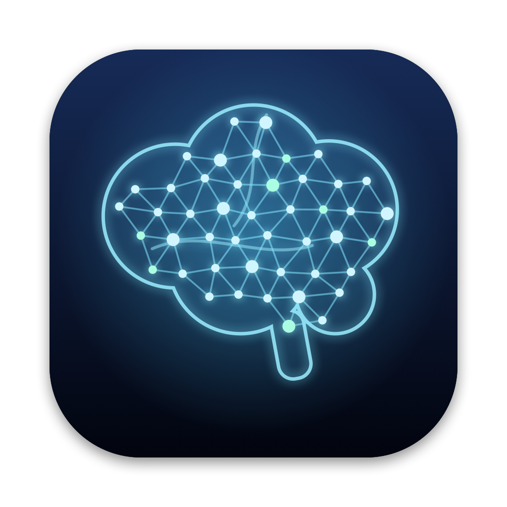

# Nous macOS App

現行桌面包裝使用 Electron 與 Node.js 本機核心。Tauri、Quest 客戶端及跨裝置同步尚未實作；現況與驗證範圍見 [目前實作狀態](../../../docs/Current_Implementation_Status.md)，規劃見 [功能擴充評估](../../../docs/13_Feature_Expansion_Assessment_2026-10-24.md)。

把 Nous 電子腦包成 macOS App：內建本機核心，不用開終端機；上方選單列有 Nous 圖示，常用動作和設定都在裡面。App 的設定以選單列為主體：視窗裡的設定頁只剩「帳號與登入」（ChatGPT 引擎帳號與即時語音用的 ChatGPT 方案（Codex）帳號），其他設定都在選單列；瀏覽器版（終端機啟動、沒有選單列）保留完整的設定畫面。



## 安裝

1. [v0.1.0 預覽版](https://github.com/pcpcchen-coder/AIOS/releases/tag/nous-desktop-v0.1.0) 提供 `Nous-0.1.0-mac-arm64.zip`，適用 Apple Silicon。這是既有預先建置產物，尚未核對是否含 2026-10-23 最新 main 的功能。要使用目前原碼版本，依下方「自己打包」建置；使用 zip 時，解壓後把 `Nous.app` 拖進「應用程式」。
2. 預設打包流程使用本機 ad-hoc 簽章，沒有 Apple 公證。若 macOS 阻擋你已確認來源的 App，到「系統設定 → 隱私權與安全性」最下方按「強制打開」；或在終端機執行：

   ```bash
   xattr -dr com.apple.quarantine /Applications/Nous.app
   ```

3. 選擇即時語音路徑。可在選單列「即時語音」用 ChatGPT 方案（Codex）登入，或選「填入 OpenAI API key…」打開設定檔。用 API key 時，把 key 貼在 `OPENAI_API_KEY=` 後面，存檔後 App 會重新啟動核心套用。兩種登入與計費路徑的實測範圍見 [即時語音驗證](../../../docs/validation/live-voice-2026-10-23.md)。
4. 第一次開始語音對話時，macOS 會詢問麥克風權限，按「允許」。

## 選單列圖示

| 項目 | 作用 |
|---|---|
| 狀態列（前三行） | 目前引擎、即時語音的路徑與計費（例如「ChatGPT 方案（Codex 額度）· gpt-live-1-codex」，進行中的對話另外標示）與語音狀態、進行中的任務數 |
| 顯示電子腦（⌥⌘N） | 叫出／收起視窗（全域快捷鍵） |
| 開始／結束語音對話（⌥⌘V） | 即時語音（全域快捷鍵） |
| 打字對話、看進度 | 直接打開對應畫面 |
| AI 引擎 | 切換執行交辦工作的引擎：ChatGPT／Claude／模擬；「登入／帳號設定…」打開視窗裡的「帳號與登入」頁（ChatGPT 登入） |
| 即時語音 | 路徑（自動／ChatGPT 方案／API key；下一次開始生效，不用重新啟動）、ChatGPT 方案（Codex）登入、ChatGPT 方案路徑的聲音、ChatGPT 方案用量；API key 路徑的模型（`gpt-realtime` 或 `gpt-realtime-mini`，實際費率依 OpenAI 當期定價）與聲音（改了會重新啟動核心）、「帳號與登入…」（同一個帳號頁，可登出或用裝置代碼登入）、填入 API key、OpenAI 用量 |
| 同時處理任務數 | 2／4／6／8 |
| 鏡頭與語音設定 | 「鏡頭與手勢」：鏡頭、看著說話、面向螢幕幾秒後開始對話、對話結束後暫停、看著說話時先打招呼、手掌停止播報、靠近時電子腦放大倍率（1、1.5、2、2.5、3 倍，預設 2 倍），這一段最後是「顯示鏡頭畫面」；「語音」：語音模式閒置多久自動關閉、即時語音閒置多久自動結束。開關是打勾項目；秒數與倍率是一組預設選項，目前的值打勾，值是用語音或瀏覽器版設定畫面的 −／+ 調的、不在選項裡時多一項「（目前）」。點了立即保存並套用，不用重新啟動核心；保存失敗會跳出原因並重新讀取實際保存的值。用語音或打字指令改了設定（例如「關閉看著說話」），頁面會通知 App 重新讀取，選單列跟著更新。鏡頭未啟用（沒有 `NOUS_CAMERA=on`）時鏡頭的開關、秒數、倍率與「顯示鏡頭畫面」都停用，原因寫在「鏡頭與手勢」標題下方的灰色說明項（macOS 14.4 以下也看得到）、各項的說明文字（sublabel，macOS 14.4 以上）與數值項子選單的第一項。用「鏡頭」開關關掉鏡頭時，「顯示鏡頭畫面」停用並寫「鏡頭目前關閉…」，其他開關仍可改，說明寫「鏡頭目前關閉，這個開關暫時用不到」。即時語音不可用時「看著說話」的說明寫「需要即時語音（目前不可用）」。順序、標籤、選項與寫入路徑都由本機核心推導（`GET /api/settings` 的 `seconds`），選單不寫死任何設定鍵 |
| 家人辨識…（「鏡頭與語音設定」的鏡頭段最後一項） | 打開視窗裡的「家人辨識」畫面：家人列表、新增家人、刪除、試認（標「門檻未校準」）與資料說明。只有點這一項後 10 秒內、而且是主視窗本機核心的頁面，才能向核心開管理工作階段（一次有效）；沒點選單時，語音或頁面腳本不能自己開。工作階段在收起、閒置 10 分鐘、開滿 15 分鐘、主視窗重新載入或導覽時結束。登記與刪除前都會跳系統確認視窗（未成年家人要勾家長確認）。停用原因由核心給：此 Mac 無法加密保存（safeStorage 不可用）時停用；模型未安裝或雜湊不符、鏡頭未啟用時仍可打開，但只能查看與刪除。家人資料在第一次打開時才載入（啟動時不碰鑰匙圈）；解不開金鑰時畫面會說明怎麼重試（允許鑰匙圈存取或重新啟動），不會叫你清除資料。辨識只在這個畫面裡運作，沒有背景辨識，也還沒有稱名問候。詳見 [ID-01 驗證](../../../docs/validation/family-id-01-2026-10-25.md) |
| 語音指令表 | 打開唯讀的「Nous 語音指令表」視窗：所有本機指令、在哪裡有效、容易誤會的說法、可以問 AI 的事、不用說話的操作與目前秒數。內容依打開當下的設定產生（頁尾寫產生時間），改了設定要重新整理（⌘R）。不會打斷正在進行的對話 |
| 設定與資料 | 編輯 `.env`、打開任務與成果資料夾、重新啟動核心、ChatGPT 用量、麥克風權限、記錄檔 |
| 視窗永遠在最上層、在 Dock 顯示圖示、登入 Mac 時自動開啟、開啟時只顯示選單列圖示 | 勾選即生效 |

上方「顯示」選單也有「語音指令表」（⌘/），「說明」選單有同一項。

指令表視窗由本機核心產生（`GET /help/commands`），頁面沒有 script，CSP 只允許它自己的樣式；視窗不載入 preload、開 sandbox、關掉 JavaScript、用獨立的記憶體 session 並拒絕所有權限（包含麥克風與鏡頭），也不允許導覽或開新視窗；核心重新啟動後程式會重新載入這個視窗。秒數的選項、範圍與標籤都由核心提供（`GET /api/settings` 的 `seconds`），App 的程式裡沒有另一份。

> **還沒在真的 Mac 上驗證**（見 [`docs/validation/menu-settings-consolidate-2026-10-23.md`](../../../docs/validation/menu-settings-consolidate-2026-10-23.md)）：2026-10-23 把設定集中到選單列（「鏡頭與語音設定」的開關 checkbox 與「顯示鏡頭畫面」、視窗設定頁只剩帳號），Electron 部分只用 `node --check` 檢查過語法，沒有執行。
>
> **還沒在真的 Mac 上驗證**（見 [`docs/validation/menu-seconds-commands-2026-10-22.md`](../../../docs/validation/menu-seconds-commands-2026-10-22.md)）：上面「鏡頭與語音設定」子選單（當時叫「秒數與倍率設定」，含 2026-10-23 新增的倍率列）與「語音指令表」視窗的 Electron 部分只在 Linux 用 `node --check` 檢查過語法，沒有執行。包括：子選單的畫法、勾選與點選後保存；設定畫面改了秒數後選單列跟著更新（現在只有瀏覽器版或語音指令）；指令表視窗的 ⌘R 重新整理、核心重新啟動後重新載入、視窗最小化後再打開會還原；麥克風與鏡頭等權限一律被拒、不能導覽或開新視窗。核心產生的資料（`GET /api/settings` 的 `seconds`、`GET /help/commands` 頁面）在 Linux 上已測試。

圖示是黑白範本圖，會跟著淺色／深色選單列變色；語音開啟時右下角多一個實心圓點（像錄音指示燈），有任務在跑時圖示旁顯示數量。關掉視窗不會結束 App，Nous 留在選單列，背景任務繼續；要完全結束用「結束 Nous」（⌘Q）。

## 檔案放在哪裡

| 內容 | 位置 |
|---|---|
| 設定（API key 等） | `~/Library/Application Support/Nous/.env` |
| App 偏好（模型、聲音、視窗…） | `~/Library/Application Support/Nous/desktop.json` |
| 任務與成果 | `~/Library/Application Support/Nous/data/` |
| ChatGPT 登入憑證 | `~/.config/nous/`（與終端機版共用，不用重新登入） |
| 鏡頭設定 | `~/.config/nous/camera.json`（與終端機版共用；選單列「鏡頭與語音設定」的鏡頭開關、秒數與電子腦放大倍率寫入這裡） |
| 語音閒置秒數 | `~/.config/nous/voice.json`（與終端機版共用；選單列「鏡頭與語音設定」的語音兩項寫入這裡） |
| 家人辨識的加密資料 | `~/Library/Application Support/Nous/identity/gallery.v1.json`（資料夾 0700、檔案 0600、加 Time Machine 排除）。只存加密的臉部特徵與名稱，不存照片；資料金鑰以 safeStorage（Keychain 中的應用程式金鑰）包裝，每次登記或刪除都換新金鑰 |
| 家人辨識的模型與 runtime | `~/Library/Application Support/Nous/face-runtime/`（`npm run face:setup -- --product` 安裝；不在 App 包裡） |
| 記錄檔 | `~/Library/Application Support/Nous/nous.log` |

App 內容（`app.asar`）只有程式、前端與圖示，不含任何 `.env`、任務資料、登入憑證、家人資料或辨識模型。

> **家人辨識（ID-01）還沒有在真的 Mac 上驗證**：safeStorage 與 Keychain 提示、`tmutil` 排除、IPC、AR0144 登記與試認、Electron 中的 worker CSP 都只在 Linux 用替身或 headless Chromium 檢查過。門檻未校準，結果只供參考。Mac 實測步驟見 [ID-01 驗證](../../../docs/validation/family-id-01-2026-10-25.md) §6。

## 與終端機版的差別

- App 的語音對話用即時語音，需要用 ChatGPT 方案（Codex）登入或填 `OPENAI_API_KEY`。Electron 沒有 Chrome 的雲端語音辨識，所以兩者都沒有時只能打字對話；終端機版在 Chrome 裡仍可用舊的語音模式。
- 連接埠預設 8787，被占用（例如終端機版正在跑）時自動改用其他空閒埠。
- ChatGPT 登入改用系統瀏覽器開啟（Google 等登入頁會擋內嵌視窗），完成後自動回到 App。

## 自己打包

需要 macOS、Node.js 22.12 以上、Xcode Command Line Tools（`swift`、`iconutil`、`codesign`）。

```bash
cd prototype/ambient-shell
npm ci
cd desktop
npm ci
npm run icons    # 重新產生圖示（已附在 assets/，改了 scripts/make-icons.swift 才需要）
cd .. && npm run face:setup -- --product && cd desktop   # 選用：家人辨識的模型（約 53 MB，裝到 ~/Library/Application Support/Nous/face-runtime/）
npm start        # 開發：組好內容後直接用 Electron 開
npm run package  # 打包成 release/Nous-darwin-arm64/Nous.app 與 zip
```

`scripts/build.mjs` 先用 vite 建前端、用 esbuild 把本機核心（`server/nous.ts`）打成單檔 `server.mjs`，再組成 `build/app`；`scripts/package.mjs` 用 `@electron/packager`（Electron 44.7.0）打包、簽章並壓 zip。

### 固定簽章與本機權限

沒有憑證時，打包會用 ad-hoc 簽章。重新建置後的指定要求可能改變，可用 `codesign -d -r- Nous.app` 檢查。macOS 可能將更新後的包裝視為不同的 App，再次詢問鏡頭與麥克風權限；鏡頭停在啟動中時也應檢查系統權限。

打包程式支援固定的自簽憑證，用來保留同一個本機簽署身分。是否保留鏡頭與麥克風授權仍須在你的 Mac、安裝位置與更新流程驗證。可依下列步驟建立憑證：

1. 打開「鑰匙圈存取」，選單「鑰匙圈存取 → 憑證輔助程式 → 製作憑證…」。
2. 名稱填 `Nous Local Signing`，身分類型選「自簽根憑證」，憑證類型選「程式碼簽署」，按「製作」。
3. 重新執行 `npm run package`，終端機會顯示「簽章：Nous Local Signing（固定身分…）」。

換成固定簽章後可能再詢問一次權限。後續每次更新仍應檢查簽署身分與實際收音、攝影機權限，不保證所有環境都保留授權。也可以用 `NOUS_SIGN_IDENTITY="憑證名稱" npm run package` 指定其他憑證（例如 Xcode 的 Apple Development）。這張自簽憑證只對你自己的 Mac 有意義；預覽版的實際簽章須在下載後查驗，不能以本機自簽憑證保證其他人的安裝結果。
